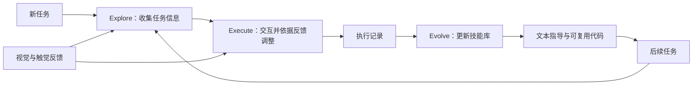
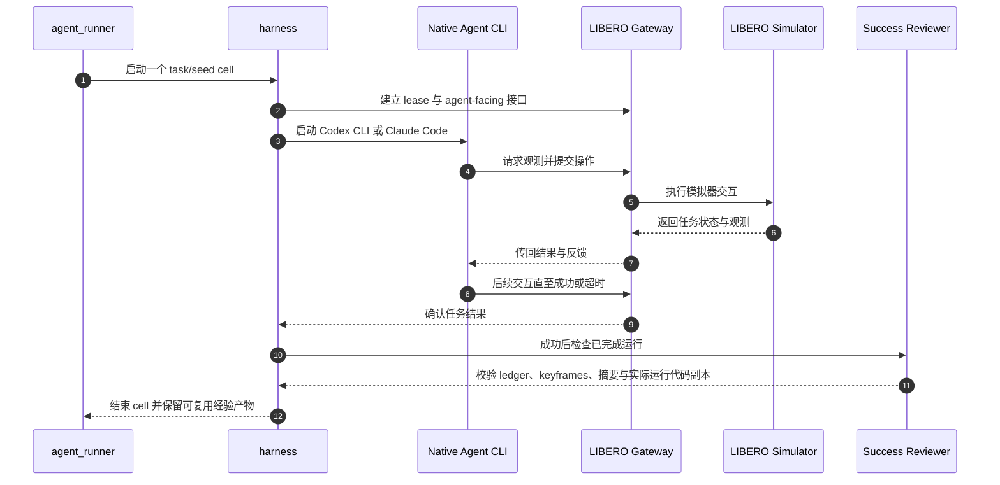

# RoboSkill：Explore, Execute, Evolve

**一句话定义：** RoboSkill 让具身智能体把任务探索和执行经验整理成可复用技能，再用于后续任务的探索与执行，形成“探索—执行—进化”循环。

## 英文缩写速查

| 缩写 | 英文全称 | 简要说明 |
|------|----------|----------|
| EEE | Explore, Execute, Evolve | RoboSkill 的技能获取、执行和更新闭环 |
| VLA | Vision-Language-Action | 论文讨论的机器人视觉语言动作模型类别 |
| LIBERO | LIBERO Benchmark | 论文中用于操作任务评测的模拟器基准 |
| CLI | Command-Line Interface | 官方复现代码支持的原生 Agent CLI 运行方式 |
| MIT | Massachusetts Institute of Technology License | 官方仓库使用的宽松开源许可证 |

## 为什么重要

具身智能体若每次面对新任务都从零推理、探索，交互成本会很高。RoboSkill 将执行记录转成后续任务可调用的经验，使技能积累成为持续闭环；论文还把触觉反馈和可复用代码纳入设计，分别帮助减少物理交互不确定性与技能调用时的推理开销。

它连接了[操作任务](../tasks/manipulation.md)中的接触反馈与[强化学习](../methods/reinforcement-learning.md)中的经验改进思路，但技能表示和复用策略本身仍需结合具体任务与 agent harness 评估。

## 核心原理

| 阶段 | 输入 | 作用 | 输出 |
|---|---|---|---|
| Explore | 当前任务、视觉和触觉反馈 | 收集任务相关信息，降低对场景与接触状态的不确定性 | 探索得到的任务信息与候选操作 |
| Execute | 任务信息、当前技能库 | 执行任务，并根据环境反馈调整动作 | 成功或失败的执行记录 |
| Evolve | 执行记录、技能库 | 从执行经验中更新技能库，形成便于后续调用的文本指导与可复用代码 | 更新后的技能 |
| Reuse | 新任务、已积累技能 | 用既有技能辅助下一轮探索和执行 | 更低成本的任务尝试 |

### 流程总览

触觉是视觉之外的交互反馈来源；论文摘要指出它用于降低物理交互不确定性。可复用代码则补充文本指导，用于减少技能复用阶段的推理开销。

## 实验与评测

论文摘要报告：

- 在 LIBERO-10 上，四种 agent 的首回合成功率提高 **12.5–25.0 个百分点**，平均运行时间降低 **7.6–72.4%**。
- 真机实验的成功率提高 **8.3 个百分点**；成功试验的平均运行时间至少降低 **14.4%**。

**评测口径：** 论文 v1 §4.1、§6.1 的 LIBERO-10 主实验以每项任务的一个 seed 构建技能，再用另外 4 个 seed 测试，共 40 个任务–seed 单元；每单元最多 4 小时，允许多次 episode。真机包含 12 项任务，每项 10 次，每次最多 1 小时。主实验结果包含同任务技能复用，不能直接作为跨任务泛化的收益。

**跨任务复用：** 论文 v1 表 4 中，Sol 首回合成功率从 30% 升至 44%，Opus 从 60% 降至 56%；两者平均耗时均下降。因此跨任务收益依赖具体 agent 和指标。

## 与其他工作对比

| 工作 | 经验如何沉淀 | 与 RoboSkill 的差异 |
|------|--------------|---------------------|
| [Agentic Coding Agent](./paper-agentic-coding-manipulation.md) | coding agent 在单任务内自写、自调代码 | 同样让通用 agent 写代码控制机器人；RoboSkill 进一步把成功经验经 reviewer 校验后写入技能库，跨任务复用 |
| [AgenticRoboRL](./paper-agentic-roborl.md) | SFT + 多轮成功奖励 RL 更新 planner 权重 | 经验沉淀进模型参数；RoboSkill 不训练模型，经验以文本指导和可复用代码的形式外置 |
| [MoCaP](./paper-mocap-mobile-code-as-policies.md) | 从人类视频提取空间记忆与站位先验 | 先验来自被动人类视频；RoboSkill 的经验来自 agent 自身的探索与执行记录，并额外利用触觉反馈 |

外置技能库的好处是可审查、可回滚，并且不依赖特定底座模型；代价是技能的适用条件需要显式维护，否则场景绑定的偶然成功会污染后续任务。

## 结论

**一句话总判：** RoboSkill 的价值在于把一次性的具身交互变成可复用经验，适用于任务会重复、技能库能持续维护的场景。

1. **先验证技能复用是否稳定。** 成功记录、场景绑定和适用条件要能区分可迁移经验与偶然成功轨迹。
2. **同时评估成功率和耗时。** 摘要显示两者均有改善，但不同 agent 的收益范围不同，应按具体基线复核。
3. **把触觉当成降低接触不确定性的补充信号。** 论文摘要未给出传感器配置和融合实现细节，复现时需查正文与源码。
4. **源码公开不代表所有实验产物公开。** 仓库不含生成的经验包、技能、历史运行记录和视频，完整复现仍受模型与算力条件约束。

## 源码运行时序图

该复现路径由官方 README 的 agent_runner、harness、libero 与成功后 reviewer 描述概括；生成的运行工作区和技能产物留在运行时目录，不随仓库发布。

## 工程实践

- **复现入口：** 先准备仓库指定的 LIBERO 环境，启动 scripts/run_libero_gateway.sh，再从 agent_runner/configs/ 复制配置并通过 agent_runner/run.py 启动实验。
- **检查运行链路：** 仓库提供 make smoke 和 make verify-publication；README 也提供 minimal harness 路径，用于检查控制器与训练闭环。
- **技能产物质量：** 获取配置启用成功后的 reviewer；其输出包括经过验证的 action ledger、keyframes、scene-local binding、summary，以及实际运行代码的逐字节副本。
- **开源状态：** 官方代码仓库公开且采用 MIT 许可；仓库说明不包含运行工作区、日志、session、视频、凭据、历史结果及生成的经验包/技能。

## 局限与风险

- 技能可能依赖特定场景或物体绑定；跨任务复用前应检查适用范围，不能把单次成功视为普适技能。
- 论文摘要提供总体收益区间，尚不足以解释每种 agent 的收益差异；需结合正文的消融、任务设置与运行时间口径分析。
- 仓库是论文执行路径的 source-only 发布。完整数值复现还需要相应模型版本和等效 GPU 资源；实验结果、视频和生成技能不在仓库中。
- 触觉反馈与代码复用分别带来传感器、执行安全和代码验证方面的工程要求；摘要没有提供这些细节的完整实现说明。

## 关联页面

- [Manipulation 操作任务](../tasks/manipulation.md)
- [Reinforcement Learning 强化学习](../methods/reinforcement-learning.md)

## 参考来源

- [论文来源归档](../../sources/papers/roboskill_arxiv_2609_37810.md)
- [官方仓库导航](../../sources/repos/roboskill.md)

## 推荐继续阅读

- [论文：Explore, Execute, Evolve](https://arxiv.org/abs/2609.37810)
- [RoboSkill 官方代码仓库](https://github.com/SII-dannyXSC/RoboSkill)
