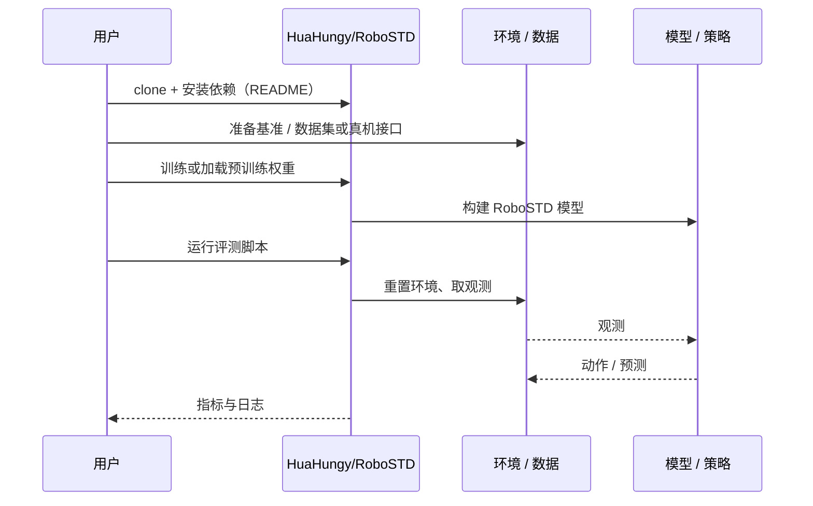

# RoboSTD（arXiv:2610.36685）

**RoboSTD**（*RoboSTD: Zero-Shot Single-to-Dual Transfer via Sagittal Mirroring for Bimanual Learning*，[arXiv:2610.36685](https://arxiv.org/abs/2610.36685)，[项目页](https://huahungy.github.io/RoboSTD/)，[代码](https://github.com/HuaHungy/RoboSTD)）来自 [具身智能小站 2026-10-28 盘点](../../sources/blogs/wechat_embodied_station_59_papers_human_video_to_robot_experience_2026-10-28.md)，属「数据采集与示范迁移」组。

## 一句话定义

**对观测、本体状态与动作做矢状面镜像，再用语言模型生成时空协同约束，构造双臂伪示范。**

## 英文缩写速查

| 缩写 | 英文全称 | 简要说明 |
|------|----------|----------|
| RoboSTD | RoboSTD: Zero-Shot Single-to-Dual Transfer via Sagittal Mirroring for Bimanual Learning | 本文方法 / 基准的简称 |

## 为什么重要

- 把单臂示范转成双臂监督。在仿真与真机 ALOHA 上验证，迁移价值依赖镜像可执行性与任务结构。
- 开源结论：**已开源**（步骤 2.5，2026-10-28）。仓库可达（git ls-remote）。项目页 HTTP 200。
- 同期同组工作见 [潜在动作、免渲染事件仿真与机器人评测：具身智能小站 10-28 期 59 篇阅读坐标](../overview/embodied-station-2026-10-28-59-papers-technology-map.md)。

## 核心机制

| 项 | 内容 |
|----|------|
| **arXiv** | [2610.36685](https://arxiv.org/abs/2610.36685) |
| **开源** | **已开源** |
| **要点** | 对观测、本体状态与动作做矢状面镜像，再用语言模型生成时空协同约束，构造双臂伪示范。 |
| **文内指标** | 公众号转述：在仿真与真机 ALOHA 上验证，迁移价值依赖镜像可执行性与任务结构。 |

## 源码运行时序图

以下为按仓库入口（`HuaHungy/RoboSTD`）推断的通用运行链路；入库日仅核实仓库可达，未逐文件阅读，具体脚本名以 README 为准。

## 实验与评测

- 公众号转述：在仿真与真机 ALOHA 上验证，迁移价值依赖镜像可执行性与任务结构。
- **读法：** 本页为索引级摘要，依据公众号转述的官方摘要与仓库信息整理；逐项数字与 baseline 以原文 PDF 为准。

## 与其他工作对比

- 横向索引见 [潜在动作、免渲染事件仿真与机器人评测：具身智能小站 10-28 期 59 篇阅读坐标](../overview/embodied-station-2026-10-28-59-papers-technology-map.md)；同 arXiv 不重复造页。

## 结论

**把单臂示范转成双臂监督：在仿真与真机 ALOHA 上验证，迁移价值依赖镜像可执行性与任务结构。**

1. 开源边界：**已开源** — 仓库可达（git ls-remote）。项目页 HTTP 200。
2. 核心机制：对观测、本体状态与动作做矢状面镜像，再用语言模型生成时空协同约束，构造双臂伪示范。
3. 复现与选型前核对任务协议、硬件与基准口径，勿直接横比公众号摘录数字。

## 关联页面

- [embodied-data-collection-four-layers-taxonomy](../concepts/embodied-data-collection-four-layers-taxonomy.md)
- [teleoperation](../tasks/teleoperation.md)
- [imitation-learning](../methods/imitation-learning.md)
- [bimanual-manipulation](../tasks/bimanual-manipulation.md)
- [embodied-station-2026-10-28-59-papers-technology-map](../overview/embodied-station-2026-10-28-59-papers-technology-map.md)

## 参考来源

- [robostd_arxiv_2610_36685.md](../../sources/papers/robostd_arxiv_2610_36685.md)
- [wechat_embodied_station_59_papers_human_video_to_robot_experience_2026-10-28.md](../../sources/blogs/wechat_embodied_station_59_papers_human_video_to_robot_experience_2026-10-28.md)
- [arXiv:2610.36685](https://arxiv.org/abs/2610.36685)

## 推荐继续阅读

- [arXiv PDF](https://arxiv.org/pdf/2610.36685)
- [项目页](https://huahungy.github.io/RoboSTD/)
- [https://github.com/HuaHungy/RoboSTD](https://github.com/HuaHungy/RoboSTD)
