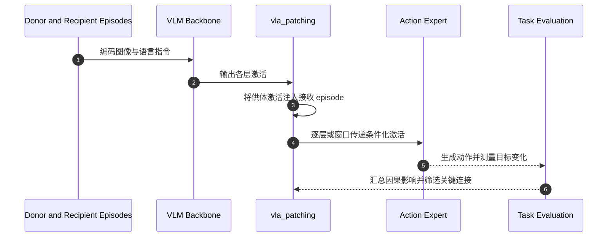

# VLA 因果分析：定位动作条件接口并压缩连接

## 一句话定义

**论文用 activation patching 追踪视觉语言信息如何因果影响机器人动作，并将动作专家的条件输入限制在少数关键层以降低计算量。**

## 英文缩写速查

| 缩写 | 英文全称 | 简要说明 |
|------|----------|----------|
| VLA | Vision-Language-Action | 将视觉与语言映射到机器人动作的模型 |
| VLM | Vision-Language Model | 提供视觉与语言表征的骨干模型 |
| AE | Action Expert | 生成或细化动作的模型模块 |
| FLOPs | Floating-Point Operations | 计算量估算指标 |
| π₀.₅ | Pi Zero Point Five | 论文分析的 VLA 模型之一 |

## 为什么重要

VLA 的动作头可能只需读取骨干网络中特定层带的信息。若能通过因果干预识别必要连接，就有机会跳过冗余条件化计算，同时把动作输出对语义目标和几何位置的依赖分开分析。

## 方法与核心发现

1. **Activation patching：** 在供体与接收 episode 之间交换某层激活，再观察机器人动作是否随供体信息改变。
2. **层带扫描：** 分别逐连接和以三层窗口注入 VLM→AE 的激活，定位对动作影响最大的中后层“action-conditioning interface”。
3. **信息分工：** 目标名词的较早层表征影响选取对象；中后层文本 token 的信息改变目标空间位置。空间信息的 token 位置因模型架构而异。
4. **架构裁剪：** MolmoBot 将 36 条条件连接缩至 3 条，论文报告 FLOPs 降低最多 33%，在 3,000 个仿真评估 episode 上成功率 46.7% 对 46.9%；π₀.₅ 也展示了真机部署验证。

## 源码运行时序图

图依据论文方法和公开仓库 `vla_patching/` 的组织概述；具体命令与模型准备步骤以仓库 README/`docs/` 为准。

## 实验与评测

- 模型：π₀.₅、MolmoAct2、MolmoBot。
- 核心效率结果：MolmoBot 只保留 3/36 条条件连接，FLOPs 最多降低 33%；3,000 episode 的成功率近似持平（46.7% vs. 46.9%）。
- 真机：作者报告同一筛选思路可用于 π₀.₅ 真机部署。
- 读法：计算量下降与成功率保持是模型/任务特定结果；不是对任意连接稀疏化方案的保证。

## 与其他工作对比

| 维度 | VLA 因果分析（本文） | [Depth-Wise Probing Driving VLA](./paper-depth-wise-probing-driving-vla.md) | [VLA Depth Decodability](./paper-vla-action-post-training-depth-decodability.md) | [Beyond Task Success](./paper-rcl-2606-01095-beyond-task-success-behavioral-and-representatio.md) |
|------|------|------|------|------|
| 诊断工具 | activation patching（因果干预） | 逐层探针 | 逐层探针 + 移除相关写入 | 行为 rollout 分析 + SAE 特征分析 |
| 分析对象 | π₀.₅、MolmoAct2、MolmoBot 的 VLM→AE 条件连接 | 智驾 VLA 规划 token | VLM→VLA 动作后训练后的深度信息 | WAM 与 VLA |
| 落地用途 | 裁剪条件连接：MolmoBot 3/36，FLOPs 最多 −33% | 学习式早读与剪层提速 | 修回被削弱的深度信息 | 模型无关的对比诊断 |
| 评测 | 3,000 仿真 episode + π₀.₅ 真机部署 | Bench2Drive | 本库页未列 | 本库页未列 |

- **相对 Depth-Wise Probing：** 两者都落到「减层 / 减连接提速」，但探针只说明信息可解码，patching 测的是对动作的因果影响；对象也从智驾换成操作 VLA。
- **相对 VLA Depth Decodability：** 那篇用逐层诊断定位并修复后训练造成的信息损失，本文用因果诊断定位可裁掉的冗余连接。
- **相对 Beyond Task Success：** 后者是比较 WAM 与 VLA 的诊断框架，不给出架构裁剪建议。
- 后三页为索引级摘要，未核对原文实验表，数字不可横比。

## 结论

**VLA 的条件信息对动作的因果作用集中在少数中后层连接，识别这条窄接口可在特定模型中换得明显计算节省而几乎不损失成功率。**

1. 层连接的重要性需要通过干预测量，单看注意力图或激活相关性不足以证明因果作用。
2. 语义对象选择与空间运动信息在层深和 token 位置上可能分开编码。
3. 3/36 的结果来自 MolmoBot 特定实验，迁移到其他骨干应重新做 patching 与准确率评估。
4. 论文把机制分析转成了可部署的连接裁剪建议；同时仍应核对具体模型的真机闭环表现。

## 工程实践与开源状态

截至 2026-10-17，官方 GitHub 仓库公开，含 `vla_patching/`、`data/`、`docs/` 与 `figures/`，MIT 许可。注意 `data/robot/franka_droid_kinematics.xml` 有单独的 Apache-2.0 许可。复现时应从仓库文档核对模型权重、仿真依赖与数据许可。

## 关联页面

- [VLA](../methods/vla.md)
- [Transformer](../concepts/transformer.md)
- [T2-z 环境潜变量](./paper-t2-z-environment-latents.md)

## 参考来源

- [论文摘录](../../sources/papers/robot-foundation-model-causal-analysis_arxiv_2610_20750.md)
- [官方实现归档](../../sources/repos/goodfire-robotics-causal-analysis.md)
- [arXiv:2610.20750](https://arxiv.org/abs/2610.20750)

## 推荐继续阅读

- [论文 PDF](https://arxiv.org/pdf/2610.20750)
- [官方代码](https://github.com/goodfire-ai/robotics_causal_analysis)
