# Robot Group Joining（arXiv:2609.28467）

**Where Should I Join? Robot Group Joining via Language-Guided Goal Prediction**（[项目页](https://robot-join.github.io/)，[arXiv:2609.28467](https://arxiv.org/abs/2609.28467)）来自 [具身智能小站 · 13 篇盘点](../../sources/blogs/wechat_embodied_13_papers_forgetmimic_2026-09-24.md)（2026-09-24）。

## 一句话定义

**语言引导预测「社会上合适的加入站位」，而非仅几何路径到固定目标点。**

## 英文缩写速查

| 缩写 | 英文全称 | 简要说明 |
|------|----------|----------|
| VLA | Vision-Language-Action | 视觉–语言–动作策略 |
| RL | Reinforcement Learning | 强化学习 |
| TO | Trajectory Optimization | 轨迹优化 |
| HITL | Human-in-the-Loop | 人在回路 |

## 为什么重要

- 人群/队列/观众互动中，加入位姿有社会规范，纯导航目标不足。
- 纳入 [13 篇技术地图](../overview/embodied-13-papers-technology-map.md) 阅读坐标。
- 开源结论（步骤 2.5，2026-09-24）：**待发布**。

## 流程总览

```mermaid
flowchart LR
    In["输入：RGB-D 观测 O<br/>+ 目标群体语言指令 T"] --> Det["人体检测器<br/>得到 N 个人（ID + 2D 框）"]
    subgraph G["阶段 1：Group Grounding"]
        Proj["用深度与内参投影到俯视 2D 平面"] --> Aff["局部尺度谱聚类<br/>（自调节 affinity，random-walk Laplacian）"]
        Aff --> Sweep["Fiedler 向量多阈值扫描<br/>（10%–90% 分位，6 档）→ 二分"]
        Sweep --> Rec["自顶向下递归划分至单人<br/>收集全部子图为候选假设集 H"]
        Rec --> Rank["假设排序：微调 SigLIP2<br/>候选外人物被遮蔽 + GeoEncoder 调制图像嵌入<br/>与文本嵌入算相似度（成对 ranking 训练）"]
        Rank --> Top["取最高分假设 → 目标群体 G_T"]
    end
    Det --> Proj
    Top --> Rep
    subgraph P["阶段 2：Goal Prediction"]
        Rep["俯视表示：人物位置 / 朝向 / 是否属于 G_T<br/>旁观者保留作局部上下文"] --> Net["People Encoder → FiLM（全局尺度 + 语言指令）<br/>→ 转置卷积 Pose Decoder<br/>占据图约束在自由空间"]
        Net --> Map["三通道输出：位置能量图 E(x,y)<br/>+ 朝向 cos / sin 图"]
        Map --> Pick["推理时取能量最小处为 (x,y)<br/>cos / sin 给出朝向 θ"]
    end
    In -->|"语言指令 T"| Net
    Det -->|"检测到的人（含旁观者）"| Rep
    Pick --> Out["加入位姿 → 机器人导航（实机实验）"]
```

图依据：论文 §III、§IV（Group Grounding）、§V（Goal Prediction）与 Fig. 2/4/5；末端“机器人导航”仅依据 §VI 实机实验概述。

## 核心机制

| 项 | 内容 |
|----|------|
| **arXiv** | [2609.28467](https://arxiv.org/abs/2609.28467) |
| **开源** | **待发布** |
| **要点** | 群体成员 grounding + 队形先验 → 多模态加入姿态；静态/动态互动真机验证。 |
| **文内指标** | 静态与动态群体场景真机（文内以 PDF 为准）。 |

## 源码运行时序图

**不适用**（截至 2026-09-24 项目页/论文未提供可运行官方代码；开源状态：**待发布**）。

## 实验与评测

- 静态与动态群体场景真机（文内以 PDF 为准）。
- **读法：** 公众号归纳；逐项 baseline 与协议以 arXiv PDF 为准。

## 与其他工作对比

- 横向索引见 [13 篇技术地图](../overview/embodied-13-papers-technology-map.md)。

## 结论

**加入 = 社会目标预测问题** — 项目页入库日 404，代码待跟进。

1. 开源边界：**待发布** — 以项目页/仓库实际链接为准（入库日 2026-09-24）。
2. 核心机制：群体成员 grounding + 队形先验 → 多模态加入姿态；静态/动态互动真机验证。…
3. 部署前核对任务协议与硬件条件，勿直接横比公众号摘录数字。

## 关联页面

- [Vision Language Navigation](../tasks/vision-language-navigation.md)
- [Teleoperation](../tasks/teleoperation.md)
- [Vla](../methods/vla.md)
- [Embodied 13 Papers Technology Map](../overview/embodied-13-papers-technology-map.md)

## 参考来源

- [13 篇盘点（公众号）](../../sources/blogs/wechat_embodied_13_papers_forgetmimic_2026-09-24.md)
- [Where Should I Join? Robot Group Joining via Language-Guided Goal Prediction](../../sources/papers/robot-group-joining_arxiv_2609_28467.md)
- [arXiv PDF](https://arxiv.org/pdf/2609.28467)：已通读方法部分（实验与附录以略读为准）：摘要、§I 引言、§III 任务定义、§IV 群体 grounding、§V 目标预测、§VI-A 实验设定（略读其余实验与实机结果）

## 推荐继续阅读

- [arXiv:2609.28467](https://arxiv.org/abs/2609.28467) — 原文
