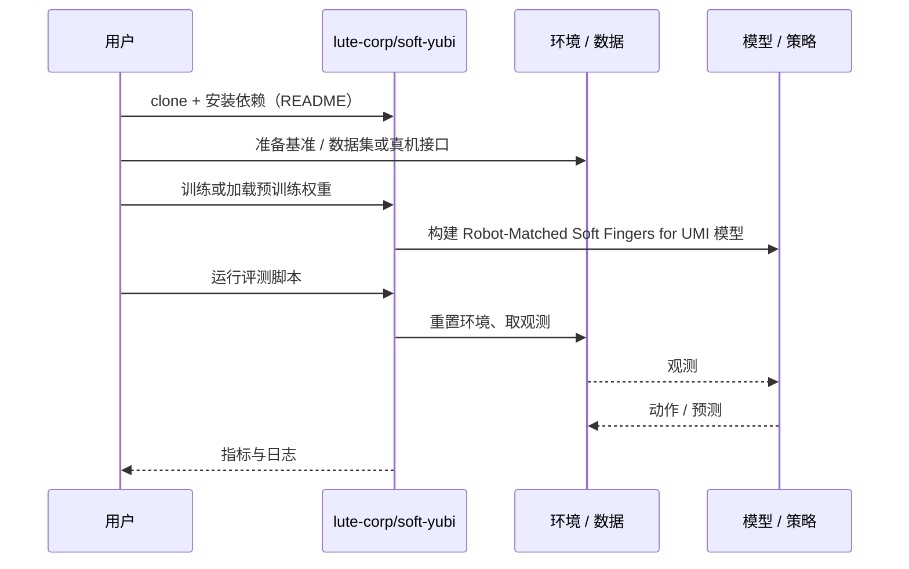

# Robot-Matched Soft Fingers for UMI（arXiv:2611.03779）

**Robot-Matched Soft Fingers for UMI**（*Robot-Matched Soft Fingers for UMI Data Collection: Lessons from 100 Hours of Pick and Place*，[arXiv:2611.03779](https://arxiv.org/abs/2611.03779)，[项目页](https://lute-corp.github.io/soft-yubi-site/)，[代码](https://github.com/lute-corp/soft-yubi)）来自 [具身智能小站 2026-11-04 盘点](../../sources/blogs/wechat_embodied_station_57_papers_da_reward_model_failure_2026-11-04.md)，属「触觉与灵巧操作」组。

## 一句话定义

**让手持采集器使用与机器人匹配的柔软斜置夹指，通过可见形变传达接触线索；用多物体抓放研究相机配置与中间训练对新物体适配的影响。**

## 英文缩写速查

| 缩写 | 英文全称 | 简要说明 |
|------|----------|----------|
| Robot-Matched Soft Fingers for UMI | Robot-Matched Soft Fingers for UMI Data Collection: Lessons from 100 Hours of Pick and Place | 本文方法 / 基准的简称 |
| UMI | Universal Manipulation Interface | 手持通用操作采集接口 |

## 为什么重要

- 把软指形变变成可见的接触线索。
- 开源结论：**已开源**（步骤 2.5，2026-11-04）。仓库可达（git ls-remote）。项目页 HTTP 200。
- 同期同组工作见 [VLM 奖励评估、动作动力学与开放权重机器人智能体：具身智能小站 11-04 期 57 篇阅读坐标](../overview/embodied-station-2026-11-04-57-papers-technology-map.md)。

## 核心机制

| 项 | 内容 |
|----|------|
| **arXiv** | [2611.03779](https://arxiv.org/abs/2611.03779) |
| **开源** | **已开源** |
| **要点** | 让手持采集器使用与机器人匹配的柔软斜置夹指，通过可见形变传达接触线索；用多物体抓放研究相机配置与中间训练对新物体适配的影响。 |
| **文内指标** | 公众号未给具体数字，本页不引用。 |

## 源码运行时序图

以下为按仓库入口（`lute-corp/soft-yubi`）推断的通用运行链路；入库日仅核实仓库可达，未逐文件阅读，具体脚本名以 README 为准。

## 实验与评测

- 公众号未给具体数字，本页不引用。
- **读法：** 本页为索引级摘要，依据公众号转述的官方摘要与仓库信息整理；逐项数字与 baseline 以原文 PDF 为准。

## 与其他工作对比

- 横向索引见 [VLM 奖励评估、动作动力学与开放权重机器人智能体：具身智能小站 11-04 期 57 篇阅读坐标](../overview/embodied-station-2026-11-04-57-papers-technology-map.md)；同 arXiv 不重复造页。

## 结论

**把软指形变变成可见的接触线索：让手持采集器使用与机器人匹配的柔软斜置夹指，通过可见形变传达接触线索；用多物体抓放研究相机配置与中间训练对新物体适配的影响。**

1. 开源边界：**已开源** — 仓库可达（git ls-remote）。项目页 HTTP 200。
2. 核心机制：让手持采集器使用与机器人匹配的柔软斜置夹指，通过可见形变传达接触线索；用多物体抓放研究相机配置与中间训练对新物体适配的影响。
3. 复现与选型前核对任务协议、硬件与基准口径，勿直接横比公众号摘录数字。

## 关联页面

- [tactile-sensing](../concepts/tactile-sensing.md)
- [contact-rich-manipulation](../concepts/contact-rich-manipulation.md)
- [dexterous-kinematics](../concepts/dexterous-kinematics.md)
- [embodied-data-collection-four-layers-taxonomy](../concepts/embodied-data-collection-four-layers-taxonomy.md)
- [embodied-station-2026-11-04-57-papers-technology-map](../overview/embodied-station-2026-11-04-57-papers-technology-map.md)

## 参考来源

- [robot_matched_soft_fingers_for_umi_arxiv_2611_03779.md](../../sources/papers/robot_matched_soft_fingers_for_umi_arxiv_2611_03779.md)
- [wechat_embodied_station_57_papers_da_reward_model_failure_2026-11-04.md](../../sources/blogs/wechat_embodied_station_57_papers_da_reward_model_failure_2026-11-04.md)
- [arXiv:2611.03779](https://arxiv.org/abs/2611.03779)

## 推荐继续阅读

- [arXiv PDF](https://arxiv.org/pdf/2611.03779)
- [项目页](https://lute-corp.github.io/soft-yubi-site/)
- [https://github.com/lute-corp/soft-yubi](https://github.com/lute-corp/soft-yubi)
