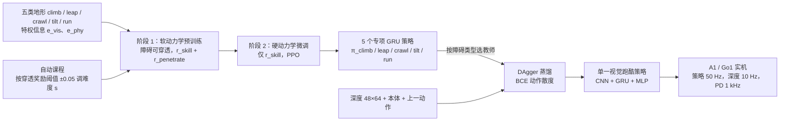
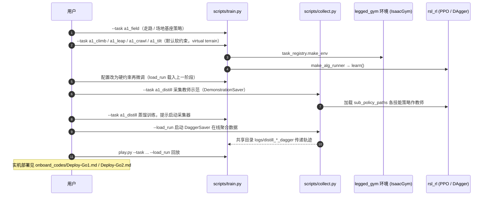

# Robot Parkour Learning（HMI P130）

**Robot Parkour Learning**（*Robot Parkour Learning*，2023，[arXiv:2309.05665](https://arxiv.org/abs/2309.05665)）收录于具身智能研究室 [论文与项目总索引](https://github.com/RealXiaoze/humanoid-motion-intelligence/blob/main/%E8%AE%BA%E6%96%87%E4%B8%8E%E9%A1%B9%E7%9B%AE/README.md) **P130**，主分类为 **Locomotion与运动先验**。本页为本库独立详情节点（编译自策展解读与公开元数据，非原文镜像）。

## 一句话定义

用直接配点启发的软→硬动力学约束课程先让策略发现可行动作，再蒸馏成接收深度的单一视觉四足跑酷策略。

## 英文缩写速查

| 缩写 | 英文全称 | 简要说明 |
|------|----------|----------|
| DAgger | Dataset Aggregation | 用专家（五个专项技能策略）在学生状态分布上标注动作，蒸馏出单一视觉策略 |
| PPO | Proximal Policy Optimization | 软约束预训练、硬约束微调均用 PPO |
| GRU | Gated Recurrent Unit | 专项策略与视觉跑酷策略都用 1 层 256 维 GRU 提供短期记忆 |
| MPC | Model Predictive Control | 实机对照的 A1 内置控制器（默认 / special mode） |
| RMA | Rapid Motor Adaptation | 对照基线：在外参隐空间蒸馏，无法合并多个技能 |
| RND | Random Network Distillation | 对照的探索奖励基线 |
| Sim2Real | Simulation to Real | 深度图预处理 + 延迟随机化后迁移到 A1 / Go1 |

## 为什么重要

- 系统分别训练攀爬、跨沟、低姿穿越、侧身挤过和奔跑专家。第一阶段障碍允许穿透，碰撞点进入障碍的深度形成连续惩罚，策略即使还不会完整越障，也能从向前运动与较小穿透中获得梯度。课程逐渐提高障碍和穿透约束难度。第二阶段再换成不可穿透的硬碰撞环境细调，让动作满足真实接触动力学。整个过程只使用简单的前进、能耗和存活类奖励，没有动物参考动作，也没有AMP判别器。
- 在 HMI 六条技术路线中属于 **Locomotion与运动先验**，补齐「总索引有条目、本库无下钻页」的缺口。
- 与相邻方法对照时，优先看问题设定与接口，而不是只记算法名。

## 核心信息

| 字段 | 内容 |
|------|------|
| HMI ID | P130 |
| 年份 | 2023 |
| 分组 | Locomotion与运动先验 |
| 开源状态 | 已开源（与 Extreme Parkour 同仓生态，但论文问题设定不同） |
| 原文 | https://arxiv.org/abs/2309.05665 |

## 核心原理

Robot Parkour解决的是一个探索难题：攀高台、跨大沟、钻低洞和侧身穿缝都需要短时间内做出极端动作，但如果障碍从训练开始就是不可穿透的，随机策略几乎拿不到前进奖励；为每项技能手写一套动作模板又很难扩展。作者用“先让障碍可穿透，再恢复真实碰撞”的课程替代参考动作。

### 流程直觉

以下流程依据原文 §3（arXiv:2309.05665v2）绘制：

奖励：`r_skill = r_forward + r_energy + r_alive`（`r_alive = 2`，能耗项为各关节 `|τ·q̇|` 平方和）；`r_penetrate = -Σ_p (α5·1[p] + α6·d(p))·v_x`，乘以前进速度 `v_x` 以防策略冲刺穿过障碍躲避惩罚。课程中每个机器人难度分数 `s ∈ [0,1]`，障碍属性取 `(1-s)·l_easy + s·l_hard`；奔跑技能无障碍，跳过软约束预训练。

## 工程实践

专家训练时可以看到特权地形和物理状态，最后通过DAgger蒸馏成一个循环视觉策略。部署策略输入机载深度与本体历史，自动判断应当爬、跳、钻还是侧身，不需要外部技能切换器。作者还专门模拟深度缺失、噪声和延迟，并让视觉预处理尽量匹配真机相机。

| 检查项 | 建议 |
|--------|------|
| 一手来源 | 回 arXiv / DOI / 项目页核对数值与声明 |
| 开源边界 | 已开源（与 Extreme Parkour 同仓生态，但论文问题设定不同） |
| 本库定位 | 详情编译页；深入公式与实验表读原文 |

## 源码运行时序图

依据官方仓库 [ZiwenZhuang/parkour](https://github.com/ZiwenZhuang/parkour) 的 `README.md`、`legged_gym/README.md` 及 `legged_gym/scripts/{train,collect,play}.py` 入口绘制（已读 README 与入口脚本；任务配置文件如 `a1_field_config.py` 仅按 README 描述引用，未逐行阅读）。需 Isaac Gym Preview 4；README 注明 Go1/Go2 配置不保证复现论文性能，A1 部署代码仍为待办。

## 实验与评测读法

以下数值均核对自原文（arXiv:2309.05665v2，CoRL 2023）。

**仿真（Table 2，测试难度高于训练，最长 3.6 m，100 次试验 × 3 个随机种子）：**

| 方法 | 成功率 Climb / Leap / Crawl / Tilt / Run (%) |
|------|------------------------------------------|
| Blind | 0 / 0 / 13 / 0 / 100 |
| MLP | 0 / 1 / 63 / 43 / 100 |
| No Distill | 0 / 0 / 73 / 0 / 100 |
| RMA | - / - / - / 74 / -（仅 tilt） |
| **Ours（视觉跑酷策略）** | **86 / 80 / 100 / 73 / 100** |
| Oracles w/o Soft Dyn | 0 / 0 / 93 / 86 / 100 |
| Oracles（特权，软→硬） | 95 / 82 / 100 / 100 / 100 |

- 训练 / 测试障碍范围（Table 1）：climb 高度 0.2–0.45 m / 0.25–0.5 m；leap 沟宽 0.2–0.8 m / 0.3–0.9 m；crawl 净高 0.32→0.22 / 0.3→0.2 m；tilt 通道宽 0.32→0.28 / 0.3→0.26 m。
- 软约束预训练使专项策略平均成功率约 95%；RND 与无软约束基线完全学不会 climb / leap（附录 E、Figure 9）。
- GRU 记忆必要：MLP 学不会 climb / leap，因为前腿上台后仍需依赖过去深度图记住障碍尺寸。

**实机（A1，每项 10 次）：** 攀高 0.40 m（1.53× 机身高）成功率 80%；跨沟 0.60 m（1.5× 机身长）80%；钻低障 0.2 m（0.76× 机身高）90%；侧身通过 0.28 m 窄缝（小于机身宽）；优于 Blind 与 A1 内置 MPC（含 special mode，后者靠遥操作降低 / 倾斜机身）。户外：跨 0.6 m 石墩间隙、连续攀爬 0.42 m 台阶、钻露营车、湿滑草地。观察到涌现的"推开重试"行为。Go1 同管线可用，但定量实机对比仅在 A1 上报告。

## 结论

**Robot Parkour Learning 的核心价值是"软→硬动力学约束两阶段 RL + DAgger 多专家蒸馏"这一可复用管线：以极简奖励在低成本四足上得到单一深度视觉跑酷策略，而非某个新网络结构。**

- 探索难题靠"障碍可穿透 + 穿透惩罚乘 `v_x` + 按穿透奖励自适应课程"解决；没有该阶段，climb / leap 成功率为 0（Table 2、Figure 9）。
- 奖励只有前进、能耗（`|τ·q̇|` 平方和）、存活 `2`，再加预训练期穿透项；无动物参考动作，无 AMP。
- 特权专家（地形尺寸、物理参数）→ DAgger 蒸馏成 CNN+GRU 视觉策略，蒸馏后 climb 86% / leap 80% / crawl 100% / tilt 73%，相对特权 Oracle 有轻度掉点；循环结构不可去。
- 部署关键：深度 48×64、10 Hz；策略 50 Hz；PD `Kp=50, Kd=1`；目标关节位置按 25 Nm 力矩限幅裁剪；仿真随机化深度延迟 0.2–0.26 s。
- 复现提示：专项策略各约 12 h 软约束 + 6 h 硬约束（1×3090），蒸馏需多 GPU；A1 部署代码待补。

## 局限与风险

- 原文自述局限：仿真环境须手工构建，新技能只能靠新增障碍与外观环境学习；未来方向是用 3D 视觉 / 图形自动生成环境，并探索 RGB 语义输入替代深度。
- 实机定量评测只在 A1 上做（Go1 仅展示同管线可用）；所有结果依赖 IsaacGym 手工地形，深度输入分辨率仅 48×64。
- 官方仓库 README 称 Go1 / Go2 训练配置"不保证与论文性能一致"，A1 部署代码仍为待办；复现与论文数值可能有差距。
- 它是后续 Humanoid Parkour 与 Project Instinct 感知跑酷路线的前序，但勿把 HMI 解读中的工程判断直接写成论文作者承诺。

## 与其他工作对比

| 维度 | 本工作（Robot Parkour） | [Extreme Parkour](./extreme-parkour.md) | [Humanoid Parkour](./paper-notebook-humanoid-parkour-learning.md) | [AMP Locomotion](./paper-amp-locomotion-quadruped-rewards.md) |
|------|-------------------------|-----------------------------------------|-------------------------------------------------------------------|---------------------------------------------------------------|
| 技能获取方式 | 软→硬动力学约束课程分别训练多专家 | 单一策略 + 视觉，端到端极限越障 | 把跑酷范式迁移到人形 | 短段犬类动作 + AMP 判别器 |
| 参考动作依赖 | 无参考动作，仅前进/能耗/存活奖励 | 无参考动作 | 无参考动作 | 依赖犬类示范提供风格 |
| 感知与部署 | DAgger 蒸馏为单一循环视觉（深度）策略 | 机载深度 + 本体，端到端 | 深度/本体，人形形态 | 本体 + 速度命令，无外感知 |
| 载体 | A1 / Go1 四足 | 四足 | 人形 | Unitree A1 四足 |
| 关系/取舍 | 用「可穿透课程」解探索难题，是感知跑酷路线前序 | 同为四足视觉跑酷，问题设定更聚焦极限动作 | 本工作的人形后继工作 | 同属「替代手工步态奖励」，但走示范而非课程 |

## 关联页面

- [楼梯与障碍感知运动](../tasks/stair-obstacle-perceptive-locomotion.md) — 从障碍类别和深度观测理解软硬约束课程的应用场景。
- [HMI 论文覆盖导读](../queries/hmi-papers-coverage.md)
- [Humanoid Motion Intelligence](./humanoid-motion-intelligence.md)
- [extreme-parkour](./extreme-parkour.md)
- [paper-notebook-humanoid-parkour-learning](./paper-notebook-humanoid-parkour-learning.md)
- [privileged-training](../concepts/privileged-training.md)
- [locomotion](../tasks/locomotion.md)

## 参考来源

- [sources/papers/hmi_p130_robot-parkour-learning.md](../../sources/papers/hmi_p130_robot-parkour-learning.md)
- [sources/repos/humanoid-motion-intelligence.md](../../sources/repos/humanoid-motion-intelligence.md)
- [HMI 论文总索引](https://github.com/RealXiaoze/humanoid-motion-intelligence/blob/main/%E8%AE%BA%E6%96%87%E4%B8%8E%E9%A1%B9%E7%9B%AE/README.md)

## 推荐继续阅读

- [arXiv:2309.05665](https://arxiv.org/abs/2309.05665)
- [项目/官方解读](https://robot-parkour.github.io/)
- [代码](https://github.com/ZiwenZhuang/parkour)
- [HMI 逐篇解读 P130](https://github.com/RealXiaoze/humanoid-motion-intelligence/blob/main/%E8%AE%BA%E6%96%87%E4%B8%8E%E9%A1%B9%E7%9B%AE/%E8%AE%BA%E6%96%87%E9%80%90%E7%AF%87%E8%A7%A3%E8%AF%BB/P130.md)
