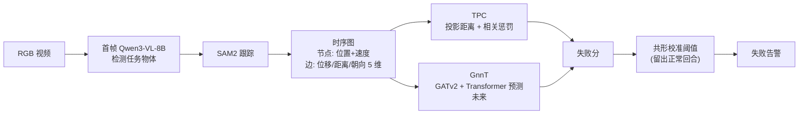

# Robot-WATCHDOG：用对象关系图检测操作失败

**Robot-WATCHDOG**（*failure detection through object-centric graph representation*，[arXiv:2610.13403](https://arxiv.org/abs/2610.13403)，[项目页](https://cea-list.github.io/Robot-WATCHDOG/)，CoRL 2026 接收）由 Université Paris-Saclay CEA List、Inria / LORIA 与 Bleu Robotics 的 Rolland、Mayran de Chamisso、Mouret 提出。它只从正常示范学习，用物体中心的时空图来判断“这次执行偏离了正常多少”。

## 一句话定义

**把每个回合变成“物体 + 末端”的时间序列图，用几何偏离加关系相关性（TPC）或未来状态预测误差（GnnT）打失败分，再用共形校准给阈值。**

## 英文缩写速查

| 缩写 | 英文全称 | 简要说明 |
|------|----------|----------|
| TPC | Trajectory Projection and Correlation | 非参数失败分：到最近专家轨迹的投影距离 + 关系相关性惩罚 |
| GnnT | Graph neural network + Transformer | GATv2 编码空间交互 + Transformer 预测未来物体位置 |
| GAT | Graph Attention Network | 图注意力，本文用 GATv2 |
| AUPR | Area Under the Precision-Recall curve | 阈值无关指标 |
| MCC | Matthews Correlation Coefficient | 平衡的二分类指标 |
| SAM2 | Segment Anything Model 2 | 物体跟踪器 |

## 为什么重要

- **只需正常示范：** 失败难以枚举，部署侧能拿到的往往只有成功数据。
- **抓语义错误：** 图像特征检测器对“拿错物体、顺序错”不敏感；物体关系图直接表达这些信息。
- **轻量：** TPC 不需训练，单帧约 7 ms。

## 方法栈 / 流程总览

## 方法

- **图：** 节点为任务物体与末端，特征为绝对 2D 位置和瞬时速度；边为相对 x/y 位移、距离、朝向 cos/sin（5 维）。
- **TPC：** 对每个物体算到同标签最近专家轨迹的正交投影距离，按专家均值与标准差归一化，指数递增权重聚合时间；再加观测与正常成对 Pearson 相关矩阵的 ℓ1 差异作为关系惩罚。
- **GnnT：** GATv2 空间编码 + 滑窗 token 的 Transformer（含相对时间、物体 ID、回合进度编码）+ MLP 预测未来位置；损失为位置 MSE + 边一致性。
- **校准：** 用留出的正常回合按容忍度 α 构造随时间变化的阈值（未做有限样本修正，误差水平近似）。

## 实验与评测

- **数据：** BotFails 的 4 个刚体任务 + 新数据集（结构化摆桌、传送带废物分拣）共 6 个任务，10 个随机种子平均（Table 4 为 5 个种子，与正文不一致，见源归档）。新数据集：摆桌用 ALOHA、4 路相机，100 条专家 + 21 条测试回合；废物分拣用 SO-100、单顶视相机，100 条专家 + 51 条测试回合。
- **对比：** AP-RMS、AP-Fréchet、Soft-DTW、logpZO、lopO、AE-Recon、FIDeL（图像检测器）。
- **AUPR / 最大 MCC：** TPC BotFails 0.811 / 0.751、Watchdog 0.810 / 0.719；GnnT 0.623 / 0.488、0.648 / 0.631；最强基线 AP-RMS 0.442 / 0.320、AP-Fréchet 0.346 / 0.344。
- **共形校准后 MCC：** TPC 0.675 / 0.641；GnnT 0.347 / 0.571；最强基线 0.220（FIDeL）/ 0.329（logpZO）。
- **消融：** 视觉特征在摆桌任务上 MCC 为 0；图相对仅轨迹模型 +23.8 点；去边伤 GnnT；预测式比归一化流密度式跨种子更稳。
- **延迟（RTX 3090）：** SAM2+TPC 29.72 ms/帧（33.6 FPS），SAM2+GnnT 42.59 ms/帧（23.5 FPS）；Qwen 初始化 7.03 s/任务。

## 源码运行时序图

不适用：论文与[项目页](../../sources/sites/robot_watchdog_project_page.md)都没有作者代码仓库，页面中的 GitHub 链接仅指向 LeRobot 和页面模板；截至 2026-10-12 无可对齐的目录与脚本。

## 工程实践

- 若自建：Qwen3-VL-8B 首帧检测一次，SAM2 逐帧跟踪，TPC 只需存专家轨迹；先用 TPC 做基线，因为其训练为零。
- 阈值用共形校准，注意其使用未修正的经验分位数，实际误报率只是近似。
- 对遮挡、漏检与身份切换敏感，需监控跟踪质量。

## 结论

**物体中心图让失败检测从“看像不像”变成“看关系对不对”，在刚体、离散物体的操作任务上优于图像检测器。**

1. TPC 在两类数据集上 AUPR 约 0.81，较最强基线（0.44、0.35）高出一截。
2. 非参数 TPC 反而比学习型 GnnT 在多数指标上更强，且无需训练。
3. 视觉特征在摆桌任务 MCC 为 0，说明语义/交互错误需要关系信息。
4. SAM2+TPC 约 33.6 FPS，可在线运行。
5. 仅适用于离散刚体，且无公开代码。

## 局限与风险

- **开源：** 无公开代码；新数据集宣称随文发布但无可核实链接。
- 依赖离散物体抽象，不适合可变形物体、流体、涂装等；依赖 VLM + SAM2，遮挡会破坏图；只建质心，缺朝向与细粒度位姿。
- 正文 10 种子与 Table 4 的 5 种子不一致；失败回合数未在读到的部分给出。
- 数据规模小（6 个任务），真机策略闭环中的使用效果（检测后如何恢复）本文不涉及。

## 与其他工作对比

| 对照 | 读法 |
|------|------|
| [FARM 失败读出](./paper-farm-failure-readout.md) | 同属失败检测；对比点：是否依赖策略内部表征 |
| [Foresight 动作条件失败监控](./paper-foresight-action-conditioned-failure-monitoring.md) | 世界模型预测式监控；本文用物体图预测 |
| FIDeL | 本文主要图像基线 |
| [ALOHA](./aloha.md) | 新数据集摆桌任务采集平台 |

## 关联页面

- [34 篇空间落地技术图谱（汇总页）](../overview/embodied-station-34-papers-spatial-grounding-technology-map.md)
- [操作任务总览](../tasks/manipulation.md)
- [FARM 失败读出](./paper-farm-failure-readout.md)
- [Foresight 失败监控](./paper-foresight-action-conditioned-failure-monitoring.md)
- [ALOHA](./aloha.md)
- [机器人视觉感知栈选型闭环](../queries/robot-perception-stack-selection-loop.md) — 本页对应其 ② 检测/分割层的下游用法：首帧 Qwen3-VL-8B 检测 + SAM2 跟踪构建物体中心图做失败检测，遮挡会破坏图且只建质心、缺朝向

## 参考来源

- [公众号盘点：具身智能小站 34 篇](../../sources/blogs/wechat_embodied_station_34_papers_spatial_grounding_2026-10-12.md)
- [robot_watchdog_arxiv_2610_13403.md](../../sources/papers/robot_watchdog_arxiv_2610_13403.md)
- [robot_watchdog_project_page.md](../../sources/sites/robot_watchdog_project_page.md)
- [arXiv:2610.13403](https://arxiv.org/abs/2610.13403)

## 推荐继续阅读

- [Robot-WATCHDOG 项目页](https://cea-list.github.io/Robot-WATCHDOG/)
- [arXiv HTML 全文](https://arxiv.org/html/2610.13403v1)
