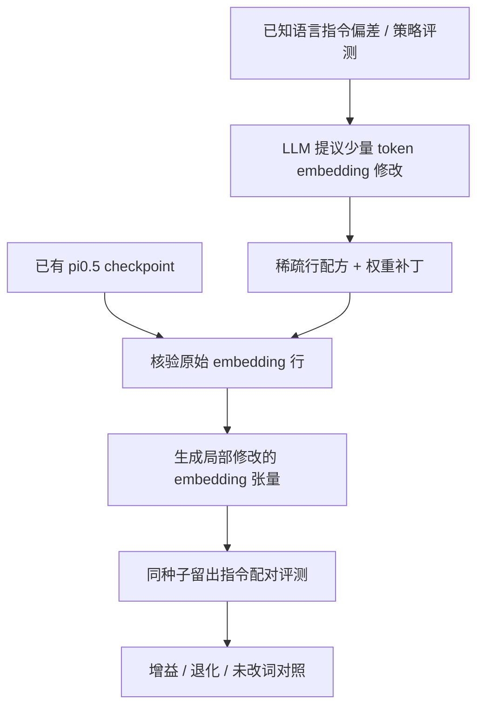
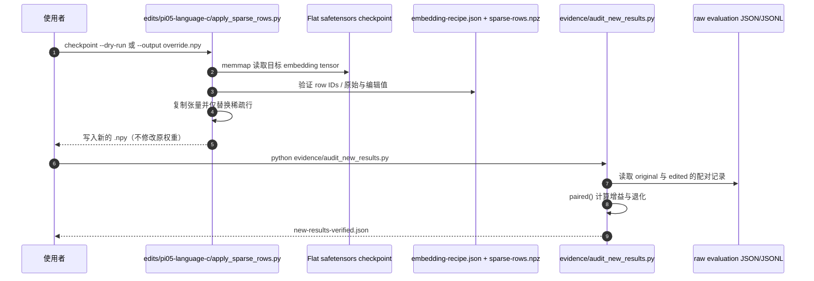

# Can LLMs Debug Robots by Editing Their Weights?｜让语言模型直接稀疏编辑机器人策略权重

## 一句话定义

该研究以语言模型驱动的稀疏词嵌入行编辑，在不进行梯度再训练、也不补充机器人示范的前提下改善已掌握技能与不同指令措辞的匹配。

## 英文缩写速查

| 缩写 | 英文全称 | 简要说明 |
|---|---|---|
| VLA | Vision-Language-Action | 具身视觉语言动作策略 |
| LLM | Large Language Model | 建议改动词嵌入的编辑器 |
| SFT | Supervised Fine-Tuning | 与无需梯度补丁作对照的常规途径 |

## 为什么重要

对已有技能的词汇指向错误有时可从语言嵌入层定位，不必重新采集大量机器人动作；但编辑词向量不等于学会一个新物理技能。

## 核心原理

1. 使用现有策略的错误指令与模拟评估，LLM 为少量 token embedding 行提出修补方案；编辑是权重级修改而非新增推理提示。
2. 在原基座 checkpoint 上只替换经过验证的若干 token 行；通过配对留出指令评估干预的增益、退化与未触及的词。
3. 发布 pi0.5 embedding patch、验证报告、episode 记录；重点仍是语义/词汇对齐，其他任务和真机泛化需要分开验证。

## 流程总览

## 源码运行时序图

下图仅依照官方开源入口的静态调用链绘制，不表示已运行训练、实验或机器人。

## 工程实践

- 官方入口：python edits/pi05-language-c/apply_sparse_rows.py <checkpoint> --dry-run；python evidence/audit_new_results.py（审计已有结果）。
- 源码核对：`apply_sparse_rows.py` 通过原始 checkpoint memmap、recipe 与 npz row IDs 一致性、原始行值检查后生成覆盖 `.npy`，不会修改原 checkpoint，更不会运行模型；`evidence/audit_new_results.py` 读取已发布 JSON/JSONL episode 配对结果生成统计。仓库 Apache-2.0。
- 复现前检查输入格式、动作坐标系、依赖、评测种子以及硬件和 API 资源；作者报告数字不可当作本仓实测。

## 实验与评测

- 作者在 765 条留出改写指令上报告 π0.5 成功率 660/765（86.3%）→ 704/765（92.0%），成对比较增益 48、退化 4。
- 其中涉及修改词行的 335 个输入受影响；不涉及修改词的 430 条在公开审计里成功/失败结果不变。

## 结论

**该研究以语言模型驱动的稀疏词嵌入行编辑，在不进行梯度再训练、也不补充机器人示范的前提下改善已掌握技能与不同指令措辞的匹配。**

1. 先以论文明确的输入输出、数据拆分和评测协议定位方法适用范围。
2. 区分定量实验、官方开源可复现入口与本次未执行的实验步骤。
3. 重点跟进部署时的误差、计算开销以及任务/机器人构型迁移边界。

## 与其他工作对比

- **对比原版 `pi0.5_libero` 与方向/替换严格控制编辑（765 条留出语言改写变体，Tables 2–3）：** 相比未编辑基线（**86.3%**，660/765），编辑会话 C 将成功率提升至 **92.0%**（704/765，`g/l = 48/4`，精确检验 `p = 1.31×10⁻¹⁰`），且严格保持未读取编辑词行的 430 条指令结果 100% 不变（Table 2）。在同 65 行的匹配范数随机方向扰动控制下，成功率反而微降至 **85.2%**（`7/15`，`p = 0.134`），排除纯参数扰动假说；而直接按编辑器发现的同义目标全量替换达 **90.5%**（`43/11`），C 虽点估计更高但双方在 763 个有效对上的直接比较未达 0.05 显著阈值（`p = 0.0614`）。固定观测回放实验（Table 4）进一步证实方向编辑将动作块与标准锚点的距离比 `ρ` 从 1.000 降至 0.340–0.367，纯范数控制仍为 1.004。
- **对比常规 `SFT` / LoRA 再训练：** 稀疏词嵌入行编辑无需收集新机器人示范、无梯度更新，但能力边界也清晰限定在「已有物理技能的词汇映射纠错」，无法替代 `SFT` 学习全新动作技能。

## 局限与风险

- 不能把改变 token 嵌入理解为获得新物理动作技能或解决任意长尾任务。
- 公开的更广泛任务控制、其他策略与真机证据尚不充分；模型基座 checkpoint 需另行获取。
- Apache-2.0 源码，`apply_sparse_rows.py` 只生成核验过的新 `.npy` 覆盖张量，不实际运行机器人策略。

## 关联页面

- [manipulation ](../tasks/manipulation.md)
- [imitation-learning ](../methods/imitation-learning.md)
- [vla ](../methods/vla.md)
- [相关纵深路线](../../roadmap/depth-vla.md)

## 参考来源

- [论文原文与技术核对归档](../../sources/papers/robot-weight-debugging-arxiv-2611-09376.md)
- [官方代码及开放状态归档](../../sources/repos/robot-weight-debugging.md)

## 推荐继续阅读

- [arXiv:2611.09376 全文](https://arxiv.org/html/2611.09376v1)
- [官方源码](https://github.com/jushengzhang/robot-weight-debugging)
