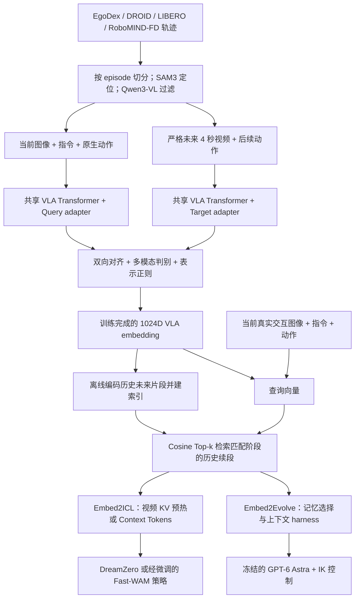

# Robota-Embed：统一 VLA 嵌入用于机器人上下文学习与经验演化
# Robota-Embed: Unified VLA Embeddings for Robot In-Context Learning and Evolution

## 一句话定义

Robota-Embed 把当前**任务 + 视觉 + 实际动作表示**与历史轨迹的**下一段运动**编码到同一检索空间，按执行阶段找到可用经验，再为机器人策略提供上下文或演化局部记忆。

## 英文缩写速查

| 缩写 | 英文全称 | 简要说明 |
|---|---|---|
| VLA | Vision-Language-Action | 将图像、指令和原生动作一起编码为检索键 |
| ICL | In-Context Learning | 从历史经验检索参考并注入策略上下文 |
| R@1 | Recall at 1 | 第一名检索结果命中正确未来片段/episode 的比例 |
| KV | Key-Value | DreamZero 视频上下文缓存，用检索到的视频预热 |
| WAM | World Action Model | Fast-WAM 等可消费视频或 Context Tokens 的模型 |
| IK | Inverse Kinematics | Embed2Evolve 仿真中将高层目标转为执行动作的控制接口 |

## 为什么重要

- 静态视觉相似不等于动作阶段相同；抓取前和放置后的场景可能类似，但接下来应做的动作不同。
- 检索历史**未来续段**，比仅匹配同一瞬间的帧更适合给当前策略提供操作参考。
- 必须区分**改进检索模型**、**只更新策略上下文**和**微调下游策略**三个不同训练/部署层次。

## 核心信息

| 项目 | 内容 |
|---|---|
| 一手论文 | [arXiv:2610.19495v1](https://arxiv.org/html/2610.19495)，2026-10-14；[PDF](https://arxiv.org/pdf/2610.19495) |
| 机构 | 英伟达（NVIDIA）、麻省理工学院（MIT）、加州大学伯克利分校（UC Berkeley）、牛津大学（Oxford）、卡内基梅隆大学（CMU） |
| 网络 | Cosmos3-Edge 4B 初始化；28 层共享 Transformer，查询/未来分离的 adapter；1024 维 L2 归一化嵌入 |
| 训练数据 | EgoDex / DROID / LIBERO / RoboMIND–Franka-dual，1,695,684 个 current–future anchor，四源等概率采样 |
| 未来目标 | 严格在查询时刻之后的 4 秒视频（16 帧）和原生频率动作 |
| 基准 | 4,000 query × 共用 8,000-entry gallery，clip/episode R@1 = 47.33% / 81.77% |
| 发布情况 | **2026-11-08：Code、Model & benchmark 仍为 Coming soon**，暂无官方可运行实现入口 |
| 原文归档 | [论文精读](../../sources/papers/robota_embed_arxiv_2610_19495.md) · [官方项目页](../../sources/sites/robota-embed.md) |

## 核心原理

记源数据集为 d，当前查询是 `(instruction, current crop, current native action, d)`，候选目标是 `(instruction, strictly-future video, future actions, d)`。各数据集保留原生动作接口（EgoDex 57D/30Hz、DROID 10D/15Hz、LIBERO 10D/10Hz、RoboMIND-FD 20D/10Hz），经域专属 projector 映射到共享网络。

- **预测式双端编码：** 共享 Cosmos3-Edge Transformer、视频 tokenizer 和投影头；query/target 各自 residual adapter；动作 token 时间池化后投影到 1024D，L2 归一化，再按 cosine similarity 检索。
- **三组训练目标：** 未来 clip 双向 InfoNCE 对齐、语言/视觉/动作置换及任务/对象/动作 hard negatives、表示各向同性和居中正则；语义相容或未来重叠的片段不会被随意当作负例。
- **经验存取：** 离线对历史未来片段建索引；在线把当前 VLA 投入同一空间，检索与当前动作阶段相容的后续片段，再通过策略支持的上下文接口提供参考。

## 流程总览

依据论文 §3、§5 和附录 A–D 绘制。**1,695,684 条训练 anchor 不等于 Embed2Evolve 在线任务记忆库规模**，后者只在任务开发尝试中积累。

## 两种下游用法

| 路径 | 检索结果如何进入策略 | 参数更新边界 |
|---|---|---|
| **Embed2ICL / DreamZero** | 选 DROID 视频，经 reranking 后预热 DreamZero 视觉 KV cache | **不更新 DreamZero 策略**，只变视频参考 |
| **Embed2ICL / Fast-WAM** | 选 EgoDex 示例，离线缓存 `32×1024` Context Tokens，并通过 1024→4096 prefilling adapter 加入 cross-attention | **Fast-WAM 经微调**（约 6.02B 可训练参数）；检索编码器冻结 |
| **Embed2Evolve** | 反复尝试建立任务局部记忆，搜索 Top-k、刷新周期、保留历史及成功/效率奖励；测试前固定配置与库 | **GPT-6 Astra 与 Robota-Embed 均冻结**；变化的是外部记忆和 harness |

注意：“无需更新基础模型参数”**仅准确描述 Embed2Evolve 的 GPT-6 Astra 策略与检索器冻结设置**；不能泛化为 Robota-Embed 无需训练或 Fast-WAM 不需微调。

## 工程实践

1. **数据处理：** 先隔离训练与测试 episode/session，再从指令定位操作对象；SAM3 生成 320×192 互动裁剪、Qwen3-VL 做可见性门禁，配对未来 4 秒窗。统一动作张量需做各域分位数归一化和至 64 维的 padding，但保留 native projector。
2. **检索监控：** 同时报告 clip-level 与 episode-level R@1；同 episode 命中不能冒充精确执行阶段命中。监控去动作、去视觉的分布外遮蔽和重训消融，不能把两者混为一谈。
3. **策略集成：** 先验证消费端能否接受历史视频 KV 或预先提取的 Context Tokens；随意注入示例可能更差（DROID-Sim 随机视频 36% vs 不预热 47%）。
4. **闭环限制：** A100 上 1M/15M 索引的查询编码+Top-10 检索分别约 160.36/195.17 ms，尚未计 SAM3、reranker、策略推理与执行；**不能**由此声称支持高频关节控制环。
5. **复现：** 截至 2026-11-08 没有发布官方权重、代码和基准，以上是论文方案及数据核查，不代表已运行复现。

## 源码运行时序图

**不适用。** 官方项目页截至 2026-11-08 显示 Code 与 Model & benchmark 均为 **Coming soon**；无可阅读的可执行入口、模块调用或 README 命令，不能臆造源码时序图。上面的 Mermaid 是**论文方法流程图**而不是源码运行证据。

## 实验与评测

| 评测 | 对照 | Robota-Embed 相关结果 | 重要口径 |
|---|---|---|---|
| Robota-Embed-Bench clip R@1 | Gemini Embedding 2：25.24% | **47.33%** | 四源共用 8,000 个候选，baseline 无动作输入 |
| Robota-Embed-Bench episode R@1 | Gemini：48.30% | **81.77%** | 允许命中同一 episode 的其他 clip |
| 推理期去 query 动作 | 完整 VLA：47.33% | **20.08%** | 固定 checkpoint 的输入遮蔽，并非重训 |
| DROID 同数据重训去动作 | 完整 VLA：78.7% | **59.8%** | 与固定 checkpoint 遮蔽实验区分 |
| DROID-Sim / DreamZero | 不预热 47.0%，随机视频 36.0% | **56.3%** | 3 个仿真任务均值，冻结策略 |
| LIBERO difficult / Fast-WAM | 官方 release 86.4%，随机 Tokens 88.0% | **92.8%** | 预选 5 任务 × 50 次/条件；有额外微调 |
| 真机 Split Cup | 不使用 ICL：66.67 | **87.50** | **任务阶段进度评分**，非成功率；12 次/条件 |
| ManiSkill / GPT-6 Astra | Direct 24%；随机历史 20%；独立演化 Omni 33% | **68%** | 开发阶段选定的 5 个任务 × 20 个新 seed/条件 |
| ManiSkill 策略 tokens/rollout | Direct 0.921M；独立演化 Omni ≈2.531M | **0.518M** | 对 Direct **−43.7%**；对 Omni ≈**−79.5%**；只计正式测试、含失败 |

**统计边界：** ManiSkill 成功率是五项**仿真**任务的平均，不是开放世界人形机器人能力；43.7% 是相对于 GPT-6 Astra Direct 的**每次测试 rollout 策略 Token**节省，排除了记忆构建与 harness 调参成本。论文另报告共享成功的 19 组样本里 GPT 决策数减少 64.1%、客户端观察时间减少 41.4%，后者受 API 负载及并发条件混杂，不宜作单纯算法推理提速结论。

## 结论

**一句话总判：有用的机器人历史经验必须匹配任务、动作和执行阶段；收益来自“正确检索 + 可消费的策略上下文”，而非只增加记忆量。**

1. **动作是检索键的一部分** — 模型比较与重训消融均支持原生动作提供额外信息，但不能从遮蔽结果推断通用因果排序。
2. **选未来而不是只选相似画面** — clip R@1 和 episode R@1 要分别评估，避免误把同场景错误时刻当正确参考。
3. **冻策略也能变强，但限定场景** — Embed2Evolve 在选定 ManiSkill 上 24%→68%，并非真机通用成功率。
4. **Token 节省须说明分母** — 43.7% 是对 Direct 的正式测试策略 Token；79.5% 是对独立演化 Omni 的比较，二者不可混用。
5. **ICL 分训练与不训练** — DreamZero 可免额外策略更新，而 Fast-WAM 的训练版确实有微调。
6. **先评估延迟和接口** — 检索器耗时不等于控制闭环频率，官方实现未开放前仅能做设计评估。

## 与其他工作对比

- 相比不含动作的通用 VL embedding（如 Gemini Embedding 2、Omni-Embed-Nemotron-3B），Robota-Embed 将**当前原生动作和候选未来动作**同时用于检索 key，而不是只把动作当返回结果。
- 相比只在当前 episode 内回忆的方案，Embed2Evolve 在**开发阶段跨尝试**累积成功/失败记忆；正式测试时完全固定记忆与检索方案。
- 与 [机器人上下文学习](../concepts/robot-in-context-learning.md) 及 [VLA](../methods/vla.md) 的关系，是“选择哪个历史续段”和“如何让策略消费它”之间的接口设计。

## 局限与风险

- **开源未完成：** 官方项目页目前仍为 Code、Model & benchmark Coming soon，第三方无法基于作者实现独立复现。
- **对照不完全等价：** 部分 benchmark 基线本身不接受动作输入；Omni 演化比较同时改变最终记忆库和配置，不是固定 harness 的单变量替换。
- **评测样本与外推：** 真机每任务仅 12 条 rollout；五个 ManiSkill 任务为开发中挑选的集合，非开放世界/人形通用测试。
- **动作分布迁移：** ManiSkill 用 command endpoint-error proxy 和 LIBERO codec，跨本体适配与真实驱动数据存在差异。
- **资源口径：** Token 减少不包括检索/建库/开发；观察到的执行时间受 API 排队混杂；取回更多上下文可能增加系统开销。
- **窗口限制：** 固定四秒未来窗，未验证可适配长时序或更多本体。

## 关联页面

- [VLA](../methods/vla.md) — 视觉语言动作统一表示
- [机器人上下文学习](../concepts/robot-in-context-learning.md) — 历史示范条件化
- [数据飞轮](../concepts/data-flywheel.md) — 任务经验持续积累
- [动作分块](../methods/action-chunking.md) — 动作序列与时序边界

## 参考来源

- [Robota-Embed 一手论文全文精读归档](../../sources/papers/robota_embed_arxiv_2610_19495.md)
- [Robota-Embed 官方项目页开放状态核验](../../sources/sites/robota-embed.md)

## 推荐继续阅读

- [arXiv 原文 HTML（含附录）](https://arxiv.org/html/2610.19495)
- [官方 Robota-Embed 项目主页](https://robota-ai.github.io/robota-embed/)
