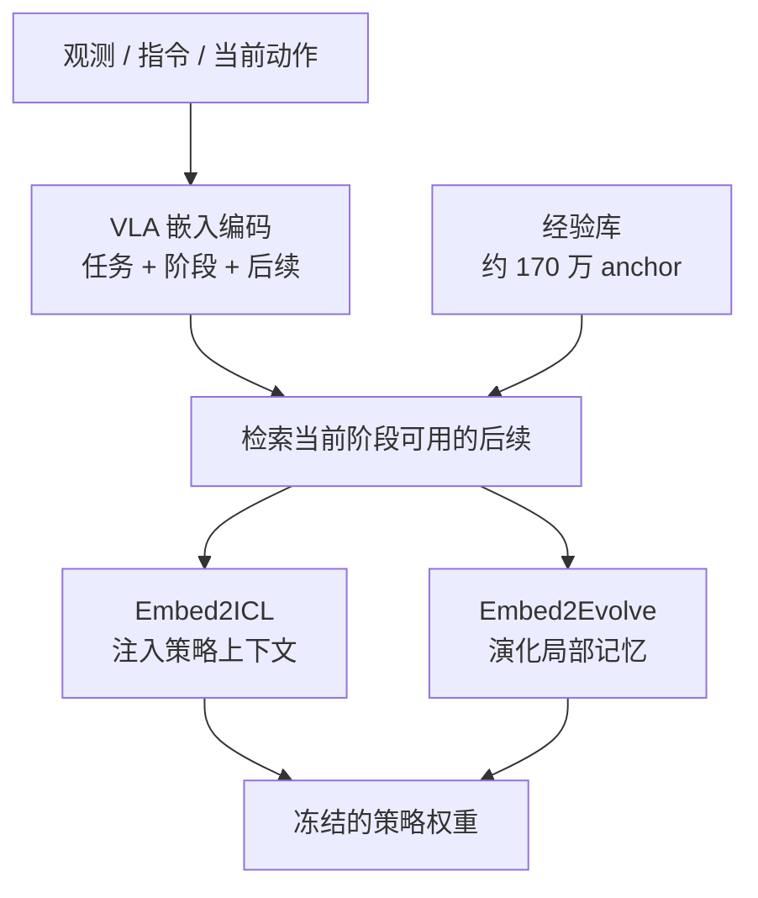

# Robota-Embed：统一 VLA 嵌入的机器人上下文学习与经验演化

**一句话定义：** 用一个联合编码任务、执行阶段与后续动作的 VLA 嵌入模型，从经验库中检索当前阶段真正可用的后续内容，并以此做上下文学习和局部记忆演化。

## 英文缩写速查

| 缩写 | 英文全称 | 简要说明 |
|------|----------|----------|
| VLA | Vision-Language-Action | 同时处理视觉、语言与动作的机器人策略，本文嵌入的编码对象 |
| ICL | In-Context Learning | 不更新权重，仅在上下文中注入检索到的经验来改变策略行为（Embed2ICL） |
| R@1 | Recall at 1 | 检索结果首位命中正确条目的比例，本文的主要检索指标 |
| clip / episode | clip-level / episode-level | 按短片段与整段任务两种粒度计算检索指标 |

## 为什么重要

- 机器人经验库的检索常只看视觉或语言相似度，忽略执行阶段与动作，导致检索到"看起来相似、但当前不可用"的片段。
- 把检索与策略上下文结合，可以在不重训策略权重的前提下利用过往经验。
- 论文同时报告检索指标与下游策略成功率，便于区分"检索准"与"真机进展"两件事。

## 核心信息

| 项目 | 内容 |
|------|------|
| 论文 | Robota-Embed: Unified VLA Embeddings for Robot In-Context Learning and Evolution |
| arXiv | 2610.19495（v1，2026-10-14） |
| 作者 | Yunze Liu 等 19 人（含 Yuke Zhu、Trevor Darrell、Linxi "Jim" Fan、Song Han、Han Cai） |
| 机构 | 未核实（arXiv 与项目页均未列出） |
| 数据 / 平台 | 约 170 万清洗 anchor；Robota-Embed-Bench（4,000 query，8,000 gallery）；DROID-Sim、LIBERO、ManiSkill |
| 开源 status | **待发布**：项目页 Code、Model &amp; benchmark 均为 Coming soon；未列仓库或权重 URL（2026-10-15） |
| 来源 | [sources/papers/robota_embed_arxiv_2610_19495.md](../../sources/papers/robota_embed_arxiv_2610_19495.md) |

## 核心原理

嵌入模型把观测、指令与动作映射到同一空间，query 与录制的未来片段都带有任务、阶段与后续内容信息。检索得到的经验被注入策略上下文（Embed2ICL），或用于更新局部记忆（Embed2Evolve），而策略权重保持不变。

## 工程实践

- **检索侧：** 同时输入视觉、语言与动作时检索效果最好；去掉动作输入的损害大于去掉视觉（摘要数字）。
- **上下文侧：** 只把检索结果注入上下文，不改策略权重，便于在已部署策略上试验。
- **评测侧：** 区分仿真成功率与真机任务进展；页面中的 LIBERO、DROID-Sim、ManiSkill 结果均为仿真。
- **复现：** 代码、模型与基准截至入库日均为待发布，无法本地复现。
- **源码运行时序图：** **不适用**（截至 2026-10-15 无官方代码或权重发布，项目页写明 Coming soon）。

## 实验与评测

- **检索指标（摘要数字）：** 最终 checkpoint clip 级 R@1 47.33%，episode 级 R@1 81.77%；优于一个不含动作信息的通用嵌入基线。
- **消融（摘要数字）：** 项目页称，去掉 query 中的动作后，四域平均 clip 级 R@1 由 47.33% 降至 20.08%。
- **下游（摘要数字）：** Embed2ICL 在 DROID-Sim 与 LIBERO 上提升策略成功率（具体数值未核实）；Embed2Evolve 在五个 ManiSkill 任务上达到 68% 成功率，策略 token 较对照 harness 减少约 79.5%。
- 以上数字来自摘要与项目页的 WebFetch 转述，未逐字核对原文。

## 结论

**一句话总判：检索的价值在于按执行阶段选对经验，而不在于嵌入本身更大。**

1. **动作信息是检索的关键** — 去掉动作的损害大于去掉视觉，说明"当前阶段可用的后续"依赖动作表示。
2. **检索准不等于真机进展** — 摘要区分了检索指标与任务成功率，两者需分别看待。
3. **上下文注入可以不改权重** — Embed2ICL 与 Embed2Evolve 都冻结策略，适合已部署系统的渐进改进。
4. **token 成本是实际收益之一** — Embed2Evolve 的 token 减少幅度需与对照 harness 一起读。
5. **代码待发布前只能作为方法参考** — 截至入库日无可运行实现，复现与第三方验证需等待发布。

## 与其他工作对比

- 与 [机器人上下文学习](../concepts/robot-in-context-learning.md) 页中的方法相比，本文把检索对象从单纯示例扩展到带阶段与动作的嵌入空间。
- 与普通视觉-语言检索相比，本文强调动作与阶段，因此更接近 [VLA](../methods/vla.md) 策略的执行上下文。
- 摘要中的通用嵌入基线是不含动作的检索器，本页未核实其他公开检索基线的对比结果。

## 局限与风险

- **待发布：** 代码、模型与基准截至 2026-10-15 均未公开，结论不可独立复现。
- **仿真为主：** 下游成功率主要来自 DROID-Sim、LIBERO、ManiSkill 等仿真设置；真机进展的范围与次数未在摘要中核实。
- **数据规模：** 170 万 anchor 的清洗流程与来源未在摘要中展开，迁移到其他机器人或任务时需重新评估。
- **上下文成本：** 注入检索结果会增加上下文长度，token 节省的结论依赖文中对照 harness 的设定。

## 关联页面

- [VLA](../methods/vla.md) — 嵌入所针对的策略范式
- [机器人上下文学习](../concepts/robot-in-context-learning.md) — Embed2ICL 所属的范式
- [数据飞轮](../concepts/data-flywheel.md) — 经验库持续积累与回流的背景
- [动作分块](../methods/action-chunking.md) — 动作表示与检索单元的相关设计

## 参考来源

- [Robota-Embed 来源归档](../../sources/papers/robota_embed_arxiv_2610_19495.md)
- 微信「具身站 31 篇论文」摘要：[sources/raw/wechat_embodied_station_robot_31_papers_2026-10-15.md](../../sources/raw/wechat_embodied_station_robot_31_papers_2026-10-15.md)

## 推荐继续阅读

- [arXiv:2610.19495 — Robota-Embed](https://arxiv.org/abs/2610.19495)
- [Robota-Embed 项目页](https://robota-ai.github.io/robota-embed/)
