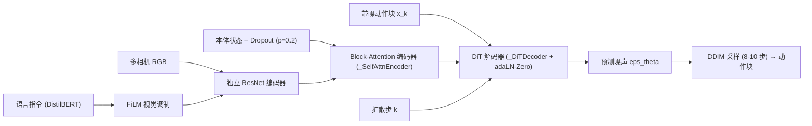
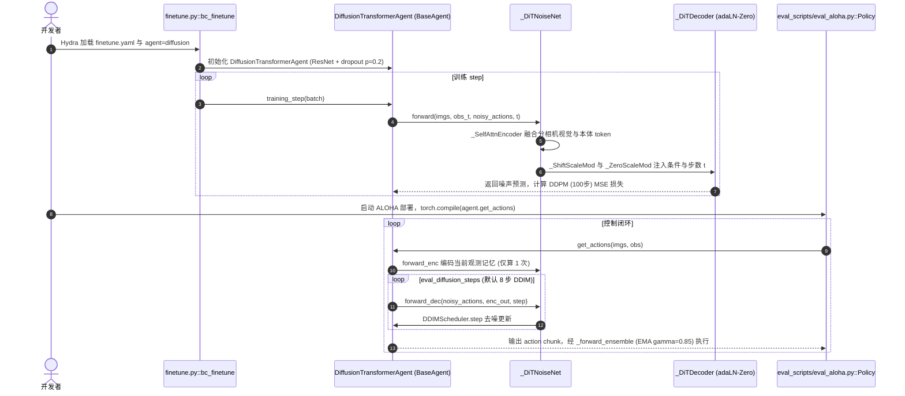

# DiT-Block Policy：机器人扩散 Transformer 的「配方」

**The Ingredients for Robotic Diffusion Transformers**（[arXiv:2410.10088](https://arxiv.org/abs/2410.10088)，[项目页](https://dit-policy.github.io/)，[代码](https://github.com/SudeepDasari/dit-policy)）由 **Sudeep Dasari、Oier Mees、Sebastian Zhao、Mohan Kumar Srirama、Sergey Levine**（CMU / UC Berkeley）提出。针对 [Diffusion Policy](./paper-diffusion-policy.md) 原始 cross-attention Transformer 噪声网络极难调参、真机容易发散的痛点，论文给出了系统可复现的架构配方 **DiT-Block Policy**：用 **adaLN-Zero** 扩散解码器替换标准交叉注意力块，并结合分相机独立 ResNet 视觉编码与本体 dropout。

## 一句话定义

**通过「分相机独立 ResNet + FiLM 语言 + 本体 dropout + adaLN-Zero 解码块」的系统配方，解决机器人扩散 Transformer 噪声网络训练不稳定的问题并实现跨双臂/单臂真机稳定缩放。**

## 英文缩写速查

| 缩写 | 英文全称 | 简要说明 |
|------|----------|----------|
| DP | Diffusion Policy | 动作块级 DDPM 去噪模仿学习框架 |
| DiT | Diffusion Transformer | 以 Transformer 作为扩散去噪主干的架构族 |
| adaLN-Zero | Adaptive Layer Normalization (Zero-Init) | 由条件特征调制 LayerNorm 参数且残差门控零初始化的解码块 |
| DDPM | Denoising Diffusion Probabilistic Model | 训练期多步加噪与噪声预测目标 |
| DDIM | Denoising Diffusion Implicit Model | 推理期少步确定性去噪采样器 |
| FiLM | Feature-wise Linear Modulation | 将 DistilBERT 语言特征注入视觉特征层 |
| BC | Behavior Cloning | 行为克隆离线示教学习范式 |

## 为什么重要

- **破除“Transformer 不如 U-Net”误区：** 原文指出并非 Transformer 容量不够，而是传统 cross-attention 条件注入与纯卷积 stem 词元化在机器人少量高维示范下极难稳定优化。
- **确立 DiT 在动作策略中的标准模块：** 验证 **adaLN-Zero + 零初始化输出门控** 能在仅 8–10 步 DDIM 下稳定输出平滑双臂轨迹，而无需依赖大批量暴力调参。
- **开源对照基线与 BiPlay 数据集：** 官方仓同框实现 DiT-Block、U-Net DP 与 ACT 基线，并公开约 10 小时、7,023 个片段的多场景 ALOHA 双臂 play 数据集 **BiPlay**。

## 核心原理

### 核心信息

| 项 | 内容 |
|----|------|
| **机构** | 卡内基梅隆大学（CMU）；加州大学伯克利分校（UC Berkeley） |
| **出处** | arXiv:2410.10088（2024） |
| **输入** | 多路相机 RGB + DistilBERT 语言条件 + 低维本体（含 `p=0.2` dropout） |
| **Action chunk** | 论文训练 `H=100`；DDPM `k=100`（`squaredcos_cap_v2`）；论文推理 10 步 DDIM（代码默认配置 `eval_diffusion_steps: 8`） |
| **开源** | **已开源** — `SudeepDasari/dit-policy`（MIT）+ HF **BiPlay** |

### 核心机制

1. **分相机独立 ResNet + FiLM 语言注入 + 本体 Dropout：**
   - 每路相机分配**独立权重**的 ResNet 编码器提取空间特征图，避免共享主干混淆多视角几何语义（注：论文正文写 ResNet-26，项目页图注写 ResNet-18，公开代码默认 `resnet_gn` / `resnet_gn_nopool` 配套 ImageNet 预训练 ResNet-18 特征下载脚本）；
   - DistilBERT 提取的语言指令向量经 **FiLM** 调制视觉卷积层；
   - 低维本体状态输入施加 `nn.Dropout(p=0.2)`（`data4robotics/agent.py`），防止策略偷懒记忆本体轨迹捷径而忽视视觉变化。
2. **Block-Attention 观测编码器（`_SelfAttnEncoder`）：** 视觉 patch token 与本体 token 拼接后经双向注意力编码块融合，提取多层上下文记忆嵌入，且推理时只需在去噪循环前调用一次 `forward_enc` 缓存。
3. **adaLN-Zero 扩散解码器（`_DiTDecoder`）：** 在扩散去噪端用自适应层归一化替代传统 cross-attention，将编码器条件与正弦时间步 $k$ 之和通过 `_ShiftScaleMod`（调制 scale/shift）和 `_ZeroScaleMod`（残差门控参数初始化为全零）注入每一解码层，使训练初始阶段近似恒等残差路径，显著抑制早期梯度震荡。
4. **少步确定性 DDIM 与时间集成执行：** 训练采用 100 步余弦噪声日程（`squaredcos_cap_v2`），真机部署采用少步确定性 DDIM 采样（论文 10 步，代码 `diffusion.yaml` 默认 8 步）并与 `eval_aloha.py` 中的 `pred_horizon=48`、衰减系数 `gamma=0.85` 时间集成或分块执行结合。

### 流程总览

## 评测与实验对比

基于 `arXiv:2410.10088` Table II–V 与 Fig. 5 原文数据：

- **双臂 ALOHA 长时域对比（Table II，含 / 不含 BiPlay）：**
  - **使用 BiPlay 预混训：** DiT-Block Policy 平均成功率 **60% ± 9%**（Pick Place `50%`、Pen Uncap `100%`、Sushi Cut `29%`），显著优于 **D.P. U-Net（42% ± 9%）** 与 **ACT（33% ± 8%）**；而 **D.P. Transformer 基线全部任务均为 0% ± 0%**（训练不稳定导致真机动作剧烈抖动或完全失效）。
  - **仅用单任务示教（不含 BiPlay）：** DiT-Block 仍以 **51% ± 9%** 领先 ACT（37% ± 8%）和 D.P. U-Net（30% ± 9%），体现架构自身的数据效率优势。
- **注意力与零初始化消融（Table III，Pick Place / Pen Uncap）：**
  - 在同样 10 步 DDIM 下，**DiT-Block (ours) 达 50% ± 12% / 100% ± 0%**；去掉零初始化（No Zero-Init）降为 **38% ± 11% / 80% ± 13%**（整体降 16%）；
  - 标准 **Cross Attn.** 在 10 步 DDIM 下为 **0% / 0%**，需暴力增加到 100 步采样才升至 **38% ± 15% / 70% ± 11%**（且推理抖动严重）；**In-Context** 变体即便 100 步仍为 **0% / 0%**。
- **视觉编码器消融（Table IV）：** 将独立 ResNet 替换为 3 层卷积 stem（产出等量 49 token）并保持 85M 同参数或扩至 150M 参数（No ResNet），在 ALOHA Pick Place 上成功率均归 **0%**（Pen Uncap 仅 `13% / 20%`），证明预训练/结构化 CNN 特征词元化在中小规模机器人数据中仍远胜直接让 Transformer 从零学像素 patch。
- **跨本体单臂与仿真对比（Fig. 5 & Table V）：** 在单第三视角、笛卡尔速度控制的 Franka FR3（Toasting、Wiping）任务上，DiT-Block 平均超越 ACT **20%**、超越 D.P. U-Net **35%**；在 robomimic 四项仿真基准（Table V）上，DiT-Block 未做逐任务特调即达平均 **88.5%**（Lift 100%, Can 98%, Square 84%, Tool Hang 72%），逼近精调后的 D.P. Transformer **94%**（100%/100%/100%/76%），验证“仿真接近但真机差距悬殊”的真实现象。

## 与其他工作对比

| 对照维度 | DiT-Block Policy（本文） | [Diffusion Policy](./paper-diffusion-policy.md) | [RDT-1B](./paper-rdt-1b.md) |
|----------|--------------------------|-----------------------------------------------|-----------------------------|
| 核心去噪结构 | `_SelfAttnEncoder` + **adaLN-Zero** 解码器 | 1D U-Net + FiLM，或传统 cross-attn Transformer | 28 层 QKNorm + RMSNorm + **交替交叉注意力 (ACI)** |
| 视觉–语言先验 | 分相机 ResNet + FiLM DistilBERT | ResNet-18（无原生语言条件） | 冻结 SigLIP + T5-XXL |
| 典型规模与定位 | 115M（配方探索 + 强基线 + BiPlay） | ~数十到上百 M（范式奠基） | 1.2B 参数 + 1M 轨迹预训练基础模型 |

## 结论

**机器人扩散 Transformer 之所以在真机上“训不动”，关键不在于 Transformer 自身缺乏表达力，而在于缺少分相机 CNN 词元化、本体抗捷径 dropout 与 adaLN-Zero 条件注入这一整套工程配方。**

- **Transformer 替代 U-Net 的实战抓手：** 采用 `_ShiftScaleMod` 与 `_ZeroScaleMod`（adaLN-Zero）代替交叉注意力，不仅收敛快，还能把推理步数安全压到 8–10 步 DDIM。
- **小中数据量勿盲目端到端去 CNN：** 至少在数百至数千条示范量级下，独立权重的预训练 ResNet 仍明显优于纯卷积 stem / ViT 从零学习。
- **警惕仿真过拟合掩盖真机不稳定：** robomimic 仿真拿高分的原生 cross-attention Transformer 在 ALOHA 真机直接跌至 0%，方案选型应以真机消融和少步采样稳定性为准。
- **工程复现重点关注采样与缓存拆分：** 代码中 `_DiTNoiseNet.forward_enc` 在 DDIM 循环外只算一次、循环内仅跑轻量 `forward_dec`，再结合 `torch.compile` 是保持真机响应频率的关键。

## 源码运行时序图

节点对照 `SudeepDasari/dit-policy` 仓库 `finetune.py`、`experiments/agent/diffusion.yaml`、`data4robotics/agent.py`、`data4robotics/models/diffusion.py` 与 `eval_scripts/eval_aloha.py`：

## 工程实践

| 项 | 实现要点（核对仓库） |
|----|----------------------|
| 默认超参差异 | 论文报告 10 步 DDIM 与 ResNet-26；开源默认 `experiments/agent/diffusion.yaml` 为 `num_blocks: 6`、`hidden_dim: 512`、`nhead: 8`、`features: resnet_gn_nopool`、`train_diffusion_steps: 100`、`eval_diffusion_steps: 8`。 |
| 数据格式准备 | 需先运行预训练视觉特征下载脚本（`download_features.sh` 获取 `IN_1M_resnet18.pth` 等权重），并将演示轨迹转换为 `robobuf` 缓存格式后再传入 `finetune.py`。 |
| 真机推理优化 | `eval_scripts/eval_aloha.py` 对 `agent.eval().cuda().get_actions` 调用 `torch.compile`，并提供滑动窗口时间集成（`_forward_ensemble`, `pred_horizon=48`）与分块执行（`_forward_chunked`）两种模式切换。 |

## 局限与风险

- **多步采样固有耗时：** 仍基于 8–10 步 DDIM 离散迭代采样，极端高频力控场景的时延高于 1–4 步流匹配或一致性蒸馏策略。
- **语言理解深度受限：** 依赖冻结 DistilBERT + FiLM 注入简单任务短语，未接入大规模视觉语言模型（VLM），开放词汇与复杂组合指令理解弱于 [Dita](./paper-dita-scaling-diffusion-transformer-vla.md) 与 [RDT-1B](./paper-rdt-1b.md)。
- **文档与配置口径不完全一致：** 论文正文、项目页示意图与公开 YAML 在 ResNet 深度（26 vs 18）和 DDIM 步数（10 vs 8）上存在微小差异，复现消融时须以仓库配置为准。

## 与其他页面的关联

- [Diffusion Policy 方法页](../methods/diffusion-policy.md) — 扩散去噪策略核心原理与演化全貌
- [Action Chunking](../methods/action-chunking.md) — `H=100` 长视野动作块规划与时间集成原理
- [Behavior Cloning](../methods/behavior-cloning.md) — 离线示教克隆中的本体捷径问题及解决思路
- [双臂操作任务（Bimanual Manipulation）](../tasks/bimanual-manipulation.md) 与 [操作任务（Manipulation）](../tasks/manipulation.md) — ALOHA 双臂与 Franka 单臂真机应用场景
- [Diffusion Transformer 概念页](../concepts/diffusion-transformer.md) — adaLN-Zero 条件注入机制基础
- [Diffusion Policy](./paper-diffusion-policy.md) — 本文直接对比并改良的前置经典工作
- [RDT-1B](./paper-rdt-1b.md) — 进一步将双臂扩散 Transformer 扩展至 1.2B 参数与跨本体预训练
- [ScaleDP](./paper-scaledp-scaling-diffusion-transformer-policy.md) — 探讨扩散策略参数缩放定律的平行研究
- [扩散与流匹配纵深路线](../../roadmap/depth-robotics-diffusion-dit-flow.md) — 路线中连接经典 DP 与大型 DiT VLA 的关键桥梁

## 参考来源

- [robotic_dit_ingredients_arxiv_2410_10088.md](../../sources/papers/robotic_dit_ingredients_arxiv_2410_10088.md) — `arXiv:2410.10088` 全文通读与 Table II–V 详表核对
- [sudeepdasari_dit_policy.md](../../sources/repos/sudeepdasari_dit_policy.md) — `SudeepDasari/dit-policy` 核心源码与 YAML 核对
- [dit-policy-github-io.md](../../sources/sites/dit-policy-github-io.md) — 官方项目页核查

## 推荐继续阅读

- [论文全文（arXiv:2410.10088）](https://arxiv.org/abs/2410.10088)
- [官方代码仓库（SudeepDasari/dit-policy）](https://github.com/SudeepDasari/dit-policy)
- [BiPlay 双臂数据集（Hugging Face）](https://huggingface.co/datasets/oier-mees/BiPlay)
