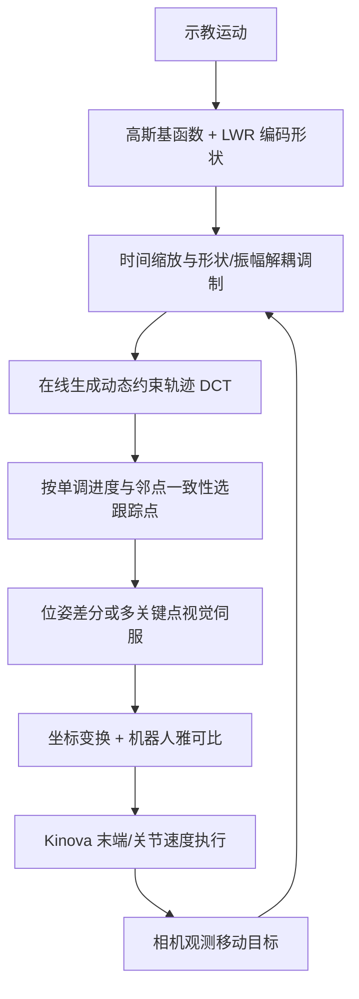

# Robotic Servo Tracking of Moving Targets with Dynamic Imitation Constraints

**一句话定义：** 把示教轨迹变成在线可变形的动态约束轨迹（DCT），跟随移动目标时调整时间进度与路径形状，并自适应选取下一跟踪点，闭环生成机械臂速度指令。

## 英文缩写速查

| 缩写 | 英文全称 | 简要说明 |
|------|----------|----------|
| DCT | Dynamic Constrained Trajectory | 在线变形并提供动态跟踪约束点的轨迹表示 |
| DMP | Dynamic Movement Primitive | 将示教运动编码为可泛化轨迹的运动基元框架 |
| LWR | Locally Weighted Regression | 以局部加权回归拟合示教轨迹的基函数模型 |
| PBVS | Position-Based Visual Servoing | 根据相对 3D 位姿误差生成视觉伺服控制 |
| IBVS | Image-Based Visual Servoing | 根据图像特征误差生成视觉伺服控制 |

## 核心信息

| 字段 | 内容 |
|------|------|
| 作者 | Yazhe Luo, Sipu Ruan, Yifei Li, Diansheng Chen |
| 机构 | 北京航空航天大学；太原理工大学；湖南省智能康复机器人及辅助设备工程技术研究中心（作者署名依人而异） |
| 发表 | IROS 2026（作者公告称已接收）；arXiv:2609.14589v1，2026-09-13 |
| 硬件 | Kinova 机械臂、RealSense 深度相机；100 Hz 控制，关节速度上限 π/3 |
| 方法 | 高斯基函数 + LWR 编码示教形状；时间缩放与形状/振幅解耦调制；单调进度约束下自适应选取 DCT 跟踪点 |
| 代码 | 截至 2026-10-13，未找到官方可运行代码仓库或项目页 |

## 问题与方法

固定示教轨迹配合传统视觉伺服，目标突然运动或路径受障碍影响时，既定跟踪点可能落后、导致振荡，或迫使机器人走不合适的中间路径。本文让示教轨迹成为可随目标更新的约束，而非固定逐点命令。

1. **编码示教形状：** 通过高斯基函数和局部加权回归获得可泛化的轨迹表示。
2. **动态调制：** 时间缩放适配目标变化速度；形状/振幅解耦，允许起终点相同但中间路径不同，并维持单调进度。
3. **自适应选点：** 目标位姿更新后在线生成广义轨迹，按到目标的单调距离准则与相邻点一致性选取下一控制点，减少往返摆动。
4. **生成指令：** 通过目标位姿差分或多个关键点对应关系得到末端 6D 速度，经坐标变换和机械臂雅可比映射为关节速度。

## 流程总览

## 评测与结果

论文在仿真和 Kinova 真机上评测 20 个场景，覆盖平移、旋转、混合目标扰动以及光照/背景变化。作者称各方法采用一致初始条件、脚本和接口。表中尝试次数（Att.）为 150、场景数（Scen.）为 20；不把二者自行相乘解释为独立总试验数。

| 方法 | 平均时长 | 位姿误差 | 成功率 | 超调/振荡 |
|------|---------:|---------:|-------:|----------:|
| RTMPose4VSG | 6.4 ± 1.0 s | 8.0 ± 2.1 mm | 83% | 2 |
| TSCTO | 8.3 ± 1.1 s | 6.0 ± 1.8 mm | 79% | 1 |
| OMPL-CHOMP | 23.4 ± 0.9 s | 14 ± 3.7 mm | 80% | — |
| OMPL-STOMP | 10.1 ± 0.9 s | 18 ± 4.9 mm | 75% | — |
| **本文方法** | **7.0 ± 0.8 s** | **4.0 ± 1.2 mm** | **87%** | **0** |

这是单篇论文自身设置下的实验结果，不代表其他机械臂、感知器或目标动态条件的保证。理论收敛分析依赖目标运动有界等假设；系统使用可用的目标位姿/特征观测，并非端到端从图像学习感知和控制。

## 源码运行时序图

**不适用：** 截至 2026-10-13，论文和作者公开信息中未找到官方训练、推理或部署代码仓库及运行入口；上方流程图描述论文方法，不代表代码实现。

## 工程实践与适用边界

- 适用于示教可提供路径先验、目标持续移动且视觉系统可提供相对位姿或关键点的机械臂跟踪。
- 创新重点在轨迹级约束和控制点选择，而非学习检测器；不可误写成端到端视觉策略。
- 真机设置为 Kinova + RealSense、100 Hz、关节速度上限 π/3；性能依赖论文实验实现。
- 无公开实现入口，基函数配置、控制器整定与硬件接线需从论文自行补足。

## 与其他工作对比

| 工作 | 关联与区别 |
|------|------|
| DMP（动态运动基元） | 同为基函数 + 局部加权回归编码示教并支持时间缩放；本文额外解耦形状/振幅调制，并在目标持续移动时在线选取跟踪点，而非只改终点再积分 |
| [经典视觉伺服](../methods/visual-servoing.md)（如 RTMPose4VSG） | 直接以即时视觉误差生成速度，目标突变时易振荡；本文用示教轨迹约束中间路径，论文表中误差 4.0 mm vs 8.0 mm、振荡 0 vs 2 |
| TSCTO | 论文中的轨迹约束跟踪对照，精度（6.0 mm）与无振荡表现接近本文，但时长和成功率略逊 |
| OMPL-CHOMP / STOMP（[轨迹优化](../methods/trajectory-optimization.md)） | 基于采样 / 优化的重规划，时长明显更长、误差更大；本文以示教先验替代每次全局重规划 |
| [TacRefineNet](./paper-tacrefinenet-tactile-grasp-refinement.md) | 同样把跟踪误差转为增量控制，但信号来自触觉而非视觉位姿，作用阶段是抓取精调 |

## 结论

**核心价值是把即时误差伺服提升为随目标在线变形的示教轨迹约束；论文在 Kinova 测试中报告兼顾精度、成功率和抑制振荡。**

1. 路径中间段需随目标改变时，关注 DCT 形状/振幅调制，而不只调整速度增益。
2. 时间缩放适配目标节奏，形状调制改变空间路径，两者作用不同。
3. 复现实验应同时记录时长、位姿误差、成功率和振荡/超调。
4. 4.0 ± 1.2 mm 与 87% 是特定 Kinova/RealSense 场景结果。
5. 目标观测不可用或目标运动不满足有界等分析假设时，结论不能直接照搬。
6. 无公开代码时，论文应视作复现规格而非即插即用软件；需补全感知、标定、雅可比与安全限幅。

## 关联页面

- [Visual Servoing（视觉伺服控制）](../methods/visual-servoing.md) — 轨迹级动态约束与传统视觉误差伺服的关系。
- [Manipulation 任务](../tasks/manipulation.md) — 机械臂跟踪控制背景。
- [Behavior Cloning Loss](../formalizations/behavior-cloning-loss.md) — 示教轨迹先验相关背景。
- [TacRefineNet（触觉伺服论文）](./paper-tacrefinenet-tactile-grasp-refinement.md) — 另一个跟踪误差转增量控制的案例。

## 参考来源

- [论文来源摘录与映射](../../sources/papers/robotic_servo_tracking_arxiv_2609_14589.md)
- [arXiv 论文](https://arxiv.org/abs/2609.14589)
- [作者 Sipu Ruan 的 IROS 2026 接收公告](https://www.linkedin.com/posts/sipu-ruan-880387297_iros2026-activity-7381643623704444928)
- [Beihang Robotics Service and Planning Lab](https://robotics.buaa.edu.cn/)

## 推荐继续阅读

- [论文全文 HTML](https://arxiv.org/html/2609.14589v1)
- [Visual Servoing 基础综述（Chaumette & Hutchinson, 2006）](https://doi.org/10.1109/MRA.2006.250573)
