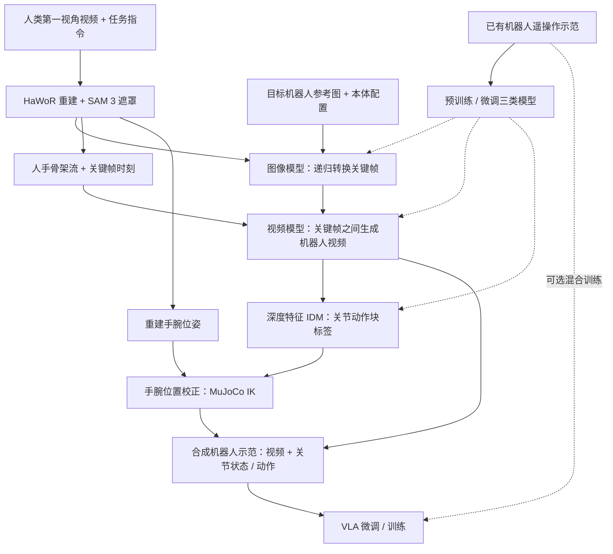
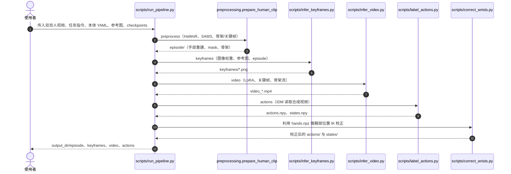

# RoboTryOn：基于虚拟试穿的人类视频到灵巧机器人示范合成（Synthesizing Dexterous Robot Demonstrations from Human Videos via Virtual Try-On）

**原文：** [论文 arXiv:2611.05163v3](https://arxiv.org/html/2611.05163) · [项目主页](https://ryan-seungyong-lee.github.io/RoboTryOn/) · [官方源码](https://github.com/ryan-seungyong-lee/RoboTryOn) · [模型权重](https://huggingface.co/RyanL22/RoboTryOn)  
**作者：** Seungyong Lee、Suhyeok Jang、Minyoung Kim、Jinwoo Shin。**机构：** 韩国科学技术院（KAIST）、瑞沃世界（RLWRLD）、高丽大学（Korea University）。本页复用已有论文身份，不另建重复项目节点。

## 一句话定义

**RoboTryOn 先把人类第一视角操作视频里的手臂替换为目标机器人，再根据合成机器人视频反推关节动作和状态，将无动作标签的人类示范变成可用于模仿学习的机器人示范。** “零任务遥操作”是指目标新任务没有对应机器人示范，**不是**整个系统不需要任何机器人数据。

## 英文缩写速查

| 缩写 | 英文全称 | 简要说明 |
|------|----------|----------|
| IDM | Inverse Dynamics Model | 从合成的视频观测预测机器人关节动作 |
| VLA | Vision-Language-Action | 使用视觉、语言指令与状态预测动作的策略 |
| IK | Inverse Kinematics | 用重建的手腕位置校正机器人手臂关节 |
| LoRA | Low-Rank Adaptation | 官方提供图像和视频模型的低秩适配权重 |
| PnP | Pick-and-Place | 取放任务，论文划分域内与域外任务时的基准之一 |

## 为什么重要

- **缩小视觉差距**：仅遮挡人手（EgoMimic）或把渲染机器人覆盖到人视频（Masquerade），训练与部署看到的视觉域仍不自然；RoboTryOn 生成接近目标机器人真实相机画面的观测，推理时无需给实时相机再加遮挡或覆盖。
- **缩小动作差距**：人手骨架直接重定向无法保证适合机器手的接触与抓握。作者用以机器人遥操作轨迹训练的 IDM 为生成视频打动作标签，只用重建手腕辅助末端位置校正。
- **为新任务扩增数据**：让目标机器人从先前未遥操作过的物体、目标、技能与双手协作视频中学习，而非每换一个任务就重采机器人示范。

## 核心原理

论文 3.1–3.5 节将带任务指令的第一视角人类视频与目标机器人参考图像映射为包含视频观测、关节状态和关节动作的合成机器人轨迹。**三个生成/标注模型均先用机器人遥操作数据训练**，不要求同一动作的人机成对视频。

1. **预处理（HaWoR + SAM 3）**：重建人手，取得左右手 17 点骨架、手臂遮罩和目标物体遮罩；依据双腕运动速度局部低谷、位移与置信度选择关键帧。骨架重定向只用来引导生成，不直接充当最终手部动作。
2. **关键帧转换（图像模型 fθ）**：对遮掉人手的帧做目标机器人修补；第一帧由目标机器人参考图像指定形态，此后的关键帧以前一张机器人关键帧自回归条件生成，保持场景和机器人外观一致。
3. **视频合成（视频模型 gφ）**：把关键帧及整段人手骨架流作为条件，补全两关键帧间运动；长视频按关键帧切段，相邻片段共享边界关键帧。论文视频输出是每视角 1024×576、20 Hz。
4. **动作标签（IDM hψ）**：Depth Anything V2 特征骨干 + flow-matching 动作头，从合成视频两帧及形态标识预测关节动作块；滑窗融合、平滑，并用重建人手腕位置 + MuJoCo IK 校正手臂，保留 IDM 的手指关节动作；用动作与状态的实测延迟关系导出关节状态。
5. **策略训练**：用合成的（视觉观测、状态、动作、语言指令）单独微调 VLA，或与现有遥操作数据混合训练；论文主要用 π₀.₅，另以 RLDX-1-Img 验证跨策略骨干。

## 流程总览

**监督边界**：人视频只提供操作行为及场景，机器人动作由机器人数据训练的 IDM 产生，不能把生成关节动作视为人视频直接测得的真实力矩/接触力。

## 源码运行时序图

下图核对自官方 `run_pipeline.py`、`configs/pipeline.yaml`、README 的端到端 / 分阶段命令；展示**推理合成**，不把生成流程误写成真机闭环运行时序。

**可复现入口**：`python scripts/run_pipeline.py --config configs/pipeline.yaml ...`。官方要求各阶段可使用独立 Python 环境；`stages` 可选择部分阶段重跑。`configs/embodiments/gr1.yaml` 是形态配置示例，**机器人 URDF/MJCF 资产不随仓库发放**。

## 工程实践

| 环节 | 官方实现及检查点 |
|------|----------------|
| 环境 | Python 3.10、CUDA 12.4、PyTorch 2.5（README 推荐）；图像、视频、IDM 依赖版本不同，推荐分环境 |
| 预处理 | 人视频必须尽量与机器人头部相机视角一致；HaWoR 和 SAM 3 单独安装，提供形态配置、手部关键点和相机参数 |
| 生成权重 | Hugging Face `RyanL22/RoboTryOn` 下已有 image（FLUX.2 klein 9B LoRA）、video（LTX-2.5 LoRA）、idm（Depth Anything V2-L） |
| 训练入口 | `scripts/train_image.py`、`scripts/train_video.py`、`scripts/train_idm.py`；机器人数据包括 LeRobot v2.1 的示例读取路径 |
| 生成输出 | `output_dir/episode/`、`keyframes/`、`video/`、`actions/actions.npy` 与 `states.npy`；需要自行接入策略训练和机器人控制器 |
| 质量验收 | 分别核对生成场景与物体连续性、动作回放抓取成功率、关节极限/IK、训练与部署相机视角、留出任务成功率 |

**开源状态（2026-11-22 复核）**：官方仓库有可运行脚本、配置、训练与推理入口；项目页已有代码、模型权重和 Hugging Face Demo 链接。**开放代码/权重不代表一键复现实验全部实机平台或模型训练数据**。

## 实验与评测

论文 `4` 与 Appendix C/F，基于 OpenArm + Inspire RH56F1（7-DoF 臂、6-DoF 手）和 RB-Y1 + WujiHand2（7-DoF 臂、20-DoF 手）；四个域内 PnP 任务有机器人示范，七个域外任务只有人视频。主要实验为每任务 **28 次真机评测**；双手任务每只手计 0.5 分，不能将所有表格项误称为严格的整任务完成比例。

| π₀.₅ 训练数据 | OpenArm 域内 / 域外 | RB-Y1 域内 / 域外 |
|---|---|---|
| 仅遥操作 | 47.3% / 3.1% | 69.6% / 1.0% |
| 遥操作 + EgoMimic | 50.0% / 5.1% | 63.4% / 5.1% |
| 遥操作 + Masquerade | 67.9% / 8.2% | 63.4% / 7.7% |
| 遥操作 + RoboTryOn | **75.9% / 73.0%** | **79.5% / 46.9%** |
| 仅 RoboTryOn 合成示范用于策略训练 | 57.1% / 48.5% | 60.7% / 40.3% |

- **2.1% → 60.0%**：将两个机器人、七个域外任务的「仅遥操作」和「遥操作 + RoboTryOn」平均；**不是**完全没有任何机器人数据就从零学习。
- **动作可执行性**：66 条仿真开环回放中，重定向标签成功率 34.8%，RoboTryOn（含手腕校正）为 69.7%；这是特定仿真任务的动作标签质量指标。
- **视觉域差距**：相对真机视频的 Fréchet SigLIP distance，从原始人视频 125.5 降至 32.7，低值更近；不是任务成功率。
- **数据成本**：按作者统计的操作人员工时，合成的人视频策略以约 1/3 采集工时达到 50 条遥操作演示的任务性能；**未将算力开销计入这一人力成本数字**。
- **消融**：OpenArm 域外 73.0%；去掉手部骨架流降至 21.4%，去掉腕部校正降至 48.0%，去掉后续关键帧降至 39.3%，揭示时间运动条件和准确关节标签的重要性。

## 局限与风险

1. **机器人数据依赖仍在**：每个新形态需要该机器人的一些遥操作视频训练生成模型与 IDM，只是无需为每个新任务都做遥操作。
2. **无力觉标签，细接触有限**：伪动作没有力信息，紧配合插入、复杂触觉反馈及精细抓握无法保证准确；RB-Y1 的 Air Fryer 任务为 0%，论文明确给出细粒度抓握失败实例。
3. **相机与可达性假设**：人视频需对齐机器人头部视角及相机标定；原始评估固定机器人底座与颈部，不能直接外推到移动相机或超出可达空间的动作。
4. **视频生成有幻觉、流水线较重**：物体消失、手穿物体、抓错位置均出现在失败例；论文 Appendix B 的 H100 计时表显示 15 秒演示需要数分钟离线合成，不能当实时动作控制器。
5. **评估边界**：真机策略只覆盖 OpenArm 和 RB-Y1 的桌面操作；GR-1 只做视频合成展示，没有真机策略成功率结论。

## 与其他工作对比

- [动作重定向](../concepts/dexterous-kinematics.md) 把人手姿态映射到机器人关节，RoboTryOn 则先生成目标机器人视觉，再用 IDM 产生关节动作；两者不应混为同一标注机制。
- 与论文报告的 **EgoMimic / Masquerade** 相比，后两者分别依赖测试时遮挡和叠加机器手，RoboTryOn 让策略直接看原始机器人相机画面；表中对比在论文统一数据和骨干下进行。
- 与 [具身数据采集四层分类](../concepts/embodied-data-collection-four-layers-taxonomy.md) 结合，RoboTryOn 归于**人类视频经生成模型转换为带伪动作标签的合成机器人示范**，不等同于真实遥操作数据。

## 结论

**RoboTryOn 的价值是打通“人类无关节标签视频 → 对齐机器人视觉域的示范 → 动作标签 → VLA 训练”，在论文限定的桌面任务中显著拓宽新技能覆盖。**

1. 如果任务缺少机器人遥操作示范但有人类操作视频，可用该方法补任务覆盖，而非声称完全零机器人数据。
2. 优先验收 **画面、骨架、动作标签、手腕 IK、仿真回放** 五处中间结果，不只看视频好不好看。
3. 以 **任务成功率、执行可行性和数据采集工时** 三项联合评估，不把 FSD 特征距离或省工时直接当实机收益。
4. 精细接触、移动相机和新硬件迁移需做专门校验；在已报告的 Air Fryer 等失败情形不应依赖合成数据直接部署。

## 关联页面

- [模仿学习](../methods/imitation-learning.md) / [灵巧运动学](../concepts/dexterous-kinematics.md) / [操作任务](../tasks/manipulation.md)
- [具身数据采集分层](../concepts/embodied-data-collection-four-layers-taxonomy.md)
- [模仿学习纵深路线：Stage 6](../../roadmap/depth-imitation-learning.md) / [具身数据纵深路线：Stage 4](../../roadmap/depth-embodied-data.md)
- [原有 43 篇技术地图](../overview/embodied-station-2026-11-05-43-papers-technology-map.md)

## 参考来源

- [论文原文（HTML v3；正文 + 附录 A–F 通读记录）](../../sources/papers/robotryon_arxiv_2611_05163.md)
- [官方源码与运行入口](../../sources/repos/robotryon.md)
- [官方项目主页与开放状态](../../sources/sites/robotryon.md)
- [2026-11-05 二手线索](../../sources/blogs/wechat_embodied_station_43_papers_grasp_mesa_airoa_2026-11-05.md)

## 推荐继续阅读

- [论文 HTML（版本 v3）](https://arxiv.org/html/2611.05163)
- [官方仓库 README](https://github.com/ryan-seungyong-lee/RoboTryOn)
- [Hugging Face 模型权重](https://huggingface.co/RyanL22/RoboTryOn)
- [项目主页与示范](https://ryan-seungyong-lee.github.io/RoboTryOn/)
