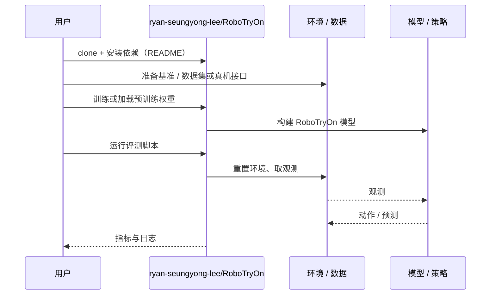

# RoboTryOn（arXiv:2611.05163）

**RoboTryOn**（*RoboTryOn: Synthesizing Dexterous Robot Demonstrations from Human Videos via Virtual Try-On*，[arXiv:2611.05163](https://arxiv.org/abs/2611.05163)，[项目页](https://ryan-seungyong-lee.github.io/RoboTryOn/)，[代码](https://github.com/ryan-seungyong-lee/RoboTryOn)）来自 [具身智能小站 2026-11-05 盘点](../../sources/blogs/wechat_embodied_station_43_papers_grasp_mesa_airoa_2026-11-05.md)，属「灵巧操作与示范学习」组。

## 一句话定义

**保留桌上的物体和动作，把画面中的人手换成目标机器手，再从合成视频反推动作指令。**

## 英文缩写速查

| 缩写 | 英文全称 | 简要说明 |
|------|----------|----------|
| RoboTryOn | RoboTryOn: Synthesizing Dexterous Robot Demonstrations from Human Videos via Virtual Try-On | 本文方法 / 基准的简称 |

## 为什么重要

- 把人手操作视频变成机器人示范。RoboTryOn 用这套流程训练策略，专门测试了缺少该任务真机示范时的双手操作。
- 开源结论：**已开源**（步骤 2.5，2026-11-05）。仓库 ryan-seungyong-lee/RoboTryOn 经 git ls-remote 可达；项目页另有两个 Coming soon 按钮（具体指向未核对，推测为模型 / 数据资源）。
- 同期同组工作见 [接触丰富的手物重定向、分项泛化评测与手持夹爪示范：具身智能小站 11-05 期 43 篇阅读坐标](../overview/embodied-station-2026-11-05-43-papers-technology-map.md)。

## 核心机制

| 项 | 内容 |
|----|------|
| **arXiv** | [2611.05163](https://arxiv.org/abs/2611.05163) |
| **开源** | **已开源** |
| **要点** | 保留桌上的物体和动作，把画面中的人手换成目标机器手，再从合成视频反推动作指令。 |
| **文内指标** | 公众号转述：RoboTryOn 用这套流程训练策略，专门测试了缺少该任务真机示范时的双手操作。 |

## 源码运行时序图

以下为按仓库入口（`ryan-seungyong-lee/RoboTryOn`）推断的通用运行链路；入库日仅核实仓库可达，未逐文件阅读，具体脚本名以 README 为准。

## 实验与评测

- 公众号转述：RoboTryOn 用这套流程训练策略，专门测试了缺少该任务真机示范时的双手操作。
- **读法：** 本页为索引级摘要，依据公众号转述的官方摘要与仓库信息整理；逐项数字与 baseline 以原文 PDF 为准。

## 与其他工作对比

- 横向索引见 [接触丰富的手物重定向、分项泛化评测与手持夹爪示范：具身智能小站 11-05 期 43 篇阅读坐标](../overview/embodied-station-2026-11-05-43-papers-technology-map.md)；同 arXiv 不重复造页。

## 结论

**把人手操作视频变成机器人示范：RoboTryOn 用这套流程训练策略，专门测试了缺少该任务真机示范时的双手操作。**

1. 开源边界：**已开源** — 仓库 ryan-seungyong-lee/RoboTryOn 经 git ls-remote 可达；项目页另有两个 Coming soon 按钮（具体指向未核对，推测为模型 / 数据资源）。
2. 核心机制：保留桌上的物体和动作，把画面中的人手换成目标机器手，再从合成视频反推动作指令。
3. 复现与选型前核对任务协议、硬件与基准口径，勿直接横比公众号摘录数字。

## 关联页面

- [imitation-learning](../methods/imitation-learning.md)
- [dexterous-kinematics](../concepts/dexterous-kinematics.md)
- [manipulation](../tasks/manipulation.md)
- [embodied-data-collection-four-layers-taxonomy](../concepts/embodied-data-collection-four-layers-taxonomy.md)
- [embodied-station-2026-11-05-43-papers-technology-map](../overview/embodied-station-2026-11-05-43-papers-technology-map.md)

## 参考来源

- [robotryon_arxiv_2611_05163.md](../../sources/papers/robotryon_arxiv_2611_05163.md)
- [wechat_embodied_station_43_papers_grasp_mesa_airoa_2026-11-05.md](../../sources/blogs/wechat_embodied_station_43_papers_grasp_mesa_airoa_2026-11-05.md)
- [arXiv:2611.05163](https://arxiv.org/abs/2611.05163)

## 推荐继续阅读

- [arXiv PDF](https://arxiv.org/pdf/2611.05163)
- [项目页](https://ryan-seungyong-lee.github.io/RoboTryOn/)
- [https://github.com/ryan-seungyong-lee/RoboTryOn](https://github.com/ryan-seungyong-lee/RoboTryOn)
