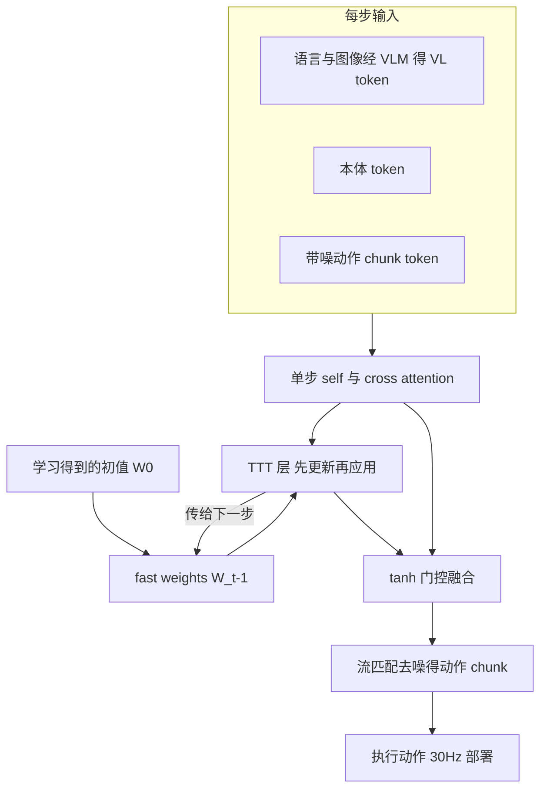

# RoboTTT（Test-Time-Training Robot Policies）

**RoboTTT**（*Context Scaling for Robot Policies*，[arXiv:2607.15275](https://arxiv.org/abs/2607.15275)，[NVIDIA GEAR 项目页](https://research.nvidia.com/labs/gear/robottt/)）把 **Test-Time Training（TTT）** 写进机器人 **Vision-Language-Action（VLA）** 基础模型的时间维：模型内的 TTT 层携带一个小网络，其 **fast weights** 就是递推状态，训练与推理时都由梯度下降逐步更新，把历史压进固定大小的参数而不是堆叠 KV cache。本页依据论文 v1 全文通读（范围见 [来源归档](../../sources/papers/robottt_arxiv_2607_15275.md)）。

## 一句话定义

**在 VLA 的动作头里用「逐步梯度更新的小型 fast-weight 网络」代替短历史窗口，使策略以不随上下文增长的推理成本条件于约 8K 步 visuomotor 历史（论文 §1、§3）。**

## 英文缩写速查

| 缩写 | 英文全称 | 简要说明 |
|------|----------|----------|
| TTT | Test-Time Training | 推理时对模型一小部分参数（fast weights）做自监督梯度更新（§2） |
| VLA | Vision-Language-Action | 视觉-语言-动作统一的机器人策略 |
| DiT | Diffusion Transformer | GR00T N1.7 的动作头骨干，RoboTTT 在其每层后加 TTT 层（§3.1） |
| TBPTT | Truncated Backpropagation Through Time | 分段反传，fast weights 跨段传递、梯度在段边界截断（§3.2） |
| GDN | Gated DeltaNet | 论文用的固定大小循环记忆基线，更新不含测试时梯度下降（§4） |
| DAgger | Dataset Aggregation | 策略出错时由人接管纠正并回收数据的模仿学习方法（§3.3） |
| YAM | YAM 双臂桌面机器人 | 论文全部真机实验的平台，四路 RGB 相机（§4、附录 A.3） |

## 为什么重要

- **新的 scaling 轴（作者主张）：** 预训练上下文从 128 扩到 8K 步，三任务平均完成分一路上升，8K 时 71.5%，比 1K 的 43.9% 高 63%，作者称无饱和迹象，GDN 没有这一趋势（§4，图 8）。这是作者自己的实验结论，仅在三个装配任务和同一骨架上得到。
- **同一配方换来两种上下文能力：** 对选定 timestep 掩掉损失、只更新 fast weights，既可以把人视频当上下文做 one-shot 模仿，也可以把失败 rollout 当上下文做 DAgger Distillation（§3.3）。
- **部署内学习与普通 TTT 微调不同：** 论文明确区分了只是「收集测试任务数据再微调整个模型」的机器人 TTT 工作（Evolve-VLA 等，§5）与本文用 fast weights 的做法。库内 [TTT-Parkour](./paper-notebook-ttt-parkour.md) 属于前一类思路，[WAM-TTT](./paper-wam-ttt-human-video-test-time-steering.md) 的比较见 [对照页](../comparisons/wam-ttt-robottt-stellavla-zero-wam-embodied-icl.md)。

## 核心原理与流程总览

| 模块 | 作用（论文出处） |
|------|------------------|
| TTT 层 | 更新 `W_t ← W_{t-1} − η∇L_FW`，输出 `O_t = f_{W_t}(Q_t)`，L_FW 为均方误差；θ_Q、θ_K、θ_V 与初值 W_0 由外层任务损失学习（§2，式 1-2） |
| 放置位置 | DiT 每层 attention 后加一层；attention 管单步，TTT 管跨时间（§3.1，图 2） |
| register token | N=16 个，携带 VL 信息跨时间，VL token 本身不进 TTT（§3.1） |
| tanh 门控 | `O = tanh(α)·O_TTT + O_attn`，α 初值 0.001，保护预训练能力（§3.1，式 3） |
| sequence action forcing | 每个 action chunk 独立采样流匹配噪声水平，论文称不用则训练不稳定（§3.2，式 5） |
| TBPTT | 段内反传，fast weights 跨段传递，段边界截梯度，W_0 经第一段获得梯度（§3.2，图 4） |
| 损失掩码 | 被掩 timestep 只更新 fast weights，不做动作监督（§3.3） |

两种上下文用法（§3.3）：

| 模式 | 只更新 fast weights（掩损失） | 计算动作损失 | 测试时能力（作者报告） |
|------|------------------------------|--------------|------------------------|
| 人视频模仿 | 人手装配视频 | 同配置机器人轨迹 | Circuit 未见配置 one-shot，6/10 完全成功（表 2） |
| DAgger Distillation | 全部执行动作（含次优机器人动作） | 仅人工纠正 | 无人工在线自纠偏（图 10、11） |

## 工程实践

- **底座与规模：** 基于 GR00T N1.7（Eagle VLM + DiT），16 个 DiT 层各加一个两层 MLP（GeLU）的 TTT 层；DiT 原 538M 参数，每个 TTT 层约 +10M，总计 690M；内层学习率在常数基值 0.1 上学习，RoPE θ=10000（§3.4，附录 A.1）。
- **训练流程：** 预训练混合桌面双臂机器人数据与第一视角人类视频，上下文逐步增长到目标长度，30K 步，16 张 GB200；预训练只调新增序列层，冻结 GR00T N1.7 其余部分；之后各任务统一用 1K 上下文、20K 步全参数后训练（§3.4，附录 A.2）。因此主结果里部署的策略是 8K 预训练、1K 后训练的组合，8K 指预训练上下文。
- **优化器：** AdamW，权重衰减 1e-5；预训练 WSD 学习率调度峰值 2e-5，后训练 cosine 峰值 5e-5；4K 及以下全局 batch 64，更长为 16（附录 A.2）。
- **部署：** YAM 双臂，顶、底、左腕、右腕四个 RealSense D405 的 480p RGB，RTX 5090 工作站 30Hz 推理，每条 rollout 从 W_0 开始逐步更新并传递 fast weights（§3.2，附录 A.3）。论文给出「延迟不随上下文增长」的设计性论证，正文未见逐上下文长度的延迟实测曲线。
- **评测协议：** 方法间复现一致的初始物体摆放；每策略 20 次（Gear Bot 与 Circuit 人视频设定 10 次）；按任务评分表打归一化完成分（附录 B）。
- **代码：** 论文未给出代码仓库，本页 frontmatter 不写 code 字段。

## 评测证据与清单说法的核对

对象：CoRL 2026 Berseth 阅读清单第 016 条（P0，Oral）的一句话摘要「Test-time training scales policy context to 8K timesteps without extra latency, enabling in-context imitation from human video and policy improvement.」（清单自述为 LLM 据摘要起草，排序是作者个人兴趣打分，不是论文质量评价）。

| 清单说法 | 论文核对 |
|----------|----------|
| TTT 把上下文扩到 8K 步 | 属实但需限定：8K 是预训练上下文长度，下游任务后训练统一用 1K（§3.4）；图 8 的 scaling 是预训练上下文变化后再后训练评测的结果 |
| 无额外延迟 | 摘要与 §1 称「without growing inference latency」，依据是 fast weights 固定大小；正文没有分上下文长度的延迟测量，属设计性主张 |
| 从人视频做 in-context 模仿 | 属实，真机，但范围窄：只在 Circuit 一个任务、10 次试验 6/10 成功（完成分 65%），对比只有 GDN（0/10），GR00T N1.7 系列因无法放入视频未对比（表 2）；人视频是机器人静止、人手装配的固定相机录像（§4） |
| 策略改进 | 属实但分两件事：DAgger Distillation 是用 100 条 DAgger 数据微调后的提升（相对 +33%，RoboTTT 为 +36%，图 10），在线自纠偏是训练出的行为（图 11 定性例子）；并非部署时无监督地持续变强 |
| 未提及的部分 | 清单没有提到：主结果平均完成分 79% vs 42%（图 7）、Gear Bot 十阶段仅 RoboTTT 完全成功 2/10（表 1）、结果全部来自 YAM 双臂三个装配任务、论文承认训练成本随上下文增加（§6） |

## 常见误区或局限

**论文自己承认的局限（§6）：** 训练上下文变长使训练成本上升；TTT 层的目标尚未面向机器人设计；RoboTTT 不能处理所有部署失败模式，结合强化学习是后续方向。附录 A 提到更复杂的测试时优化器（如 Muon）留待未来。

**本页读出的、论文未验证之处（作者自述与我的判断分开）：**

- 全部真机结果来自同一平台（YAM）与同一类别任务（装配），测试配置多为 Circuit 的留出组合；论文没有跨平台或跨任务族检验。
- 样本量小：Gear Bot 每方法 10 次，RoboTTT 完全成功 2 次（表 1）；one-shot 实验 10 次；表 2、表 3 没有置信区间或重复种子。
- 图 8 的 scaling 评测早于主结果里的 DAgger 训练（图注），且 8K 仅是预训练长度，后训练为 1K；是否能在更长后训练或部署上下文上继续受益，论文未测。
- 逐任务完成分只能从图 7 柱状图目测（约数，见来源归档），正文只给了平均值和少数点值。
- 基线 GDN 与 Hist. 的优劣被作者用「假说」解释（线性联想更新不足以压缩数千步重复数据、历史帧引入伪相关与时间分布外），这些解释没有单独的因果实验，属作者推测。
- **误区：** 把 RoboTTT 当成测试时整模型微调；其实更新的是层内 fast weights，慢权重在推理时冻结（§2）。
- **误区：** 认为 8K 上下文是存 8K 帧图像；实际是压缩进固定大小权重，由自监督目标与元学习的 W_0 决定保留什么。
- **未核实：** 旧版本写的「截至入库日无公开代码」，论文本身未说明代码是否发布，本页不作判断。

## 与其他工作对比

| 路线 | 记忆载体 | 测试时更新 | 与 RoboTTT 关系 |
|------|----------|------------|-----------------|
| RoboTTT | 层内 fast weights（固定大小） | 每步自监督梯度更新 | 本页方法 |
| [TTT-Parkour](./paper-notebook-ttt-parkour.md) | 已训练策略权重 | 仿真里短时离线微调 | 同名不同物，非 fast weights 路线 |
| [WAM-TTT](./paper-wam-ttt-human-video-test-time-steering.md) | 冻结 WAM 上的 fast-weight 记忆 | 人视频批次 TTT | 另一种人视频条件化 |
| [StellaVLA](./paper-stellavla-structured-icl-vla.md) | 结构化 ICL 上下文 | 无 | 同类能力，论文未做同基准对比 |
| GDN | 固定大小循环状态 | 无测试时梯度 | 论文的主要对照基线（图 7、图 8） |
| 自回归整段历史模型（KV cache） | 变长 KV | 无 | 论文称解码延迟随上下文线性增长，故实时部署受限（§5） |

## 源码运行时序图

**不适用（2026-11-12 核查）：** [NVIDIA GEAR 官方项目页](https://research.nvidia.com/labs/gear/robottt/)与论文尚未提供可核实的 RoboTTT 原版训练/推理代码入口，不能用对 GR00T 的推测性调用链冒充官方源码时序图；上方 Mermaid 是论文机制图，不是实现图。

## 结论

**RoboTTT 的主要贡献是将长时历史写入逐步更新的快权重，让机器人在后续动作预测时真正利用过去的信息，而不是不断扩展 KV 缓存。**

1. **训练与推理分清：** 8K 步是长上下文预训练配置；主任务后训练使用 1K 步，不要把 8K 当成每个真机 rollout 的固定窗口。
2. **指标分清：** 三任务平均 **79%** 是归一化完成度，不等同于完整成功率；Gear Bot 完整完成 **2/10**，比较方法 **0/10**（论文图表和表 1）。
3. **示范记忆：** 陌生电路配置一次人视频观察后的成功 **6/10** 对比 GDN **0/10**，仅证明该受测装配协议上的记忆利用能力。
4. **计算与部署：** fast weights 的大小与历史长度无关是设计结构；实测在线延迟/长时间稳定性仍需要在目标平台另行 benchmark。
5. **复现边界：** 官方代码未公开时，只能根据论文给出算法层时序，不应宣称已完成源码复现。

## 关联页面

- [VLA（Vision-Language-Action）](../methods/vla.md) 论文所扩展的基础模型抽象
- [GR00T N1](./paper-hrl-stack-34-gr00t_n1.md) 与 [Isaac GR00T](./isaac-gr00t.md) 论文的底座模型线
- [Action Chunking](../methods/action-chunking.md) 动作头按 chunk 预测的背景
- [流匹配具身策略](../concepts/flow-matching-embodied-policy.md) 动作头的训练目标背景
- [DAgger](../methods/dagger.md) DAgger Distillation 所对照的标准做法
- [模仿学习](../methods/imitation-learning.md) 人视频与纠正数据所处的学习范式
- [机器人上下文学习](../concepts/robot-in-context-learning.md) 同类 in-context 能力的概念页
- [TTT-Parkour](./paper-notebook-ttt-parkour.md) 同名缩写的另一条路线
- [WAM-TTT](./paper-wam-ttt-human-video-test-time-steering.md) 与 [StellaVLA](./paper-stellavla-structured-icl-vla.md) 及 [横向对照页](../comparisons/wam-ttt-robottt-stellavla-zero-wam-embodied-icl.md)
- [Manipulation](../tasks/manipulation.md) 与 [Bimanual Manipulation](../tasks/bimanual-manipulation.md) 任务语境

## 参考来源

- [RoboTTT 论文全文通读归档](../../sources/papers/robottt_arxiv_2607_15275.md)
- [RoboTTT 论文摘录（NVIDIA GEAR，项目页与策展）](../../sources/papers/robottt_nvidia_gear.md)
- [NVIDIA Research RoboTTT 项目页归档](../../sources/sites/nvidia-research-robottt.md)
- [每日智能四篇 ICL 纵横向解读（2026-08-31）](../../sources/blogs/wechat_meiri_zhineng_embodied_icl_four_papers_2026-08-31.md)

## 推荐继续阅读

- 论文 PDF：<https://arxiv.org/pdf/2607.15275v1>
- 官方项目页与视频：<https://research.nvidia.com/labs/gear/robottt/>
- GR00T N1 原文：<https://arxiv.org/abs/2503.14734>
- Algorithm Distillation：<https://arxiv.org/abs/2210.14215>
- Gated DeltaNet 基线：<https://arxiv.org/abs/2412.06464>
