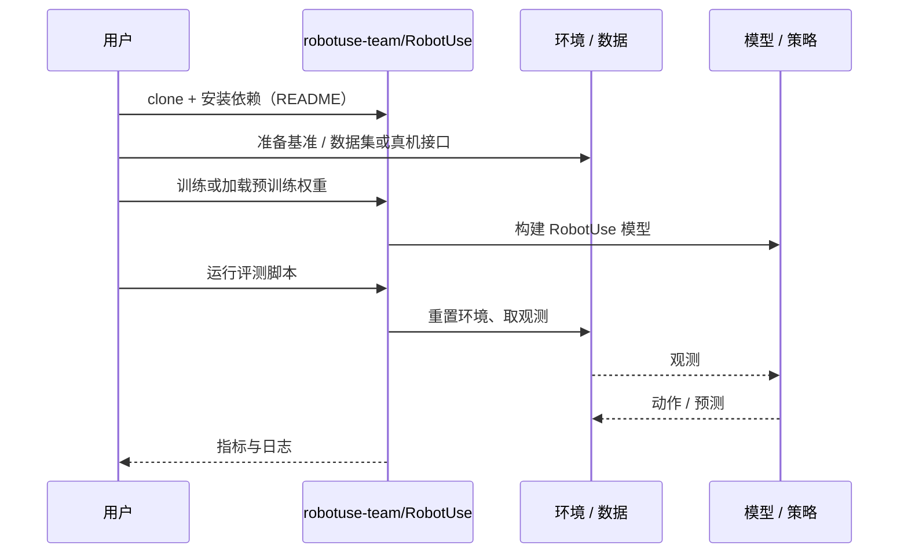

# RobotUse（arXiv:2610.04929）

**RobotUse**（*RobotUse: Allocating Computation, Context, and Decisions*，[arXiv:2610.04929](https://arxiv.org/abs/2610.04929)，[项目页](https://robotuse-team.github.io/)，[代码](https://github.com/robotuse-team/RobotUse)）来自 [具身智能小站 2026-10-13 盘点](../../sources/blogs/wechat_embodied_station_34_papers_mulligan_2026-10-13.md)，属「策略与后训练」组。

## 一句话定义

**智能体视觉选择目标与位姿，后端完成几何规划与控制；子目标上下文与持续更新的操作手册支持反复修正。**

## 英文缩写速查

| 缩写 | 英文全称 | 简要说明 |
|------|----------|----------|
| VLM | Vision-Language Model | 视觉语言模型 |
| Agent | LLM Agent | 语言模型智能体 |
| IK | Inverse Kinematics | 逆运动学 |

## 为什么重要

- 把物理决策留给智能体、执行交给后端，才能复用经验。
- 开源结论：**已开源**（步骤 2.5，2026-10-14）。仓库可达。
- 同期同组工作见 [失败导向采集与可组合世界动作模型：具身智能小站 10-13 期 34 篇阅读坐标](../overview/embodied-station-2026-10-13-34-papers-technology-map.md)。

## 核心机制

| 项 | 内容 |
|----|------|
| **arXiv** | [2610.04929](https://arxiv.org/abs/2610.04929) |
| **开源** | **已开源** |
| **要点** | 评测包含真机经验迁移。 |
| **文内指标** | 以原文为准。 |

## 源码运行时序图

以下为按仓库入口（`robotuse-team/RobotUse`）推断的通用运行链路；入库日仅核实仓库可达，未逐文件阅读，具体脚本名以 README 为准。

## 实验与评测

- 以原文为准。
- **读法：** 本页为索引级摘要，依据公众号转述的官方摘要与仓库信息整理；逐项数字与 baseline 以原文 PDF 为准。

## 与其他工作对比

- 横向索引见 [失败导向采集与可组合世界动作模型：具身智能小站 10-13 期 34 篇阅读坐标](../overview/embodied-station-2026-10-13-34-papers-technology-map.md)；同 arXiv 不重复造页。

## 结论

**agent 式操作系统的核心是分工边界与可更新的手册。**

1. 开源边界：**已开源** — 仓库可达。
2. 核心机制：评测包含真机经验迁移。
3. 复现与选型前核对任务协议、硬件与基准口径，勿直接横比公众号摘录数字。

## 关联页面

- [llm-robotics-control-interfaces](../concepts/llm-robotics-control-interfaces.md)
- [manipulation](../tasks/manipulation.md)
- [paper-hardware-aware-llm-vlm-zero-shot-task-planning](./paper-hardware-aware-llm-vlm-zero-shot-task-planning.md)
- [embodied-station-2026-10-13-34-papers-technology-map](../overview/embodied-station-2026-10-13-34-papers-technology-map.md)

## 参考来源

- [robotuse_allocating_computation_context_decisions_arxiv_2610_04929.md](../../sources/papers/robotuse_allocating_computation_context_decisions_arxiv_2610_04929.md)
- [wechat_embodied_station_34_papers_mulligan_2026-10-13.md](../../sources/blogs/wechat_embodied_station_34_papers_mulligan_2026-10-13.md)
- [arXiv:2610.04929](https://arxiv.org/abs/2610.04929)

## 推荐继续阅读

- [arXiv PDF](https://arxiv.org/pdf/2610.04929)
- [项目页](https://robotuse-team.github.io/)
- [https://github.com/robotuse-team/RobotUse](https://github.com/robotuse-team/RobotUse)
