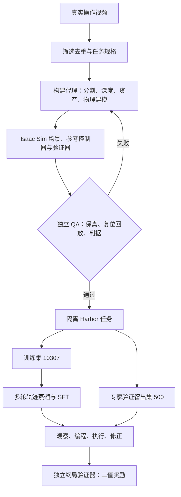
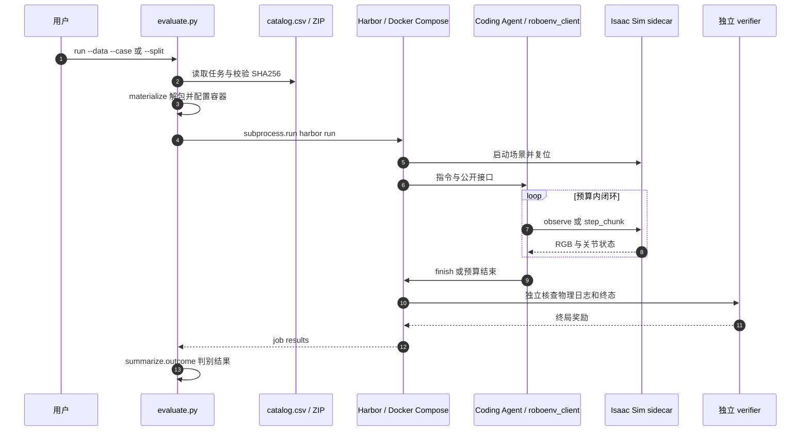

# RoboUniverse-10K（通过真实到仿真环境迈向智能体机器人的规模化时代）

**RoboUniverse-10K: Toward the Scaling Era of Agentic Robotics via Real-to-Sim Environments**（arXiv:2611.31002v1，2026）。[PDF](https://arxiv.org/pdf/2611.31002) · [HTML](https://arxiv.org/html/2611.31002v1) · [项目页](https://lab.einsia.ai/robo-universe/) · [代码](https://github.com/Einsia/RoboUniverse-10K)。

## 一句话定义

用真实机器人操作视频生成独立可执行的物理任务及验证器，使编程智能体能通过观察、写代码、执行和修正开展大规模后训练与留出任务评测。

## 英文缩写速查

| 缩写 | 英文全称 | 简要说明 |
|---|---|---|
| QA | Quality Assurance | 独立质量验收 |
| SFT | Supervised Fine-Tuning | 多轮工具轨迹监督微调 |
| RL | Reinforcement Learning | 可验证奖励的后续训练方向 |
| IK | Inverse Kinematics | 末端目标到关节目标的求解 |
| RGB | Red Green Blue | 彩色相机观察 |

## 为什么重要

- 扩展对象是可执行、可复位的环境，而非只增加静态动作轨迹。
- 通过训练与未见任务分离检测泛化，并用物理证据验证结果，不以代理自报完成为准。
- Agent 写控制程序而非直接输出端到端动作；感知、运动学与接触闭环仍是瓶颈。

## 核心信息

| 项目 | 论文口径 |
|---|---|
| 机构 | 清华大学、Einsia.AI、北京大学、伊利诺伊大学厄巴纳-香槟分校、香港大学、伦敦大学学院、北卡罗来纳大学教堂山分校 |
| 环境 | 10,807 个 Isaac Sim 环境；10,307 训练，500 留出 |
| 本体 | 单臂 Franka 4,132；双臂 AgileX 6,675 |
| 单臂任务 | 抓放 1,375；装配与关节操作 1,801；柔性与材料 877；复合 79 |
| 双臂任务 | 协同搬运交接 3,460；装配稳定 1,409；柔性转移 500；分阶段协作 1,306 |
| 代表数据源 | DROID、BridgeData V2、RoboDesk、RoboCOIN、GM100 等 |
| 留出集 | RoboUniverse-Verified：200 单臂、300 双臂；10 位专家人工核查 |

## 核心原理

真实视频筛选、去重并转写任务规格；构建 agent 用 SAM 3.1、DA3 深度、资产库和物理建模技能重建场景，编写参考控制程序与 verifier。QA 独立检查语义与场景保真、reset/replay、一致的成功与失败判据，并返工修复。合格任务封装成 Harbor 环境。

公开接口仅允许读取图像和机器人状态并发送关节目标，仿真在模型思考时暂停。评测每个 episode 只有一次尝试；finish 或预算耗尽后独立 verifier 检查日志及终态，输出 0/1。参考 Franka 控制 20 Hz、AgileX 15 Hz，物理均 240 Hz（附录 §7.1）；无内置 IK 服务，代理自行实现运动学。验证器检查实际交互、目标终态、释放后静止及物理有效性，防止瞬时成功或穿透造成误判。

## 项目流程图

## 源码运行时序图

基于官方 README 与 evaluate.py 的静态阅读；仿真与 agent 内部接口按论文 §2.1，未执行 GPU 复现。

## 评测与结果

| 指标 | 论文结果 |
|---|---|
| 最佳被测闭源模型 | 85.8%（GPT-6.2 Astra） |
| Claude Opus 5.5 | 76.8% |
| 四个开源基线范围 | 2.6%–10.0% |
| SFT 数据 | 约 17K 多轮轨迹、0.79B tokens；GPT-6 Astra Medium |
| 总体成功率 | Qwen3.6-35B-A3B 0.8% → RoboUniverse-35B-A3B 21.2% |
| 单臂 / 双臂 | 2.0%→40.5% / 0→8.3% |

Table 2 与 3 的口径为 500 个留出任务。弱模型在需要抓取时尤其困难；前沿模型约八成失败发生于接触之后，柔性布料仍难解决。盖子任务中 6 mm 偏心、5.6° 倾角超过 2 mm/4° 阈值，说明视觉近似完成不等于物理达标。SFT 学到建模、修正、验证程序，双臂仍受空间感知与协调限制。

## 结论

该工作的主要贡献是规模化构建可验证交互环境并展示编程智能体的监督后训练收益。

- 将环境构建和独立验收分工，避免构建器同时自评。
- 明确训练和留出任务边界，固定数据 revision 与预算。
- 抓取、接触力与终态精度需要单独诊断，不能只看高层任务理解。
- 以单臂与双臂分项观察 SFT 收益，避免总体指标掩盖双臂瓶颈。
- 外部 LIBERO-MAX、RoboCasa、RoboTwin 2.0 及真实 Franka 绘图为迁移案例，不是普遍部署成功率证明。

## 工程实践

先按官方 README 安装 Python 3.12、Harbor、Docker 与 Isaac Sim 镜像，准备数据包和模型服务；用 `python evaluate.py list --data "$DATA" --split heldout500` 检查任务选择，再选择单任务运行。评测异常与任务失败应分开计数；不要把 oracle 参考解成绩当作代理成绩。

## 局限与风险

- 论文 §6 明确复杂关节物体的闩锁、摩擦及接触动力学难从视频恢复，场景仍简化。
- 当前主要为短原子操作，长程任务覆盖有限。RL-ready 不等于已经证明在线 RL 收益。
- 已发布评测源码、环境数据及模型入口；完整自动生成和训练流水线尚未核实公开。
- PDF 已获取，正文及接口与 QA 附录重点已核对，但 §9 完整提示词未逐页核查；保留草稿，不宣称原文通读或满分。

## 关联页面

- [Agentic Real2Sim](./paper-agentic-real2sim.md) — 物理环境构造方法对照
- [RoboWild](./paper-robowild.md) — 复杂场景机器人代理评测对照
- [仿真评测基础设施](../concepts/simulation-evaluation-infrastructure.md)
- [Real2Sim 纵深路线](../../roadmap/depth-real2sim.md)

## 参考来源

- [论文原文归档](../../sources/papers/robouniverse_10k_arxiv_2611_31002.md)
- [项目页核查](../../sources/sites/robouniverse-10k.md)
- [评测源码归档](../../sources/repos/robouniverse-10k.md)

## 推荐继续阅读

- [原文 HTML](https://arxiv.org/html/2611.31002v1)
- [官方评测实现](https://github.com/Einsia/RoboUniverse-10K)
- [环境数据](https://huggingface.co/datasets/Einsia/RoboUniverse-10K)
