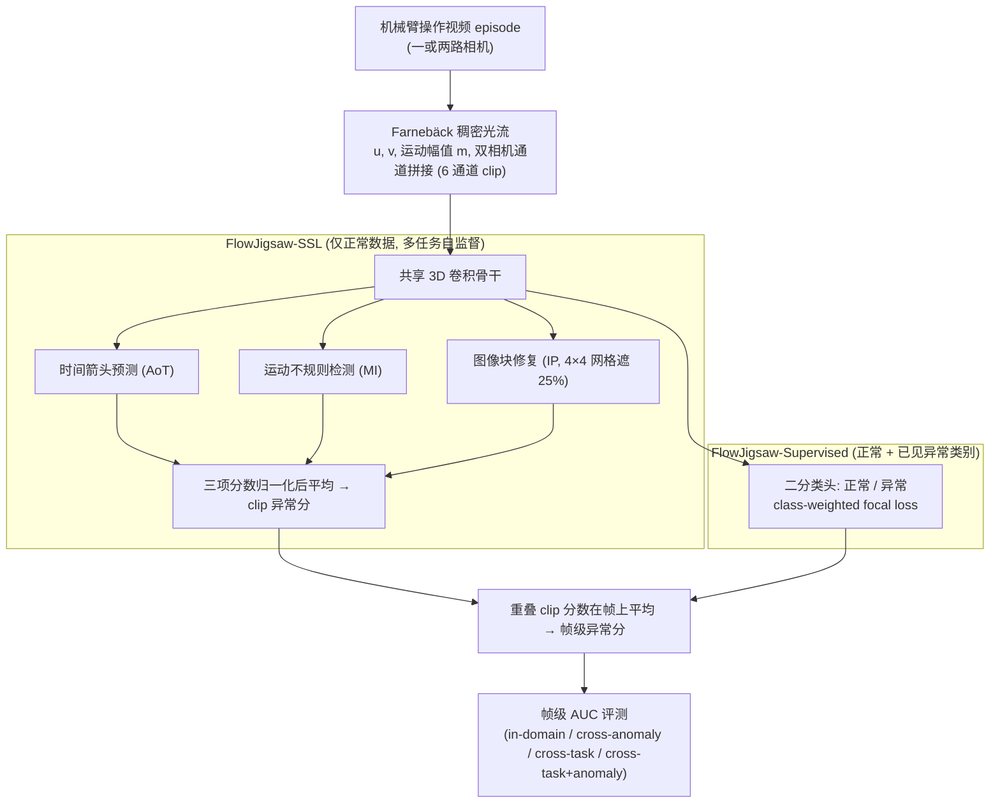

# RoboVAD（arXiv:2609.17843）

**RoboVAD**（*RoboVAD: A Large Cross-Domain Evaluation Benchmark for Anomaly Detection in Robotic Arm Manipulation Videos*，[arXiv:2609.17843](https://arxiv.org/abs/2609.17843)，[项目页](https://zenodo.org/records/22754659)）来自 [具身智能小站 11 篇盘点](../../sources/blogs/wechat_embodied_station_11_papers_constraint_control_2026-09-20.md)（2026-09-20）。

## 一句话定义

**1,078 episode、5 类任务、5 类异常、2 视角；跨域未见任务为测试重点；最难设置下所有方法帧级 micro-AUC 均低于 70%。**

## 英文缩写速查

| 缩写 | 英文全称 | 简要说明 |
|------|----------|----------|
| VAD | Video Anomaly Detection | 视频异常检测 |
| AUC | Area Under Curve | ROC 曲线下面积 |
| OOD | Out-of-Distribution | 分布外/未见任务域 |
| AD | Anomaly Detection | 异常检测 |

## 为什么重要

- 机械臂异常检测常被单一任务/视角限制；跨域泛化缺口需要统一基准暴露。
- 开源结论：**部分开源**（步骤 2.5，2026-09-20）。
- 与 [11 篇技术地图](../overview/constraint-control-11-papers-technology-map.md) 中同类工作可横向对照。

## 流程总览

图依据：论文 §IV（作者提出的 FlowJigsaw-SSL / FlowJigsaw-Supervised，式 1–4）；本页主体为基准，图仅覆盖论文自述的检测方法

## 核心机制

| 项 | 内容 |
|----|------|
| **arXiv** | [2609.17843](https://arxiv.org/abs/2609.17843) |
| **开源** | **部分开源** |
| **要点** | 大规模跨域机械臂操作视频；正常/异常 episode 标注；强调未见任务域迁移评测。 |
| **文内指标** | 1,078 episodes；5 tasks × 5 anomaly types × 2 cameras；最难 split 全部方法 micro-AUC < 70%。 |

## 源码运行时序图

**不适用**（截至 2026-09-20 未发布可运行官方代码或待核实）。

## 实验与评测

- 1,078 episodes；5 tasks × 5 anomaly types × 2 cameras；最难 split 全部方法 micro-AUC < 70%。
- **读法：** 索引级摘要；逐项对照与 baseline 以原文 PDF 为准。

## 与其他工作对比

- 横向索引见 [11 篇技术地图](../overview/constraint-control-11-papers-technology-map.md)；与同 arXiv 节点不重复造页。

## 结论

**RoboVAD 表明机械臂视频异常检测在跨域设置下仍远未解决；适合作为方法选型与泛化下限对照。**

1. 开源边界：**部分开源** — 以项目页实际链接为准（入库日 2026-09-20）。
2. 核心机制：大规模跨域机械臂操作视频；正常/异常 episode 标注；强调未见任务域迁移评测。…
3. 部署前核对任务协议与硬件条件，勿直接横比公众号摘录数字。

## 关联页面

- [manipulation](../tasks/manipulation.md)
- [imitation-learning](../methods/imitation-learning.md)
- [paper-pointzero](./paper-pointzero.md)
- [safety-filter](../concepts/safety-filter.md)
- [embodied-eval-benchmark-selection-loop](../queries/embodied-eval-benchmark-selection-loop.md) — 跨域未见任务 split 上所有方法帧级 micro-AUC < 70%，是该闭环第 ③ 层「均值成功率的陷阱」与第 ④ 层「评测结论能否外推」的异常检测侧对照
- [robot-perception-stack-selection-loop](../queries/robot-perception-stack-selection-loop.md) — 2 视角 RGB 视频帧级判异，属该闭环第 ② 层「2D 检测/分割选型」的评测入口：跨域掉点说明域内高分不等于换任务/换视角仍可用

## 参考来源

- [robovad_arxiv_2609_17843.md](../../sources/papers/robovad_arxiv_2609_17843.md)
- [wechat_embodied_station_11_papers_constraint_control_2026-09-20.md](../../sources/blogs/wechat_embodied_station_11_papers_constraint_control_2026-09-20.md)
- [arXiv:2609.17843](https://arxiv.org/abs/2609.17843)
- [arXiv PDF](https://arxiv.org/pdf/2609.17843)：已通读方法部分（实验与附录以略读为准）：§I 引言、§IV 方法（FlowJigsaw 两个变体）、§V-A 实现细节

## 推荐继续阅读

- [arXiv PDF](https://arxiv.org/pdf/2609.17843)
- [项目页](https://zenodo.org/records/22754659)

