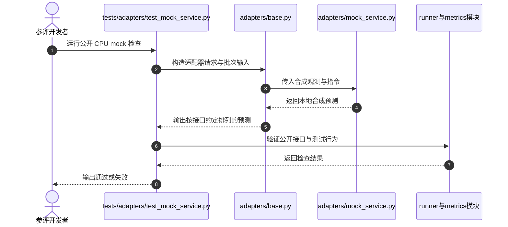

# RoboValue：细粒度仿真-真实机器人价值模型基准

**RoboValue**（*A Fine-Grained Sim-and-Real Benchmark for Unified Evaluation of Robotic Value Models*，[arXiv:2610.26663](https://arxiv.org/abs/2610.26663)，[项目页](https://robovalue-benchmark.github.io/)，[代码](https://github.com/RoboValue-Benchmark/RoboValue)）由**清华大学、智元机器人、Xspark AI、中山大学、北京大学和香港大学**团队提出，用统一协议检查机器人价值模型对执行过程的判断是否忠实于任务指令和轨迹历史。

## 一句话定义

**RoboValue 是一个同时覆盖仿真与真实操作任务、按四类执行理解能力诊断机器人价值模型的公开评测基准。**

## 英文缩写速查

| 缩写 | 英文全称 | 简要说明 |
|------|----------|----------|
| RoboValue | Robotic Value Model Benchmark | 本文基准与项目名 |
| ID / OOD | In-Domain / Out-of-Domain | 标准域内与跨本体、跨环境分布变化 |
| SA | Success Assessment | 检查模型能否区分任务完成与未完成 |
| VOC | Value-Order Correlation | 检查预测价值与轨迹进度排序的一致性 |
| FPL | Failure Progress Localization | 评估价值模型定位失败进度的能力 |

## 为什么重要

价值模型可用来给长时程操作提供稠密奖励、筛选训练样本、排序候选动作或监控运行状态。如果只看任务成功率或整体进度相关性，模型可能仍然把错误指令当作完成、把重复出现的画面误判成相同进度，或奖励无效恢复。RoboValue 把这些误差拆成可单独诊断的评测维度，为选择监督数据和评估反馈风险提供了更具体的依据。

## 核心原理

RoboValue 统一不同模型的输入输出接口，并以诊断性轨迹构造测试问题，评估四类能力：

1. **任务状态理解：** 是否按指定物体、动作和约束判断状态完成，而非只识别大致任务类别。
2. **时序进度监控：** 价值随执行推进或回退的变化是否合理，且在相似视觉状态反复出现时能否利用历史。
3. **失败与恢复推理：** 是否能定位何时开始失败、区分纠正动作与纠正成功。
4. **价值一致性：** 同一语义子任务在不同有效执行顺序中，能否获得相近的价值增量。

基准数据包含 15 项仿真与 20 项真实双臂操作任务。训练集含 3,500 条专家示范；保留测试集有 2,792 条轨迹，覆盖标准设置、跨本体与跨环境条件。项目公开训练数据并提供统一接口；组织方保留测试轨迹，评测以参评模型服务和适配器形式接入。

## 源码运行时序图

官方仓库公开了适配器基类、mock service、推理和 runner 模块。以下时序图概括 README 中的公开 CPU mock 接口检查；完整排行榜评测由组织方提供保留测试数据并调用参评服务。

公开检查不等于一次官方排行榜评测：测试集由组织方保留，参评方提交适配器、依赖、服务规格和模型版本，再由组织方运行指标。

## 工程实践

| 项 | 说明 |
|----|------|
| 评测轨道 | Zero-Shot 与 One-Shot 有论文结果；Full-Shot 允许在完整训练拆分上训练或微调，报告中尚无 Full-Shot 结果 |
| 模型接口 | 按模型支持情况实现 `value`、`compare` 和/或 `subtask`，声明输入预处理与分数方向 |
| 本地验证 | Python 3.10+ 可运行 README 提供的 CPU mock 测试；它检查合成接口，不需要 GPU |
| 正式评测 | 将适配器、配置、服务说明和版本信息交给维护团队；官方准备查询并使用保留测试集计算分数 |
| 数据访问 | Hugging Face 发布训练子集；测试轨迹不公开下载 |

## 实验与评测

论文将分数按域内与可用的域外设置汇总，分别发布 Zero-Shot 和 One-Shot 排行榜。Zero-Shot 总榜由 RoboMeter-4B 领先（60.05）；One-Shot 总榜由 Robo-Dopamine 2.0-8B Preview 领先（58.33）。能力分项揭示排名之外的差异：RynnValue-4B 的任务状态理解更强，Robo-Dopamine 2.0-8B Preview 在其余三项领先。即使头部模型，失败恢复推理和价值一致性仍有不足。环境变化导致较广泛的性能下降；本体变化下模型通常更能保持域内优势。

### 评测指标如何读

排行榜不是单一统一模型分数的替代品，而是把能力结构并列呈现。任务状态指标检查结果与指令是否一致，时间指标检查进度曲线和历史记忆，失败恢复指标观察问题定位和修复结果，价值一致性则比较不同有效解法。对将价值直接用于策略学习的场景，应优先查看失败轨迹、反事实指令、回退段和跨环境结果，不能只看完成判断或正向进度排序。

## 与其他工作对比

- [TOPReward](./paper-topreward.md) 用视频 VLM token 似然作零样本进度信号；RoboValue 提供更细粒度的跨模型评测协议，能暴露总体进度相关性掩盖的指令、历史和恢复问题。
- [RoboReward](./paper-roboreward.md) 聚焦从视觉轨迹学习过程奖励；RoboValue 的重点是统一测试不同价值模型的能力与可靠性。
- [PRM-as-a-Judge](./paper-prm-as-a-judge.md) 将冻结过程奖励模型用于评估 VLA/WAM 过程；RoboValue 本身则围绕 manipulation value feedback 组织数据、指标与排行榜。
- [过程奖励建模](../concepts/progress-reward-modeling.md) 提供更广的过程信号构造和选型框架。

## 结论

**RoboValue 的核心价值是把“任务成功/总体进度”拆成可诊断的执行理解能力；排行榜高分不能替代对失败恢复、历史记忆和价值一致性的逐项检查。**

1. **先看分项再看总榜：** 总榜平均了四种不同能力，部署场景要按策略更新或监控目标选择关注指标。
2. **测历史与反事实：** 对重复视觉状态、逆向播放和改写指令加入专项验证，避免只测标准完成轨迹。
3. **把域外拆开：** 单独查看跨本体与跨环境表现，论文显示环境变化的影响更广。
4. **区分已报告轨道：** 当前论文给出 Zero-Shot 和 One-Shot 结果；Full-Shot 暂无排行榜结果。
5. **注意正式评测边界：** 代码和训练子集公开，但保留测试集由维护方运行，公开 mock 测试并非官方模型分数。

## 局限与风险

- 评测覆盖双臂操作任务；结果不能直接外推到移动操作、腿足运动或任意机器人控制任务。
- 测试集由维护方保留，外部团队难以独立复算排行榜分数，正式比较依赖协议版本与维护方运行流程。
- 分项指标揭示特定失败模式，但不能单独证明把模型部署进 RL 或在线控制后一定带来更高任务成功率。
- 价值模型的接口仍需对齐不同输出语义；比较时应保留模型自身分数方向和支持操作，不能把不支持的指标随意记作零分。

## 关联页面

- [过程奖励建模](../concepts/progress-reward-modeling.md) — 过程信号构造与评测维度
- [TOPReward](./paper-topreward.md) — 冻结视频 VLM 的进度估值实例
- [RoboReward](./paper-roboreward.md) — 视觉过程奖励学习
- [PRM-as-a-Judge](./paper-prm-as-a-judge.md) — 冻结 PRM 的过程评测
- [机器人操作](../tasks/manipulation.md) — 操作任务与机器人案例
- [具身大模型评测基准选型闭环](../queries/embodied-eval-benchmark-selection-loop.md) — 评测基准在选型闭环中的定位与取舍

## 参考来源

- [arXiv 论文归档](../../sources/papers/robo_value_benchmark_arxiv_2610_26663.md)
- [项目主页归档](../../sources/sites/robovalue-benchmark.md)
- [官方代码归档](../../sources/repos/robovalue-benchmark-robovalue.md)

## 推荐继续阅读

- [RoboValue 技术报告](https://arxiv.org/abs/2610.26663) — 数据、协议与实验
- [RoboValue 项目主页](https://robovalue-benchmark.github.io/) — 文档、leaderboard 与提交说明
- [官方代码仓库](https://github.com/RoboValue-Benchmark/RoboValue) — 接口、指标实现和 CPU mock 检查
- [Hugging Face 训练数据](https://huggingface.co/datasets/wzlllong/value-model-benchmark-training-data) — 公开数据入口
