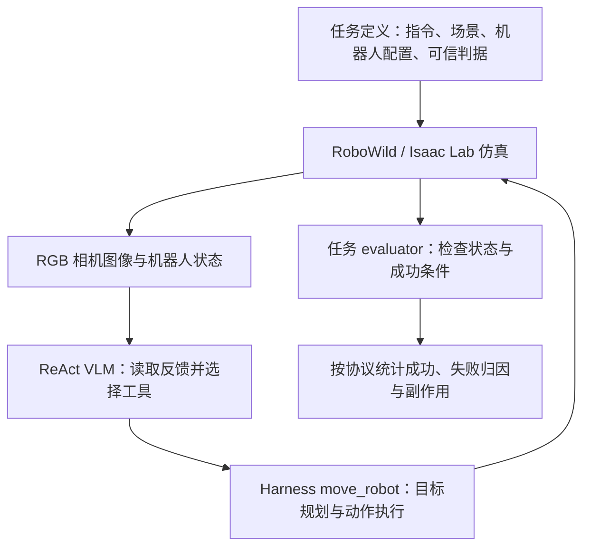
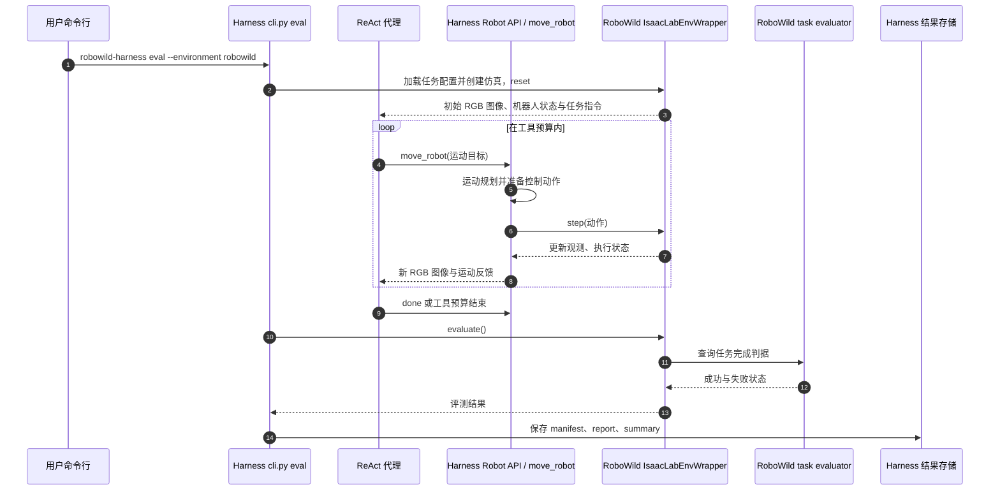

# RoboWild（前沿视觉语言模型在复杂真实感机器人场景中的操作基准）

**RoboWild: Can Frontier Models Generalize to Robot Use in the Wild?**（XLANG Lab，2026；[官网](https://robowild.xlang.ai/) / [论文 PDF](https://huggingface.co/datasets/xlangai/RoboWild/blob/main/RoboWild.pdf) / [官方代码](https://github.com/xlang-ai/RoboWild) / [资产数据集](https://huggingface.co/datasets/xlangai/RoboWild)）面向 Robot-Use Agent（RUA）的长程操作评测。**这里的 wild 是多物体、杂乱、功能交互丰富的仿真，不是真实家庭执行。** 目前已核对官网、README、评测文档和关键源码；论文 PDF 暂无法读取，节点按 draft 维护。

## 一句话定义

**RoboWild 将前沿视觉语言模型放进布置完整、物理交互复杂的 Isaac Lab 仿真环境，通过统一 Robot API 评价它能否真正执行多步操作任务，而不是只回答“该怎么做”。**

## 英文缩写速查

| 缩写 | 英文全称 | 简要说明 |
|------|----------|----------|
| RUA | Robot-Use Agent | 使用工具接口操控机器人完成任务的智能体 |
| VLM | Vision-Language Model | 官网被测的前沿视觉语言模型 |
| ReAct | Reasoning and Acting | 观察—工具调用—观察的默认代理循环 |
| RGB | Red Green Blue | 默认评测提供的彩色视觉图像 |
| API | Application Programming Interface | Harness 暴露的机器人动作与观察接口 |
| IK | Inverse Kinematics | 末端目标到关节控制量的运动学求解 |

## 为什么重要

1. **接近实际家庭/车间操作的难度来源：** 家具、抽屉、旋钮、软体/粒子物件和大量非目标障碍，使“理解指令”与“能安全完成”不再是同一件事。
2. **有更明确的失败归因：** 官网统计的抓取、运动、功能物件操作以及目标选择失败，可以帮助把问题定位到接触执行、控制接口或高层认知。
3. **不应混淆评测对象：** 该工作评估的是 VLM + ReAct + 工具/规划器/模拟器组成的整体 robot-use 系统，并非直接证明一个端到端 VLA checkpoint 的手部控制能力。

## 核心信息与任务组成

| 维度 | 官方可核对口径 |
|------|---------------|
| 机构 | XLANG Lab |
| 场景 | 38 个布置完整的仿真空间，涵盖家庭、工作间、实验室等 |
| 交互物体 | 4,480 件；含关节机构、可变形体、粒子集与超过 60 种交互行为 |
| 总量 | 341 个任务–本体组合，而不是 341 个互不重复的任务文本 |
| 任务拆分 | Dexmate Vega-1 的 239 个设置 + 34 个共享设置分别在另 3 种本体复用（102 个组合） |
| 机器人 | Dexmate Vega-1、Mobile ALOHA、Franka Mobile、Unitree G1 + Dex3 |
| 仿真与接口 | Isaac Sim / Isaac Lab；RoboWild-Harness + Robot API + cuRobo |
| 默认可见信息 | RGB 图像、相机标定及机器人状态；默认不开放深度帧 |
| 默认执行协议 | ReAct、`react_move`、`independent`（模型推理时暂停仿真） |

## 核心原理与项目流程

- **环境层：** 每项任务有 `config.yaml`（指令、场景、本体设置）和可信 `evaluator.py`；仿真场景包含有状态物件、接触/力学机制。
- **代理层：** VLM 接收图像和状态，调用 Harness 所选 Robot API。默认 `react_move` 把运动目标变成一次 `move_robot` 调用；Harness 负责规划与执行，代理之后再观察反馈。
- **评测层：** 仿真通过任务谓词判定完成，并记录状态、失败轨迹、工具预算与安全副作用。**默认工具的规划有自身碰撞与关节限制，但不使用场景障碍碰撞世界**（官方 TOOL_PROFILES 文档）；不能把它写成保证安全的避障控制器。



## 实验与评测（官方主页公开结果）

官网榜单标注 **ReAct、各模型最高 thinking level、weighted success**；摘要的第一名精确值为 **13.28%**，榜单显示一位小数 **13.3%**。本表是官网公布值而非本地复跑。

| 排名 | 模型 | Weighted success |
|------|------|------------------|
| 1 | Claude Fable 5.2 | 13.3%（摘要 13.28%） |
| 2 | GPT-6 Astra | 11.6% |
| 3 | Gemini 4 Carbon | 10.6% |
| 4 | Claude Opus 5.5 | 6.5% |
| 5 | GPT-6.1 Sol | 4.6% |

**失败归因（官网注明 188 个失败运行样本）：**

| 失败类型 | 比例 |
|----------|------|
| 抓取失败（Grasp Failure） | 42.6% |
| 运动或执行失败（Motion or Execution） | 28.7% |
| 功能物体操作失败（Functional Object Operation） | 16.0% |
| 目标/对象选择错误（Goal or Target Selection） | 6.9% |
| 其他（Other） | 5.9% |

**错误恢复（local fix rate）：** Interface **78.7%**、Re-anchor **45.5%**、Contact **25.7%**。该率衡量局部错误是否被修复，不是整任务完成率。安全副作用方面官网另报无关物体被扰动 **87%**、collision stop **78%**、任务物体掉落/倾倒 **75%**；对应统计范围和细节仍需论文验证。

**对人形机器人结果的边界：** 官网摘要明确指出人形本体难做，但本次可访问的官方正文未给出 Unitree G1 分组的完整成功数，因此不重复传播“人形一题都没成功”这一尚未独立核对的定量断言。

## 结论

**RoboWild 目前最强 ReAct 系统在复杂仿真家务/操作任务中成功率仍低；可验证的失败统计显示接触与动作执行是重要瓶颈，但不能据此宣称高层推理已被完全解决。**

1. 讨论“13.28%”必须同时报告 **ReAct + weighted success + 官方榜单版本**。
2. 341 是**任务–本体组合**，按不同机器人统计时需要区分 239 与复用的 34。
3. 188 个失败样本中抓取失败 42.6%，目标选择错误 6.9%；这仅是该样本的失败标签分布，不是“认知准确率 93.1%”。
4. 78.7% 与 25.7% 是接口/接触 **局部恢复率**，不能相减后宣称整体成功率提升。
5. 分开评估目标完成率、接触/抓取、碰撞/扰动与可恢复性；仿真分数不能取代真机验收。

## 与其他工作对比

- [RoboDojo](./robodojo.md) 提供 42 项仿真任务和 18 项真机任务、策略接口与验证规则；RoboWild 针对 VLM-RUA 在更杂乱的场景执行任务。官网所给跨榜对比不是控制全部差异的单变量实验。
- [Embodied First Exam](./embodied-first-exam.md) 主要测编码智能体通过编程完成各套具身任务；RoboWild 默认测试观察后发起 Robot API 工具调用的 ReAct agent，也另有 coding-agent harness 接口。
- [VLA 方法](../methods/vla.md) 关注从多模态输入生成机器人动作；RoboWild 默认在控制工具/运动规划器上层调用 VLM，成绩不直接等同于独立 VLA 策略的评测。
- [机器人操作任务](../tasks/manipulation.md) 与[仿真评测基础设施](../concepts/simulation-evaluation-infrastructure.md)是评测分层的重要背景。

## 工程实践

官方 README 给出工作区安装与最小测试；下方命令只在完成 CUDA、Isaac Sim / Lab、官方资产和 Harness 环境之后适用。

```bash
# 安装环境后，验证场景与任务创建
CUDA_VISIBLE_DEVICES=0 ./IsaacLab/isaaclab.sh -p robowild/test.py --enable_cameras

# 进入 robowild 目录，先配置 AGENT_CONFIG、MODEL_API_KEY、ASSETS_DIR、CUROBO_SOURCE
robowild-harness eval --environment robowild --environment-checkout "$PWD" \
  --tasks 01-01 --agent "$AGENT_CONFIG" \
  --tool-profile react_move --mode independent --gpus 1 --envs-per-gpu 1 --rounds 1
```

完整配置还需按机器人指定 `--assignment-options`（`robot_type` / `control_mode` / 资产与 cuRobo 路径），见[源码核对归档](../../sources/repos/robowild.md)中的完整命令。默认 Short/Long 工具预算分别 100/200 次；要做横评应固定模型、thinking、预算、机器人配置、种子与观测接口。

## 源码运行时序图

已静态阅读官方 `RoboWild-Harness/src/robowild_harness/cli.py`、`docs/TOOL_PROFILES.md` 及 `RoboWild/source/robowild/robowild/bench/env/isaaclab_env.py`。下图只表示官方代码/文档支持的模块职责及 `reset/step/evaluate` 主干，未声称逐函数 trace 或本地成功运行。



## 局限与风险

- **论文原文待读：** 截至 2026-11-22 官方 PDF 链接可找到但当前环境无法读取；模型消融、权重定义、置信区间及分本体成绩暂不能当作已通读的论文结论。
- **场景真实性 ≠ 真实部署：** 官方实验基于 Isaac Lab，物体动力学真实性与真机传感/延迟/接触误差仍可能存在差距。
- **系统性对照限制：** 模型、思维预算、harness 工具、场景与动作接口共同影响成功率；不要把全部失败单独归因给 LLM 或单一低层控制器。
- **安全：** 无关物体扰动及碰撞停止比例高；默认工具规划没有环境碰撞世界，不宜直接套用到有人类的真实环境。
- **资源成本：** 官方环境要求兼容 NVIDIA GPU / Isaac Sim 6.0.1 / Isaac Lab 3.0.0-beta2、资产、CUDA 12.8 和 cuRobo；没有完成硬件/软件部署验证。

## 关联页面

- [RoboDojo](./robodojo.md)
- [Embodied First Exam](./embodied-first-exam.md)
- [VLA 方法](../methods/vla.md)
- [机器人操作任务](../tasks/manipulation.md)
- [具身评测基准枢纽](../overview/hub-embodied-eval-benchmark.md)
- [具身模型评测纵深 Stage 3](../../roadmap/depth-embodied-eval.md)

## 参考来源

- [RoboWild 论文核查记录（PDF 未通读）](../../sources/papers/robowild_xlang_2026.md)
- [官方项目页与榜单核查](../../sources/sites/robowild-xlang-ai.md)
- [官方 README、评测文档与源码核对](../../sources/repos/robowild.md)

## 推荐继续阅读

- [RoboWild 原始论文 PDF](https://huggingface.co/datasets/xlangai/RoboWild/blob/main/RoboWild.pdf)
- [XLANG Lab 官方项目主页及最新结果](https://robowild.xlang.ai/)
- [RoboWild-Harness 源码、工具配置与 CLI](https://github.com/xlang-ai/RoboWild-Harness)
