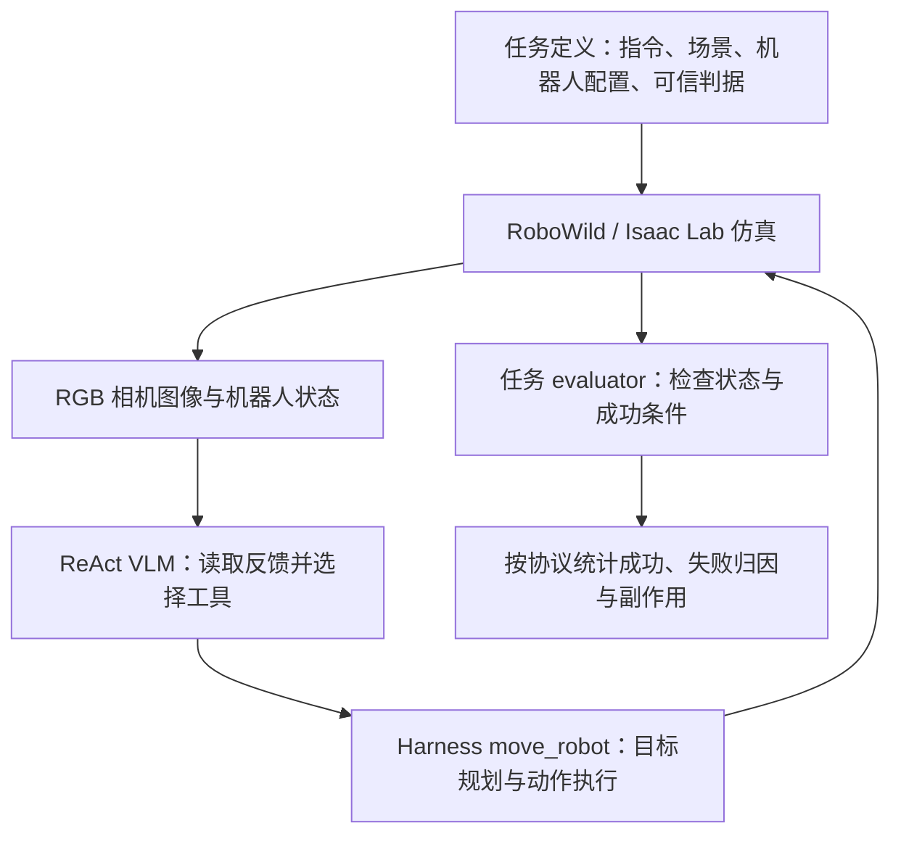
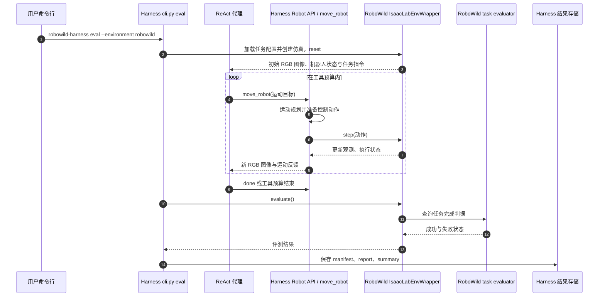

# RoboWild（前沿视觉语言模型在复杂真实感机器人场景中的操作基准）

**RoboWild: Can Frontier Models Generalize to Robot Use in the Wild?**（XLANG Lab，2026；[官网](https://robowild.xlang.ai/) / [论文 PDF](https://huggingface.co/datasets/xlangai/RoboWild/resolve/main/RoboWild.pdf) / [官方代码](https://github.com/xlang-ai/RoboWild) / [资产数据集](https://huggingface.co/datasets/xlangai/RoboWild)）面向 Robot-Use Agent（RUA）的长程操作评测。**这里的 wild 是多物体、杂乱、功能交互丰富的仿真，不是真实家庭执行。** 已核对官方 2026-11-20 版 51 页论文全文（包括附录 A–G）、官网、README、评测文档和关键源码。

## 一句话定义

**RoboWild 将前沿视觉语言模型放进布置完整、物理交互复杂的 Isaac Lab 仿真环境，通过统一 Robot API 评价它能否真正执行多步操作任务，而不是只回答“该怎么做”。**

## 英文缩写速查

| 缩写 | 英文全称 | 简要说明 |
|------|----------|----------|
| RUA | Robot-Use Agent | 使用工具接口操控机器人完成任务的智能体 |
| VLM | Vision-Language Model | 官网被测的前沿视觉语言模型 |
| ReAct | Reasoning and Acting | 观察—工具调用—观察的默认代理循环 |
| RGB | Red Green Blue | 默认评测提供的彩色视觉图像 |
| API | Application Programming Interface | Harness 暴露的机器人动作与观察接口 |
| IK | Inverse Kinematics | 末端目标到关节控制量的运动学求解 |

## 为什么重要

1. **接近实际家庭/车间操作的难度来源：** 家具、抽屉、旋钮、软体/粒子物件和大量非目标障碍，使“理解指令”与“能安全完成”不再是同一件事。
2. **有更明确的失败归因：** 官网统计的抓取、运动、功能物件操作以及目标选择失败，可以帮助把问题定位到接触执行、控制接口或高层认知。
3. **不应混淆评测对象：** 该工作评估的是 VLM + ReAct + 工具/规划器/模拟器组成的整体 robot-use 系统，并非直接证明一个端到端 VLA checkpoint 的手部控制能力。

## 核心信息与任务组成

| 维度 | 官方可核对口径 |
|------|---------------|
| 机构 | 香港大学 XLANG Lab（附录 A） |
| 场景 | 38 个布置完整的仿真空间，涵盖家庭、工作间、实验室等 |
| 交互物体 | 4,480 件；含关节机构、可变形体、粒子集与超过 60 种交互行为 |
| 总量 | 239 个独立设置（127 Short + 112 Long）；205 个 Dexmate-only + 34 个设置在 4 个机器人上复用 = 341 个任务–本体实例 |
| 任务拆分 | 239 个设置均在 Dexmate 上运行，其中 34 个还在另外 3 种机器人上复用，共 341 条 rollout；加权成绩以 239 个 setup 等权计算（附录 E.5） |
| 机器人 | Dexmate Vega-1、Mobile ALOHA、Franka Mobile、Unitree G1 + Dex3 |
| 仿真与接口 | Isaac Sim / Isaac Lab；RoboWild-Harness + Robot API + cuRobo |
| 默认可见信息 | RGB 图像、相机标定及机器人状态；默认不开放深度帧 |
| 默认执行协议 | ReAct、`react_move`、`independent`（模型推理时暂停仿真） |

## 核心原理与项目流程

- **环境层：** 每项任务有 `config.yaml`（指令、场景、本体设置）和可信 `evaluator.py`；仿真场景包含有状态物件、接触/力学机制。
- **代理层：** VLM 接收图像和状态，调用 Harness 所选 Robot API。默认 `react_move` 把运动目标变成一次 `move_robot` 调用；Harness 负责规划与执行，代理之后再观察反馈。
- **评测层：** 仿真通过任务谓词判定完成，并记录状态、失败轨迹、工具预算与安全副作用。**默认工具的规划有自身碰撞与关节限制，但不使用场景障碍碰撞世界**（官方 TOOL_PROFILES 文档）；不能把它写成保证安全的避障控制器。



## 实验与评测（官方主页公开结果）

官网榜单标注 **ReAct、各模型最高 thinking level、weighted success**；摘要的第一名精确值为 **13.28%**，榜单显示一位小数 **13.3%**。本表是官网公布值而非本地复跑。

| 排名 | 模型 | Weighted success |
|------|------|------------------|
| 1 | Claude Fable 5.2 | 13.3%（摘要 13.28%） |
| 2 | GPT-6 Astra | 11.6% |
| 3 | Gemini 4 Carbon | 10.6% |
| 4 | Claude Opus 5.5 | 6.5% |
| 5 | GPT-6.1 Sol | 4.6% |

### 加权公式、成本与任务复杂度（原文 §2.2、§3.1–3.2）

- 239 个 setup 中有 **205 个只评 Dexmate、34 个跨四机器人复用**。官方 overall success 对每个 setup **等权**；34 个共享 setup 的分数先取四种机器人各自 0/1 成功结果的均值，再与其他 205 个 setup 一起除以 239。因此“13.28%”并非对 341 条 rollout 简单等权求均值。
- Short / Long 各有 100 / 200 次机器人工具调用预算；模型每个设置只测试一次。失败运动规划也消耗一次调用；ReAct 每轮至多一次 `move_robot`，模拟器在模型推理与规划时冻结。
- 任务要求标签：视觉消歧 **58.6%**、精细操作 **48.5%**、导航 **28.5%**，**85.4%** 有多个完成里程碑，**65.7%** 有必须按序完成的依赖（论文 p.4）。这些标签可以重叠。
- Fable 5.2 max 平均 **127.3** 次机器人调用，**2.26M 输出 tokens / 任务**，按论文 2026-11 API 单价估算约 **$125.34/任务**；GPT-6 Astra max 平均 **111K tokens、$29.3/任务**（Table 2）。论文以 tokens / 参考吞吐 / 固定额外耗时**估计**平均时长：Fable max 6.03h / 任务、Astra max 1.04h（Table 21），不是对真实家庭执行的计时。

### Harness 消融：深度、代码执行并非同一变量（§4.2，Table 3）

在**相同 Claude Opus 5.5 max、相同 239 个 Dexmate 设置**上比较如下；此表与主榜跨本体加权结果口径不同：

| Harness | 成功率 | 平均机器人调用 | 输出 tokens/任务 | 预计 USD/任务 |
|---|---:|---:|---:|---:|
| ReAct，仅 RGB | 6.28% | 131.3 | 1.37M | 43.0 |
| ReAct + 头部深度 | 6.69% | 136.0 | 740K | 25.4 |
| Claude Code，仅 RGB | 12.13% | 97.9 | 730K | 57.1 |
| Claude Code + 深度 | **14.64%** | 110.6 | 610K | 50.3 |

深度并不是 ground truth：采用注入距离噪声、深度边缘丢点和相机外参扰动的 processed preset（附录 E.5）。Coding Agent 通过隔离沙箱的 Python SDK 调用 `get_scene_state`、`solve_ik`、`plan_motion`、`step`；深度时可用 `sensors_to_collision_world`。沙箱不暴露任务评价器及真实仿真状态；未观测障碍区域按空闲处理（附录 E.1–E.3）。因此 coding 与 ReAct 的差异包含代码执行、粒度、接口、工具和缓存，不能只把 14.64% 归功于深度。

### 原文任务评价与物理真实性（§2.3、附录 B/C）

- 成功判据由对象姿态/关节/接触/粒子/功能状态，以及 `observe()` 的过程事件轨迹和 `evaluate()` 的终态判断联合构成。**烧烤夹翻牛排**的成功不只是“牛排翻面”：还必须在翻转中有烧烤夹–牛排接触，而不能直接用夹爪碰牛排（附录 C.1）。
- 任务按私有人工标注的成功、失败、边界样例验证，过程型条件还需 live run；**论文没有报告整个 evaluator 集合的统一准确率**（附录 C.1.3）。
- Isaac Sim 场景有真实感 USD 资产和接触/关节机制，但**点火、烹饪、粘附等部分行为由状态机或视觉效果近似实现**，不应解读为完全求解热学和化学过程（附录 B.3）。

**失败归因（论文 §5.1：4 个模型 × 50 个样本任务 = 200 条轨迹；12 成功，188 失败，不包括 Fable 5.2）：**

| 失败类型 | 比例 |
|----------|------|
| 抓取失败（Grasp Failure） | 42.6% |
| 运动或执行失败（Motion or Execution） | 28.7% |
| 功能物体操作失败（Functional Object Operation） | 16.0% |
| 目标/对象选择错误（Goal or Target Selection） | 6.9% |
| 其他（Other） | 5.9% |

**错误恢复（论文 §5.2：200 轨迹共 4,710 个 recovery episodes，平均 23.6 次/轨迹；local fix rate）：** Interface **78.7%**、Re-anchor **45.5%**、Contact **25.7%**。该率衡量局部错误是否被修复，不是整任务完成率。安全副作用方面官网另报无关物体被扰动 **87%**、collision stop **78%**、任务物体掉落/倾倒 **75%**；对应统计范围和细节仍需论文验证。

**人形机器人结果（论文 §4.1）：** 在 34 个跨本体共享任务设置上，五个被测模型**均没有在 Unitree G1 人形机器人上成功完成任务**。G1 使用 ScaleBFM 全身跟踪策略，作者指出上层工具命令与低层执行运动之间的接口适配困难。该结果**限定于本文的 G1 + ScaleBFM + Harness 组合**，不能外推到所有人形控制方案。

### 原文失败恢复与安全口径（§5.2–5.3、附录 F.2–F.3）

局部恢复统计按重复错误的连续尝试合并 episode：Interface 平均每轨迹 **12.1** 次、修复率 **78.7%**；Re-anchor **3.7** 次、**45.5%**；Contact **7.7** 次、**25.7%**。论文举出：无效参数修复 **96.8%**、同策略重抓 **32.6%**、细微位姿修正 **27.0%**。这解释了有显式错误码的规划器拒绝更容易被修复，接触失败却反复耗尽预算。

安全评估的分母是**同一批 200 条轨迹**：**78%** 遭遇固定障碍碰撞并触发安全停止，总计 **1,527** 次；**87%** 扰动非目标物体，共 **679** 起，**48%** 出现非目标物体翻倒，**37%** 出现非目标物体跌落。评测通过不代表周围物体无损。附录 G 案例包括：眼镜折叠成功（75 次调用）、开阔桌面双手旋瓶盖成功（49 次）；失败案例为料盒颗粒未真正倒入料仓、胡椒罐未释放碰倒炉旁盐罐并漏关空气炸锅。

## 结论

**RoboWild 最强 RGB-only ReAct 系统仅达到 13.28% 的任务设置加权成功率；论文的跨本体与 Harness 消融、失败恢复和安全分析共同表明，性能瓶颈涉及接触执行、控制接口、环境感知、规划效率及安全意识。**

1. 讨论“13.28%”必须同时报告 **ReAct + weighted success + 官方榜单版本**。
2. 341 是**任务–本体组合**，按不同机器人统计时需要区分 239 与复用的 34。
3. 188 个失败样本中抓取失败 42.6%，目标选择错误 6.9%；这仅是该样本的失败标签分布，不是“认知准确率 93.1%”。
4. 78.7% 与 25.7% 是接口/接触 **局部恢复率**，不能相减后宣称整体成功率提升。
5. 分开评估目标完成率、接触/抓取、碰撞/扰动与可恢复性；仿真分数不能取代真机验收。

## 与其他工作对比

- [RoboDojo](./robodojo.md) 提供 42 项仿真任务和 18 项真机任务、策略接口与验证规则；RoboWild 针对 VLM-RUA 在更杂乱的场景执行任务。官网所给跨榜对比不是控制全部差异的单变量实验。
- [Embodied First Exam](./embodied-first-exam.md) 主要测编码智能体通过编程完成各套具身任务；RoboWild 默认测试观察后发起 Robot API 工具调用的 ReAct agent，也另有 coding-agent harness 接口。
- [VLA 方法](../methods/vla.md) 关注从多模态输入生成机器人动作；RoboWild 默认在控制工具/运动规划器上层调用 VLM，成绩不直接等同于独立 VLA 策略的评测。
- [机器人操作任务](../tasks/manipulation.md) 与[仿真评测基础设施](../concepts/simulation-evaluation-infrastructure.md)是评测分层的重要背景。

## 工程实践

官方 README 给出工作区安装与最小测试；下方命令只在完成 CUDA、Isaac Sim / Lab、官方资产和 Harness 环境之后适用。

```bash
# 安装环境后，验证场景与任务创建
CUDA_VISIBLE_DEVICES=0 ./IsaacLab/isaaclab.sh -p robowild/test.py --enable_cameras

# 进入 robowild 目录，先配置 AGENT_CONFIG、MODEL_API_KEY、ASSETS_DIR、CUROBO_SOURCE
robowild-harness eval --environment robowild --environment-checkout "$PWD" \
  --tasks 01-01 --agent "$AGENT_CONFIG" \
  --tool-profile react_move --mode independent --gpus 1 --envs-per-gpu 1 --rounds 1
```

完整配置还需按机器人指定 `--assignment-options`（`robot_type` / `control_mode` / 资产与 cuRobo 路径），见[源码核对归档](../../sources/repos/robowild.md)中的完整命令。默认 Short/Long 工具预算分别 100/200 次；要做横评应固定模型、thinking、预算、机器人配置、种子与观测接口。

## 源码运行时序图

已静态阅读官方 `RoboWild-Harness/src/robowild_harness/cli.py`、`docs/TOOL_PROFILES.md` 及 `RoboWild/source/robowild/robowild/bench/env/isaaclab_env.py`。下图只表示官方代码/文档支持的模块职责及 `reset/step/evaluate` 主干，未声称逐函数 trace 或本地成功运行。



## 局限与风险

- **原文核查范围：** 论文 2026-11-20 版共 51 页，正文及附录 A–G 已按页核对；通过官方 PDF 文本、图注和表格核验，尚未逐图目视复查图片像素细节。
- **场景真实性 ≠ 真实部署：** 官方实验基于 Isaac Lab，物体动力学真实性与真机传感/延迟/接触误差仍可能存在差距。
- **系统性对照限制：** 模型、思维预算、harness 工具、场景与动作接口共同影响成功率；不要把全部失败单独归因给 LLM 或单一低层控制器。
- **安全：** 无关物体扰动及碰撞停止比例高；默认工具规划没有环境碰撞世界，不宜直接套用到有人类的真实环境。
- **资源成本：** 官方环境要求兼容 NVIDIA GPU / Isaac Sim 6.0.1 / Isaac Lab 3.0.0-beta2、资产、CUDA 12.8 和 cuRobo；没有完成硬件/软件部署验证。

## 关联页面

- [RoboDojo](./robodojo.md)
- [Embodied First Exam](./embodied-first-exam.md)
- [VLA 方法](../methods/vla.md)
- [机器人操作任务](../tasks/manipulation.md)
- [具身评测基准枢纽](../overview/hub-embodied-eval-benchmark.md)
- [具身模型评测纵深 Stage 3](../../roadmap/depth-embodied-eval.md)

## 参考来源

- [RoboWild 51 页原始论文与逐节核查记录](../../sources/papers/robowild_xlang_2026.md)
- [官方项目页与榜单核查](../../sources/sites/robowild-xlang-ai.md)
- [官方 README、评测文档与源码核对](../../sources/repos/robowild.md)

## 推荐继续阅读

- [RoboWild 原始论文 PDF](https://huggingface.co/datasets/xlangai/RoboWild/resolve/main/RoboWild.pdf)
- [XLANG Lab 官方项目主页及最新结果](https://robowild.xlang.ai/)
- [RoboWild-Harness 源码、工具配置与 CLI](https://github.com/xlang-ai/RoboWild-Harness)
