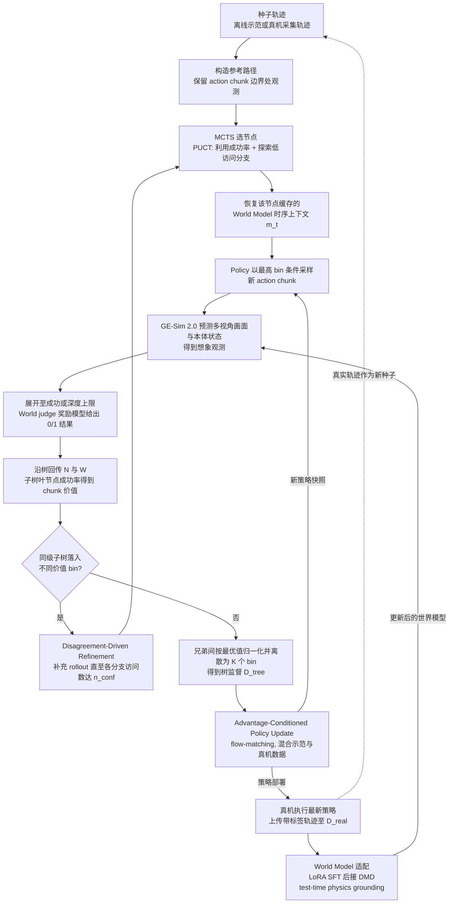

# Rollback：世界模型经验回溯

## 一句话定义

Rollback 在世界模型中回到关键决策点探索替代动作，并利用反事实结果改善机器人策略。

## 英文缩写速查

| 缩写 | 英文全称 | 简要说明 |
|------|----------|----------|
| LoRA | Low-Rank Adaptation | 使用低秩参数更新世界模型 |
| WM | World Model | 预测动作后环境变化的模型 |
| RL | Reinforcement Learning | 通过交互反馈改进策略的学习范式 |

## 为什么重要

真实世界难以完全重置和比较同一决策的替代结果；模型内回溯提供了针对关键动作进行分支比较的途径。

## 流程总览

图依据：论文 §4.1–4.3 / §5.3 / Fig.2

## 核心机制

世界模型回到关键决策点，生成替代动作的未来并对比分支，将成败归因转化为动作级监督，无需额外训练价值模型。分布式模型搜索与异步真机执行形成循环，真实转移经轻量 LoRA 校正世界模型，论文称之为 test-time physics grounding。

## 源码运行时序图

不适用：2026-10-29 项目页访问失败，尚未核实官方可运行代码及入口。

## 实验与评测

- 与各任务最强基线相比，积木抽取、抛球和桌面冰壶成功率分别提高 **10.67、11.11、11.85 个百分点**。
- 抛球和桌面冰壶在 8 小时训练内超过人类参与者平均成功率；这是论文特定任务和评测条件下的结果。

## 结论

回溯集中比较关键决策，真实反馈用于减少模型动力学偏差。

1. 区分模型内回溯与真实环境中的物理重置。
2. 三项提升均为绝对百分点，比较时保留各自基线。
3. 部署需评估真机数据采集、模型更新成本和分支预测误差。

## 与其他工作对比

[SafeLoop](./paper-safeloop-vla-rollback.md) 利用风险预测将机器人恢复到安全状态；Rollback 在世界模型内回溯以生成策略训练监督，二者的回滚对象和目的不同。

## 工程实践与局限

项目页截至 2026-10-29 访问失败，代码、权重和数据状态待核实；当前摘要不足以判断复现成本及各任务细节。

## 关联页面

- [世界动作模型](../concepts/world-action-models.md)
- [操作任务](../tasks/manipulation.md)
- [E0.5](./paper-e05-geometry-world-action.md)

## 参考来源

- [论文摘录](../../sources/papers/rollback_arxiv_2610_36068.md)
- [项目页核查](../../sources/sites/rollback-wm.md)
- [arXiv PDF](https://arxiv.org/pdf/2610.36068)：已通读方法部分（实验与附录以略读为准）：摘要、§1 引言、§3 预备知识、§4 方法（4.1–4.3）、§5 异步训练系统（5.2–5.3）、§6.1 实验设定

## 推荐继续阅读

- [Rollback 论文](https://arxiv.org/abs/2610.36068)
- [项目页](https://rollback-wm.github.io/)
