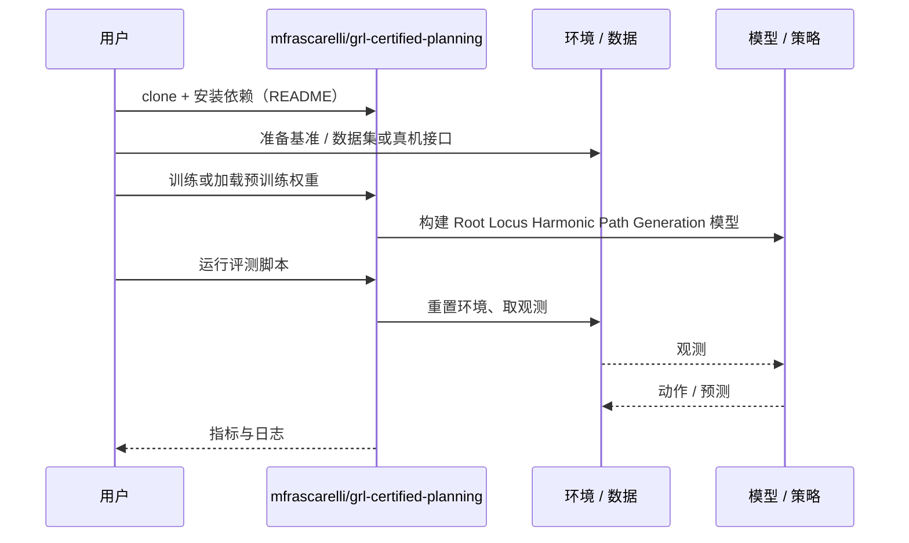

# Root Locus Harmonic Path Generation（arXiv:2610.31625）

**Root Locus Harmonic Path Generation**（*Extending Harmonic Function Methods via Root Locus for Coordinated Path Generation*，[arXiv:2610.31625](https://arxiv.org/abs/2610.31625)，[项目页](https://mfrascarelli.github.io/grl-certified-planning/)，[代码](https://github.com/mfrascarelli/grl-certified-planning)）来自 [具身智能小站 2026-10-29 盘点](../../sources/blogs/wechat_embodied_station_58_papers_diverse_demonstrations_2026-10-29.md)，属「导航、规划与定位」组。

## 一句话定义

**通过保角映射与广义根轨迹，为平面可互换机器人构造互不相交的路径及目标分配；安全证书针对实际计算的势函数成立，适用条件和离线假设很关键。**

## 英文缩写速查

| 缩写 | 英文全称 | 简要说明 |
|------|----------|----------|
| Root Locus Harmonic Path Generation | Extending Harmonic Function Methods via Root Locus for Coordinated Path Generation | 本文方法 / 基准的简称 |

## 为什么重要

- 用广义根轨迹同时生成多机器人路径。
- 开源结论：**已开源**（步骤 2.5，2026-10-29）。仓库可达（git ls-remote）。项目页 HTTP 200。
- 同期同组工作见 [多样成功示范、触觉工具链与预见式感知：具身智能小站 10-29 期 58 篇阅读坐标](../overview/embodied-station-2026-10-29-58-papers-technology-map.md)。

## 核心机制

| 项 | 内容 |
|----|------|
| **arXiv** | [2610.31625](https://arxiv.org/abs/2610.31625) |
| **开源** | **已开源** |
| **要点** | 通过保角映射与广义根轨迹，为平面可互换机器人构造互不相交的路径及目标分配；安全证书针对实际计算的势函数成立，适用条件和离线假设很关键。 |
| **文内指标** | 公众号未给具体数字，本页不引用。 |

## 源码运行时序图

以下为按仓库入口（`mfrascarelli/grl-certified-planning`）推断的通用运行链路；入库日仅核实仓库可达，未逐文件阅读，具体脚本名以 README 为准。

## 实验与评测

- 公众号未给具体数字，本页不引用。
- **读法：** 本页为索引级摘要，依据公众号转述的官方摘要与仓库信息整理；逐项数字与 baseline 以原文 PDF 为准。

## 与其他工作对比

- 横向索引见 [多样成功示范、触觉工具链与预见式感知：具身智能小站 10-29 期 58 篇阅读坐标](../overview/embodied-station-2026-10-29-58-papers-technology-map.md)；同 arXiv 不重复造页。

## 结论

**用广义根轨迹同时生成多机器人路径：通过保角映射与广义根轨迹，为平面可互换机器人构造互不相交的路径及目标分配；安全证书针对实际计算的势函数成立，适用条件和离线假设很关键。**

1. 开源边界：**已开源** — 仓库可达（git ls-remote）。项目页 HTTP 200。
2. 核心机制：通过保角映射与广义根轨迹，为平面可互换机器人构造互不相交的路径及目标分配；安全证书针对实际计算的势函数成立，适用条件和离线假设很关键。
3. 复现与选型前核对任务协议、硬件与基准口径，勿直接横比公众号摘录数字。

## 关联页面

- [locomotion](../tasks/locomotion.md)
- [vision-language-navigation](../tasks/vision-language-navigation.md)
- [sim2real](../concepts/sim2real.md)
- [embodied-station-2026-10-29-58-papers-technology-map](../overview/embodied-station-2026-10-29-58-papers-technology-map.md)

## 参考来源

- [root_locus_harmonic_path_generation_arxiv_2610_31625.md](../../sources/papers/root_locus_harmonic_path_generation_arxiv_2610_31625.md)
- [wechat_embodied_station_58_papers_diverse_demonstrations_2026-10-29.md](../../sources/blogs/wechat_embodied_station_58_papers_diverse_demonstrations_2026-10-29.md)
- [arXiv:2610.31625](https://arxiv.org/abs/2610.31625)

## 推荐继续阅读

- [arXiv PDF](https://arxiv.org/pdf/2610.31625)
- [项目页](https://mfrascarelli.github.io/grl-certified-planning/)
- [https://github.com/mfrascarelli/grl-certified-planning](https://github.com/mfrascarelli/grl-certified-planning)
