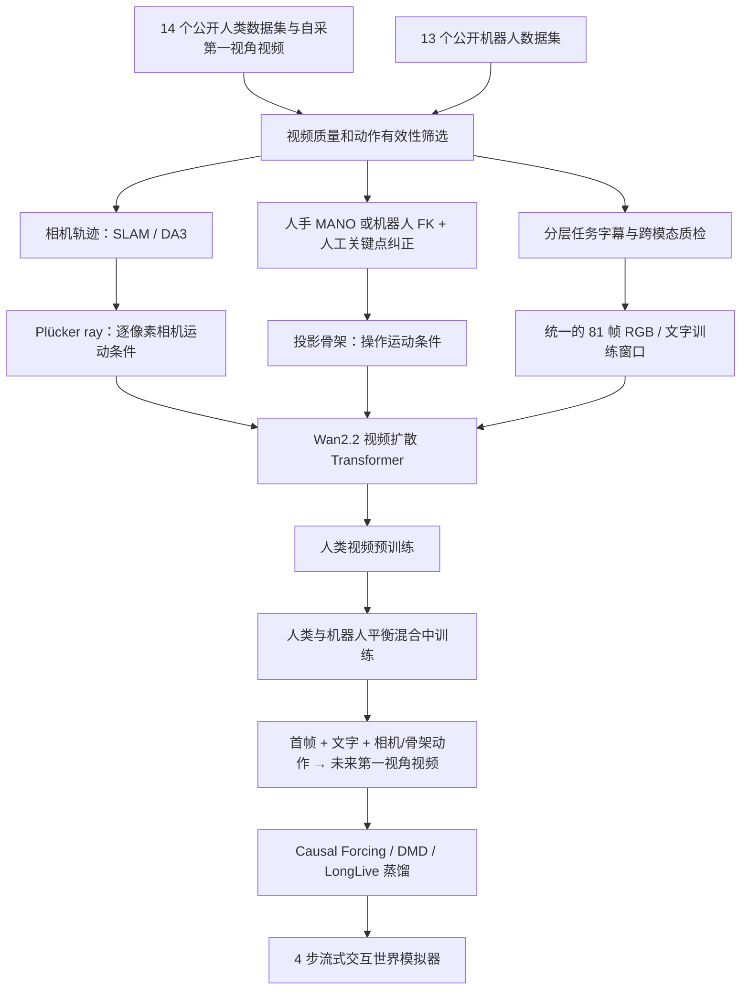
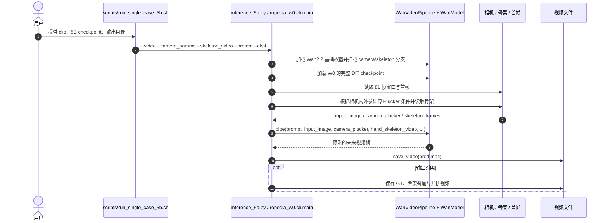

# Ropedia W0：跨本体运动-操作世界模型

## 一句话定义

Ropedia W0 将人类第一视角经验与多种机器人数据编码到共享运动学接口中，学习跨本体预测运动和操作后果的世界模型。

## 英文缩写速查

| 缩写 | 英文全称 | 简要说明 |
|------|----------|----------|
| W0 | World Zero | Ropedia W0 的模型名称 |
| WM | World Model | 预测动作后果以支持规划或策略评估的模型 |
| Xp-Data | Cross-Embodiment Data | 论文整理的人类与机器人运动-操作数据集 |
| Xp-Teleop | Cross-Embodiment Teleoperation | 论文提出的长程灵巧人形遥操作基准 |
| VR | Virtual Reality | 项目页展示的实时交互方式 |

## 为什么重要

世界模型常被单一 embodiment 的动作空间限制。Ropedia W0 探索用共享表示吸收人类视频和异构机器人数据，让人类经验也能成为机器人运动-操作模型的训练信号。

## 流程总览

流程依据：arXiv:2610.26855v1 §3、§4、Fig. 2 / Fig. 4、附录 B。该图反映论文训练流水线，不能视为仓库已公开完整训练实现。

## 核心原理

**输出是第一视角未来画面，而非直接关节控制量。** 论文把相机相对于首帧的位姿投影为六通道 Plücker ray map，将人手的 MANO 关键点、机器人基于 URDF 正运动学（FK）并经过人工校正的关键点渲染成图像对齐骨架。5B dense 与 A14B MoE 版本的 Wan2.2 视频扩散骨干通过零初始化投影融合相机、骨架条件；文字经交叉注意力进入模型。

训练先用人类视频预训练，再以人类/机器人数据 **1:1 采样概率**持续训练；随后通过 Causal Forcing、非对称 DMD 与 LongLive 将模型蒸馏为 4 步自回归流式学生，供低延迟交互预测。

## 评测与结果

- **训练数据：** Xp-Data 包含约 **10,000 小时人类 + 3,000 小时机器人视频**，来自 14 个公开人类数据集、13 个公开机器人数据集与超过 6,000 小时团队自采多视角第一视角视频；统一了 camera、skeleton、caption 等条件。
- **新基准 Xp-Teleop：** Unitree G1 双人同步遥操作，**27 段长时记录、543 个原子动作片段、30 类技能**，共约 1 小时。保留失败与恢复，不能将其解释为成功率。
- **五个机器人基准：** DreamDojo、Ψ0、ω-HOME、Xp-Teleop、AgiBot，另有 EgoSuite + OpenAoE 共 200 段未见人类第一视角视频；实验区分零目标数据、few-shot 与 full-data 后训练。
- **可核查数值：** DreamDojo In-lab 在 **1% 目标数据**下 W0 5B PSNR **20.854**、DreamDojo 14B **18.983**；跨 8 种本体的 400 窗口，A14B midtrain PSNR **21.98**，删除骨架条件降至 **18.17**（Table S6）。
- **蒸馏：** 4 步 5B 学生在 640×480 单 GPU 上报告 **21.3 fps**，相对 50 步 teacher 端到端约 **7 倍**；实测滚动至 61 秒，时长继续增加仍有漂移风险。
- **下游：** 把 W0 5B 视频骨干用于 FastWAM 初始化后，LIBERO-Plus 成功率从 **50.06%** 提升至 **56.82%**。这是 WAM 的权重初始化实验，不能把该成功率归到 W0 世界模型直接输出动作。

**特别注意 zero-shot 的定义：** 仅指目标评测数据集未用于训练，目标机器人**可能已在混合中训练的其他数据集出现**；不能写成未见机器人本体或直接无监督上机。以上依据论文 §6 和附录 C–E。

## 工程实践与开源状态

截至 **2026-11-13**，官方 GitHub README 和 Hugging Face 已确认：**5B 人类预训练、5B 人机中训练两个 safetensors 权重、5B 推理脚本及 Xp-Teleop 数据已发布**；**A14B 权重与推理、benchmark fine-tuned checkpoint、评测与后训练源码仍待发布**。旧归档的「所有权重与 Xp-Teleop 均待发布」已过时。

5B 推理要求本地完整 Wan2.2-TI2V-5B 基础模型、对应 W0 checkpoint、`video.mp4` 首帧、`data.npz`（内外参）、`skeleton.mp4` 和 `prompt.txt`。仓库提供 18 个示例和 `scripts/run_single_case_5b.sh`。README 提示需要至少 40GB 显存的 NVIDIA GPU（640×480、81 帧时峰值约 31GB），并非普通低显存 GPU 即可直接复现。

许可区分：代码 **Apache-2.0**、模型权重 **CC BY-NC 4.0**、Xp-Teleop 数据 **CC BY 4.0**；Wan2.2 基座和其他视频源遵循各自许可。

## 源码运行时序图

调用链据官方 `scripts/run_single_case_5b.sh`、`inference_5b.py`、`ropedia_w0/cli.py`（已检查 2026-11-13）；该公开推理链路是**50-step 5B 离线视频生成**，不等同论文蒸馏后 21.3 fps 的实时学生。

## 与其他工作对比

| 维度 | 单本体世界模型 | Ropedia W0 |
|------|-----------------|------------|
| 训练经验 | 主要来自目标机器人 | 混合人类第一视角与多种机器人数据 |
| 动作表征 | 依赖特定机器人动作空间 | 相机位姿 + 投影骨架共享表示 |
| 目标 | 预测单一平台的未来 | 探索跨人和机器人本体的 loco-manipulation 预测 |

## 局限与风险

- 统一表示减少动作空间差异，但不等于消除接触、执行器和动力学差异。
- 大规模人类视频能否稳定提升机器人任务表现，仍依赖数据质量、运动学映射与后训练。
- 公开 5B 推理可用于验证已有 checkpoint，但其模型大小、显存门槛和训练/评测源码缺口限制了完整复现。
- 论文附录 F 指出运动学条件未显式建模接触或物体动力学，长于一分钟的稳定性也尚待验证。

## 结论

**Ropedia W0 的核心贡献是把人类经验纳入跨本体运动-操作世界模型训练，并以共享运动学表示连接异构数据。**

- 评估它时分别看人类预训练、机器人数据、后训练各自贡献，避免把总数据量等同于迁移收益。
- “13k 小时”是人类与机器人数据合计，不能误写成全为机器人数据。
- 5B 两个 checkpoint 和 Xp-Teleop 已发布；A14B、目标任务微调权重、评测及后训练源码仍未完整开放。
- 跨本体结果不保证零样本真机控制安全；仍需单独验证闭环执行。

## 关联页面

- [Ropedia Xperience 2](./paper-ropedia-xperience-2.md) — 将米制真实场景与第一视角行为对齐的数据基础设施，区别于 W0 的世界模型训练。

- [Holi-World](./paper-holi-world.md) — 用第一视角经验构建时空世界记录。
- [EgoXperience](./paper-egoxperience.md) — 在统一世界坐标系中重建手、物体与场景。
- [S-Agent 2.0](./paper-s-agent-2.md) — 使用三维感知工具进行空间推理。

- [UnifoLM 世界模型动作](../entities/unifolm-world-model-action.md) — 世界模型与动作接口
- [生成式世界模型](../methods/generative-world-models.md) — 视频生成式预测方法

## 参考来源

- [Ropedia W0 论文 v1 全文核对](../../sources/papers/ropedia_w0_arxiv_2610_26855.md)
- [项目页归档](../../sources/sites/ropedia-w0.md)
- [官方仓库归档](../../sources/repos/ropedia-w0.md)

## 推荐继续阅读

- [Ropedia W0 arXiv](https://arxiv.org/abs/2610.26855)
- [Ropedia W0 项目页](https://ropedia.github.io/ropedia-w0/)
- [官方代码仓库](https://github.com/Ropedia/ropedia-w0)
- [公开 5B 模型权重](https://huggingface.co/ropedia-ai/Ropedia-W0)
- [Xp-Teleop 数据集](https://huggingface.co/datasets/ropedia-ai/Xp-Teleop)
