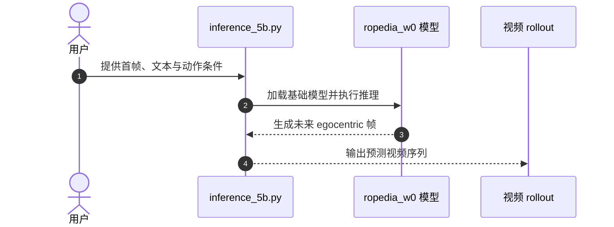

# Ropedia W0：跨本体运动-操作世界模型

## 一句话定义

Ropedia W0 将人类第一视角经验与多种机器人数据编码到共享运动学接口中，学习跨本体预测运动和操作后果的世界模型。

## 英文缩写速查

| 缩写 | 英文全称 | 简要说明 |
|------|----------|----------|
| W0 | World Zero | Ropedia W0 的模型名称 |
| WM | World Model | 预测动作后果以支持规划或策略评估的模型 |
| Xp-Data | Cross-Embodiment Data | 论文整理的人类与机器人运动-操作数据集 |
| Xp-Teleop | Cross-Embodiment Teleoperation | 论文提出的长程灵巧人形遥操作基准 |
| VR | Virtual Reality | 项目页展示的实时交互方式 |

## 为什么重要

世界模型常被单一 embodiment 的动作空间限制。Ropedia W0 探索用共享表示吸收人类视频和异构机器人数据，让人类经验也能成为机器人运动-操作模型的训练信号。

## 核心原理

论文将移动表示为相机位姿，将操作表示为投影骨架，并利用机器人前向运动学生成骨架后做人工校正。这样把不同关节结构的原始动作转换为较统一的运动学表征，再训练模型预测未来第一视角视频。

## 评测与结果

论文称 Xp-Data 包含 **10,000 小时人类第一视角视频 + 3,000 小时机器人数据**，并在 DreamDojo、Ψ0、ω-HOME、Xp-Teleop、AgiBot 等五类跨本体基准及人类视频上评测。蒸馏模型可进行实时、分钟级 rollout；这些结论来自论文摘要，比较时需核对各基准协议。

## 工程实践与开源状态

官方仓库已公开，包含推理脚本、模型代码、示例和工具；仓库 README 将更多 checkpoint、Xp-Teleop 数据、评估和后训练代码列为待发布。代码 Apache-2.0、模型权重 CC BY-NC 4.0、数据 CC BY 4.0，许可不能互相替代。

### 源码运行时序图

该图概括仓库公开的 5B 推理入口；完整权重和数据的发布状态应以仓库 README 为准。

## 与其他工作对比

| 维度 | 单本体世界模型 | Ropedia W0 |
|------|-----------------|------------|
| 训练经验 | 主要来自目标机器人 | 混合人类第一视角与多种机器人数据 |
| 动作表征 | 依赖特定机器人动作空间 | 相机位姿 + 投影骨架共享表示 |
| 目标 | 预测单一平台的未来 | 探索跨人和机器人本体的 loco-manipulation 预测 |

## 局限与风险

- 统一表示减少动作空间差异，但不等于消除接触、执行器和动力学差异。
- 大规模人类视频能否稳定提升机器人任务表现，仍依赖数据质量、运动学映射与后训练。
- 模型权重和数据尚不等同于代码开放；当前仓库分项发布状态需要持续核对。

## 结论

**Ropedia W0 的核心贡献是把人类经验纳入跨本体运动-操作世界模型训练，并以共享运动学表示连接异构数据。**

- 评估它时分别看人类预训练、机器人数据、后训练各自贡献，避免把总数据量等同于迁移收益。
- “13k 小时”是人类与机器人数据合计，不能误写成全为机器人数据。
- 推理代码已公开，模型权重、数据集和完整训练/评估链路仍有待发布项。
- 跨本体结果不保证零样本真机控制安全；仍需单独验证闭环执行。

## 关联页面

- [UnifoLM 世界模型动作](../entities/unifolm-world-model-action.md) — 世界模型与动作接口
- [生成式世界模型](../methods/generative-world-models.md) — 视频生成式预测方法

## 参考来源

- [Ropedia W0 论文摘录](../../sources/papers/ropedia_w0_arxiv_2610_26855.md)
- [项目页归档](../../sources/sites/ropedia-w0.md)
- [官方仓库归档](../../sources/repos/ropedia-w0.md)

## 推荐继续阅读

- [Ropedia W0 arXiv](https://arxiv.org/abs/2610.26855)
- [Ropedia W0 项目页](https://ropedia.github.io/ropedia-w0/)
- [官方代码仓库](https://github.com/Ropedia/ropedia-w0)
