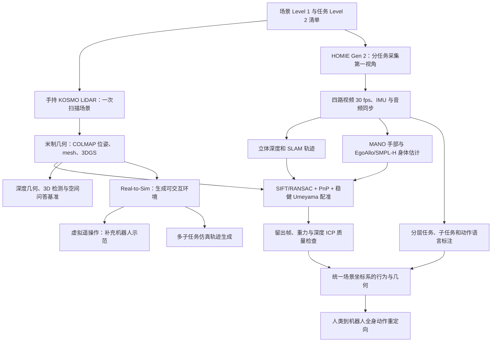
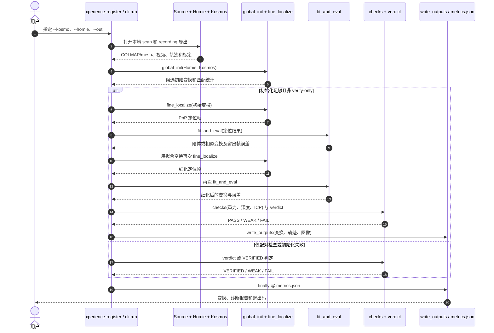

# Ropedia Xperience 2：面向物理 AI 环境与行为规模化的高标准数据基座

## 一句话定义

**Ropedia Xperience 2（《A Gold Standard for Scaling Physical AI Environments and Behaviors》）**通过「一次场景 3D 扫描 + 多次第一视角任务采集 + 可质检的空间配准」，将真实环境与人类动作纳入同一米制坐标框架，既可用于几何评测，也可复用为机器人仿真环境与行为数据。

## 英文缩写速查

| 缩写 | 英文全称 | 简要说明 |
|------|----------|----------|
| 3DGS | 3D Gaussian Splatting | 用于场景新视角渲染的三维高斯表示 |
| HOMIE | HOMIE Gen 2 | Ropedia 的头戴第一视角多相机采集设备（产品名） |
| IMU | Inertial Measurement Unit | 头戴设备提供重力和惯性观测 |
| SLAM | Simultaneous Localization and Mapping | 恢复第一视角设备轨迹及地图 |
| MANO | Model with Articulated and Non-rigid defOrmations | 手部参数化模型，用于估计左右手姿态 |
| SMPL-H | Skinned Multi-Person Linear Model with Hands | 全身与手部姿态参数化模型 |
| PnP | Perspective-n-Point | 依据 3D 地图点和 2D 观测定位相机 |
| ICP | Iterative Closest Point | 比对深度与扫描几何、核查配准 |
| QC | Quality Control | 场景扫描质量审核和发布分级 |

## 为什么重要

单独的第一视角视频记录了「如何做」，孤立三维扫描记录了「在哪里做」，但前者缺少高精度可交互环境，后者缺少真实动作。该工作尝试把两者对齐为可复用资产：一次真实场景采集可衍生空间感知基准、数字孪生仿真环境、机器人动作和额外仿真示范，减少每条任务都要重新部署实体机器人的依赖。

它提出的是**环境与行为联合扩展的数据基础设施**，不是训练完成的通用 VLA/WAM，也尚未实证得到物理 AI 的 scaling law。

## 流程总览

图据 arXiv:2611.17060v1 的 §2–§5 与附录 B。**流程图描述论文级 pipeline 与演示能力，并不表示所有中间件都已经开源，也不表示每条录制在数据仓库中已配准。**

## 核心原理

### 采集：环境与行为分开传感、同一现场关联

1. 采集者先在场景准备阶段减少屏幕、照明、门与人员变化；手持 KOSMO 扫描仪采集米制 LiDAR 几何、鱼眼影像与多视角位姿。
2. 再佩戴 HOMIE Gen 2，用四个全局快门鱼眼相机、IMU、四声道音频分别记录该场景安排的任务。前向双目用于立体深度和手部分析。
3. 后处理产生 3DGS、网格、COLMAP 视图；在统一 30 fps 帧索引上对齐相机、惯性与音频；SLAM 恢复相机轨迹，MANO 拟合手部，EgoAllo/SMPL-H 根据头和手推断身体运动，多模态模型生成分层动作语义。

观测和估计应分层使用：**视频/IMU 是观测；深度、人体姿态与环境网格是估计；层次化文字是生成标注**。特别是摄像头看不到的下肢不是实际动捕真值。

### 配准：把 HOMIE 记录世界系映射到扫描场景系

- 以扫描图像、COLMAP 相机和三角网格为参考，对第一视角帧做 SIFT 特征检索及 RANSAC 匹配；扫描像素通过网格射线投射变成三维点，再用 PnP 获得相机在扫描系的位姿。
- 用稳健 Umeyama 拟合 SLAM 相机中心与 PnP 定位的变换，使用独立留出帧评价误差。长度足够、确有收益时允许小幅 Sim(3) 比例校正，否则使用刚体变换。
- 对齐后还核查 IMU 重力、头戴深度与场景网格的 ICP 一致性。输出质量等级 PASS / WEAK / FAIL；配准工具单独提供的 VERIFIED 只表示视觉配对通过。
- **坐标细节：** 身体关节已在记录 SLAM 世界系；手部关节原本在左立体相机系，需先通过当帧相机外参再映射到扫描系，不能直接将总变换作用于相机局部关节。

## 数据规模与发布状态

| 统计项 | 论文 v1 报告 | 注意事项 |
|------|-------------|----------|
| 保留的扫描场景 | **1,589** | 同一物理空间可能多次扫描 |
| 采集地点 | **596** | 是更广泛采集 inventory 的地点，不代表独立发布扫描 |
| 任务定义 / 录像 | **74 / 4,230** | 录像与 131 h 是采集清单口径，非全已处理/配准 |
| 第一视角时长 | **131 h** | 不能写成已全部上架可下载 |
| 扫描质量 | 148 Perfect / 934 Usable / 507 Reuse | Reuse 可能存在局部缺失（31.9%） |
| 类别分布 | 12 类；室内家居 1,389 场景 | 家居占约 87.4%，分布不均 |

官方 [Hugging Face 数据卡](../../sources/datasets/ropedia-xperience-2.md) 在 2026-11-13 明确表示**分批上传中**：第一批展示 **126 个场景**，文件按场景继续上传。首批文件的扫描坐标系与 HOMIE SLAM 世界系分离，**录制→扫描配准结果尚未随这批数据提供**；论文保留数量不是仓库的实时可用下载量。数据集采用 **CC BY-NC 4.0**，不是无条件商用开放。

## 实验与评测

论文三类基准均采用**同一组 20 场景（15 室内、5 室外）**，与 1,589 个发布扫描的全量统计不同。

| 方向 | 被测范围 | 论文报告的代表性结果 |
|------|----------|----------------------|
| 深度与几何 | 11 模型；Sparse 5、Medium 11–100、Dense 335–500 帧 | π³ 在轨迹 ATE 和表面 F-score 领先；高密度输入有模型 OOM，无单一全指标冠军 |
| 3D 目标检测 | 7 种方法；20 场景人工 3D 框 | Boxer AP25 **24.69%**、AP50 **6.09%**；细粒度三维定位仍困难 |
| 空间智能 | 12 模型、500 道空间问答 | Gemini-2.5-Pro 总体 **74.2%**；HoliWorld-VL-4B **67.8%**；距离题总体偏难 |

扫描重建和 COLMAP 位姿作为几何**伪真值**而非独立激光测绘真值；论文指标需按输入视角数、对齐协议、查询物体类别及问题类别解读。下游演示与基准测评不能混为同一种成功率。

### 环境与行为复用的四条路径

| 路径 | 输入和输出 | 论文中的演示 / 边界 |
|------|------------|---------------------|
| Real-to-Sim | 扫描几何和外观 → 具物理碰撞的仿真环境 | 展示 217 个物体的单场景，与 3DGS 对照，不等于独立真实精度证明 |
| Human-to-Robot Retargeting | 已配准人类动作 → 轮式人形全身、底盘与灵巧手轨迹 | 4 段共 10.3 min、底盘位移 96 m；指尖中位误差 0.40–0.55 cm，属仿真回放和约束检查 |
| Virtual Teleoperation | Real-to-Sim 环境 + 操作者输入 → 新机器人轨迹 | 仿真厨房水壶操作，支持虚拟场景重置；不是真机成功率 |
| Long-Horizon Generation | 仿真环境 + 多步任务程序 → 连贯导航与操作轨迹 | 8 子任务、30 个留出初始状态全部完成；单环境演示，不代表跨场景泛化 |

## 源码运行时序图

官方仓库已提供 **Apache-2.0** 的可运行单段 **HOMIE→KOSMO 场景配准工具**。按 `pyproject.toml` 的 `xperience-register = scene_registration.cli:main`、`cli.py` 的 `run()` 调用顺序和 `align.py` / `quality.py` 绘制：

复现命令：`pip install -e .` 后运行 `xperience-register --kosmo <场景导出目录> --homie <记录导出目录> --out results/take-01`（真实参数请替换）。PASS 的主要门槛是留出平移误差中位 ≤5 cm、p90 ≤12 cm、重力误差 ≤2°、ICP 变化 ≤10 cm / 2° 且独立检查完整。只运行 `--verify-only` 得到 VERIFIED **不是**精确配准通过。

仓库的 `examples/fit_synthetic_trajectory.py` 仅测试变换拟合；没有真实数据输入时不能把它当作完整图像、深度或机器人下游链路的端到端复现。

## 工程实践与开放边界

- **已发布可运行：** 局部单对记录/扫描的配准 CLI、文档、基础测试和合成轨迹拟合示例；无须下载训练权重。
- **未见完整可运行源码：** 原始 HOMIE 感知/标注全链路、批量发布客户端、Real-to-Sim 物理环境生成、全身重定向、仿真遥操作及八子任务生成器。论文中出现的功能示例不等于其代码已公开。
- **数据访问：** 通过 HF 数据集逐场获取，需核对对应录制是否上传、原始导出能否满足工具输入；许可证为非商业，不能用 Apache-2.0 的代码许可替代。
- **质量调试：** 优先查看初始化匹配、`heldout` 平移误差、深度/重力/ICP 约束和 `metrics.json` 的最终 verdict；当图像存在纹理重复、头部朝下或轨迹近乎静止时谨慎使用。

## 与其他工作对比

| 工作 | 重点 | 与 Xperience 2 的关系 |
|------|------|----------------------|
| Xperience-10M | 大规模第一视角行为片段 | Xperience 2 加入米制环境扫描与可检查的跨场景坐标关联 |
| [Ropedia W0](./paper-ropedia-w0.md) | 跨人类/机器人本体的运动-操作预测世界模型 | W0 偏下游模型；Xperience 2 偏可供训练/评测/仿真的数据基础设施 |
| [EgoXperience](./paper-egoxperience.md) | 联合恢复相机、手、物体和场景几何 | EgoXperience 研究感知重建模型，Xperience 2 强调真实扫描注册与多途径复用 |
| [Holi-World](./paper-holi-world.md) | 时空结构化的第一视角世界经验 | 相邻人类行为资源路线，不能直接认为数据或训练协议完全相同 |

## 结论

**Xperience 2 值得关注的不是 1,589 这个单一数量，而是「可度量场景 + 多任务行为 + 配准质量控制 + 下游环境/行为复用」的组合。**

1. **分开读三个口径：** 1,589 个保留扫描、596 个采集地点与 4,230 段录像并非同一统计单位；HF 文件仍分批发布。
2. **优先核对场景质量：** Reuse 允许局部缺陷，不宜把所有场景当作几何真值或全覆盖数字孪生。
3. **先复现已开放的配准子模块：** 可检查输入条件、留出误差和 ICP，再讨论下游仿真；不要把论文演示等同于开源工具可复现。
4. **评测范围有限：** 三类 benchmark 仅在 20 场景评估；八子任务 30/30 是固定仿真任务和指定初始态，不代表任意真实场景的泛化。
5. **长期价值是数据复用接口：** 观测、估计、生成标签应保持溯源和置信度，方便真实机器人训练时筛选可靠片段。

## 局限与风险

- 家庭场景主导（约 87.4%）；办公室、商店、餐馆占比很低，不能直接假设商业场景覆盖充分。
- 下肢姿态是依据头和手推断，语言标签自动生成，存在误差；扫描 mesh/COLMAP 也并非独立 ground truth。
- 单次全局配准不能修正局部 SLAM 漂移；静止或短路径时难以可靠确定尺度，重复纹理会导致误匹配。
- 目前的数据文件、可运行代码和论文完整 pipeline 存在实际开放边界；研究引用与商用授权需要分别审查。

## 关联页面

- [Ropedia W0：跨本体世界模型](./paper-ropedia-w0.md) — 下游世界模型如何利用跨本体动作表示
- [EgoXperience：第一视角联合重建](./paper-egoxperience.md) — 相机、手、物体与场景重建
- [Holi-World：人类第一视角世界经验](./paper-holi-world.md) — 另一条空间理解与数据组织路线

## 参考来源

- [技术报告全文核对归档](../../sources/papers/ropedia_xperience_2_arxiv_2611_17060.md)
- [Ropedia 官方项目页归档](../../sources/sites/ropedia-xperience-2.md)
- [官方可运行配准源码归档](../../sources/repos/ropedia-xperience-2.md)
- [Hugging Face 数据集卡归档](../../sources/datasets/ropedia-xperience-2.md)

## 推荐继续阅读

- [论文全文 HTML，arXiv v1](https://arxiv.org/html/2611.17060v1) — §2–§5 与附录 B/D
- [官方项目页](https://ropedia.com/xperience/2-research/) — 场景、基准和下游演示
- [官方 GitHub](https://github.com/Ropedia/Ropedia-Xperience-2) — 配准 CLI 与运行文档
- [Hugging Face 数据集](https://huggingface.co/datasets/ropedia-ai/Ropedia-Xperience-2) — 实时上传状态与许可
