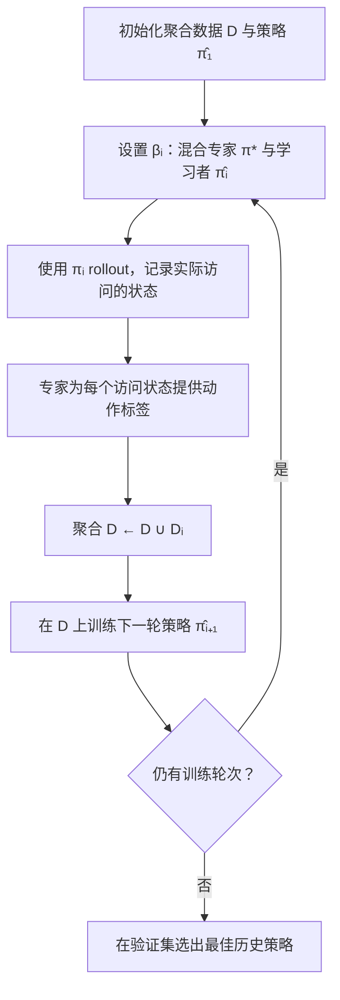

# DAgger 原论文（Ross et al., 2011）

**A Reduction of Imitation Learning and Structured Prediction to No-Regret Online Learning**（[PMLR v15](https://proceedings.mlr.press/v15/ross11a.html)，AISTATS 2011）由 **Stephane Ross、Geoffrey Gordon、Drew Bagnell** 提出 **DAgger（Dataset Aggregation）**：在序列决策里，让学习策略先 rollout，再由专家为 **策略实际访问的状态** 补标，把新数据并入训练集迭代重训。

## 一句话定义

**用在线数据聚合把「部署时会去到的状态」写进训练集，而不是只在专家演示分布上做 BC——DAgger 的核心是改数据闭环，不是改损失函数族。**

## 英文缩写速查

| 缩写 | 英文全称 | 简要说明 |
|------|----------|----------|
| DAgger | Dataset Aggregation | 本文提出的迭代专家回标模仿学习算法 |
| BC | Behavior Cloning | 纯离线专家演示监督，易受 covariate shift 影响 |
| IL | Imitation Learning | 从专家演示或反馈学习策略的总称 |
| MPC | Model Predictive Control | 滚动优化控制序列；常作 DAgger 专家 |
| RL | Reinforcement Learning | 用回报优化策略；与 IL 互补 |
| AISTATS | Artificial Intelligence and Statistics | 本文发表会议 |

## 为什么重要

- **理论锚点：** 把 IL / 结构化预测与 **no-regret 在线学习** 对接，说明在策略诱导分布上聚合标注为何能优于纯 BC。
- **工程默认变体：** 后人形/VLA 里的 **teacher–student 蒸馏、HITL 纠偏、共享控制** 多可追溯到「策略访问状态 + 专家补标」这一闭环（见 [DAgger 方法页](../methods/dagger.md) 工程节）。
- **与 IRL 对照：** 不推断奖励、不跑内环 RL，但需要 **在线专家**——选型见 [Inverse Reinforcement Learning](../methods/inverse-reinforcement-learning.md)。

## 核心信息

| 项 | 内容 |
|----|------|
| **会议** | AISTATS 2011（PMLR Vol. 15, pp. 627–635） |
| **PDF** | <http://proceedings.mlr.press/v15/ross11a/ross11a.pdf> |
| **开源** | **不适用**（经典理论论文；无官方代码仓） |

## 核心原理

### 问题：序列决策违反 i.i.d.

未来观测依赖先前动作/预测；纯 BC 在专家分布 $d_{\pi^*}$ 上优化，部署却在 $d_{\pi_\theta}$ 上评测 → **covariate shift** 与 **compounding error**（长 horizon 上误差累积）。

### DAgger 迭代（原论文 Algorithm 3.1）

1. 初始化聚合数据集 D=∅ 和学习策略 π̂₁（可任选初始策略）；常以第一轮完全由专家执行（β₁=1）获取数据。
2. 第 i 轮用混合策略 πᵢ = βᵢπ* + (1−βᵢ)π̂ᵢ 采集 T 步轨迹；βᵢ 随迭代衰减，简单版本为 βᵢ = 𝟙(i=1)。
3. 对轨迹中**实际访问的每个状态**查询专家动作，得到 Dᵢ = {(s, π*(s))}；将 Dᵢ 并入全部历史数据 D。
4. 用聚合数据 D 训练下一轮学习策略 π̂ᵢ₊₁；重复采集、标注和训练。
5. 返回**验证集上表现最佳**的历史策略 π̂ᵢ，而非无条件返回最后一轮。

**理论保证的前提：** 原文将该过程与 Follow-The-Leader / no-regret 在线学习联系起来；在代理损失、专家相对任务代价上界等条件下，可将相对专家的 T 步代价增量约束为随 T 线性增长的量级，而不是说任意深度策略都无条件成立。

### 与 BC 的误差量级（常用读法）

| 设定 | 单步误差 $\epsilon$、horizon $H$ 的常用上界量级 |
|------|-----------------------------------------------|
| 纯 BC | $\mathcal{O}(\epsilon H^2)$ |
| DAgger 类在线聚合 | $\mathcal{O}(\epsilon H)$ |

## 流程总览

根据原论文 §3 的 Algorithm 3.1 绘制，βᵢ 表示专家与当前策略的混合比例：

图示区分了**采样策略**（可混合专家）与**最终部署策略**（平稳确定性学习策略）；数据标注由专家完成，学习者主要决定下一轮会访问哪些状态。

## 源码运行时序图

**不适用** — 2011 原论文无官方可运行代码仓；工程实现分散于各机器人栈（如 [Holosoma](./holosoma.md) 的 DAgger 式蒸馏、LeHome 真机 `record_real_dagger.py` 等），见 [DAgger 方法页](../methods/dagger.md)。

## 工程实践

**按原论文复现的最小闭环**（不是新增的官方实现）：

1. 固定任务、训练预算与基础监督学习器，先建立只用专家示范训练的 BC 基线。
2. 依 Algorithm 3.1 迭代：执行混合策略 → 收集当前策略访问的状态 → 查询专家动作 → 聚合全量历史数据 → 重新训练。
3. 在**相同验证任务**上挑选历史最优策略，报告成功率、错误恢复能力、在线专家标注量及随训练轮次变化的曲线；不能只比较最终训练损失。
4. 保留专家混合日程 βᵢ、采样步数、轨迹数与每轮训练配置，便于区别数据分布改善和总数据量增加带来的收益。

**真实机器人的迁移建议（非 2011 年论文实验）**：先在仿真/安全沙盒做学生 rollout；真机增加碰撞边界、急停和人工接管。若专家仅在失败时回标或仅能覆盖有限状态，这是 HG-DAgger 等工程变体，须与原论文的“每轮状态由专家标注”假设区分。

## 局限与风险

- **专家成本：** 在线回标比离线演示贵，真机需共享控制与安全兜底。
- **非原始形式的变体更多：** 人形/loco 常混 **PPO / KL**（如 PHP、LadderMan），纯 DAgger 动作回归不足以覆盖高动态技能。
- **数据偏置：** 专家过早接管会缺少「接近失败可恢复」状态。

## 实验与评测

原论文 §5 不是现代机器人真机基准，而是两个模仿学习游戏任务和一个序列标注任务；以下为原论文**具体实验**，不是外部复现：

| 任务 | 设定 | 论文报告的关键结果 |
|---|---|---|
| Super Tux Kart（§5.1） | 由画面特征预测转向、线性岭回归、每轮约 1 圈、20 轮 | DAgger 约在第 15 轮后达到每圈 0 次掉出赛道；SMILe 20 轮后仍约每圈掉出 2 次 |
| Super Mario Bros.（§5.2） | 用规划器作为专家，线性 SVM 预测动作 | DAgger 明显优于纯监督基线与测试的 SMILe / SEARN 变体；论文还比较不同 βᵢ 衰减日程 |
| 手写词识别（§5.3） | 左到右逐字符预测，前一个预测字符作为后续输入 | 字符准确率：无结构基线 82%，监督训练 83.6%，DAgger 85.5% |

**理论结果与局限：** §2 的 BC 误差界允许 T²ε 级增长；§3–§4 在 no-regret、代理损失与代价上界等假设下推导 DAgger 的线性 T 量级保证（定理 3.1–3.4）。这不是对任意策略、任意深度神经网络或真实机器人安全性的无条件保证。

详情及核对范围见 [原文通读归档](../../sources/papers/dagger_reading_arxiv_1011_0686.md)（§1–§6）；图中曲线与论文页码以 [PMLR 原文 PDF](https://proceedings.mlr.press/v15/ross11a/ross11a.pdf) 为准。
## 与其他工作对比

| 维度 | DAgger（本文） | 纯 BC | [逆强化学习](../methods/inverse-reinforcement-learning.md) |
|------|----------------|--------|------------------------------------------------------------|
| 训练分布 | **策略实际访问的状态** | 专家演示分布 | 专家演示分布（推奖励） |
| 需要什么 | **在线专家**，可对任意状态补标 | 一次性离线演示 | 演示 + 内环 RL |
| 长 horizon 误差 | $\mathcal{O}(\epsilon H)$ 量级 | $\mathcal{O}(\epsilon H^2)$ 量级 | 取决于奖励恢复质量 |
| 主要代价 | 在线标注成本 + 真机安全兜底 | 最低 | 计算成本高、奖励不唯一 |
| 产物 | 平稳确定性策略 | 同左 | 奖励函数 + 策略 |

- **它改的是数据闭环，不是损失函数：** 这是读这篇论文最容易搞错的一点——聚合后优化的仍是 [行为克隆损失](../formalizations/behavior-cloning-loss.md)；把 DAgger 当成「一种新损失」会导致复现时只改目标不改采样，收益为零。
- **现代变体的谱系：** teacher–student 蒸馏、HITL 纠偏、共享控制都可追溯到同一闭环；人形/locomotion 实现常混入 PPO/KL 项（见 [DAgger 方法页](../methods/dagger.md)），**纯动作回归版本不足以覆盖高动态技能**。
- **与 IRL 的选型判据：** 有在线专家就用 DAgger；只有离线演示且需要迁移到新动力学/新目标，才值得付 IRL 的代价。

## 结论

**DAgger 的价值在于把模仿学习的训练分布改成「策略会去的状态」，而不是换一套更复杂的监督损失。**

- 相对纯 BC，核心收益是 **covariate shift / compounding error** 的量级改善（$\mathcal{O}(\epsilon H^2)$ → $\mathcal{O}(\epsilon H)$ 的常用读法）。
- 算法本体是 **平稳确定性策略 + 迭代 Dataset Aggregation**，比当时非平稳/随机策略替代更易部署。
- 机器人工程里常见 **teacher–student / HITL 纠偏** 变体，但闭环结构与本论文一致。
- 代价是 **在线专家** 与 rollout 安全机制；不推断奖励，与 IRL 路线互补。
- 无官方代码；读原文 + [DAgger 方法页](../methods/dagger.md) 工程实例即可落地。

## 关联页面

- [DAgger（方法页）](../methods/dagger.md) — 机制、对比表与大量工程实例
- [Behavior Cloning](../methods/behavior-cloning.md) — covariate shift 与 compounding error 形式化
- [Imitation Learning](../methods/imitation-learning.md) — IL 总览
- [Behavior Cloning Loss](../formalizations/behavior-cloning-loss.md) — DAgger 聚合后仍优化的目标

## 参考来源

- [ross_dagger_aistats_2011.md](../../sources/papers/ross_dagger_aistats_2011.md) — 本次 ingest 档案
- [dagger_reading_arxiv_1011_0686.md](../../sources/papers/dagger_reading_arxiv_1011_0686.md) — 原文 §1–§6 通读归档
- [imitation_learning.md](../../sources/papers/imitation_learning.md) — IL 合集条目
- PMLR：<https://proceedings.mlr.press/v15/ross11a.html>

## 推荐继续阅读

- Ross et al., *A Reduction of Imitation Learning and Structured Prediction to No-Regret Online Learning* — 原文 PDF
- Ross & Bagnell, *Efficient Reductions for Imitation Learning* — 后续 reduction 视角
- [Diffusion Policy](../methods/diffusion-policy.md) — 生成式 IL 如何与交互式数据收集结合
