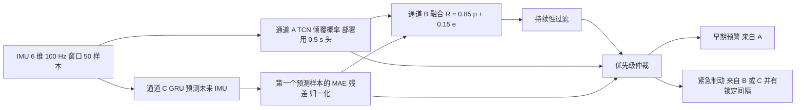

# 分层多通道倾覆预测（arXiv:2611.12261）

*Hierarchical Multi-Channel Tip-Over Prediction via Isolated Temporal Models for Planetary Rover Safety*（[arXiv:2611.12261](https://arxiv.org/abs/2611.12261)，Shete、Domínguez、Kirchner，DFKI 机器人创新中心）。数据集：[Zenodo 21258126](https://zenodo.org/records/21258126)（数据集记录，非代码仓库；论文与记录均未给代码或项目页）。

## 一句话定义

用两条互相隔离训练的时序模型分别回答「接下来会不会倾覆」（TCN）与「当前运动是否偏离正常」（GRU 预测残差），只在决策层加权融合并按优先级仲裁，输出早期预警和紧急制动；性能在 Asguardv4 实验车的 IMU 记录上离线评估（论文 摘要、IV、V）。

## 英文缩写速查

| 缩写 | 英文全称 | 简要说明 |
|------|----------|----------|
| TCN | Temporal Convolutional Network | 因果空洞卷积时序网络，本文通道 A，联合预测 0.5/1/2 s 倾覆概率 |
| GRU | Gated Recurrent Unit | 门控循环单元，本文通道 C 的编码器-解码器，预测正常动力学 |
| IMU | Inertial Measurement Unit | 惯性测量单元，本文输入为 6 维（线加速度 + 角速度），100 Hz |
| AUROC | Area Under ROC Curve | 分类器的区分能力指标，图 4 报告各预测视野 |
| MAE | Mean Absolute Error | 第一个预测样本与实测的平均绝对误差，作为 GRU 残差 |
| MLT | Median Lead Time | 首次告警到倾覆开始的中位时间 |
| EP / NE / PE | Early Prediction / Near Event / Post-Event | Table I 事件级分类，早预测 / 临近事件 / 事件后才报 |
| RTT | Orocos Real-Time Toolkit | 实时组件工具包，本文以 RTT 任务形式部署 |
| Rock | Robot Construction Kit | DFKI 的机器人组件框架 |
| LuNiS / Asguardv4 | 月球微型车技术验证平台 / 实验车 | 目标平台为 LuNiS，数据来自 Asguardv4 |

## 为什么重要

- 行星车与地球通信延迟（文中引 4 到 24 分钟量级）使人无法实时干预，需要车载的倾覆预测与制动（I）。
- 解析稳定判据（ZMP、静态稳定裕度、MHS 指数）依赖准确的接触假设，在打滑、松软土、冲击下不可靠（II）；作者因此转向基于惯性数据的学习式预测。
- 值得借鉴的设计：把「分类式预测」与「正常动力学一致性检测」拆成两路，最后用一个可解释的加权和加规则仲裁，而不是端到端的多任务网络（IV-D，作者自述的动机；论文没有做共享表示多任务基线的对照，所以「隔离优于共享」属作者假设）。

## 核心原理与流程总览

要点（论文 IV）：

1. **输入：** 6 维 IMU、100 Hz、50 样本窗口，两路共用同一窗口。
2. **通道 A：** 残差因果空洞卷积 + 时间池化 + 轻量预测头；训练时 0.5/1/2 s 多视野监督并有辅助时间到事件回归（推理不用），部署只保留 0.5 s 头，因其预测可靠性最高。
3. **通道 C：** 仅用正常运动训练的 GRU seq2seq，训练序列在倾覆前留间隔（pre-event gap）；在线只取第一个预测样本算 MAE，超过由正常预测误差统计确定的阈值就触发。
4. **通道 B：** R_t = α·p_t + (1−α)·ẽ_t，α = 0.85 由验证集选定；没有学习式融合层。
5. **仲裁：** 融合分数经持续性逻辑过滤；通道 A 发早期预警，通道 B 或 C 触发紧急制动；紧急后用软件超时保持制动、锁定间隔抑制重复指令。
6. **提前量口径：** 从首次系统告警到倾覆开始；车辆停车约需 0.5 s，故 1.82 s 中位提前量被作者估计为留出约 1.32 s 的余量（IV-E）。

## 工程实践

- **部署：** 作为 Rock 中的 Orocos RTT 任务组件，100 Hz；论文称整条流水线（TCN、GRU、残差、融合、仲裁）平均 1.38 ms 每周期（IV-E）。测量硬件与是否含 I/O，论文未写，属未核实。
- **数据：** 757,316 条同步 IMU 样本；Zenodo 记录为 CC-BY-4.0、约 80.7 MB 的 zip，含时间戳、加速度、陀螺、磁力计（记录说明未作网络输入）、roll/pitch/yaw（用于可视化与生成标签）、倾覆标签及提前 0.5 s 的早期预警标签（我只读了记录元数据，未下载数据）。
- **划分：** 按时间顺序切 训练 / 验证 / 测试 / 训练 四块，窗口分区内生成，跨界窗口丢弃；论文明说这不是按 session 或地形划分（III）。复现或迁移时要意识到相邻时间块可能来自同一次行驶。
- **阈值与 α：** α 由验证集确定；GRU 的触发阈值来自正常残差统计；多种运行配置（保守、早预警、高召回、敏感融合）在 F1 与提前量间权衡（V-C，图 6）。
- **没有代码：** 论文与 Zenodo 都没给实现，要复现只能按 IV 节自己写；超参（卷积层数、隐藏维度、阈值数值、持续性窗口长度）论文正文未给出，因此未核实。

## 结果摘要（Table I，共 124 个倾覆事件）

| 方法 | P | R | F1 | EP | NE | PE | Pred. | MLT(s) |
|------|---|---|----|----|----|----|-------|--------|
| Ch A（TCN） | 0.843 | 0.825 | 0.834 | 102 | 8 | 7 | 110/124 | 1.88 |
| Ch B（融合） | 0.907 | 0.885 | 0.892 | 99 | 9 | 8 | 108/124 | 1.82 |
| Ch C（GRU） | 0.639 | 0.795 | 0.703 | 57 | 24 | 8 | 81/124 | 0.74 |
| 分层决策（最终） | 0.934 | 0.913 | 0.921 | 114 | 7 | 0 | 121/124 | 1.82 |

- 121/124 即摘要中的 97.58% 事件覆盖。
- 单独看提前量，通道 A 的 1.88 s 略高于最终输出的 1.82 s；最终输出在 F1 与事件覆盖上最好（V-A）。
- AUROC 随视野增大而降：图 4 约 0.944（0.5 s）、0.929（1 s）、0.911（2 s，正文明写）。
- 推测（非作者所述）：Pred. = EP + NE，PE 不计入；四行数字均对得上。

## 与其他工作对比

| 工作 | 关注点 | 与本文的区别 |
|------|--------|--------------|
| 本文分层多通道倾覆预测 | 行星车 IMU 时序上的倾覆概率 + 正常动力学残差，决策层融合 | 纯惯性输入、离线记录评估，输出预警与紧急制动 |
| 解析稳定判据（ZMP、静态稳定裕度、MHS，论文 II） | 基于接触与几何模型的稳定裕度 | 依赖准确接触假设，打滑与松软土下不可靠；论文未与之做同数据数值对比 |
| [面向行星探索的地形感知自主](./paper-terrain-aware-autonomous-planetary-exploration.md) | RGB-D 高程与本体交互指标写入多层地图，选择探索目标 | 事前用外感知规避危险地形；本文只在车辆运动中用 IMU 预测倾覆 |
| [动作条件失败监控 Foresight](./paper-foresight-action-conditioned-failure-monitoring.md) | 动作条件表征预测操作失败风险 | 同属失败预警，但面向操作策略与学习表征；本文是车体动力学与规则仲裁 |

## 结论

**把「会不会倾覆」与「运动是否反常」拆成两条隔离训练的时序通道，再用加权融合和优先级仲裁出决策，在 124 个倾覆事件上覆盖 121 个、中位提前 1.82 s。**

1. 最终分层决策 F1 0.921、PE 为 0，优于任一单通道（TCN 0.834、融合 0.892、GRU 0.703，Table I）。
2. 部署只保留 0.5 s 预测头，因 AUROC 随视野增大而下降（约 0.944 到 0.911，图 4）；整条流水线 100 Hz、每周期 1.38 ms（IV-E）。
3. 提前量与 F1 存在权衡，可按保守 / 早预警 / 高召回等配置选择（图 6）。
4. 局限：时间块划分而非按地形 / session、单平台单传感器、无解析判据与共享表示基线，也没有实车闭环避险验证（V-A、VI）。

## 与文章说法的核对

对照公众号《机器人动作块太长，什么时候该重新规划？》对本文的段落（claims 文件）：

| 文章说法 | 论文核对 |
|----------|----------|
| 「越野车倾覆预警」 | 对象是行星探测车（研究用的 Asguardv4 实验车，目标平台 LuNiS），不是民用越野车。标题和正文均为 planetary rover。 |
| 「把不同风险信号分开学」「隔离不同时间通道建模」 | 属实：TCN 与 GRU 独立训练、仅在决策层融合（I、IV）。但「隔离优于共享多任务」没有对照实验，是作者假设。 |
| 「再融合规则、时序预测与残差检测」 | 大体属实但措辞略松：融合的是 TCN 概率与 GRU 残差两路学习信号，加权后再用持续性逻辑、优先级仲裁和锁定间隔这些规则；并没有单独的第三路「规则」预测器。Table I 里的 Ch A / B / C 中，B 是融合通道。 |
| 「争取倾覆预警提前量」 | 属实：最终输出中位提前量 1.82 s，作者估计扣掉约 0.5 s 制动后余约 1.32 s（IV-E、V-C）。但通道 A 单独的提前量 1.88 s 更长，且更长提前量的配置 F1 更低（图 6）。 |
| 「基于地面试验记录评估」 | 属实：数据为 Asguardv4 在 DFKI 场地的 IMU 记录，按时间块划分、在保留块上做事件级统计（III、V）。 |
| 「识别风险事件不等于已验证闭环避险或行星现场部署」 | 与论文一致：论文报告的是离线 / 记录数据上的事件覆盖与提前量，没有展示实车用该系统制动并避免倾覆的闭环试验；LuNiS 部署写在未来工作；未见地形与其他车体形态的泛化也明说未评估（V-A、VI）。注意论文摘要与结论也写了「已作为 RTT 组件在行星车软件栈上以 100 Hz 运行」，所以「部署」一词有两层：软件栈集成是论文所称已做，闭环避险与现场部署未见验证。 |

文章未写但值得补充：数据划分是时间块而非 session / 地形；成绩来自 124 个事件，样本量有限；摘要所称「异质地形」限于记录采集的地形类型。

## 局限

**论文自述：**

- 仅在保留的时间块上评估，不能证明对未见地形和其他车体形态的泛化（V-A、VI）。
- 高动态但可恢复的交互仍有误报；仅凭惯性数据很难分开安全瞬态与真实危险（VI）。
- 缺少真实行星移动数据集，泛化未评估（VI）。
- 未来工作：显式时间到事件估计、视觉地形感知、不确定性感知预测、LuNiS 部署与跨平台评估（VI）。

**我看到的未验证之处（判断，非作者自述）：**

- 划分是时间块而非 session / 地形 run，相邻块可能来自同一次行驶，测试结果可能偏乐观；论文自己强调了这一点但未量化影响。
- 124 个事件、单一平台（Asguardv4）、单一传感器（IMU），统计置信区间和多次随机种子论文未给。
- α = 0.85 与阈值在同一数据分布上调出；「接近 Pareto 前沿」基于作者自己设定的少数配置（图 6），不是系统扫描。
- 1.32 s 余量是由 1.82 s 减约 0.5 s 制动时间得到的估算；0.5 s 的制动响应来自作者描述，论文没有给出测量过程，且中位提前量并非最坏情况。
- 论文未与现有解析判据（ZMP、MHS）或其他学习式方法做同数据对比，只与自家前作 [19] 作了文字性比较（V-A），未列数值对比；也无共享表示多任务基线。
- 1.38 ms 的测量平台和负载未说明；超参、阈值未在正文给出。
- 本页对图 5、图 6 只读到趋势，未数字化。

## 关联页面

- [GRU](../concepts/gru.md)：通道 C 的序列模型
- [安全过滤器](../concepts/safety-filter.md)：另一类运行时安全干预思路
- [机器人安全状态机](../concepts/robot-safety-state-machine.md)：分级预警与紧急制动的工程对照
- [传感器融合](../concepts/sensor-fusion.md)：本文的融合发生在决策层而非特征层
- [分布外泛化](../concepts/out-of-distribution-generalization.md)：论文承认未验证的泛化问题
- [IMU 原理与算法](../concepts/imu-principles-algorithms-camera-sync.md)：输入信号背景
- [面向行星探索的地形感知自主](./paper-terrain-aware-autonomous-planetary-exploration.md)：同属行星探测车
- [机器人闭环运行时安全检查](./paper-runtime-safety-check-robot-loops.md)：运行时监控对照
- [动作条件失败监控](./paper-foresight-action-conditioned-failure-monitoring.md)：另一种失败预警思路
- [机器人感知栈选型闭环](../queries/robot-perception-stack-selection-loop.md)：本文的 IMU 异常检测在感知栈中的位置与选型取舍

## 参考来源

- [来源归档：分层多通道倾覆预测](../../sources/papers/rover-tipover-multichannel_arxiv_2611_12261.md)
- [arXiv:2611.12261](https://arxiv.org/abs/2611.12261)
- [Zenodo 数据集 10.5281/zenodo.21258126](https://zenodo.org/records/21258126)

## 继续阅读

- [arXiv PDF](https://arxiv.org/pdf/2611.12261v1)
- 作者前作（论文 [19]）：Prediction-based tip-over prevention for planetary exploration rovers, Engineering Proceedings 90(1), 2025（本页未读）
- [安全过滤器](../concepts/safety-filter.md)
