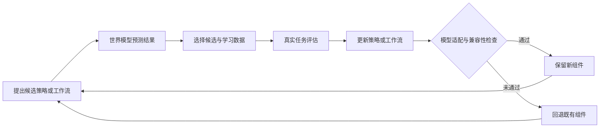
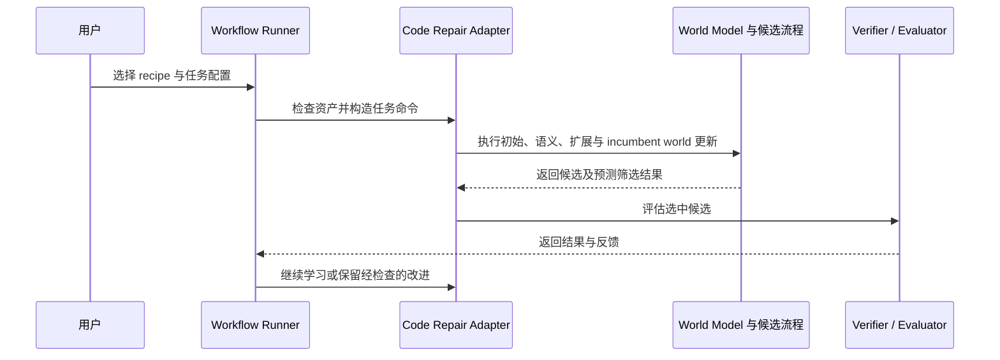

# RSI-Anything（世界模型辅助的递归自我改进）

## 一句话定义

RSI-Anything 是一个以预测式世界模型辅助候选筛选、策略学习和受控模型适配的跨任务迭代改进框架；它把“自我改进”落在可评估、可回滚的组件闭环，而不是宣称系统已自主设计并部署全新后继模型。

## 英文缩写速查

| 缩写 | 英文全称 | 简要说明 |
|------|----------|----------|
| RSI | Recursive Self-Improvement | 递归自我改进；本文中的框架名和研究目标 |
| JEPA | Joint Embedding Predictive Architecture | 预测潜在表征的架构家族，RSI-Anything 的世界模型基础 |
| WM | World Model | 预测候选动作/方案后果的模型，用于低成本筛选 |
| GUI | Graphical User Interface | 图形界面交互任务，如 MiniWoB++ 与 OSWorld |
| OPF | Orthogonal Predictive Factorization | JEPA-Anything 提出的正交预测因子分解 |

## 核心原理

系统共享环节为 **Propose → Predict → Select → Evaluate → Learn → Retain**。候选生成器提出策略或工作流变体，世界模型估计后果并辅助选择；选中的候选进入任务评测，观测反馈用于改进策略/工作流及筛选学习数据。需要更新世界模型时，框架按任务适配，并以组件与兼容性检查决定是否保留。预测是筛选信号，不替代最终任务评估。

它与 [递归自我改进概念页](../concepts/recursive-self-improvement.md) 中“系统自主设计、训练并部署后继模型”的强定义有距离：此处展示的是任务适配的候选—预测—验证循环，改进对象可以只是 policy/workflow，世界模型只在必要时更新。

## 评测与结果

论文及项目方报告覆盖代码修复、GUI、实验室规划、反应优化和免疫科学假设。读数应按任务和预算分别理解：

| 任务 | 报告结果 | 解释边界 |
|------|----------|----------|
| CodeContests | 固定 ReasonFlux-Coder-7B、200 题×3 seeds、近似在线测试调用预算：静态候选选择 26.3%，预测选择 29.2%，再加世界模型适配 31.2% | 是逐项消融，不能外推成通用代码修复提升 |
| MiniWoB++ | 成功率 51% → 99%；平均动作数降低 39.4% | 项目方报告的 GUI 基准结果 |
| OSWorld | 相对初始系统 +18.4%，相对 RLAnything +5.5% | 原文为相对增幅，不是百分点 |
| LabHorizon F200 L2 | 五个版本的分数 21.80 → 46.01 | 规划评测分数不等于真实仪器实验结果 |
| 反应优化 | 40 次实验平均最佳产率 96.15%，Bayesian Optimization 对照 82.16% | 仅覆盖报告的反应筛选范围和预算 |

## 源码运行时序图

仓库公开 workflow runner、CLI、任务适配器及代码修复/GUI 流程。共享 runner 负责按 recipe 编排阶段，adapter 负责具体任务命令与逻辑；下图只表示代码修复的配置运行路径，不代表所有科学任务共用同一个执行器。

## 开源与复现边界

官方仓库为公开 Apache-2.0 代码，含共享 runner、任务配置、代码修复与 GUI 实现和文档。官方复现记录为 Linux、Python 3.10.12、NVIDIA A800 80GB；两个基础模型合计约 21.4 GB，模型、任务资产和依赖需另外准备。因此代码可访问不等于可在轻量环境中直接复现全部结果。论文涉及的实验室规划、反应优化和免疫方向不能据仓库存在通用 runner 就推定为均已完整开放。

## 局限与风险

- 论文明确表示仍需多轮联合评估，才能确认策略与世界模型是否会相互促进；当前结果不足以证明稳定的长期自我强化。
- 预测模型可能误估候选后果；最终任务评估及兼容性检查是保留新组件的必要门槛。
- 实验室结果中的规划得分与实验室实际设备执行需要区分；免疫科学方向的假设仍未验证。
- 反应优化结论受所报告的反应筛选范围与 40 次预算限制，不能视为普适化学发现能力。
- 官方实现需要大模型与专用 GPU 资源，复现成本显著；不同任务 adapter 的公开完整度不一致。
- 这是研究框架与报告结果，不是可直接部署的机器人控制包或经安全认证的自治系统。

## 结论

RSI-Anything 的主要贡献是把世界模型预测接入一个具有评估和兼容性门槛的迭代改进环，当前证据支持若干具体基准上的候选筛选收益，尚不足以证明跨任务的长期递归自我改进。

- 读代码修复结果时，应优先看 26.3%→29.2%→31.2% 的同预算消融，而非只看最终数字。
- GUI 结果同时报告成功率和动作数，体现性能与交互成本两项指标。
- LabHorizon 分数是规划证据；真实仪器复现需另行核查。
- 用于部署前应验证模型预测校准、组件兼容性、回退策略及每个任务适配器的开放程度。
- 将其归入递归改进的工程案例，而不视为已实现完全自主后继模型研发。

## 与其他工作对比

| 对照 | 改进什么 | 预测/选择信号 | 与 RSI-Anything 的差异 |
|------|----------|----------------|------------------------|
| **RSI-Anything** | 策略 / 工作流，按需适配世界模型 | JEPA 式世界模型预测 + 真实任务评估 + 兼容性检查 | — |
| 静态候选选择（CodeContests 消融基线） | 不更新 | 无世界模型预测 | 同预算下 26.3% → 加预测选择 29.2% → 再加世界模型适配 31.2% |
| RLAnything（OSWorld 对照） | — | — | 论文报告 RSI-Anything 相对其 +5.5%（相对增幅，非百分点）；本库暂无该工作独立页面 |
| Bayesian Optimization（反应优化对照） | 实验参数 | 代理模型 + 采集函数 | 40 次实验平均最佳产率 96.15% vs 82.16%，仅限报告的反应范围与预算 |
| [JEPA-Anything](./paper-jepa-anything.md) | 预测表征本身 | OPF 潜在预测 | 提供世界模型基础；RSI-Anything 把预测接到 propose–predict–select–evaluate 改进环 |
| [递归自我改进](../concepts/recursive-self-improvement.md) 强定义 | 系统自主设计、训练并部署后继模型 | — | RSI-Anything 是任务适配、可回滚的组件闭环，尚未达到强定义 |

## 关联页面

- [JEPA-Anything](./paper-jepa-anything.md) — RSI-Anything 的预测模型基础，方法与系统是两个独立项目。
- [PhAI Labs](./phai-labs.md) — 研究机构及项目关系。
- [递归自我改进](../concepts/recursive-self-improvement.md) — 强定义与任务闭环案例的边界。
- [生成式世界模型](../methods/generative-world-models.md) — 预测式世界模型的方法坐标。

## 参考来源

- [RSI-Anything 技术报告](../../sources/papers/rsi_anything_arxiv_2610_13912.md)
- [RSI-Anything 官方仓库](../../sources/repos/rsi-anything.md)
- [PhAI Labs 项目页归档](../../sources/sites/rsi-anything.md)

## 推荐继续阅读

- [RSI-Anything arXiv 页面](https://arxiv.org/abs/2610.13912)
- [RSI-Anything 官方仓库](https://github.com/Gen-Verse/RSI-Anything)
- [JEPA-Anything](./paper-jepa-anything.md)
