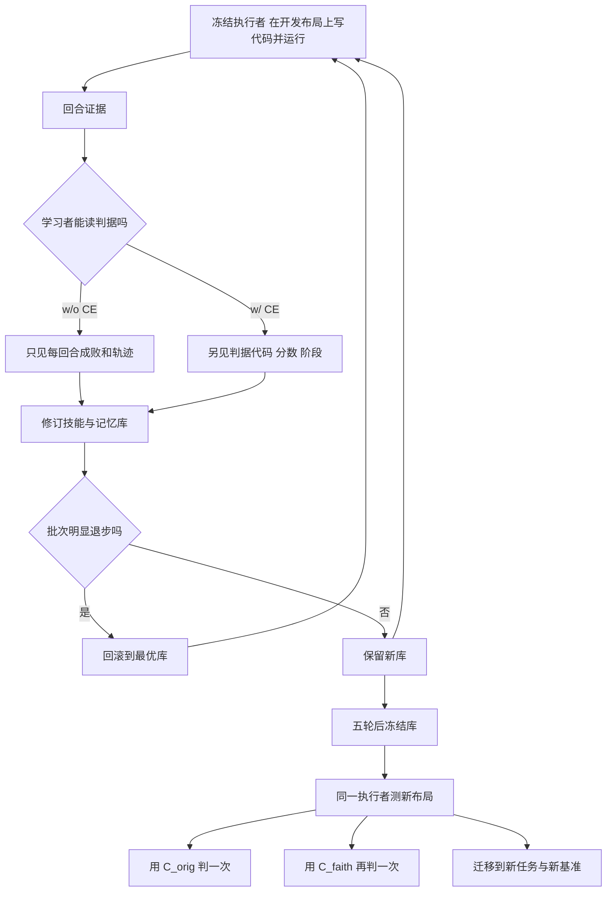

# RSIJudge：学到的是任务还是判据（arXiv:2611.08318）

**RSIJudge**（*Learning the Task or Learning the Verifier? Rethinking Criteria Exposure in Embodied Self-Improvement*，[arXiv:2611.08318](https://arxiv.org/abs/2611.08318)，北京大学，Daquan Zhou 通讯）是一篇**评测方法论**论文，不提出新的机器人策略。它回答一个问题：自我改进的具身编码智能体读到基准的成功判据后，得分变高，是更会做指令要求的任务，还是只是更会过这个验证器。本页依据对论文全文（含附录）的通读，归档见 [sources/papers/rsijudge_arxiv_2611_08318.md](../../sources/papers/rsijudge_arxiv_2611_08318.md)。

## 一句话定义

**RSIJudge 把「学习者是否能读成功判据」当作唯一实验变量（Criteria Exposure，CE），并用作者重写的「忠于指令」判据重判同一批回合，检验自我改进的得分提升来自任务能力还是来自适配验证器。**

## 英文缩写速查

| 缩写 / 记号 | 英文全称 | 简要说明 |
|------|----------|----------|
| CE | Criteria Exposure | 学习者能读判据代码、分数与阶段（w/ CE），对照组只见每回合成败（w/o CE） |
| C^orig | original criteria | 基准自带的成功判据 |
| C^faith | instruction-faithful criteria | 作者重写、只验证指令所述内容的判据（论文中 C 的上标 faith） |
| S_τ | instruction-asked success | 指令本身要求的成功，不能直接计算，C^faith 是作者的代理（§3.1、§3.3） |
| SR | success rate | 成功率 |
| VLA | Vision-Language-Action | 视觉-语言-动作策略，这些基准最初为其而建，见 [VLA](../methods/vla.md) |
| MLLM | Multimodal Large Language Model | 执行者 GPT-6 Astra 的类型 |
| w/ CE、w/o CE | with / without CE | 两种实验设置 |

## 为什么重要

- **作者自述：** 具身仿真基准的判据原本为模仿学习策略写成，常常要求比指令更多（例如 RoboDojo 的 press_by_number 要求蓝键恰好按两次且夹在两组红键之间，指令没写），对示教训练的策略无妨，对读判据来改代码的智能体则会把「判据与指令的差」变成分数（§1，图 1）。
- 许多已有系统以不同程度向学习者暴露判据：规则描述、公开评分表、数值阈值、形式化目标谓词、验证器源码（§1，§2）。论文指出这类系统中暴露程度多由设计固定，很少作为实验变量单独拆开（§2）。
- 实践含义（作者建议，§4.2.3、§6）：默认不暴露判据地度量自我改进，并同时报告忠于指令判据下的成功率。
- 与本库的联系：属于 [AI 智能体评测](../concepts/ai-agent-evaluation.md) 与 [仿真评测与真实世界差距](../concepts/sim-vs-real-eval-gap.md) 的一个具体案例，也可对照 [奖励设计](../concepts/reward-design.md) 中的奖励误设 / 规格博弈问题（论文相关工作引用了奖励误设研究，§2）。

## 核心机制

### 方法栈与实验设计

| 项 | 内容（出处） |
|----|------|
| **执行者（冻结）** | GPT-6 Astra，高推理强度；经 PyRUA-Lean 的冻结 `robo` API 写代码，仅 RGB 感知（SAM 3 与多视角测量）与运动基元，无 VLA、深度、仿真器状态（§3.1，附录 A.2） |
| **学习者** | Claude Code + Opus 5.5，高推理强度；每轮对库做一次修订，库 = 可调用技能 + 记忆条目，每任务至多 40,000 字符（§3.1，附录 A.2） |
| **循环** | 每任务五轮、五个开发布局（seed 1 的布局 0–4）；批次比最优批次少 ≥2 次成功则回滚到最优库（Algorithm 1，θ=2） |
| **唯一开关** | w/o CE：只见每回合成败；w/ CE：另见判据代码、每回合分数与通过阶段。执行者从不读判据（§3.1） |
| **任务** | RoboDojo（双臂 ARX-X5，仅 RGB）；25 个学习任务 = 16 判据受限 + 9 忠实，事先分组；LIBERO-PRO 与 RoboCasa365 用于迁移（§3.4，附录 A.1） |
| **测试** | seed 0 的布局 0–19，每任务每设置 20 回合（§3.4） |

### 判据受限任务与忠于指令判据

- 判据受限：判据与指令要求的成功在某些轨迹上不一致（§3.2）。RoboDojo 42 个任务人工逐个审查，19 个不一致，加 solve_equation（判据有 bug）共 20 个、26 个变体；33 个任务要求双臂回 home，而只有 5 条指令要求复位（附录 B）。类型名为作者自拟，最常见为隐藏规则与硬阈值。
- C^faith：只改 `run_reward` 与 `get_score`，不改指令、不动原仓库；两套判据对同一回合独立判定，所有结论翻转的回合人工检查，作者称未发现新判据误判（§3.3，附录 C 表 6）。

## 评测与结果（均为论文数字）

| 实验 | 结果（出处） |
|------|------|
| 原判据，25 任务 | 空库 24.6%，w/o CE 47.8%，w/ CE 62.0%（§4.1.1 表 1） |
| 其中判据受限 16 任务 | 8.4 / 27.8 / 51.6；忠实 9 任务 53.3 / 83.3 / 80.6（表 1） |
| 同一批回合换 C^faith 重判（16 任务，各 320 回合） | w/ CE 51.6% 到 45.0%，w/o CE 27.8% 到 47.2%；差距缩小 25.9 点，按任务自助法 95% 区间 4.7–54.4（§4.2.1，图 4） |
| 互换所读判据（10 任务，各 200 回合） | 读 C^orig 的库 57.0% 到 45.0%（换 C^faith 判）；读 C^faith 的库 65.0% 到 13.5%（换 C^orig 判）（§4.2.2，图 5） |
| RoboDojo 新任务迁移（10 目标任务） | 空库 65/200，w/o CE 80/200，w/ CE 71/200（§4.3.1 表 2） |
| LIBERO-PRO（6 任务 × 10 种子） | 45/60，48/60，46/60（表 2） |
| RoboCasa365（库来自 RoboDojo） | 22/100，24/100，24/100；库来自 RoboCasa365 自身：33/100（w/o CE）、29/100（w/ CE）（表 2） |

### 论文给出的解释（作者自述，机制未经消融，见局限）

- 暴露只在判据比指令多要求、且失败回合不会暴露这条规则时有用：build_tower 的剩余积木会暴露规则，两种设置都 20/20；press_by_number 的按键协议不会暴露，w/o CE 学习者从未发现（§4.1.1）。
- w/ CE 的记忆条目用判据的语言写经验，55 条中 19 条引用判据代码，w/o CE 的 53 条无一引用；w/o CE 学习者需要找物理原因，如把空夹爪失败归因于 KEEP 让半张夹爪重新合上（附录 F，图 7）。
- 迁移：相同数字的抓取条目，w/o CE 蒸馏库让空夹爪移动传 OPEN 的比例为 91%，w/ CE 蒸馏库为 3%（空库 35%）；solve_equation 解出 19/20 对 14/20、15/20；insert_tubes 上 w/ CE 蒸馏库把 500 个动作里的 116 个花在重新测量，解出 6/20 对 12/20、11/20（附录 H，表 9，图 7）。

## 工程实践

- **做评测时：** 论文建议学习者只拿真实机器人会拿到的反馈（成败），并让基准判据只验证指令所述内容；基准最好在指令中写明判据验证的计数、顺序、终态、双臂复位，并发布带版本的判据以及与指令的对照（§4.1.2）。
- **复现入口：** 代码在 PyRUA-Lean 仓库的 RSIJudge 分支，README 列出循环（`pyrualean.learn`）、`faithful_criteria/`（C^faith 覆盖层与双判据）、`eval/`、`transfer/` 与 `configs/`；依赖 RoboDojo 指定提交、Isaac Sim 5.1.0、Isaac Lab 0.54.3、约 45 GB 显存的 GPU、SAM 3，以及一个执行者模型端点和 Claude Code。本页只静态阅读了 README，未运行代码。
- **读懂数字时：** 附录 D 表 7 给出逐任务的双判据计数，判据受限任务的汇总数字受少数任务驱动（如 press_by_number：w/ CE 20 回合在 C^orig 下成功、C^faith 下 0；w/o CE 相反 19 回合只在 C^faith 下成功；swap_blocks 与 make_kong 也呈极端分化），引用均值前建议同时看逐任务表。这是本页对表 7 的读法，不是论文结论。
- 与本库其他 PyRUA / 编码智能体论文的对照见 [PyRUA-Real](../entities/paper-pyrua-real.md)（同一执行者框架家族）与 [EmbodiedEvo](../entities/paper-embodied-evo-coding-agent.md)（论文 §2 称其为最近的对照消融：任务描述对「描述加 wiki」，但两组都用原判据评分）。

## 与其他工作对比

论文 §2 把已有自我改进 / 智能体系统按「向学习者暴露多少判据」排列：规则描述、公开评分表、数值阈值、形式化目标谓词、验证器源码；这些系统的暴露程度多由设计固定，RSIJudge 的差别是把暴露当作**唯一实验变量**拆开，并用 C^faith 重判同一批回合（§2、§3）。

| 对照 | 关系（出处） |
|------|------|
| [EmbodiedEvo](../entities/paper-embodied-evo-coding-agent.md) | 论文 §2 称其为最近的对照消融：比较「任务描述」与「描述加 wiki」，但两组都用原判据评分；RSIJudge 额外换判据重判 |
| [PyRUA-Real](../entities/paper-pyrua-real.md) | 同一 PyRUA 执行者框架家族；RSIJudge 用其 Lean 版本作冻结执行者，本身不比较策略能力 |
| [奖励设计](../concepts/reward-design.md) 中的奖励误设 / 规格博弈 | 论文相关工作引用奖励误设研究（§2）；RSIJudge 把同一问题落到「基准判据比指令要求更多」这一具身评测场景 |

## 结论

**RSIJudge 说明：在判据比指令多要求的任务上，自我改进循环读判据带来的得分提升主要是在适配验证器，换成忠于指令的判据后差距基本消失，迁移也无额外收益。**

1. 真正该看的指标是 C^faith 下的成功率：判据受限 16 任务上 w/ CE 45.0% 对 w/o CE 47.2%（§4.2.1），而不是 C^orig 下的 51.6% 对 27.8%。
2. 汇总差距的不确定性很大（差距缩小 25.9 点，95% 区间 4.7–54.4），且受 press_by_number 等少数任务驱动，引用前看附录 D 表 7 逐任务计数。
3. 迁移数字（表 2）是次要证据：RoboDojo 新任务 w/o CE 80/200 对 w/ CE 71/200，跨基准受天花板与技能几乎不被调用限制。
4. 评测设计读法：报告自我改进时默认不向学习者暴露判据，并同时给出忠于指令判据下的成功率（§4.2.3、§6）；基准在指令中写清计数、顺序、终态、复位要求（§4.1.2）。
5. 结论边界：C^faith 由作者编写、仅覆盖 RoboDojo，执行者与学习者各一种模型，本页未见学习过程的重复报告；外推到其他基准或模型前需复核。

## 局限

**论文自己承认的（§5）：**

- C^faith 由作者自己编写，是 S_τ 的代理；仅 RoboDojo 的判据被重写，其他基准未做；作者列出的后续是独立复核、发布判据代码、第二个基准的重写、用 VLM 成败检测替代仿真成败。
- 仿真里的「只看成败」比真实世界里人或 VLM 给出的成败更干净。
- 暴露只研究了两档（读 / 不读），规则描述、公开评分表、部分阈值这些中间档没有单独研究。
- 每任务仅 20 个测试布局，所以定量结论用汇总，单任务只作定性描述；蒸馏方差未估计；关于暴露往库里写了什么、迁移了什么、执行者如何使用迁移库的解释基于条目文字、技能调用与动作统计，没有消融。
- 附录 A.1 指出开发批次噪声大：同一库在同一布局重跑，4% 的情形结论会变；同一空库的两次第 0 轮批次至少 13% 的回合不同。

**本页读到的、论文未验证或需谨慎之处（读者判断，非论文结论）：**

- 每个任务与设置只学出一个库，我在文中没有看到对「学习过程本身」多次重复的报告，所以 w/ CE 与 w/o CE 的差距里有多少来自学习随机性，无法由论文判断（推测：幅度不小，因为开发批次噪声已有 13% 量级）。
- 执行者与学习者各只有一种模型（GPT-6 Astra、Opus 5.5）；结论是否随模型更换而变，论文没有测。
- 重判实验（§4.2.1）只覆盖 16 个判据受限任务；忠实任务上 w/ CE 与 w/o CE 本来就持平，所以「暴露没有收益」的结论在判据受限任务上是由 C^faith 的选择定义出来的，C^faith 的合理性依赖作者的人工审查（附录 C 说明了规则与每项改动，但没有独立复核）。
- 「忠于指令」的某些改动含作者自己的决定（如 fasten_screws 的「拧紧」设为螺母下沉 ≥35 mm，build_tower 何谓一座塔，store_laptop_and_headphones 哪些边可朝下，见附录 C），这些是判断而非客观事实。
- 跨基准结果（表 2）受天花板限制：LIBERO-PRO 空库在 40 个任务中已有 34 个五个种子全解，被测的 6 个任务差异很小（附录 I），不宜据此读出「方法无效」。
- 论文使用的模型名称（GPT-6 Astra、Claude Opus 5.5）以论文原文为准，本页未独立核实其规格。

## 关联页面

- [RoboDojo](../entities/robodojo.md) — 本文主基准，判据与指令的差距在此分析
- [EmbodiedEvo：自进化编码智能体](../entities/paper-embodied-evo-coding-agent.md) — 论文 §2 点名的最近对照
- [PyRUA-Real](../entities/paper-pyrua-real.md) — 同一 PyRUA 框架家族
- [LIBERO 基准](../entities/libero-benchmark.md)、[LIBERO-PRO](../entities/paper-libero-vpro.md)、[RoboCasa](../entities/robocasa.md) — 迁移实验的另外两个基准
- [递归自我改进](../concepts/recursive-self-improvement.md)
- [仿真评测与真实世界差距](../concepts/sim-vs-real-eval-gap.md)
- [AI 智能体评测](../concepts/ai-agent-evaluation.md)
- [奖励设计](../concepts/reward-design.md)
- [具身大模型评测基准选型闭环](../queries/embodied-eval-benchmark-selection-loop.md) — 落在其 ③ 策略任务成功率层：基准判据与指令不一致会让成功率虚高，RSIJudge 给出判据层面的典型误判案例

## 参考来源

- [sources/papers/rsijudge_arxiv_2611_08318.md](../../sources/papers/rsijudge_arxiv_2611_08318.md) — 论文通读归档
- [arXiv:2611.08318](https://arxiv.org/abs/2611.08318)
- 代码：[DAGroup-PKU/PyRUA-Lean（RSIJudge 分支）](https://github.com/DAGroup-PKU/PyRUA-Lean/tree/RSIJudge)，README 已静态核对
- 项目页：[dagroup-pku.github.io/PyRUA-Lean/RSIJudge](https://dagroup-pku.github.io/PyRUA-Lean/RSIJudge/)

## 推荐继续阅读

- [arXiv PDF](https://arxiv.org/pdf/2611.08318v1) 的附录 B（判据与指令逐任务对照）、附录 C 表 6（每项判据改动）与附录 D 表 7（逐任务双判据计数）
- [RoboDojo 实体页](../entities/robodojo.md)
- [递归自我改进](../concepts/recursive-self-improvement.md)
