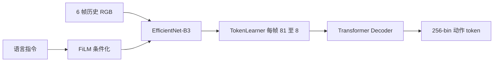
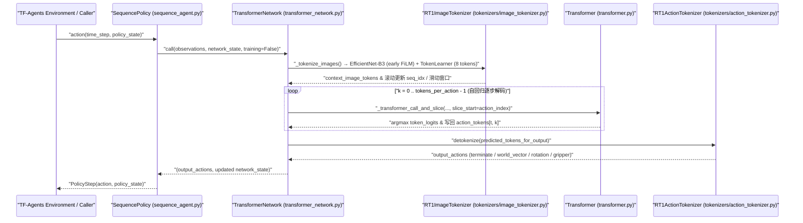

# RT-1：规模化真机控制的 Robotics Transformer

**RT-1**（*RT-1: Robotics Transformer for Real-World Control at Scale*，[arXiv:2212.06817](https://arxiv.org/abs/2212.06817)，[代码](https://github.com/google-research/robotics_transformer)）由 **谷歌 DeepMind** 提出：在约 **130k** 真实演示、**700+** 任务上训练单一 Transformer，把语言指令与历史图像映射为离散动作 token。

## 一句话定义

**先证明 Transformer 能在大规模真机数据上做端到端操作，再谈 VLM 迁移。**

## 英文缩写速查

| 缩写 | 英文全称 | 简要说明 |
|------|----------|----------|
| RT | Robotics Transformer | 本系列操作策略族 |
| FiLM | Feature-wise Linear Modulation | 用语言调制视觉特征 |
| VLA | Vision-Language-Action | 后续由 [RT-2](./paper-rt-2.md) 命名的范式 |
| BC | Behavior Cloning | 本工作的训练范式 |
| WAM | World Action Model | 世界预测与动作生成耦合 |
| IDM | Inverse Dynamics Model | 先预测未来再反推动作 |
| WM | World Model | 环境前向预测模型 |

## 为什么重要

- 纳入 [VLA/WM 阅读路线](../../sources/blogs/wechat_embodied_ai_lab_vla_wm_reading_roadmap_2026-09-02.md) 的奠基篇。
- **历史帧** 对操作至关重要：单帧策略在时序任务上明显不足。
- TokenLearner 将每帧视觉 token 从 **81 压缩至 8**，使 Transformer 可训练。
- **已公开**模型代码与 TensorFlow SavedModel 检查点，是读 [RT-2](./paper-rt-2.md) / [OpenVLA](./paper-openvla.md) 前的架构对照。

## 核心原理

- **语言调制视觉编码（FiLM + EfficientNet + TokenLearner）：** 语言嵌入通过 FiLM 对 EfficientNet 空间特征逐通道调制，再经 `TokenLearnerModule` 将每帧 81 个视觉 token 压缩为 8 个，支撑 6 帧历史图像输入下的可扩展训练与 3 Hz 实时控制。
- **256-bin 序列动作建模与因果掩码：** 将连续末端增量、夹爪开合与终止位统一离散为 `vocab_size = 256` token，`Transformer` 通过带因果遮罩的自注意力掩蔽历史动作间非必要干扰、按步自回归预测动作序列并用交叉熵训练。

## 核心信息

| 项 | 内容 |
|----|------|
| **机构** | 谷歌 DeepMind（Google DeepMind） |
| **数据** | ~130k 演示，700+ 任务 |
| **视觉** | EfficientNet-B3 + TokenLearner |
| **动作** | 连续动作维度离散为 256 个 bin；另有模式切换 |
| **开源** | **已开源** [google-research/robotics_transformer](https://github.com/google-research/robotics_transformer) |

### 流程总览

## 评测

- 论文表 2：已见任务 97%、未见任务 76%、干扰物 83%、背景变化 59%；均为对应测试集的成功率。
- 消融重点是历史上下文与 token 压缩，而非更重的视觉骨干。
- 具体成功率表以 [原文](https://arxiv.org/abs/2212.06817) 为准。

## 结论

**RT-1 把「规模化真机 BC + Transformer」做成可复现基线，VLA 的动作离散化接口从这里开始。**

- 历史图像是操作策略的一等输入，不是可选增强
- Token 压缩是算力门槛，不是精度装饰
- 离散动作 bin 把连续控制变成语言模型可解的序列问题
- 读后续 VLA 时先对照：有没有历史、如何压视觉 token、动作是否仍是 bin
- 官方仓提供 TensorFlow/TF-Agents 模型组件、单元测试与 3 组 SavedModel 检查点；130k 真机轨迹数据未随代码仓一并释放

## 工程实践

- **节拍缓冲与真实频宽（Appendix C.1）：** 系统将观测获取到动作下发的时间差统一填充延迟至 **280 ms**，用固定控制节拍降低执行抖动（不等于神经网络单次前向耗时 280 ms）。
- **数据配方优先覆盖任务多样性（§6.3–6.5）：** 13 台 Everyday Robots 在 17 个月内采集的 13 万+条示教覆盖 744 项任务；混入仿真或异构机器人数据时应独立汇报已见任务、未见目标与干扰物成功率。
- **本地验证入口：** 可在源码仓运行 `python -m robotics_transformer.tokenizers.action_tokenizer.test` 或 `bazel test ...` 验证离散化与网络前向接口，推理直接加载 `trained_checkpoints/rt1main`（SavedModel）。

## 源码运行时序图

> 代码路径对照 [sources/repos/google-research-robotics-transformer.md](../../sources/repos/google-research-robotics-transformer.md)（commit `4569641b`）。

## 局限与风险

- **数据封闭：** 公开仓不等于复现 130k 真机数据规模。
- **离散化：** 精细力控/高频连续动作不是本架构强项，见 [π₀](./paper-pi0.md)。
- **与 RT-2 分界：** 本页无互联网 VLM 知识迁移。

## 与其他工作对比

| 工作 | 相对本页 |
|------|----------|
| [RT-2](./paper-rt-2.md) | 同一动作接口，换成预训练 VLM 骨干 |
| [OpenVLA](./paper-openvla.md) | 开源 7B 复现路线 |
| [Octo](./paper-octo.md) | 更灵活的读出头与多模态输入 |

## 关联页面

- [RT-2](./paper-rt-2.md)
- [RT 系列方法页](../methods/robotics-transformer-rt-series.md)
- [VLA](../methods/vla.md)
- [VLA/WM 14 篇路线](../overview/vla-wm-reading-roadmap-14-papers-technology-map.md)

- 列表实体：[Awesome World-Action Models（RCL）](paper-rcl-wam-robot-learning-control-survey.md)
- 技术地图：[RCL Awesome WAM 技术地图](../overview/rcl-awesome-wam-technology-map.md)
- 方法/任务：[generative-world-models.md](../methods/generative-world-models.md)、[manipulation.md](../tasks/manipulation.md)

- [awesome-world-action-models-rcl](paper-rcl-wam-robot-learning-control-survey.md)
- [locomotion](../tasks/locomotion.md)

## 推荐继续阅读

- [arXiv:2212.06817](https://arxiv.org/abs/2212.06817)
- [google-research/robotics_transformer](https://github.com/google-research/robotics_transformer)

- [Awesome World-Action Models (RCL) 仓库](https://github.com/rcl-robotics/Awesome-World-Action-Models)
- [原文](https://www.roboticsproceedings.org/rss19/p025.pdf)

## 参考来源

- [rt_1_arxiv_2212_06817](../../sources/papers/rt_1_arxiv_2212_06817.md)
- [具身智能研究室 VLA/WM 阅读路线](../../sources/blogs/wechat_embodied_ai_lab_vla_wm_reading_roadmap_2026-09-02.md)
- [google-research-robotics-transformer](../../sources/repos/google-research-robotics-transformer.md)

- [`sources/papers/rcl_awesome_wam_ref_d73223ab358ff6f8ecd9_rt-1-robotics-transformer-for-real-world.md`](../../sources/papers/rcl_awesome_wam_ref_d73223ab358ff6f8ecd9_rt-1-robotics-transformer-for-real-world.md) — 本条目策展摘录
- [`sources/papers/rcl_awesome_wam_catalog.md`](../../sources/papers/rcl_awesome_wam_catalog.md) — 列表总表
- [`sources/repos/awesome-world-action-models-rcl.md`](../../sources/repos/awesome-world-action-models-rcl.md)
- [`docs/PAPERS.md`](https://github.com/RCL-Robotics/Awesome-World-Action-Models/blob/main/docs/PAPERS.md) — 上游论文目录
- 论文：<https://www.roboticsproceedings.org/rss19/p025.pdf>

- [原论文与官方资源](https://robotics-transformer1.github.io)

> 本次核查：论文 [arXiv v2](https://arxiv.org/abs/2212.06817v2) 全文（§1–7、Appendix A–D）、[官方项目页](https://robotics-transformer1.github.io/)及官方源码 [`google-research/robotics_transformer`](https://github.com/google-research/robotics_transformer) 关键模块（commit `4569641b`）。
