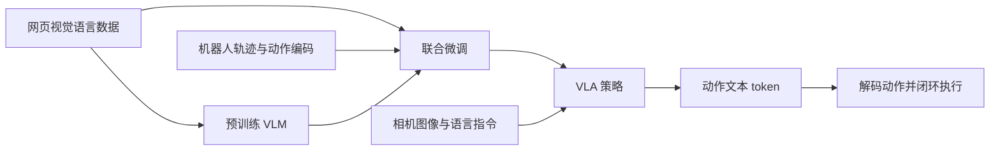

# RT-2：用 VLM 把网页知识迁到机器人控制

**RT-2**（*RT-2: Vision-Language-Action Models Transfer Web Knowledge to Robotic Control*，[arXiv:2307.15818](https://arxiv.org/abs/2307.15818)）由 **谷歌 DeepMind** 提出：把机器人动作写成 **文本 token**，直接微调 PaLI-X / PaLM-E 等预训练 VLM，使互联网视觉–语言知识进入物理控制。这是 **VLA 这一命名** 的来源工作。

## 一句话定义

**VLA = 把连续动作离散成语言模型能说的词，再与网页图文数据一起微调。**

## 英文缩写速查

| 缩写 | 英文全称 | 简要说明 |
|------|----------|----------|
| VLA | Vision-Language-Action | 本工作确立的范式名 |
| VLM | Vision-Language Model | 预训练视觉–语言骨干 |
| Co-training | Joint robot + VQA training | 防止灾难性遗忘的联合训练 |
| BC | Behavior Cloning | 机器人数据侧的监督 |

## 为什么重要

- 纳入 [VLA/WM 阅读路线](../../sources/blogs/wechat_embodied_ai_lab_vla_wm_reading_roadmap_2026-09-02.md) 的命名篇。
- 相对 [RT-1](./paper-rt-1.md)：不只是更大 Transformer，而是 **借用网页语义**（未见物体、符号推理）。
- 动作文本化是后续 [OpenVLA](./paper-openvla.md) 自回归动作 token 的直接祖先。
- **官方训练未开源**：读本页是为范式，不是为复现权重。

## 核心原理

- **动作文本分词与词表约束：** 将 6-DoF 末端位移、夹爪开合与终止标志均匀离散为 256 bin 整数，写成 `"terminate Δpos×3 Δrot×3 gripper"` 字符串（PaLI-X 直接输出整数文本，PaLM-E 通过 symbol tuning 复用最少用词表 token）；推理时约束仅采样合法动作 token，避免自回归退化为闲聊。
- **Co-fine-tuning 防遗忘：** 把互联网图像–文本（WebLI 等约 10B 筛选后 1B 样本规模混合物）与 RT-1 真实轨迹按 50%（PaLI-X）/ 66%（PaLM-E）机器人权重混训，使模型在不新增动作专用头的前提下兼得开放语义与控制精度。

## 核心信息

| 项 | 内容 |
|----|------|
| **机构** | 谷歌 DeepMind（Google DeepMind） |
| **骨干** | PaLI-X / PaLM-E 等预训练 VLM |
| **动作** | 文本 token（离散数字串） |
| **训练** | 机器人数据 + 视觉–语言数据 co-training |
| **开源** | **官方完整训练未开源**；推理仅有社区实现 |

### 流程总览

## 评测

- 约 6000 条真机评测轨迹（附录 Table 4）：`RT-2-PaLI-X-55B` 已见任务 91%、未见物体/背景/环境综合平均 **62%**（vs `RT-1` 32%、`MOO` 35%）；`RT-2-PaLM-E-12B` 已见 93%、未见平均 **62%**；Language-Table 仿真 `RT-2-PaLI-3B` 达 `90±10`（vs `RT-1` 74、`BC-Zero` 72、`LAVA` 77）。
- 论文 §4.2 / Table 5 涌现能力（符号理解、算术与多语言推理、人物识别）：`RT-2-PaLI-X` 平均成功率约为次优基线 `RT-1` 的 2–3 倍；Co-training 相对仅用机器人数据微调显著保留多模态语义。
- 具体逐项分表以 [原文](https://arxiv.org/abs/2307.15818) 为准。

## 工程实践

- **多 TPU 云端推理 vs 端侧延迟：** `RT-2-PaLI-X-55B` 依赖多 TPU 服务端经网络调用，控制频率约 `1–3 Hz`（`5B` 约 `5 Hz`）；不适用于高带宽力控或快速动态反应场景，工程替代可对照异步双频策略或连续流匹配动作头（如 π₀ / SmolVLA）。
- **面向可复现实验的替代路径：** 因官方未公开完整训练/推理源码与 PaLI-X/PaLM-E 权重，社区复现研究应采用同接口但权重/数据完全开源的 [OpenVLA](./paper-openvla.md)（7B）或 `Octo`。

## 结论

**RT-2 把「VLM 会说话」变成「VLM 会发动作」；工程上真正可跑的开源对照是 OpenVLA，不是本页。**

- 动作离散化是把控制问题改写成 next-token 的桥梁
- co-training 是保留语义、避免只记机器人数据的关键
- 推理链示例包括根据语义选择可充当锤子的石头
- 闭源训练意味着不能用本页当复现清单
- 读 [OpenVLA](./paper-openvla.md) 时对照：同样是动作 token，但数据与权重公开

## 源码运行时序图

**不适用。** 截至 2026-09-02：官方未发布完整训练/推理仓库；社区 fork 不能当作官方入口。

## 局限与风险

- **不可复现训练：** 无官方 GitHub 训练仓与闭源骨干权重（附录 D/E 所用 PaLI-X 55B / PaLM-E 12B 闭源）。
- **物理技能与精细抓取天花板（§5 与附录 G）：** VLM 迁移带来语义泛化但**不会创造新运动技能**；附录 G 实测在抓取把手等特定部件、抹布擦拭、折叠毛巾等灵巧动作及未见推物动力学（如滚落桌面/偏心香蕉）上容易失败。
- **推理吞吐与多步间接推理受限：** 1–5 Hz 控制频率限制高频任务；附录 G 指出多跳间接语义推理仍常失效。

## 与其他工作对比

| 工作 | 相对本页 |
|------|----------|
| [RT-1](./paper-rt-1.md) | 无网页 VLM，纯机器人 Transformer |
| [OpenVLA](./paper-openvla.md) | 开源近似实现（7B vs 论文中更大闭源模型） |
| [π₀](./paper-pi0.md) | 连续流匹配动作头，不再走动作文本 |

## 关联页面

- [RT-1](./paper-rt-1.md)
- [OpenVLA](./paper-openvla.md)
- [VLA](../methods/vla.md)
- [RT 系列方法页](../methods/robotics-transformer-rt-series.md)
- [VLA/WM 14 篇路线](../overview/vla-wm-reading-roadmap-14-papers-technology-map.md)

## 推荐继续阅读

- [arXiv:2307.15818](https://arxiv.org/abs/2307.15818)

## 参考来源

- [rt_2_arxiv_2307_15818](../../sources/papers/rt_2_arxiv_2307_15818.md)
- [rt2_vla_reading_arxiv_2307_15818](../../sources/papers/rt2_vla_reading_arxiv_2307_15818.md) — 原文 arXiv:2307.15818v1 全文通读与附录核查归档
- [具身智能研究室 VLA/WM 阅读路线](../../sources/blogs/wechat_embodied_ai_lab_vla_wm_reading_roadmap_2026-09-02.md)

> 本次核查：论文 [arXiv v1](https://arxiv.org/abs/2307.15818v1) 全文（正文 §1–§6 与附录 B–H）及[官方项目页](https://robotics-transformer2.github.io/)；官方未发布代码仓库。
