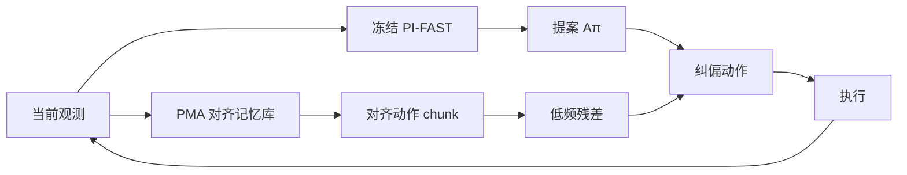

# RTCF（Retrieve in Time, Correct in Frequency · arXiv:2608.04527，v3 已撤稿）

> **重要状态提示（2026-10-28 arXiv v3 撤稿）：** 本文一作 Yuze Fan 已于 2026-10-28 提交 [arXiv:2608.04527v3](https://arxiv.org/abs/2608.04527) 撤稿声明，明确指出当前手稿属初步版本、**实验证据尚不足以完全支撑主要结论，需大量补充实验与验证以确立报告发现的可靠性与泛化性**。下文技术机制与数据均核对自 v2 全文，仅供方法脉络参考，**不宜作为已验证定论直接引用**。

**RTCF**（*Retrieve in Time, Correct in Frequency*，[arXiv:2608.04527](https://arxiv.org/abs/2608.04527) v2）由 **清华深圳研究院 / 清华 SIGS、同济、复旦、Everwise-Tech** 等提出（范宇泽 / 曹越 / 高鹏杰 / … / 王学谦）：在 **冻结 chunk 式 VLA** 外挂一条 **免训练** 测试时纠偏链路——先用 **Progressive Memory Alignment（PMA）** 把当前执行历史对齐到成功轨迹，再只把检索动作的 **低频运动残差** 叠回策略提案；夹爪与高频细节仍跟冻结策略。

## 一句话定义

**别微调大 VLA：用历史对齐找到「进度一致」的成功记忆，只借它的低频运动趋势改提案——单次前向、CPU 约 11 ms。**

## 英文缩写速查

| 缩写 | 英文全称 | 简要说明 |
|------|----------|----------|
| RTCF | Retrieve in Time, Correct in Frequency | 本文框架：时间维检索 + 频域纠偏 |
| PMA | Progressive Memory Alignment | 因果单调 frontier 的在线子序列对齐 |
| VLA | Vision-Language-Action | 被冻结的 base 策略（文中 PI-FAST） |
| FAST | Efficient action tokenization | π₀ 系动作 tokenization；文中 PI-FAST |
| DCT | Discrete Cosine Transform | 动作 chunk 频域分解载体 |
| LIBERO-Long | — | 十任务多阶段套件；本文主增益来源 |

## 为什么重要

- **补齐「冻结 VLA 纠偏」谱系的免训练格：** [DynaWM](./paper-dynawm-vla-online-correction.md) 要训世界模型；[DreamSteer](./paper-dreamsteer-vla-deployment-steering.md) 要 WM+价值模型；RTCF **零参数更新、不重复 VLA 推理、不加 GPU**。
- **显式拆开两个问题：** (1) 检索哪条、对齐到哪一帧；(2) 转移动作的哪一频段——消融证明时域硬融合会 **伤害** Long（50.0% < baseline 61.6%）。
- **工程画像清晰：** 单次 policy forward；PMA+读出中位 **10.99 ms**；描述子 RAM 32–50 MiB。

## 核心信息

| 项 | 内容 |
|----|------|
| **机构** | 清华大学深圳研究院；清华深圳国际研究生院（SIGS）；同济大学；复旦大学；Everwise-Tech |
| **论文状态** | **v3 已于 2026-10-28 被一作 Yuze Fan 撤稿**（v1: 2026-08-05，v2: 2026-08-07） |
| **Base 策略** | 冻结 **PI-FAST**（π₀-FAST 系） |
| **记忆库** | seed=7 成功轨迹预采集后冻结（SigLIP-PCA 描述子 + `π_FAST` BPE 存动作）；测试全库搜索、无 oracle |
| **开源** | **确认未开源**（v2 正文与 v3 `abs.html` 均无项目页 / GitHub / 权重） |

## 核心原理

### Retrieve in Time（PMA）

- 观测经冻结 **SigLIP–PCA** 成描述子；成功记忆同样预编码。
- 对每条记忆维护 **alignment frontier**：新观测到来时按因果转移更新（可停留 / 单位前进 / 有界跳过），保留竞争单调假设。
- 取当前最低平均代价终点 → 同时得到 **哪条记忆** 与 **对齐位置**，无需阶段标签。

### Correct in Frequency

- 读出对齐处未来动作 chunk；对 **运动通道** 做频域分解。
- 转移 **系数裁剪 + 缩放（\(\lambda_0=0.1\)）** 的低频残差到策略提案。
- **高频分量与夹爪** 保留 \(A^\pi_t\)；解码失败则原样执行。

### 流程总览

## 工程实践

| 项 | 内容 |
|----|------|
| 源码状态 | 无公开仓库且 v3 已撤稿 |
| 评测协议 | 四套件 × 10 任务 × 10 初始态 × 5 seed（101–105）= **2,000 episodes/条件** |
| 设备画像 | RTX 4090 跑策略；纠偏在 Xeon Platinum 8358P CPU（描述子 RAM 32–50 MiB，DP 状态 48–75 KiB） |
| 失败回退 | 无可用 future chunk 或 BPE 解码失败 → 保持原提案 \(A^\pi_t\) |
| 落地前提 | 需要 **同任务成功轨迹记忆库**；库外分布增益未保证 |

## 源码运行时序图

**不适用。** 经核对 `arXiv:2608.04527v2` 全文与 `2608.04527.abs.html`，作者未公开 GitHub 代码仓、项目页或模型权重，且已于 2026-10-28 提交 v3 撤稿（无官方可运行实现）。

## 评测与对比

Matched PI-FAST 对照（Table 1，v2 报告）：

| Method | Long | Spatial | Object | Goal | All |
|--------|------|---------|--------|------|-----|
| PI-FAST | 61.6 | 96.4 | 97.4 | 90.0 | 86.4 |
| Frame-NN（无历史对齐） | 63.6 | 95.8 | 96.8 | 88.6 | 86.2 |
| Time-Domain（无频选） | **50.0** | 96.2 | 97.2 | 87.0 | 82.6 |
| **RTCF** | **68.6** | **97.4** | **97.8** | 89.8 | **88.4** |

- **阶段延迟与长程任务明细（v2 Table 2 & §4.2）：** PMA 检索 p50/p95 = **6.28 / 7.52 ms**，FAST 未来片段读出 p50 = **4.71 ms**（两阶段合计 **10.99 ms**），Stage-median 动作就绪延迟估计 386.47 ms → 398.67 ms（+3.16%）；LIBERO-Long 10 个任务中 6 升 / 1 平 / 3 降（净 +35 成功）。

## 结论

**RTCF 在 v2 中提出了将「时序进度对齐」与「频域低频残差修正」解耦的免训练思路，但因 v3 已于 2026-10-28 被作者以实验证据不足为由撤稿，其实际有效性尚待作者补充验证。**

1. **首要事实：v3 已撤稿，切勿直接引用其基准结论** — `2608.04527.abs.html` 明确声明当前版本的实验证据尚不足以完全支撑主要结论与泛化性。
2. **思路仍有启发（待再验证）：历史对齐优于单帧，低频残差优于全时域覆盖** — v2 消融显示 Time-Domain 掉到 50.0%（34 rescue / 92 regression），提示直接在时域覆盖动作 chunk 会破坏反应性。
3. **主报告增益集中于 LIBERO-Long（+7.0 pt，Task 5 贡献 +11 成功）** — 且包含 3 个任务小幅回退及 Goal 套件 89.8 < 90.0，并非单调提升。
4. **选型替代：** 需要已验证/有训练支撑的在线修正看 [DynaWM](./paper-dynawm-vla-online-correction.md) 或 [DreamSteer](./paper-dreamsteer-vla-deployment-steering.md)；若参考 RTCF 思路须自行实现并独立验证。

## 局限与风险

- **v3 撤稿风险（核心约束）：** 作者于 2026-10-28 主动撤回论文，说明原有实验证据不足以支持主要结论与泛化性。
- **单模型单基准：** v2 仅报告冻结 PI-FAST + LIBERO 仿真；跨策略家族、更大记忆库与真机均未验证。
- **Goal 与部分 Long 任务存在回退：** Goal 套件 89.8 < baseline 90.0，Long 的 Task 4/6/8 亦有回退；对预采集成功记忆库覆盖高度敏感。
- **无开源：** 无官方代码、无预采集记忆库或评估脚本公开。

## 与其他工作对比

| 工作 | 训练 | 机制 | 相对 RTCF |
|------|------|------|-----------|
| [DynaWM](./paper-dynawm-vla-online-correction.md) | 要训 | 流匹配重写 chunk | 更强动态目标，成本高 |
| [DreamSteer](./paper-dreamsteer-vla-deployment-steering.md) | 组件预训练 | WM 想象 + 价值筛选 | 多候选，非记忆回放 |
| [BridgeVLA++](./paper-bridgevla-plusplus.md) | 要训 | 模型内时空记忆 | 改策略结构；非测试时补丁 |
| Frame-NN / Time-Domain | 无 | 本文消融 | 证明「乱检索 / 乱融合」不够或有害 |

## 关联页面

- [VLA](../methods/vla.md)
- [Action Chunking](../methods/action-chunking.md)
- [π₀.₇ / FAST 策略](../methods/pi07-policy.md)
- [DynaWM](./paper-dynawm-vla-online-correction.md)
- [DreamSteer](./paper-dreamsteer-vla-deployment-steering.md)
- [ReflexVLA](./paper-reflexvla.md) — 作者点名未试 RTC；默认仍是 naive async
- [BridgeVLA++](./paper-bridgevla-plusplus.md)

## 参考来源

- [RTCF 论文归档](../../sources/papers/rtcf_arxiv_2608_04527.md)

## 推荐继续阅读

- arXiv 全文：<https://arxiv.org/abs/2608.04527>
- 对照：[DynaWM](./paper-dynawm-vla-online-correction.md)（可训在线修正）
