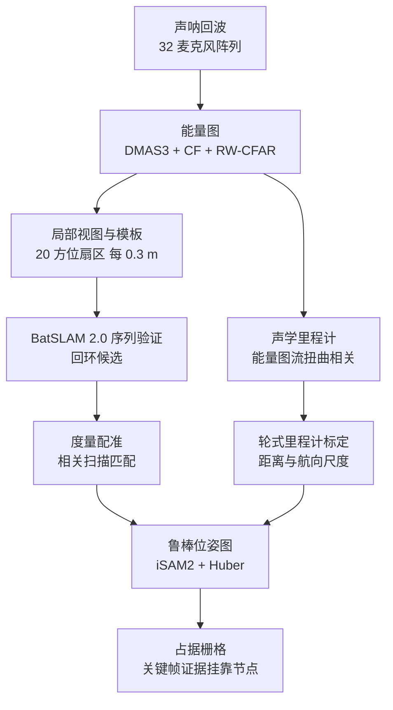
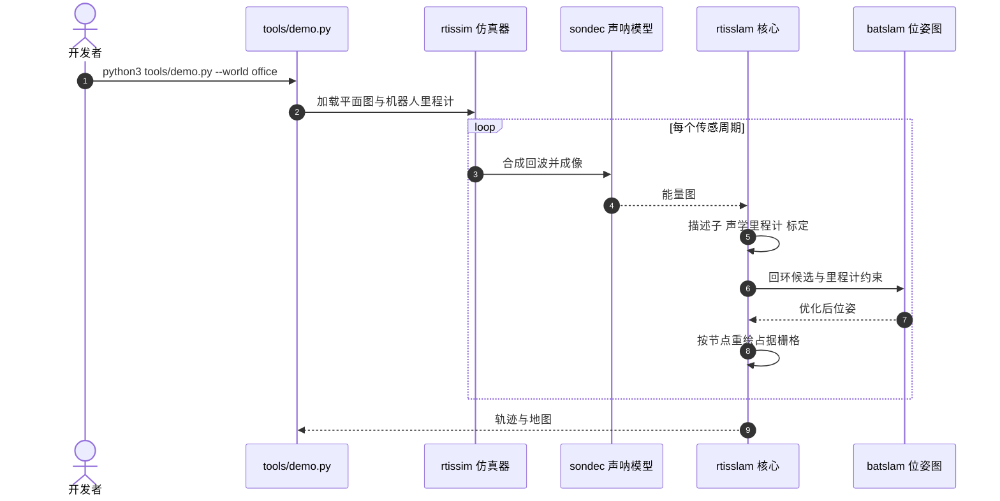

# RTISSLAM：只靠空气声呐做 SLAM

**RTISSLAM 是面向嵌入式 3D 成像声呐（eRTIS）的纯声呐 SLAM：以 BatSLAM 2.0 的鲁棒位姿图为后端，以占据栅格为地图，用声学里程计在线标定轮式里程计，并在每次回环后让地图随位姿图更新。**

论文 *RTISSLAM: In-air Imaging Sonar SLAM using a Robust Pose Graph and Occupancy Grid Mapping*（[arXiv:2610.18479](https://arxiv.org/abs/2610.18479)，[代码](https://github.com/Cosys-Lab/RTISSLAM)，单作者 Jan Steckel）。

## 英文缩写速查

| 缩写 | 英文全称 | 简要说明 |
|------|----------|----------|
| eRTIS | Embedded Real-Time Imaging Sonar | 论文所用 3D 成像声呐，1 个发射器 + 32 个麦克风，仅用水平面（论文描述为 embedded 3D imaging sonar，缩写展开为推测） |
| DMAS3 + CF | Delay-Multiply-and-Sum (3rd order) + Coherence Factor | 生成能量图（energyscape）的波束形成方法 |
| RW-CFAR | Range-Wise Constant False Alarm Rate | 沿距离方向的恒虚警滤波 |
| iSAM2 | Incremental Smoothing and Mapping 2 | GTSAM 中的增量位姿图优化，回环链接加 Huber 核 |

## 为什么重要

- 声呐在黑暗、烟、尘、玻璃附近仍能工作，补足相机与激光雷达失效的场景。
- 室内镜面反射让经典声呐 SLAM 难以落地；论文同一声呐数据上"激光雷达式栅格 SLAM"失败（slam_toolbox 误差最高 35.5 m）。
- 展示了"位姿图（负责定位）+ 栅格（只负责渲染）"的解耦结构。

## 核心信息

| 项 | 内容 |
|----|------|
| **机构** | 安特卫普大学 Cosys-Lab（应用工程学院）与 Flanders Make 战略研究中心（比利时 Lommel），依据论文 HTML；该机构未在本库机构注册表中，故无机构 tag |
| **传感器** | eRTIS，仅水平面（2D 地图） |
| **评测** | 仅仿真：办公室、仓库、中庭三种镜面墙世界；每条轨迹 5 个随机种子；无真机实验 |
| **开源** | **已开源**（2026-10-17 核查）：[Cosys-Lab/RTISSLAM](https://github.com/Cosys-Lab/RTISSLAM)，BSD-3-Clause，含仿真器、SLAM 核心、导航与 ROS 2 Jazzy 包；无独立项目页（论文提及演示视频） |

## 核心原理

### 流程总览

- 栅格以关键帧为单位存证据并挂靠位姿图节点，因此位姿图每次回环优化后，地图随之更新；栅格不反馈到位姿估计（论文自述为局限）。
- 初始 34% 的回访节点在 95% 精度下被识别（BatSLAM 2.0 设置），调参后的描述子为 54%、AUC 0.97。

## 源码运行时序图

下列模块名取自 README 的目录说明（`rtissim/`、`rtisslam/`、`batslam/`、`sondec/`、`tools/demo.py`）。具体函数名未核实，图中只画模块级交互。

- **复现路径（README）：** `python3 tools/setup_linux.py` 安装 → `python -m pytest tests/` 冒烟 → `tools/demo.py --world office`（需 `data/demo/runs/<world>/map.npz`）；论文复现为 `scripts/gen_drive.py`、`run_final.py`、`paper_figures.py`。
- **真机：** `ros2 launch rtisslam_bringup real.launch.py mode:=mapping|localization`；论文未报告真机实验。

## 与其他工作对比

| 维度 | RTISSLAM（本文） | [slam_toolbox](./slam-toolbox.md) | [ORB-SLAM3](./orb-slam3.md) | [RAGNAROK](./paper-ragnarok-radar-visual-kinematic-inertial-slam.md) |
|------|------|------|------|------|
| 主传感器 | 空气中 3D 成像声呐（仅水平面） | 2D 激光雷达 | 单目/双目/RGB-D（+IMU） | 雷达 + 视觉 + 腿式运动学 + IMU |
| 后端 | BatSLAM 2.0 鲁棒位姿图（iSAM2 + Huber） | Karto 位姿图 + lifelong 地图序列化 | 视觉特征 BA + 多地图 Atlas | B 样条本体骨干 + 多因子自适应加权 |
| 地图表示 | 关键帧证据挂靠节点的占据栅格，只负责渲染 | 2D 占据栅格，参与扫描匹配 | 稀疏特征点地图 | 未作为重点（关注轨迹） |
| 验证 | 仅仿真（三种镜面墙世界） | 成熟 ROS 2 工程栈 | 公开数据集与大量实测 | Spot 真机室外 |

- **相对 slam_toolbox：** 论文把它直接跑在同一声呐数据上作为基线（默认 23.1–35.5 m ATE），说明激光式扫描匹配假设在声呐稀疏、镜面回波下失效；但该基线本为激光设计，对比并不公平。
- **相对 ORB-SLAM3：** 二者都依赖回环修正漂移，但 RTISSLAM 的回环来自声学能量图描述子 + 序列验证，面向相机失效的黑暗、烟尘场景。
- **相对 RAGNAROK：** 同属"非视觉传感器补位退化环境"的思路，RAGNAROK 多传感器紧耦合且有真机，RTISSLAM 坚持单一声呐且仅仿真。
- 各文传感器、场景与指标不同，数字不可横比。

## 工程实践

| 项 | 建议 |
|----|------|
| 平台 | README 推荐 Ubuntu 24.04 + NVIDIA GPU（CPU 可用但慢）；依赖 torch、gtsam、ROS 2 Jazzy、Nav2、slam_toolbox |
| 环境变量 | ROS 节点需要 `RTISSLAM_ROOT`、`RTISSLAM_DATA`、`RTISSLAM_VENV` |
| 先跑什么 | 先 pytest，再 `tools/demo.py`；论文数字用 `scripts/` 序列复现（本次未实际运行，未核实） |
| 标定风险 | 开阔中庭里声学里程计覆盖不足，标定会使地图更差，需监控 |

## 实验与评测

绝对轨迹误差 ATE（m，5 种子均值 ± 标准差，仿真）：

| 方法 | 办公室 | 仓库 | 中庭 |
|------|--------|------|------|
| 轮式里程计 | 8.20 ± 0.33 | 5.09 ± 0.35 | 2.66 ± 0.34 |
| BatSLAM 2.0 链接 | 0.46 ± 0.06 | 0.82 ± 0.10 | 1.03 ± 0.07 |
| RTISSLAM（完整） | 0.31 ± 0.13 | 0.57 ± 0.13 | 1.78 ± 0.32 |
| slam_toolbox 默认 | 23.1 ± 8.2 | 35.5 ± 9.4 | 17.3 ± 2.4 |
| slam_toolbox 调参 | 6.1 ± 9.9 | 15.6 ± 5.3 | 14.9 ± 2.4 |

- 中庭中完整系统（1.78）反而差于"BatSLAM 2.0 链接 + 配准"变体（0.53），原因是轮式标定假设失效。
- 回环链接约 2090（办公室）与 1817（仓库）条每次运行；仓库中 14 条连接了相距超过 1 m 的位置（约 0.15%）。

## 结论

**RTISSLAM 证明了在镜面环境里"声呐位姿图回环 + 栅格渲染"能显著压低漂移，但证据仅来自仿真，且在开阔空间会因标定假设退化。**

1. **别把仿真数当真机** — 论文无真机实验，也无激光雷达参考，作者计划后续补充。
2. **回环是主要收益** — 办公室从 8.20 m 降到 0.31 m 主要靠位姿图回环。
3. **标定要看场景** — 中庭完整系统反而变差，声学里程计需要足够覆盖。
4. **栅格不参与定位** — 地图质量依赖位姿图，几何约束未回灌。
5. **代码可直接试** — 仓库开放且含 ROS 2 包，适合作为声呐 SLAM 的起点。

## 局限与风险

- 作者自述：仅仿真；2D 切片省略地板、天花板与多径；轮式偏差建模为常量；强混叠环境有少量错误回环（被鲁棒后端吸收）。
- 比较基线 slam_toolbox 是为激光雷达设计的，对声呐数据不公平，不宜解读为"声呐优于激光"。
- 摘要未含真实世界数字；仓库引用信息"待补"（核查日）。

## 关联页面

- [slam_toolbox](slam-toolbox.md) — 论文的对照基线
- [Navigation2](navigation2.md) — 仓库 ROS 2 包兼容的导航栈
- [ORB-SLAM3](orb-slam3.md) — 视觉 SLAM 对照
- [激光/惯性视觉 SLAM 选型](../comparisons/lidar-slam-lio-vio-selection.md) — 传感器选型语境

## 参考来源

- [rtisslam_arxiv_2610_18479.md](../../sources/papers/rtisslam_arxiv_2610_18479.md) — 论文摘录与开源核查
- [rtisslam.md](../../sources/repos/rtisslam.md) — 仓库归档
- [arXiv:2610.18479](https://arxiv.org/abs/2610.18479)

## 推荐继续阅读

- [论文 HTML](https://arxiv.org/html/2610.18479)
- [Cosys-Lab/RTISSLAM](https://github.com/Cosys-Lab/RTISSLAM)
