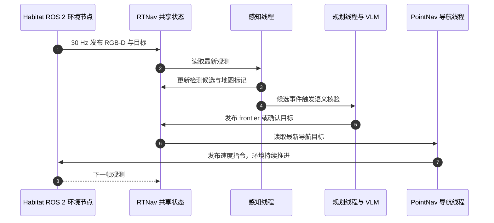

# RTNav：面向实时零样本物体导航

**RTNav**（*Towards Real-Time Zero-Shot Object Navigation*，杜克大学，arXiv:2608.26496）把零样本 ObjectNav 的环境推进与 agent 推理解耦：模拟器保持 30 Hz 墙钟频率，感知、建图、规划和导航模块异步运行，VLM 仅在 frontier 选择或目标候选核验等事件发生时调用。

## 一句话定义

RTNav 是一套面向墙钟时间预算的零样本物体导航评测与 agent 架构，核心是让机器人在语义推理耗时期间仍持续移动和更新环境状态。

## 英文缩写速查

| 缩写 | 英文全称 | 简要说明 |
|------|----------|----------|
| ObjectNav | Object-Goal Navigation | 在环境中寻找指定类别或描述的目标物体 |
| VLM | Vision-Language Model | 目标语义核验与 frontier 视图选择 |
| SCT | Success weighted by Completion Time | 同时计入成功与墙钟完成时间的指标 |
| SR | Success Rate | 成功到达目标的回合比例 |
| ROS 2 | Robot Operating System 2 | 环境与 agent 之间的实时消息接口 |

## 为什么重要

- **暴露推理延迟成本：** 同步仿真会在 agent 计算时暂停，慢推理和快推理可能得到相同的步数预算；真实部署中，旧动作会在等待期间持续执行。
- **评测整套系统：** RTNav 同时公开实时评测接口与模块化 agent，便于区分算法效果与墙钟耗时造成的性能变化。
- **可连接仿真与实机：** 除 Habitat 评测仓库外，作者还公开 Stretch 3 + Jetson AGX Thor 的真实机器人代码仓库。

## 核心原理

### 实时评测接口

环境在固定 30 Hz 的墙钟节拍下推进，agent 独立读取最新观测并发布速度指令。若推理耗时 \(\delta_i\)，环境会在这段时间里继续执行旧指令；新指令到达时对应的观测也已过时。ROS 2 将 Habitat 环境节点与 agent 节点解耦，同时保留同步模式作为对照。

### 异步导航架构

感知、地图、规划和导航分别在独立线程中读取共享状态并发布更新。实时目标检测提出候选物体，VLM 按需核验候选；尚未确认目标时，规划器使用候选视图请求 VLM 选择 frontier。PointNav policy 持续朝最新有效目标移动，不因语义推理或重规划而暂停。

| 模块 | 论文中的实现 |
|------|--------------|
| 感知 | OWLv2 开放词汇检测，约 15 Hz；Qwen3.5-9B 核验候选；MobileSAM 细化确认框 |
| 建图 | RGB-D 反投影为累积点云，再投影到二维障碍、探索区域、frontier 与目标位置地图 |
| 规划 | 目标未确认时按需比较 frontier 候选视图；目标确认后将目标位置设为导航目标 |
| 导航 | PointNav policy 追踪最新 frontier 或目标；与其他模块并行运行 |

## 源码运行时序图

真实机器人仓库另通过 `src/env/launch.py` 桥接 Stretch 3 的 ROS 1 观测至 ROS 2 `/obs/*`，由 agent 容器执行感知、建图、规划和控制。

## 工程实践

| 项 | 复现 / 部署提示 |
|----|----------------|
| 仿真评测 | 官方仓库以 Habitat + Docker 运行，环境与 agent 通过 ROS 2 通信；支持 HM3D-v1、HM3D-v2、HM3D-OVON 与六种基线。 |
| 实时指标 | 除 SR、SPL、Distance to Goal 外，使用 SCT 反映成功与墙钟完成时间；SCT 会惩罚绕行和推理等待。 |
| 硬件对比 | 论文结果使用单张 NVIDIA RTX A6000；基线应在目标硬件上重跑，避免把硬件差异误读为算法增益。 |
| 真实机器人 | [RTNav-RealWorld](https://github.com/generalroboticslab/RTNav-RealWorld) 提供 Stretch 3 与 Jetson AGX Thor 的部署适配；需要按 README 准备模型权重和机器人侧 ROS 环境。 |

## 实验与评测

论文在 HM3D-v1、HM3D-v2 和 HM3D-OVON 的实时变体上评测。固定 500 s 实时预算下，RTNav 相对最强同步基线的成功率分别高 **6.4%（OVON）**、**10.5%（HM3D-v1）**、**9.1%（HM3D-v2）**；相对 VLFM 的 SCT 分别高 **2.45、5.17、4.17**。论文还观察到同步基线在异步评测下普遍退化，且幅度与计算负载和硬件有关。

## 与其他工作对比

| 维度 | 同步 ObjectNav agent | RTNav |
|------|----------------------|-------|
| 环境推进 | 收到新动作后才推进一步 | 固定墙钟频率持续推进 |
| 推理耗时 | 通常不计入任务预算 | 直接影响覆盖距离、动作新鲜度与完成时间 |
| 模块调度 | 感知—推理—动作串行循环常由最慢模块限速 | 感知、建图、规划、导航并行，VLM 按需调用 |
| 评测读数 | SR、SPL 等步数/路径指标 | 增加 SCT 等墙钟时间指标 |

RTNav 的关键贡献是系统调度与评测协议，而非单独提出新的目标检测器或局部导航策略；若硬件推理更快，异步设计相对收益也可能变化。

## 结论

RTNav 说明零样本 ObjectNav 的实际表现取决于计算速度与模块调度，不能只用暂停式仿真中的成功率评价。

1. 比较导航 agent 时，同时报告实时模式和同步模式，才能量化推理延迟的影响。
2. 使用 SCT 等墙钟指标补充 SR/SPL；路径短不代表完成快。
3. 将高频感知与底层导航和慢速 VLM 推理解耦，可避免语义推理阻塞连续运动。
4. RTNav 的实时成绩依赖硬件；跨设备比较前应在相同设备上重新评测基线。
5. 官方公开了仿真评测与 Stretch 3 实机部署仓库，但模型、数据和机器人环境仍需按各自 README 准备。

## 局限与风险

- **硬件依赖：** 实时表现会随 GPU 与推理吞吐变化；论文数值不能直接外推到其他算力平台。
- **任务覆盖：** 实时评测沿用 HM3D 系列目标与 Habitat 场景，无法单独证明对所有动态真实室内环境都鲁棒。
- **部署门槛：** 实机仓库依赖 Stretch 3、Jetson AGX Thor、ROS 1/ROS 2 桥接及模型权重，迁移到其他机器人需要适配。

## 关联页面

- [零样本目标导航](../tasks/zero-shot-object-navigation.md)
- [导航与 SLAM 自主栈](../overview/navigation-slam-autonomy-stack.md)
- [具身语义认知地图](../concepts/embodied-semantic-cognitive-map.md)
- [Habitat-Sim](./habitat-sim.md)

## 参考来源

- [论文摘录](../../sources/papers/rtnav_arxiv_2608_26496.md)
- [Duke General Robotics Lab 项目页](../../sources/sites/duke-rtnav-project.md)
- [RTNav 官方代码仓库](../../sources/repos/duke-rtnav.md)

## 推荐继续阅读

- [RTNav 论文 HTML](https://arxiv.org/html/2608.26496v1)
- [RTNav-RealWorld 真实机器人部署](https://github.com/generalroboticslab/RTNav-RealWorld)