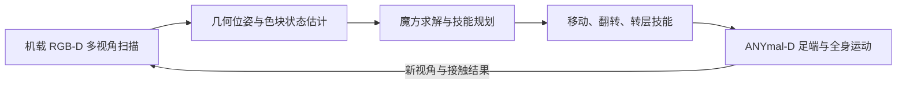

# Rubik Skills：四足机器人足端解大型魔方

**一句话定义：** Rubik Skills 把机载 RGB-D 感知、魔方求解规划和足端操作策略组合起来，让四足机器人在实机上自主扫描并完成多步魔方旋转。

## 英文缩写速查

| 缩写 | 英文全称 | 简要说明 |
|------|----------|----------|
| RGB-D | Red-Green-Blue-Depth | 机载相机提供颜色与深度，用于估计魔方位姿和色块状态 |
| RL | Reinforcement Learning | 在仿真中训练翻转、转层等足端操作策略 |
| ICP | Iterative Closest Point | 几何位姿细化算法，用于拟合观测到的魔方表面 |
| ANYmal-D | ANYmal Dynamic | 论文中执行自主解魔方任务的四足平台 |

## 为什么重要

该工作把四足运动与接触操作放在同一长时程闭环中。魔方并非一次性推到目标位置：机器人需要反复识别当前状态、规划动作、移动并精确接触，同时防止无意转动其他层。这使它成为足端操纵、主动感知和全身平衡的系统级案例。

## 核心原理

系统按三个时间尺度协作：一次解题时，求解器基于完整魔方状态生成操作序列，规划器将其转换成移动、翻转和转层技能；技能切换之间，RGB-D 感知更新魔方相对位姿；每个技能内部，位姿控制器负责接近，循环策略根据本体状态和前置深度图直接输出关节位置目标。

### 主要处理链

扫描阶段以 SAM 3 分割魔方，利用掩码深度拟合几何位姿并用 ICP 细化；将可见面矫正为 3×3 网格，在 CIE-LAB 颜色空间分类色块，再利用中心色块确定语义朝向，跨视角累积完整状态。

操作策略采用 teacher–student 路线：teacher 在仿真中使用特权观测接受强化学习；student 接收机器人本体状态与前置相机深度信息并输出关节位置目标。翻转策略约束意外层运动和整体位移；转层时一只脚压住魔方，另一只脚推动目标层。顺时针旋转通过镜像逆时针策略获得。

## 工程实践

| 环节 | 论文实现 | 对复现的启示 |
|------|----------|--------------|
| 物体建模 | 三层魔方由两个被动转动关节连接，并估计静、动态层摩擦 | 层间摩擦与接触误差会直接影响策略是否误转 |
| 仿真训练 | 随机化机器人初始姿态、相对位置、质量、接触/层摩擦与外部推力 | 仅随机化机器人状态不够；物体接触参数也是 sim-to-real 关键项 |
| 技能蒸馏 | 特权 teacher 蒸馏到循环感知 student，训练时加入相机外参和深度噪声 | 部署策略需处理图像噪声与有限历史，不能假设状态完全可观测 |
| 状态估计 | 分割、几何拟合、颜色分类、跨视角拼接 | 几何位姿与离散魔方语义状态应分开估计再融合 |

## 实验与评测

- 2 m 内几何位姿中位误差约为 2 cm，旋转误差低于 3°；色块分类室内为 100%、室外为 98.7%。
- ANYmal-D 实机自主完成 3 次完整求解，每次约 30 步，耗时约 8–9 分钟。
- 深度图改善策略成功率；循环记忆对前翻和逆时针转层更有帮助。

## 结论

**一句话总判：** 长时程足端操纵的关键是让感知、符号规划和全身技能共享一致的物体状态，并在每个接触技能后重新观测。

1. 不能把该任务简化为单个“踢魔方”策略：完整成功依赖多视角状态重建、求解、技能规划和技能间重新定位。
2. 转层动作需要双足分工：一脚固定整体，另一脚推动目标层，体现出协调接触比单点轨迹跟踪更重要。
3. 仿真随机化应覆盖层摩擦和外力；这些变化可能改变魔方内部状态，而不仅影响机器人平衡。
4. 论文报告的是 3 次完整实机求解，证明系统链路可行；样本量仍不足以说明大规模任务可靠性。
5. 截至 2026-10-20，项目页列出论文与演示，未列代码或数据仓库，因此策略训练及部署复现入口尚不可由该页获得。

## 与其他工作对比

| 控制方式 | 优势 | 该任务中的代价 |
|----------|------|----------------|
| 分层足端目标控制 | 接口直观，可单独规划接触点 | 转层时难以同时协调一脚固定与另一脚推转 |
| 直接全身关节策略 | 联合调节固定脚、操作脚与身体平衡 | 依赖接触动力学仿真、策略蒸馏和机载感知 |

论文对 Rotate CCW 的对照实验报告，直接全身关节空间控制更有利于同时压住魔方并推动目标层。

## 局限与风险

实验基于特定 ANYmal-D、相机布局和大型魔方，不能直接推断到其他四足平台或任意足端精细操作。论文报告的完整自主实机求解次数为三次。项目页当前未链接公开代码或数据集；有关策略网络细节、训练配置和硬件接口的复现需依赖论文正文或后续发布。

## 关联页面

- [Loco-manipulation](../tasks/loco-manipulation.md) — 运动与接触操作的联合任务
- [Manipulation](../tasks/manipulation.md) — 机器人操作任务基础
- [Locomotion](../tasks/locomotion.md) — 移动与技能间重新定位
- [Contact-rich manipulation](../concepts/contact-rich-manipulation.md) — 多次精确接触与接触状态管理

## 参考来源

- [论文来源归档](../../sources/papers/rubik_skills_arxiv_2610_24610.md)
- [官方项目页归档](../../sources/sites/rubik-skills.md)

## 推荐继续阅读

- [项目页：Solving a Giant Rubik's Cube with a Quadruped Robot](https://leggedrobotics.github.io/rubik-skills/)
- [论文 arXiv:2610.24610](https://arxiv.org/abs/2610.24610)
- [演示视频](https://www.youtube.com/watch?v=HFdRsFiE68c)
