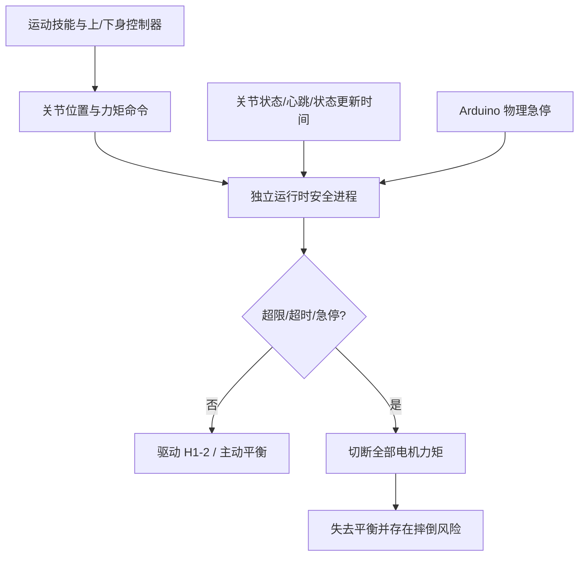

# 全尺寸人形运行时安全与紧急停止：分级力权限的部署教训（Runtime Safety and Emergency Stops on a Full-Size Humanoid: Deployment Lessons and a Case for Graduated Force Authority）

**机构：** 科罗拉多大学博尔德分校（University of Colorado Boulder）、圣母大学（University of Notre Dame）  
**论文：** [arXiv:2611.15928](https://arxiv.org/abs/2611.15928)

## 一句话定义

H1-2 实机经验显示：独立安全层的关节限位或急停会关闭平衡控制而造成摔倒；MJPC 推扰 15/15 次触发人为急停，ALMI 恢复 14/15 次；论文提出尚未实现的分级力权限构想。

## 英文缩写速查

| 缩写 | 英文全称 | 简要说明 |
|---|---|---|
| E-stop | Emergency Stop | 硬接线人工紧急停止 |
| MPC | Model Predictive Control | 研究中用于下身姿态稳定的规划控制 |
| ROS 2 | Robot Operating System 2 | Golem 开源机器人软件栈的通信框架 |
| CoM | Center of Mass | 用于评估是否离开支撑多边形的质心 |
| CBF | Control Barrier Function | 作者讨论作为可验证平衡回退的一种潜在方案 |

## 为什么重要

固定机械臂断电通常会停住，但主动平衡的人形在断开电机力矩后会倒下。把所有监控故障统一映射为无力矩急停，可能放大原本可控的失效，尤其在人和危险工件附近。

## 核心原理

ROS 2 Golem 中独立于上下身控制器的进程拦截关节命令，监测位置、速度、力矩（按厂家标称上限 90%）、状态陈旧与 heartbeat，轮询 Arduino Uno 的物理急停；丢失微控制器通信也触发停止。作者讨论按任务上下文、可信度和明确的责任归属逐步扩大可用施力范围，但该权限框架尚未落地。

### 流程总览

以下是论文方法的**概念流程**，不是未经核查的源代码调用关系。

## 实验与评测

H1-2 站立推扰试验每控制器 15 次：采样式 MuJoCo-MPC（MJPC）15/15 次需要操作者按急停，按下时刻为 4.68±2.86 秒；对抗训练 ALMI 在 14/15 次恢复正的 CoM 支撑裕度。推力峰值近似 20.4±7.0 N 与 22.1±6.9 N。测试使用安全绳接住跌落，论文未测跌倒实际损害。

## 与其他工作对比

与工业固定臂的 Category 0 断力安全状态不同，H1-2 需要持续平衡反馈；与只设关节力矩阈值相比，作者主张结合接触任务、人员距离、可验证能力与责任主体设置分级权限，但不是已经验证的安全算法。

## 结论

**H1-2 实机经验显示：独立安全层的关节限位或急停会关闭平衡控制而造成摔倒；MJPC 推扰 15/15 次触发人为急停，ALMI 恢复 14/15 次；论文提出尚未实现的分级力权限构想。**

1. 别把 **e-stop 触发** 和 **进入安全状态** 混为一谈。
2. 手肘力矩阈值可被正常行走足触地冲击触发，传感阈值须结合全身运动工况。
3. ALMI 的 14/15 恢复结果是特定推扰试验，不能推出学习控制器可认证安全。
4. 分级力权限是**提议**，并无已部署/定量证明，不能当现成安全方案。

## 工程实践

部署前按 H1-2 全运动模式验证关节限位是否误触发；记录状态时间戳、心跳、急停通信链路、失力后质心轨迹；建立主动平衡降级和物理防护方案并开展独立危险分析。

### 源码运行时序图

**不适用（未取得可核实的官方研究代码运行入口）。** 不能由论文框架图推断真实函数调用或部署数据流。

## 局限与风险

证据仅来自一台 H1-2、每控制器 15 次站立推扰，跌倒均由安全绳兜底；90% 阈值与手肘上限由经验设定，作者提出的三类更安全停止备选均尚未实现。分级力权限不是经过认证的标准解决方案。

## 关联页面

- [全身控制](../concepts/whole-body-control.md)
- [安全控制纵深路线](../../roadmap/depth-safe-control.md)
- [Sim2Real](../concepts/sim2real.md)
- [11.09–11.13 人形／四足 29 篇周报](../overview/humanoid-quadruped-2026-11-09-13-29-papers.md)

## 参考来源

- [arXiv v1 原文通读归档](../../sources/papers/runtime_safety_graduated_force_authority_arxiv_2611_15928.md)
- [论文 HTML 全文](https://arxiv.org/html/2611.15928v1)

## 推荐继续阅读

- [论文 arXiv HTML 全文](https://arxiv.org/html/2611.15928v1)
- [论文 PDF](https://arxiv.org/pdf/2611.15928v1)
