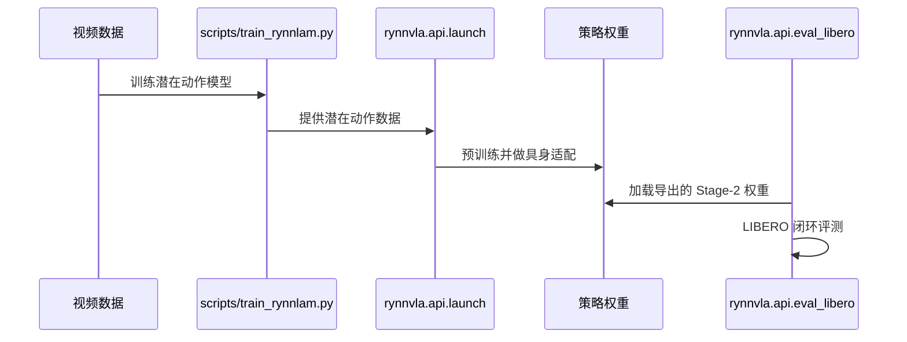

# RynnVLA-Latent: Scaling Robotic Manipulation Foundation Models with 3D-Grounded Latent Actions

**一句话定义：** RynnLAM 从视频变化学习连续的三维锚定潜在动作，使用残差未来特征预测、相机补偿三维流与相机运动解耦；VLA 先预测潜在动作块，再适配具身动作。

## 英文缩写速查

| 缩写 | 英文全称 | 简要说明 |
|------|----------|----------|
| VLA | Vision-Language-Action | 以视觉和语言条件生成动作的模型 |
| G1 | Unitree G1 | 人形机器人平台 |
| Sim2Real | Simulation to Real | 从仿真迁移到真实机器人 |

## 为什么重要

RynnLAM 从视频变化学习连续的三维锚定潜在动作，使用残差未来特征预测、相机补偿三维流与相机运动解耦；VLA 先预测潜在动作块，再适配具身动作。

## 方法与核心原理

RynnLAM 从视频变化学习连续的三维锚定潜在动作，使用残差未来特征预测、相机补偿三维流与相机运动解耦；VLA 先预测潜在动作块，再适配具身动作。

## 源码运行时序图

README 提供 RynnLAM 与 VLA 训练及 LIBERO 评测入口，代码公开；RynnLAM 和 Stage-1 2B/4B 权重另在 Hugging Face / ModelScope 发布，闭环评测需要 Stage-2 权重和外部仿真环境。

## 工程实践

复现时先对齐训练数据、具身接口和评测设置；记录数据来源及运行环境。

## 评测与结果

论文报告约 3.01 万小时视频生成 7.4552 亿潜在动作描述；4B 策略在 LIBERO、LIBERO-Plus、RoboTwin 2.0 分别为 98.8%、84.7%、88.6%，并在六项真实任务中领先所比较方法。

## 结论

**工程判断应结合论文的训练和评测条件。**

- 用三维运动监督抑制相机变化对动作表示的干扰。
- 潜在动作预训练后仍需针对目标具身进行动作适配。
- 对比基准时保留数据、任务和适配设置，避免把仿真分数当成真机成功率。

## 局限与风险

报告结果受任务和评测协议限制；README 明确公开的 Stage-1 权重不能直接作为闭环策略，需先做 Stage-2 训练。

## 与其他工作对比

与 [MimicAll](./paper-mimicall.md) 的跨机体运动跟踪相比，本工作关注不同层面的数据、动作表示或任务生成。

## 关联页面

- [MimicAll](./paper-mimicall.md)
- [操作任务](../tasks/manipulation.md)

## 参考来源

- [来源归档](../../sources/papers/rynnvla-latent.md)
- [来源归档](../../sources/sites/rynnvla-latent.md)
- [来源归档](../../sources/repos/rynnvla-latent.md)

## 推荐继续阅读

- [论文原文](https://arxiv.org/abs/2610.34356)
