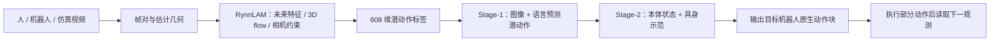
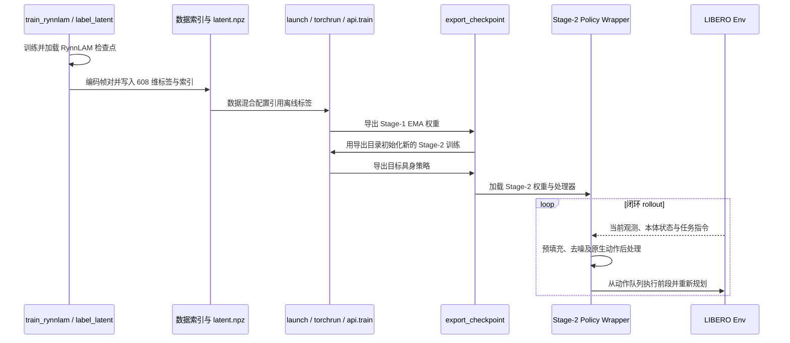

# RynnVLA-Latent：以三维锚定潜动作扩展机器人操作预训练

英文原题：*RynnVLA-Latent: Scaling Robotic Manipulation Foundation Models with 3D-Grounded Latent Actions*。

## 一句话定义

RynnLAM 把人、机器人和仿真交互视频里的**观察到的运动**转为共有的潜动作标签；RynnVLA-Latent 学会预测这些标签后，再把输出改到目标机器人控制空间。视频标签用于预训练，不是可直接下发的关节指令。

## 英文缩写速查

| 缩写 | 英文全称 | 用途 |
|---|---|---|
| VLA | Vision-Language-Action | 根据视觉和语言产生动作的策略 |
| LAM | Latent Action Model | 从相邻观测学习潜在动作表示 |
| MoT | Mixture of Transformers | 用逐层联合注意力连接 RynnBrain 与较窄的动作专家 |
| GRL | Gradient Reversal Layer | 反转相机预测损失对全局动作支路的梯度 |
| EMA | Exponential Moving Average | 发布 Stage-1 权重的参数滑动平均 |
| OSC | Operational Space Control | 官方 LIBERO 适配使用的操作空间控制接口 |

## 为什么重要

不同机器人在动作维数、关节定义和控制频率上通常不兼容。先拟合视频中共享的运动线索，可以在没有目标具身动作标注时学习表示；但最终闭环能否落地，仍取决于对该具身的相机、本体状态、动作定标和目标示范的适配。表 1 涵盖 25 个来源、30,117.68 小时视频，论文报告得到约 7.4552 亿条潜动作描述符。

## 核心机制

1. **视频帧对的三维运动监督。** 以深度和相机位姿估计补偿视角变化，构造 3D flow 伪标签；残差未来特征预测让跨帧信息必须经过小型瓶颈，而不是直接复制目标图像特征。
2. **保留相机分量而不是假设完全不变。** 一个 `ktoken_zcam` 描述符共 608 维：8 个 64 维局部 token、64 维全局动作，以及 32 维相对相机分量。相机预测分支和 GRL 约束全局动作通道，完整描述符仍显式含相机信息。
3. **Stage-1：预测潜动作。** RynnBrain 与动作专家按图像和语言做 Flow Matching；不引入原生本体/动作表示。论文使用每视角 6 个连续潜动作目标；源码把 `latent_action_chunk_size=6` 和预设里的通用 `action_chunk_size=30` 分开配置，不能互换。
4. **Stage-2：改学目标具身的原生动作。** 用导出的 Stage-1 权重初始化新的优化器训练，加入目标具身的本体状态和动作示范。论文复用动作读出主干再投影，不把 608 维直接解码成执行器指令。闭环推理按 [动作分块](../methods/action-chunking.md) 预测、执行并重新规划。

## 源码运行时序图

基于官方固定提交 `c67e6ff`。离线标注与 VLA 控制是分开的路径；闭环不调用 RynnLAM 逐步提取动作标签。

## 实验与评测

| v1 证据 | 作者报告 | 怎么读 |
|---|---|---|
| LARY 表 3 | 相对动作平均 MSE 0.38；去掉残差特征约束后 0.57 | 冻结表示回归，不是毫米级 3D 精度，也不是策略成功率 |
| LIBERO / LIBERO-Plus 表 4–5 | 4B：98.8% / 84.7% | Plus 使用已对 LIBERO 适配的策略，不在 Plus 做专项适配，不是拿公开 Stage-1 直接测 |
| RoboTwin 2.0 表 6 | Native 88.6%；Clean 88.7%，Randomized 88.4% | 训练含随机化示范；不是对随机场景的零样本。v1 §1 与 §5 写 88.3%，此处以表 6 和摘要为准 |
| VLABench 表 7 | 五条 track 的平均成功率 51.9% | 成功率不同于进度或意图评分 |
| 真机表 8 | Marvin-WUJI 和 Astribot-S1 各 3 项任务，每项 35 次；4B 在表列对照中六项均最高 | 两平台分别后训练；例：放盘 85.71%、翻牛排 42.86%、移动平台清桌 40.00%，不能推广成跨具身零样本 |

更多口径见[具身评测枢纽](../overview/hub-embodied-eval-benchmark.md)。

## 与相关工作对比

- [多视角潜动作预训练](paper-multi-view-latent-action-pretraining-cross-embodiment.md)也探索跨具身的视频监督。RynnLAM 的具体切入点是把相机补偿的三维运动与局部/全局 token 作为训练约束，而非把不同机器人的原生动作空间强行统一。
- [MimicAll](paper-mimicall.md)处理的是人形全身运动跟踪；这里学习供[机器人操作](../tasks/manipulation.md)使用的预训练标签，两者不能比较相同的跟踪指标。
- 与直接做[机器人策略学习](../methods/robot-policy-learning.md)相比，这条路线把大规模视频阶段和目标演示阶段分开；公开的是前一阶段初始化，最终策略仍取决于后一阶段数据与实现。

## 工程实践

- [Hugging Face](https://huggingface.co/collections/Alibaba-DAMO-Academy/rynnvla-latent)与 [ModelScope](https://www.modelscope.cn/collections/DAMO_Academy/RynnVLA-Latent)都覆盖 RynnLAM、Stage-1 2B、Stage-1 4B。2B/4B 是 backbone 命名、EMA 第 236442 步；不要误作论文表格中的已适配 Stage-2 评测权重。
- 先检查 `data/sample/` 的帧对索引和标签维度。若做实质性复现，需要目标数据混合、匹配的具身 schema、Stage-2 导出及外部 LIBERO。以目标环境要求核对动作变换与重规划执行步数；不能把 stage1 输出填进 7 维 OSC 接口。

## 局限与风险

深度、相机位姿和 3D flow 都依赖估计。论文不保证米制运动校准、完全的相机和物体运动解耦，或仅由回归可预测性证明动作因果可辨识。完整训练语料、各目标闭环测分权重未在核查的官方合集中提供；小样例不能复现论文成绩。

## 结论

最可复用的部分是**视频运动表征与目标控制解耦**。官方开放表示提取器、Stage-1 初始化和后训练路径；评测成绩必须与已训练的具身接口及数据分开标注。

## 关联页面

- [多视角潜动作预训练](paper-multi-view-latent-action-pretraining-cross-embodiment.md)
- [MimicAll](paper-mimicall.md)、[操作任务](../tasks/manipulation.md)
- [具身评测枢纽](../overview/hub-embodied-eval-benchmark.md)

## 参考来源

- [arXiv v1 PDF](https://arxiv.org/pdf/2610.34356v1) · [HTML](https://arxiv.org/html/2610.34356v1)
- [项目主页](https://alibaba-damo-academy.github.io/RynnVLA-Latent.github.io/) · [GitHub](https://github.com/alibaba-damo-academy/RynnVLA-Latent)
- [论文归档](../../sources/papers/rynnvla-latent.md)、[源码归档](../../sources/repos/rynnvla-latent.md)、[项目/权重发布](../../sources/sites/rynnvla-latent.md)

## 推荐继续阅读

- [动作分块](../methods/action-chunking.md)：理解为什么执行部分动作后重新规划。
- [多视角潜动作预训练](paper-multi-view-latent-action-pretraining-cross-embodiment.md)：对照跨视角表示设计。
