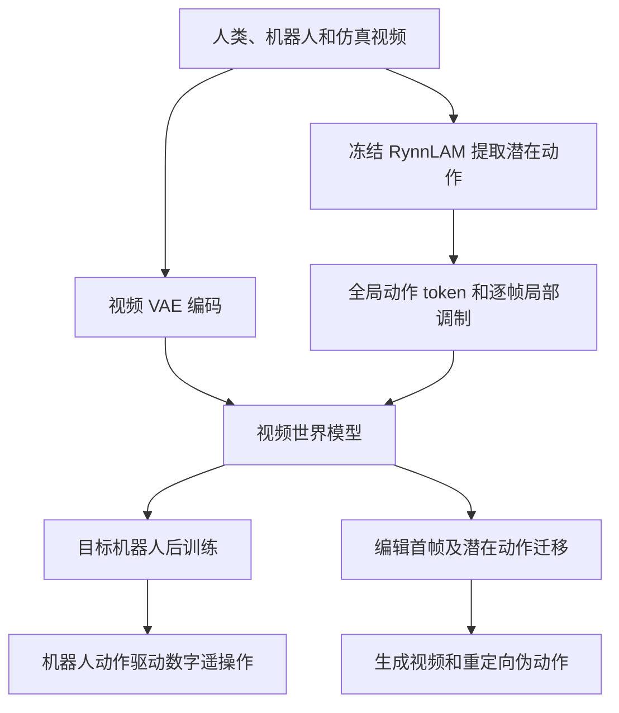
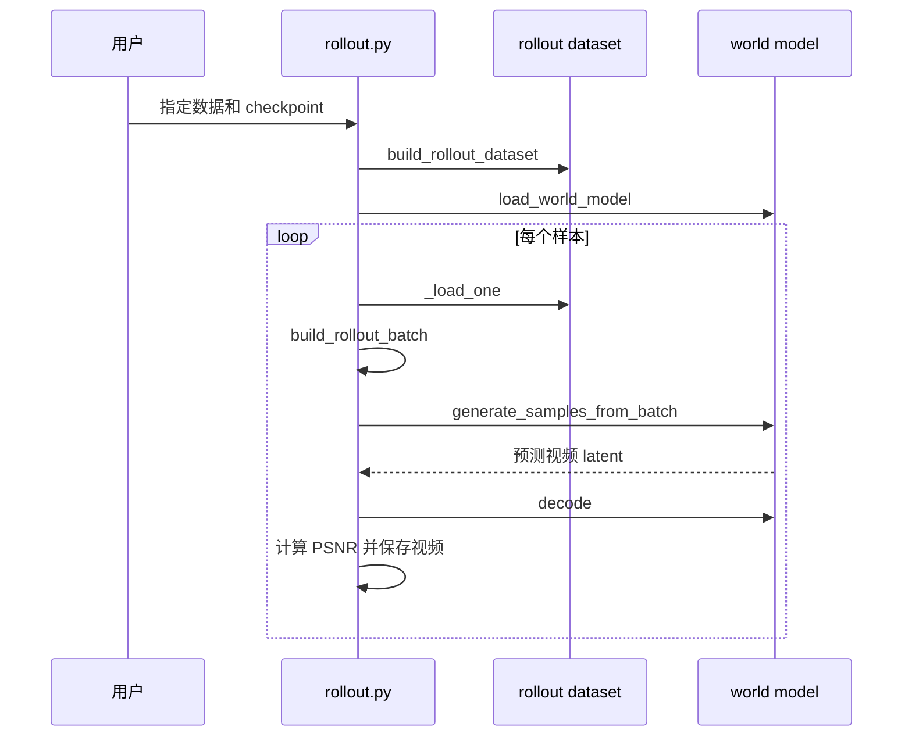

# RynnWorld-Latent（arXiv:2610.36791）

**RynnWorld-Latent**（*RynnWorld-Latent: A Cross-Embodiment World Model Conditioned on Universal Latent Actions*，[arXiv:2610.36791](https://arxiv.org/abs/2610.36791)，[项目页](https://alibaba-damo-academy.github.io/RynnWorld-Latent.github.io)，[代码](https://github.com/alibaba-damo-academy/RynnWorld-Latent)）来自 [具身智能小站 2026-10-28 盘点](../../sources/blogs/wechat_embodied_station_59_papers_human_video_to_robot_experience_2026-10-28.md)，属「潜在动作与世界模型」组。

## 一句话定义

**以三维落地潜在动作对齐人类、机器人与仿真视频，学习可控未来，并通过数字遥操作和动作迁移合成示范。**

## 英文缩写速查

| 缩写 | 英文全称 | 简要说明 |
|------|----------|----------|
| RynnLAM | Rynn Latent Action Model | 从图像变化中提取潜在动作 |
| VAE | Variational Autoencoder | 压缩视频帧为潜变量 |
| CFG | Classifier-Free Guidance | 推理时调整动作条件强度 |

## 为什么重要

- 用统一潜在动作驱动世界模型。生成数据可用于策略中间训练，但目标机器人仍需后训练适配。
- 开源结论：**已开源**（步骤 2.5，2026-10-28）。仓库可达（git ls-remote）。项目页 HTTP 200。
- 同期同组工作见 [潜在动作、免渲染事件仿真与机器人评测：具身智能小站 10-28 期 59 篇阅读坐标](../overview/embodied-station-2026-10-28-59-papers-technology-map.md)。

## 核心机制

论文 [arXiv:2610.36791v1](https://arxiv.org/html/2610.36791v1) 使用冻结 RynnLAM 对每隔 4 帧的图像提取 608 维描述符（512 维运动、64 维动作、32 维相机）。81 帧压缩为 21 个视频潜帧，对应 20 个动作；预训练的 Cosmos3 视频模型结合全局动作 token 与逐帧对齐的局部调制，预测未来视频。条件帧不做局部调制。目标机器人后训练另引入本体专用动作编码器。

## 源码运行时序图

依据官方 [scripts/inference/rollout.py](https://github.com/alibaba-damo-academy/RynnWorld-Latent/blob/main/scripts/inference/rollout.py) 的评测入口；以下描述主脚本调用，内部实现仍待进一步核查。

## 实验与评测

- 论文 v1 报告预训练使用 23 个数据集、约 5.535 亿帧。README 报告 32 个数据集、超过 2.65 亿帧，两者口径不同，原因尚未核实。
- 论文表 6：合成数据中间训练后，π₀ 在 LIBERO 从 94.4% 到 96.1%，在 LIBERO-Plus 从 53.6% 到 79.4%；π₀.₅ 分别从 96.9% 到 97.8%、84.4% 到 84.8%。不能将收益全部归因于生成质量，数据量和训练计算也不同。
- 真实机器人评测是在目标机器人后训练后的留出演示，不代表对未适配机器人零样本迁移。视频指标也不单独证明物理真实性。

## 待完成

- 尚需逐段完成原文及附录核对、深入追踪推理内部实现并运行仓库 preflight；本条目保持草稿。

## 与其他工作对比

- 横向索引见 [潜在动作、免渲染事件仿真与机器人评测：具身智能小站 10-28 期 59 篇阅读坐标](../overview/embodied-station-2026-10-28-59-papers-technology-map.md)；同 arXiv 不重复造页。

## 结论

**统一潜在动作支持跨本体视频预训练；在论文所评测的配置中，合成数据提升了下游策略成功率。**

1. 开源边界：代码和模型权重已发布；基础权重及数据集遵循各自访问和许可条件。
2. 核心机制：以三维落地潜在动作对齐人类、机器人与仿真视频，学习可控未来，并通过数字遥操作和动作迁移合成示范。
3. 复现与选型前核对任务协议、硬件与基准口径，勿直接横比公众号摘录数字。

## 关联页面

- [world-action-models](../concepts/world-action-models.md)
- [generative-world-models](../methods/generative-world-models.md)
- [vla](../methods/vla.md)
- [embodied-station-2026-10-28-59-papers-technology-map](../overview/embodied-station-2026-10-28-59-papers-technology-map.md)

## 参考来源

- [rynnworld_latent_arxiv_2610_36791.md](../../sources/papers/rynnworld_latent_arxiv_2610_36791.md)
- [wechat_embodied_station_59_papers_human_video_to_robot_experience_2026-10-28.md](../../sources/blogs/wechat_embodied_station_59_papers_human_video_to_robot_experience_2026-10-28.md)
- [arXiv:2610.36791](https://arxiv.org/abs/2610.36791)

## 推荐继续阅读

- [arXiv PDF](https://arxiv.org/pdf/2610.36791)
- [项目页](https://alibaba-damo-academy.github.io/RynnWorld-Latent.github.io)
- [https://github.com/alibaba-damo-academy/RynnWorld-Latent](https://github.com/alibaba-damo-academy/RynnWorld-Latent)
