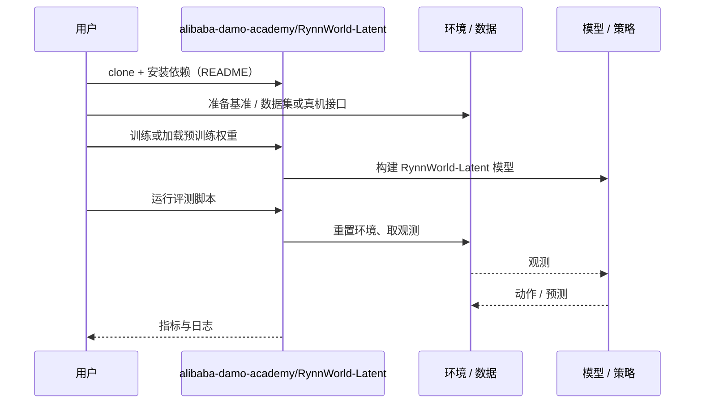

# RynnWorld-Latent（arXiv:2610.36791）

**RynnWorld-Latent**（*RynnWorld-Latent: A Cross-Embodiment World Model Conditioned on Universal Latent Actions*，[arXiv:2610.36791](https://arxiv.org/abs/2610.36791)，[项目页](https://alibaba-damo-academy.github.io/RynnWorld-Latent.github.io)，[代码](https://github.com/alibaba-damo-academy/RynnWorld-Latent)）来自 [具身智能小站 2026-10-28 盘点](../../sources/blogs/wechat_embodied_station_59_papers_human_video_to_robot_experience_2026-10-28.md)，属「潜在动作与世界模型」组。

## 一句话定义

**以三维落地潜在动作对齐人类、机器人与仿真视频，学习可控未来，并通过数字遥操作和动作迁移合成示范。**

## 英文缩写速查

| 缩写 | 英文全称 | 简要说明 |
|------|----------|----------|
| RynnWorld-Latent | RynnWorld-Latent: A Cross-Embodiment World Model Conditioned on Universal Latent Actions | 本文方法 / 基准的简称 |

## 为什么重要

- 用统一潜在动作驱动世界模型。生成数据可用于策略中间训练，但目标机器人仍需后训练适配。
- 开源结论：**已开源**（步骤 2.5，2026-10-28）。仓库可达（git ls-remote）。项目页 HTTP 200。
- 同期同组工作见 [潜在动作、免渲染事件仿真与机器人评测：具身智能小站 10-28 期 59 篇阅读坐标](../overview/embodied-station-2026-10-28-59-papers-technology-map.md)。

## 核心机制

| 项 | 内容 |
|----|------|
| **arXiv** | [2610.36791](https://arxiv.org/abs/2610.36791) |
| **开源** | **已开源** |
| **要点** | 以三维落地潜在动作对齐人类、机器人与仿真视频，学习可控未来，并通过数字遥操作和动作迁移合成示范。 |
| **文内指标** | 公众号转述：生成数据可用于策略中间训练，但目标机器人仍需后训练适配。 |

## 源码运行时序图

以下为按仓库入口（`alibaba-damo-academy/RynnWorld-Latent`）推断的通用运行链路；入库日仅核实仓库可达，未逐文件阅读，具体脚本名以 README 为准。

## 实验与评测

- 公众号转述：生成数据可用于策略中间训练，但目标机器人仍需后训练适配。
- **读法：** 本页为索引级摘要，依据公众号转述的官方摘要与仓库信息整理；逐项数字与 baseline 以原文 PDF 为准。

## 与其他工作对比

- 横向索引见 [潜在动作、免渲染事件仿真与机器人评测：具身智能小站 10-28 期 59 篇阅读坐标](../overview/embodied-station-2026-10-28-59-papers-technology-map.md)；同 arXiv 不重复造页。

## 结论

**用统一潜在动作驱动世界模型：生成数据可用于策略中间训练，但目标机器人仍需后训练适配。**

1. 开源边界：**已开源** — 仓库可达（git ls-remote）。项目页 HTTP 200。
2. 核心机制：以三维落地潜在动作对齐人类、机器人与仿真视频，学习可控未来，并通过数字遥操作和动作迁移合成示范。
3. 复现与选型前核对任务协议、硬件与基准口径，勿直接横比公众号摘录数字。

## 关联页面

- [world-action-models](../concepts/world-action-models.md)
- [generative-world-models](../methods/generative-world-models.md)
- [vla](../methods/vla.md)
- [embodied-station-2026-10-28-59-papers-technology-map](../overview/embodied-station-2026-10-28-59-papers-technology-map.md)

## 参考来源

- [rynnworld_latent_arxiv_2610_36791.md](../../sources/papers/rynnworld_latent_arxiv_2610_36791.md)
- [wechat_embodied_station_59_papers_human_video_to_robot_experience_2026-10-28.md](../../sources/blogs/wechat_embodied_station_59_papers_human_video_to_robot_experience_2026-10-28.md)
- [arXiv:2610.36791](https://arxiv.org/abs/2610.36791)

## 推荐继续阅读

- [arXiv PDF](https://arxiv.org/pdf/2610.36791)
- [项目页](https://alibaba-damo-academy.github.io/RynnWorld-Latent.github.io)
- [https://github.com/alibaba-damo-academy/RynnWorld-Latent](https://github.com/alibaba-damo-academy/RynnWorld-Latent)
