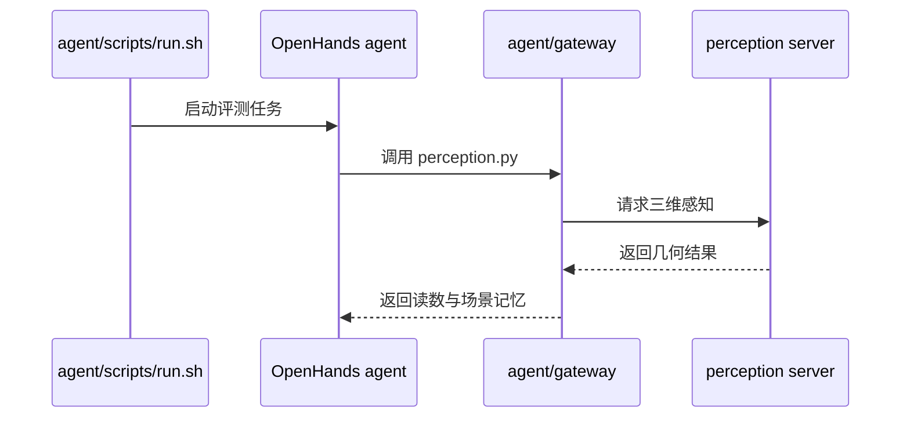

# S-Agent 2.0：通用编码智能体的空间推理

## 一句话定义

为通用编码智能体接入三维感知命令行工具、持久场景记忆和可解释的空间读数。

## 英文缩写速查

| 缩写 | 英文全称 | 简要说明 |
|------|----------|----------|
| VLM | Vision-Language Model | 视觉语言模型 |
| CLI | Command-Line Interface | 命令行接口 |
| GPU | Graphics Processing Unit | 运行感知服务的加速器 |

## 核心原理

智能体调用感知服务获取三维重建和对象信息，网关维护场景记忆，并将距离、方位及运动等读数转成可用于推理的证据；无需针对任务训练专用控制器。

## 评测与结果

论文在 Qwen3.8-27B 上报告 MMSI-Bench 66.5、ReVSI 82.3，相比同智能体无工具分别提高 13.9 和 20.5 个百分点；这是空间问答基准，不代表机器人真机成功率。

## 结论

为通用编码智能体接入三维感知命令行工具、持久场景记忆和可解释的空间读数。

- 优先核对评测协议、输入条件与基线设置，再比较指标。
- 场景几何质量和感知误差会影响下游结果。
- 项目结果不能直接等同于真实机器人闭环任务表现。

## 源码运行时序图

按 README 先配置模型、子模块和服务，再运行评测脚本。

## 工程实践与局限

官方仓库提供系统与评测代码，权重需另行获取；agent 和文档采用 Apache-2.0，perception 包装的 SpatialClaw 子模块受 NVIDIA 非商业许可证约束。

## 与其他工作对比

| 工作 | 空间能力来源 | 与 S-Agent 2.0 的差异 |
|------|--------------|-----------------------|
| [Ego3D-VLM](./paper-sa-2509-06266-spatial-reasoning-with-vision-language-models-in.md) | 后训练 VLM | 通过训练把空间能力写进权重；S-Agent 2.0 不改模型，靠外部三维感知工具提供读数 |
| [R3D](./paper-sa-2607-02921-r3d-quantitative-3d-spatial-reasoning-for-egocen.md) | 模型无关的空间工具调用 | 同属「工具调用」路线；S-Agent 2.0 用通用编码智能体（OpenHands）+ CLI 网关，并额外维护跨轮的持久场景记忆 |
| [SMA](./paper-spatial-memory-agent.md) | 冻结 VLM + 过程性空间记忆 | 同样强调记忆；SMA 用 verifier 引导记忆写入，S-Agent 2.0 的记忆由感知服务的几何结果填充 |
| [Holi-World](./paper-holi-world.md) | 世界记录蒸馏成训练数据 | 同一团队的训练路线，与本文的免训练工具路线互补 |

报告的提升以「同一智能体无工具」为对照，说明增益主要来自感知工具；更换底座模型或感知后端时需重测。感知后端 SpatialClaw 受非商业许可证约束，商用前需替换；该层在[感知栈选型闭环](../queries/robot-perception-stack-selection-loop.md)中属于「下游消费」接口。

## 关联页面

- [Ropedia W0](./paper-ropedia-w0.md) — 跨本体第一视角世界模型。
- [DONIC](./paper-donic.md) — 从人类示范学习双手跟踪控制。
- [机器人视觉感知栈选型闭环](../queries/robot-perception-stack-selection-loop.md) — 感知栈选型闭环知识链枢纽

## 参考来源

- [论文归档](../../sources/papers/s-agent-2.md)
- [项目页归档](../../sources/sites/s-agent-2.md)
- [官方仓库归档](../../sources/repos/s-agent-2.md)

## 推荐继续阅读

- [论文原文](https://arxiv.org/abs/2610.28354)
- [官方仓库](https://github.com/Ropedia/S-Agent-2.0)
