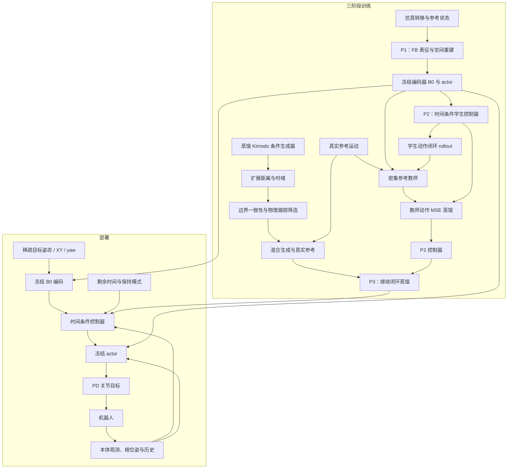

# S-BFM：基于稀疏时空目标的人形机器人行为基础模型 / A Behavioral Foundation Model for Humanoid Control from Sparse Spatiotemporal Goals

## 一句话定义

S-BFM 是从稀疏时空目标直接生成全身过渡动作的低层控制器：上游只需指定目标姿态、世界系平面位置与朝向、到达时间及保持模式，而非持续提供密集参考轨迹。

## 英文缩写速查

| 缩写 | 英文全称 | 简要说明 |
|---|---|---|
| S-BFM | Sparse Behavioral Foundation Model | 稀疏目标行为基础模型 |
| FB | Forward–Backward Representation | 可复用行为潜空间 |
| WBC | Whole-Body Control | 全身协调控制 |
| PD | Proportional–Derivative | 关节位置控制 |
| MPJPE | Mean Per-Joint Position Error | 平均关节位置误差 |
| AR / OTR | Arrival Rate / On-Time Rate | 到达率 / 准时到达率 |
| DAgger | Dataset Aggregation | 学生访问状态上的教师标注 |

## 核心信息

| 字段 | 内容 |
|---|---|
| 论文 | [arXiv:2611.27552v1](https://arxiv.org/abs/2611.27552)，2026-11-20 |
| 机构 | 香港科技大学（广州）、南洋理工大学、深圳北理莫斯科大学、智元机器人（AGIBOT） |
| 作者 | Kun Yang、Xuanyu Chen、Jing Tan、Yanjing Liu、Yubo Zhao、Renjing Xu、Addison Lin Wang |
| 平台 | Unitree G1（29 DoF）仿真；AGIBOT A3 真机 |
| 开放状态 | 2026-11-24 未发现官方项目页、可运行 S-BFM 源码或权重链接 |

## 为什么重要

密集跟踪器的上游需要维护未来参考帧，目标改变时还须重新生成平滑过渡。S-BFM 将过渡协调与节奏选择下沉到低层；潜在高层接口是少量关键目标而非整段动作。它扩展 [BFM-Zero](./paper-bfm-zero.md) 的目标到达能力，但不能等同于已完成的 VLA/WAM 全栈系统。

## 流程总览

依据论文 Fig. 2、§3 绘制，训练与部署分开。

## 核心机制

### P1：Spatial Grounding（空间落地）

固定坐标系以执行初始根 XY 和航向定义；编码输入加入缩放后 XY、sin(yaw)、cos(yaw)，同时附加到控制观测与历史。保持 FB 时序差分目标与正交正则，引入根位姿重建损失，使目标 latent 同时承载姿态与空间位置。空间监督数据混合机器人访问状态和经过平面刚体变换的参考目标；这些增强样本仅用于空间损失（Eq. 3–6）。

### P2：Time-Conditioned Distillation（时间条件蒸馏）

从真实动作片段采样终点，原始时长定义到达时间，剩余时间为 `max(T-t,0)`。目标编码在关键帧之间固定，学生逐步输出随观测和倒计时变化的行为 code；冻结 actor 输出动作。教师使用学生实际访问状态及时间对齐的密集参考标注动作，以 DAgger 式缓冲区进行动作 MSE 蒸馏，梯度穿过冻结 actor 仅更新控制器（Eq. 7–11）。保持模式在倒计时归零后继续监督。

### P3：Generative Fine-Tuning（生成式微调）

用蒸馏自 Kimodo 的条件运动生成器，在相同端点姿态下改变距离与时长，结合文本模板及数值约束生成不同过渡；经边界一致性与物理跟踪筛选后，与真实运动混合继续蒸馏。新时序生成参考使用 0.6 s 教师预览，其他参考保持 0.02 s 单步目标。部署不需要生成器、密集教师或空间 readout（Eq. 12–13）。

## 实验与评测

论文 §4、表 1–4，未独立复现。仿真为 29 DoF G1、MuJoCo 50 Hz 控制与 2 ms 物理步长，评测动作来自 LAFAN、BONES-SEED。

| 场景 | S-BFM | 对照与解读 |
|---|---|---|
| 固定关键帧时域 0.1–3.5 s | global MPJPE 38.35 cm，AR 85.47% | BeJEPA 59.35 cm、77.89% |
| 混合时域 0.02–2.5 s | global MPJPE 37.60 cm，AR 86.04% | PLAT 55.49 cm、79.26%；全局误差降低逾 32% |
| 固定空间目标 | Reach 74.56%，Hold5 35.22%，终端 XY 0.257 m | BeJEPA 43.50%、7.39%、1.667 m |
| 3–4 m 强侧向/向下扰动 | Reach 68.0% | BeJEPA 23.6% |
| P3 短时指令专项消融 | 2 m / 3 m Hold5 92.0% / 89.6% | P1+P2 为 13.6% / 39.2% |
| P1+P2+P3 消融 | OTR 17.33%，jerk 1.14 千 rad/s³ | P1 的 OTR 4.63%，jerk 1.38 |
| AGIBOT A3 真机 | 姿态过渡、2 s 稀疏跟踪、5 s 行走 / 3 s 跑步、起身 | 定性演示，未报告同规模真机统计 |

AR 允许在命令发出后至到达时刻加 0.3 s 之间满足阈值；OTR 要求首次达标落在计划时刻 ±0.3 s 内。固定目标 Reach 同时要求局部/全局关节误差、XY 与航向达标；Hold5 要求首次 Reach 后持续 5 s 的 XY 误差不超过 20 cm。基线接口有差异：SONIC/UFO 的固定目标实验保留原生接口，不输入目标 XY；BeJEPA 和 PLAT 为作者复现版本。

## 结论

S-BFM 将空间到达与过渡节奏统一到低层策略，但准时到达仍是明显瓶颈。

- 空间重建使 FB 潜空间可表征世界坐标；局部跟踪好不代表全局位置准确。
- P2 的价值在于闭环学习中间动作与节奏，而不仅是记忆目标姿态。
- P3 在短时指令下大幅改善目标保持，但并非所有消融指标都单调提升。
- 实际部署需区分 AR、OTR、Reach 与 Hold5，不能用单一成功率概括。
- 高层可以考虑稀疏姿态和时间接口，当前论文尚未验证 VLA/WAM 集成。

## 工程实践

| 项目 | 部署与复现边界 |
|---|---|
| 输入 | 本体观测、估计根位姿、观测及动作历史、目标 code、剩余时间、保持模式 |
| 输出 | 关节目标，交给低层 PD 控制 |
| 频率 | 论文仿真控制 50 Hz；不据此推断真机总线频率 |
| 状态估计 | 根位姿在初始坐标系中统一，实际系统须关注估计漂移 |
| 源码运行时序图 | **不适用**：截至 2026-11-24 未找到官方可运行实现，流程总览仅基于论文方法，不声称代码级验证 |

## 局限与风险

- 三阶段训练增加管线复杂性；单阶段带时间和终端条件的 FB 学习仍属未来工作。
- VLA/WAM 接口、高层可达性反馈及任务架构未验证。
- 仿真基线的输入信息存在差异，真机结果主要为演示；不能视为通用避障、全场景抗扰或精确到时保证。
- S-BFM 源码和权重公开状态未核实为可获取。

## 关联页面

- [行为基础模型](../concepts/behavior-foundation-model.md)
- [全身控制](../concepts/whole-body-control.md)
- [BFM-Zero](./paper-bfm-zero.md)
- [SONIC](./nvidia-sonic.md)
- [强化学习](../methods/reinforcement-learning.md)
- [DAgger](../methods/dagger.md)
- [Locomotion](../tasks/locomotion.md)
- [BFM 纵深路线](../../roadmap/depth-bfm.md) Stage 4

## 参考来源

- [S-BFM 原文核对归档](../../sources/papers/s_bfm_arxiv_2611_27552.md)
- [arXiv v1 HTML 全文](https://arxiv.org/html/2611.27552v1)

## 推荐继续阅读

- [S-BFM PDF](https://arxiv.org/pdf/2611.27552)
- [BFM-Zero 官方项目](https://lecar-lab.github.io/BFM-Zero/)
