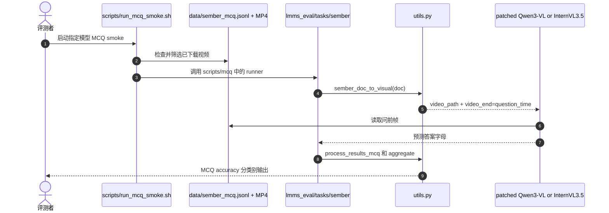

# S-EMBER: A Large-Scale Benchmark for Streaming Egocentric Memory Retrieval｜大规模流式第一视角记忆检索基准

## 一句话定义

**S-EMBER**（arXiv:2607.02689，Meta FAIR / Reality Labs）用日常第一视角长视频测量**流式情景记忆检索**：模型仅能看到提问前画面，必须回答问题并给出支持答案的时间区间。

## 英文缩写速查

| 缩写 | 英文全称 | 简要说明 |
|---|---|---|
| S-EMBER | Streaming Egocentric Memory Benchmark for Episodic Retrieval | 官方摘要定义的大规模第一视角情景记忆基准 |
| GSER | Grounded Streaming Episodic Retrieval | 只读取问前历史，并对答案证据做时间定位 |
| MCQ | Multiple-Choice Questions | 多选题形式的记忆正确率 |
| IoU | Intersection over Union | 预测证据区间和标注区间的交并比 |
| VLM | Vision-Language Model | 被测视频语言模型 |

## 为什么重要

- 仅给视频上半段却问刚刚发生的事件，才能测量在线记忆而非未来帧信息泄漏。
- 猜中答案不等于找到记忆证据；需要把**回答正确率**和**支持时间段定位**分开审计。
- 第一视角记忆对机器人连续视觉助手有启发，但不是机器人操作/运控验证。

## 核心信息

| 项 | 内容 |
|---|---|
| 原文 | Wang et al., [arXiv:2607.02689](https://arxiv.org/abs/2607.02689)，2026 |
| 机构 | Meta 基础人工智能研究（FAIR）和 Meta Reality Labs |
| 数据集 | **3,141** 视频、**388 小时**、**9,448 QA**（官方 README/data/README） |
| 问题 | 位置、动作序列、计数、视觉细节、顺序、时长、物体对比、空间推理等八类 |
| 代码 | [facebookresearch/S-EMBER](https://github.com/facebookresearch/S-EMBER)，lmms-eval 评测体系 |

## 核心原理

**GSER 时间约束：** 对问题 `q` 及提问时刻 `question_time`，输入仅为 `V[0, question_time]`；回答由选项或文字构成，定位结果是 `[t_start, t_end]`。MCQ 是分类准确率，grounding 默认计算时间 IoU。论文的联合“答对且定位正确”需要同时审核语义与时间证据，不等于只报 IoU。

### 流程总览

## 源码运行时序图

实际官方入口 [源码归档](../../sources/repos/s_ember.md)：`scripts/run_mcq_smoke.sh` → `lmms_eval/tasks/sember/utils.py` 及 patched model wrapper。

**Grounding 路径：** `scripts/grounding/run_qwen3vl.sh 8B` → `lmms_eval eval --tasks sember_grounding` → `utils.py` 解析 `Answer:` 与 `Time: [start,end]` → `sember_aggregate_temporal_iou`。默认只有 temporal IoU；答案正确性另可选 `tools/judge_grounding.py`（外部 Gemini API）。

## 工程实践

1. 从 HF 下载 `sember_mcq.jsonl`、`sember_grounding.jsonl` 及匹配 MP4，设置 `SEMBER_VIDEO_DIR`。
2. 用 `NUM_PROCESSES=1 bash scripts/run_mcq_smoke.sh internvl3_5 4B` 做小规模测试，再跑 grounding。Qwen3-VL runner 还要求 flash-attn。
3. 审核 `video_end=question_time` 是否真正限制输入（patched wrapper），并保存每个样本预测证据区间、真实区间和 IoU。
4. 若用于机器人的第一视角记忆系统，需额外验证控制周期、动作和真机安全，不可直接引用本基准分数代替。

## 实验与评测

- **数据规模：** 3,141 视频、388 小时、9,448 QA。
- **MCQ：** `sember_mcq` 输出 overall 与各八类准确率。
- **证据定位：** `sember_grounding` 输出时间区间，并按 temporal IoU 汇总；默认不验证文本语义正确性。
- **联合测量：** “回答正确且定位准确”比单个 MCQ 或 IoU 更严格，复现时需显式说明判分器与阈值。

### 正文及附录核验细节

- **指标不能互换：** 论文 §4 定义 `Acc_ov`（不因非矛盾的额外细节扣分）、`Acc_cl`（要求零幻觉）以及 MCQ；证据定位用 `mIoU`、`R@1`；联合 **GQ@0.5** 要求答案语义正确且证据 IoU≥0.5。官方默认 grounding 脚本的纯 temporal IoU **不是 GQ@0.5**。
- **原文表 3：** Gemini 3.1 Pro 的 **MCQ 54.41%**、**mIoU 0.479**、**GQ@0.5 0.297**；人工参考 GQ@0.5 为 **0.698**；Qwen3VL-32B 为 **0.163**。闭源模型不同取帧接口和预算（附录 D），跨模型比较应保留这一条件。
- **采集及时间戳：** 613 名佩戴者，原视频编码 720p/12 fps，开源评测统一抽取提问前 128 帧并提供**绝对时间戳**。§7 展示 Qwen3VL-32B 有无每帧时间戳时 mIoU 从 **0.018 → 0.412**，时间接口是定位能力的重要变量。
- **附录核对：** B：600 组 judge 对照准确率 **96.2%**；F：64 帧粗索引加 64 帧局部采样的自适应时间索引；G：首分钟无提问、至少 3 种问题类型及证据区间 padding 约束；H：PDF 第 16–17 页明确 `Answer:`、`Time: [start,end]` 和 judge JSON 字段，网页 HTML 转换缺此节内容。
- **研究边界：** 任务评测去除了音频，不验证触觉/机器人动作闭环。论文核读与 Github 源码审查已完成，但**未运行模型权重和 388 小时数据**。

## 结论

**视频记忆必须同时证明答案来自可见历史和能定位的证据，而不是只在问答上猜对。**

1. 按 `question_time` 裁切视频，禁止未来信息泄漏。
2. 将回答的准确率与证据 IoU 分开记录，不能互相替代。
3. 默认 grounding runner 只出 IoU，语义判分需要额外步骤。
4. 完整复现要求视频/JSONL 对齐，并遵守数据访问与许可。
5. 基准可指导在线记忆设计，但不衡量机器人动作层成功率。

## 与其他工作对比

| 项 | S-EMBER | [OVBench](./paper-ovbench-videochat-online.md) |
|---|---|---|
| 重心 | 流式第一视角的历史记忆证据 | 在线视频的过去、当前、未来时空理解 |
| 主要贡献 | 数据/评测协议、MCQ 与 grounding | 基准 + PMB 记忆模型 + 训练 |
| 边界 | 都不是直接的真机闭环验证 | 同左 |

## 局限与风险

- 第一视角视频缺少机器人真实动力学、触觉等状态，不可等同多模态状态估计。
- 官方仓库代码主体 CC BY-NC 4.0、部分第三方另有许可；HF 数据另受访问/使用条款约束。
- 可选 Gemini judge 需 API；默认 grounding 仅计算 IoU。
- arXiv v2 正文与附录 A–H（含 PDF 原文提示词）已核对；没有实际运行基准模型或数据，`complete` 仅代表文献解读完成。

## 关联页面

- [OVBench / VideoChat-Online](./paper-ovbench-videochat-online.md)
- [Ego4D 第一视角数据](./paper-ego4d.md)
- [具身评测基准选型](../overview/hub-embodied-eval-benchmark.md)
- [具身模型评测纵深 Stage 1](../../roadmap/depth-embodied-eval.md)
- [AI Model and Agent Benchmark Evaluation · AI 模型与智能体基准评测](../methods/ai-benchmark-evaluation.md)：S-EMBER 通过限制模型仅访问提问前历史并联合评测问答准确率与时间区间 IoU，规范了流式记忆基准评测协议。
- [Visual Representation Learning · 视觉表征学习](../methods/visual-representation-learning.md)：该基准要求模型从第一视角长视频流中提取并检索时序视觉表征以支撑在线情景记忆定位。

## 参考来源

- [论文来源归档](../../sources/papers/s_ember_arxiv_2607_02689.md)
- [官方代码核查归档](../../sources/repos/s_ember.md)
- [arXiv 原文](https://arxiv.org/abs/2607.02689)
- [官方数据与时间裁剪规范](https://github.com/facebookresearch/S-EMBER/blob/main/data/README.md)

## 推荐继续阅读

- [论文与附录](https://arxiv.org/abs/2607.02689)
- [官方评测仓库](https://github.com/facebookresearch/S-EMBER)
- [Hugging Face 数据集](https://huggingface.co/datasets/facebook/S-EMBER)
