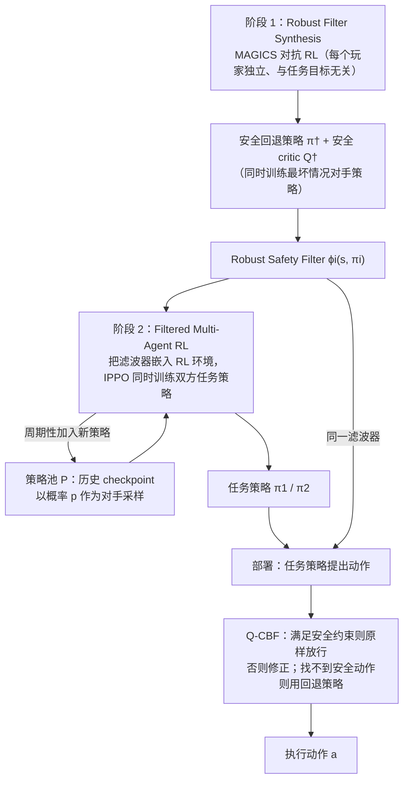

# S2C

**Turning Safety into Competence: Minimally Exploitable Robot Policies via Safety-Filtered Reinforcement Learning**（[arXiv:2609.27312](https://arxiv.org/abs/2609.27312)，[项目页](https://alliance-ai.cs.jhu.edu/s2c/)）收录自 [具身智能小站 12 篇盘点（恢复/WAM 专题）](../../sources/blogs/wechat_embodied_station_12_papers_recover_wam_2026-09-27.md)。

## 一句话定义

**Safety-filtered RL 把安全约束放进训练环，使策略在竞争任务中既强又更难被 exploit。**

## 英文缩写速查

| 缩写 | 英文全称 | 简要说明 |
|------|----------|----------|
| SR | Success Rate | 任务成功率 |
| WAM | World Action Model | 联合预测未来观测与动作 |
| VLA | Vision-Language-Action | 视觉-语言-动作策略 |
| RL | Reinforcement Learning | 强化学习 |

## 为什么重要

- 纳入 [12 篇技术地图](../overview/embodied-research-12-papers-recover-wam-technology-map.md) 与同期失败恢复、异步 WAM、接触感知、持续学习、安全 RL 条目横向对照。
- 步骤 2.5 开源结论：**待发布**。

## 流程总览

图依据：论文 §V（Fig. 3、Algorithm 1）、§V-A/B/C

## 核心信息

| 项 | 内容 |
|----|------|
| **arXiv** | [2609.27312](https://arxiv.org/abs/2609.27312) |
| **项目页** | https://alliance-ai.cs.jhu.edu/s2c/ |
| **代码** | — |
| **开源** | **待发布** |

## 实验与评测（公众号口径）

- 指标与数字以 [公众号盘点](../../sources/blogs/wechat_embodied_station_12_papers_recover_wam_2026-09-27.md) 与 **原文 PDF** 为准；读复现前核对仿真/真机与 attempt 定义。

## 源码运行时序图

**不适用**（无统一官方入口或未开源）。

## 与其他工作对比

| 对照 | 差异读法 |
|------|----------|
| [Safety Filter](../concepts/safety-filter.md) | 概念页把过滤器定位为部署期「最小修改投影回安全集」的最后一层；S2C 则**先学鲁棒安全过滤器，再把它放进训练环**，过滤器是策略学习环境的一部分 |
| [Safe RL](../methods/safe-rl.md) | 方法页四条路线中最接近「安全层屏蔽器」，该页指出屏蔽会改变环境反馈、可能误导上层 RL；S2C 在过滤后的环境中训练策略，与这一问题的关系以原文为准 |
| [PAC-MAN](./paper-pac-man-perceptive-cbf-rl.md) | 同为「训练期注入安全」：PAC-MAN 把 Link/Joint-CBF **写进奖励** 并面向人形躲避球；S2C 用**独立过滤器约束训练环境**，关注竞争任务中的胜率与可利用性 |
| [真机安全 RL 微调](../concepts/safe-real-world-rl-fine-tuning.md) | 该页聚焦 sim2real 后**真机在线适配**时用安全壳约束探索；S2C 的问题设定是竞争任务下「安全 → 能力 / 难被 exploit」，不是部署后微调 |
| [Streaming RL 分析](./paper-streaming-rl-continual-robotics.md) | 同属 [12 篇技术地图](../overview/embodied-research-12-papers-recover-wam-technology-map.md)「持续与安全训练」一线：Streaming RL 看目标/环境/身体变化下的流式适应，S2C 看安全约束下的竞争策略 |

## 结论

**总判：S2C 适合作为「Safety-filtered RL 把安全约束放进训练环，使策略在竞争任务中既强又更难被 exploit。…」方向的入口页；机制细节以 arXiv 与项目页为准。**

1. 与 [12 篇技术地图](../overview/embodied-research-12-papers-recover-wam-technology-map.md) 对照，避免与其它 arXiv 混淆。
2. 开源为 **待发布** 时从项目页/GitHub 再核实一次再写复现计划。
3. 涉及异步 WAM 或恢复评测时，同时记录 **正常起点 SR** 与 **偏差后恢复率**（若适用）。

## 关联页面

- [具身研究 12 篇（恢复/WAM）技术地图](../overview/embodied-research-12-papers-recover-wam-technology-map.md)
- [Manipulation](../tasks/manipulation.md)

## 参考来源

- [论文归档](../../sources/papers/s2c_safety_filtered_rl_arxiv_2609_27312.md)
- [公众号 12 篇清单](../../sources/blogs/wechat_embodied_station_12_papers_recover_wam_2026-09-27.md)
- [arXiv PDF](https://arxiv.org/pdf/2609.27312)：已通读方法部分（实验与附录以略读为准）：§I 引言、§V 方法（V-A/B/C）、§VI 实验设定

## 推荐继续阅读

- [arXiv:2609.27312](https://arxiv.org/abs/2609.27312)
- [项目页](https://alliance-ai.cs.jhu.edu/s2c/)

