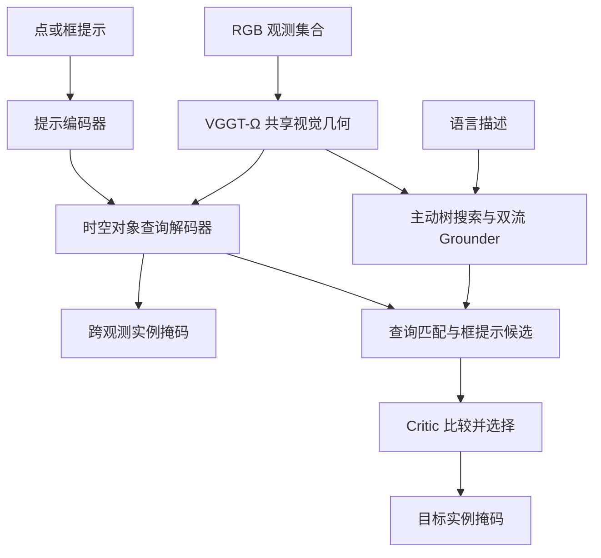
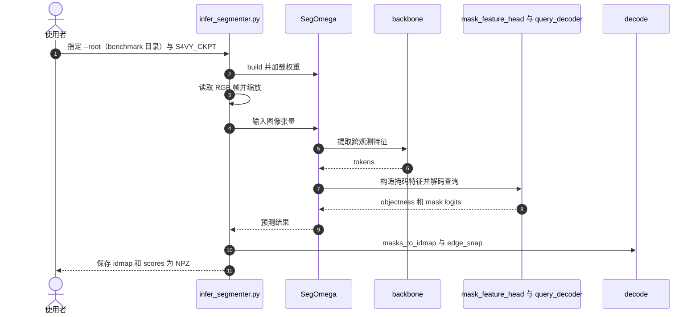

# S4VY：前馈 4D 视觉几何中的万物分割

## 一句话定义

S4VY 从一组 RGB 观测联合预测跨画面身份一致的实例掩码，支持无提示、点框选择和语言定位。

## 英文缩写速查

| 缩写 | 英文全称 | 简要说明 |
|------|----------|----------|
| RGB | Red Green Blue | 输入彩色图像 |
| SAM | Segment Anything | Meta 的可提示分割模型家族；本页与其 2D 图像/视频分割思路对比 |
| 4D | Four-Dimensional（三维空间 + 时间） | 跨多个观测的空间-时间实例；观测可稀疏或乱序 |
| VGGT | 论文仅引用名称，全称未在正文展开（未核实） | 前馈视觉几何骨干；S4VY 使用其 VGGT-Ω 变体 |
| ATS | Active Tree Search | 根据目标存在性递归搜索观测 |
| VLM | Vision-Language Model | 视觉语言模型 |
| CoT | Chain of Thought | 思维链；本文用于 Grounder 的几何相关推理监督 |
| IoU | Intersection over Union | 交并比 |
| LoRA | Low-Rank Adaptation | 低秩参数适配 |
| J&F | 区域相似度 J 与边界准确率 F 的均值 | 视频分割常用指标 |

## 为什么重要

- **动机：** 动态场景中的实例级分割是人形机器人和自动驾驶感知与规划的基础（论文引言）。
- **现有 SAM 系列的瓶颈：** SAM 及其视频扩展主要在 2D 掩码上工作，靠顺序记忆或时间传播维持身份。多个外观相似的物体同时运动、遮挡后重现、或观测稀疏乱序时，顺序传播容易失效。
- **已有几何方法的缺口：** 前馈视觉几何方法多面向静态场景；IGGT4D 扩展到了 4D，但依赖额外的特征聚类做身份关联，且没有统一的点、框、语言提示接口。
- **S4VY 的定位：** 把无提示的全量 4D 实例发现、点框提示选择和语言定位放进同一个共享几何表示中。

## 核心信息

| 项 | 内容 |
|----|------|
| 机构 | 德克萨斯农工大学（Texas A&M University）、英伟达（NVIDIA） |
| 论文 | [arXiv:2609.36875v2](https://arxiv.org/abs/2609.36875v2) |
| 骨干 | VGGT-Ω-1B，使用 LoRA 适配 |
| 输出 | 无类别的跨观测实例掩码；同一查询对应同一实例 |
| 开放状态 | [训练和推理代码及权重](../../sources/repos/s4vy.md)已发布；评测 harness 和训练数据未随仓库提供（2026-11-06 核对官方 README） |

## 核心原理

### 输入、机制与输出

- **输入：** 一组 RGB 观测 $\{I_i\}_{i=1}^{T}$，观测可以稀疏或乱序，decoder 不加入时序位置编码（论文 §3.1、附录 A.1）。
- **共享几何：** VGGT-Ω 骨干通过帧内与跨帧注意力，给出 patch tokens $z_i^F$、register tokens 与 camera token；用 LoRA 适配 patch tokens。
- **解码：** 400 个可学习对象查询与 patch tokens 交互，每个查询输出一个 4D 掩码 $\hat M_j = f_{\mathrm{ST}}(q_j, \{z_i^F\}_{i=1}^{T})$（论文式 (2)）。
- **输出：** 类别无关的 4D 实例集合；训练时用匈牙利匹配把每个真值 4D 实例分配给唯一查询，其余查询视为无对象。

### 流程总览

### 核心机制

- **持久实例：** 跨帧注意力生成共享视觉几何特征，400 个全局查询以集合预测方式生成掩码，避免事后聚类关联；输入允许稀疏和乱序。
- **提示选择：** 点框采样局部特征，形成提示查询；单向注意力使提示查询读取全局查询，同时不反向干扰无提示预测。
- **语言定位：** Grounder 在 ATS 选出的观测上同时预测查询匹配和边界框；两条路径产生候选，由独立 VLM Critic 比较选择。
- **训练：** 19 个数据集共 6.05M 观测；教师在穷尽标注数据上训练，再用伪掩码补足部分和未标注数据。Grounder 基于 Qwen3-VL-4B，Critic 基于 Qwen3-VL-2B。

## 源码运行时序图

以下对应官方仓库 `infer_segmenter.py` 的无提示分割入口，固定版本见[代码归档](../../sources/repos/s4vy.md)。脚本从 `--root` 下的 benchmark 目录逐个读取 clip 帧，权重路径由环境变量 `S4VY_CKPT` 指定。

复现路径：先准备好 clip 帧目录，再设置 `S4VY_CKPT` 与 `VGGT_OMEGA_CKPT` 后运行该脚本；输出为每个 clip 的 `idmap` 与 `scores`。

## 实验与评测

论文 v2 表 2 在无目标提示或首帧真值的统一设置中，LVOS 采样 100 帧：S4VY 的 4D-IoU 为 **0.533**，SAM 2 为 **0.450**；S4VY 的 J&F 为 **0.602**（SAM 2 为 0.444）。Ref-DAVIS 语言定位 J&F 为 **0.755**。A100-80GB 的 10.1 秒/100 帧为分割阶段耗时，不代表语言定位总延迟。

视频数据只提供逐帧 2D 标注；论文用同一模型预测的深度和相机把预测及真值掩码提升为点集后计算 4D 指标，结果不能单独证明几何重建精度。干净的多观测框提示下，表 6 中 SAM 2 通常更强。

## 与其他工作对比

| 维度 | 本页 S4VY | [SAM-V](./paper-sam-v.md) | [SAM 2](./paper-sam2.md) |
|------|-----------|-----------|-----------|
| 跨观测一致性来源 | VGGT-Ω 共享几何 + 400 个持续对象查询 | SAM 特征融合 VGGT 多视角几何特征 | 流式 memory 逐帧传播 |
| 提示方式 | 无提示、点框、语言（ATS + Grounder + Critic） | 点提示单目标；every-object 由逐帧 SAM proposals 生成点提示 | 点 / 框 / mask 提示 |
| 输入假设 | 稀疏、乱序 RGB 观测 | 多视角图像 | 图像或有序视频 |
| 开放状态 | 训练和推理代码及权重已发布；评测 harness 与训练数据未提供 | 代码已发布；checkpoint 与 VGGT 依赖有非商业 / 研究许可边界（未核实） | 推理与训练代码已开源（未核实） |

- **怎么选：** 需要无提示列出全部实例或语言定位时看 S4VY；已有单点提示、关心大视角变化下的单目标一致性时看 SAM-V；上游有可靠逐帧框提示时 SAM 2 仍可能更强（见上文表 6）。
- **读法：** S4VY 的 4D-IoU 借用自身预测的深度和相机提升掩码，与 SAM-V 的 O-IoU / R@50 口径不同（SAM-V 指标定义未核实），不能直接横比。

## 工程实践

| 项 | 论文 / 代码中的设置或数值 | 工程含义 |
|----|----------------------------|----------|
| 观测数量 | 评测中 ScanNet 每场景 8 帧、LVOS 每视频 100 帧；语言定位 Grounder 窗口 $N_w = 8$ | 观测数直接决定耗时与显存 |
| 耗时 | A100-80GB：8 观测约 0.5 s，100 观测约 10 s（分割阶段，不含语言定位） | 离线分析可用；实时闭环需另测 |
| 分辨率 | 训练 512 像素；推理脚本按骨干要求把输入高宽约束为 16 的倍数 | 输出掩码分辨率受多观测联合输入限制（论文结论） |
| 训练规模 | 分割器 50,000 步、LoRA rank 256、400 查询、64 张 A100；Prompt Encoder 另训 15,000 步 | 复现成本高，需准备 19 个来源数据 |
| 推理阈值 | `masks_to_idmap(..., score_thr=0.3)`（代码默认值） | 调参首选项，改动后需复测 |
| 语言定位 | Grounder 基于 Qwen3-VL-4B，Critic 基于 Qwen3-VL-2B；ATS 在 ScanRefer 上返回约 21.6% 的帧 | 语言链路额外引入两个 VLM 的显存与延迟 |
| 调试指标 | 无提示：T-mIoU / T-SR、4D-IoU / 4D-SR、J&F；语言：3D mIoU、Box / Mask@0.25、J&F | 同时看 T-mIoU 与 T-SR，二者差距可提示小目标或重入问题 |
| 显存 | 论文未报告显存峰值（未核实） | 部署前需在目标 GPU 上实测 |
| 机器人应用 | 论文未做机器人实机闭环实验 | 本页仅作感知层候选，接入规划前需自测遮挡下的身份稳定性 |
| 开源与许可 | 代码为 NVIDIA Source Code License-NC（仅非商业研究）；分割器权重为 FAIR NC 相关许可，grounder / critic 权重含 Apache-2.0 的 Qwen 权重；训练数据不随仓库发布；评测 harness 不随仓库发布；VGGT-Ω 需单独获取并接受其许可 | 商用前须逐项核查，不能只看仓库许可 |

## 局限与风险

- **论文自述的限制：** 多个高分辨率观测联合处理会限制输出掩码分辨率。
- **评测口径：** 视频的 4D 指标依赖模型自身预测的深度与相机，不能单独证明几何重建精度；论文可视化也只评估重建场景中的身份一致性，而非独立几何精度。
- **与 SAM 2 的边界：** 干净的多观测框提示下 SAM 2 通常更强（表 6）；把 4D-IoU 高误读为几何准确，或把无类别掩码误当成已带语义类别，都是常见误判。
- **困难样本：** 无提示分割中 T-SR 普遍低于 T-mIoU，论文归因于小目标、快速运动、遮挡与重入。
- **耗时口径：** 10.1 秒/100 帧不含语言定位端到端时间；语言链路还需运行 ATS 多窗口 Grounder 和 Critic。
- **数据风险：** 训练的语言描述部分由 VLM 或 GPT-5.6 生成并经过滤（附录 A.4），伪掩码来自教师模型；数据质量与许可都会传递到模型行为上。
- **泛化证据：** 室内、驾驶、第一人称的结果多为离线视频或零样本评测；论文没有机器人本体上的实验。
- **许可边界：** 代码、权重和训练数据均有非商业或受限条款，机器人商用部署前必须单独核查。

## 结论

S4VY 将动态场景的实例关联、提示选择和语言定位放在共享视觉几何表示上，适合研究跨视角感知。

- 稀疏乱序观测可用于评估跨视角身份一致性。
- 若上游已有可靠多帧框提示，应结合具体任务比较 SAM 2。
- 机器人部署需另测显存、总延迟、遮挡和域外场景；论文耗时不是实时闭环结论。
- 评测代码与训练数据未随仓库发布，复现实验需自行准备并核查各项许可证。

## 关联页面

- [SAM-V 多视角实例分割](./paper-sam-v.md)
- [SAM 2 视频分割](./paper-sam2.md)
- [机器人视觉感知栈选型闭环](../queries/robot-perception-stack-selection-loop.md) — 本页可归入其 ② 2D 检测/分割选型层（跨观测身份一致的无类别实例掩码，向 ③ 层提升衔接）：典型误判是把 4D-IoU 高当成几何重建准确，或把无类别掩码当成已带语义类别。

## 参考来源

- [论文归档](../../sources/papers/s4vy_arxiv_2609_36875.md)
- [官方代码归档](../../sources/repos/s4vy.md)
- [项目主页归档](../../sources/sites/s4vy.md)

## 推荐继续阅读

- [S4VY 论文 v2](https://arxiv.org/abs/2609.36875v2)
- [S4VY 项目主页](https://evergreen0929.github.io/projects/s4vy.html)
- [S4VY 官方代码仓库](https://github.com/Evergreen0929/S4VY)
