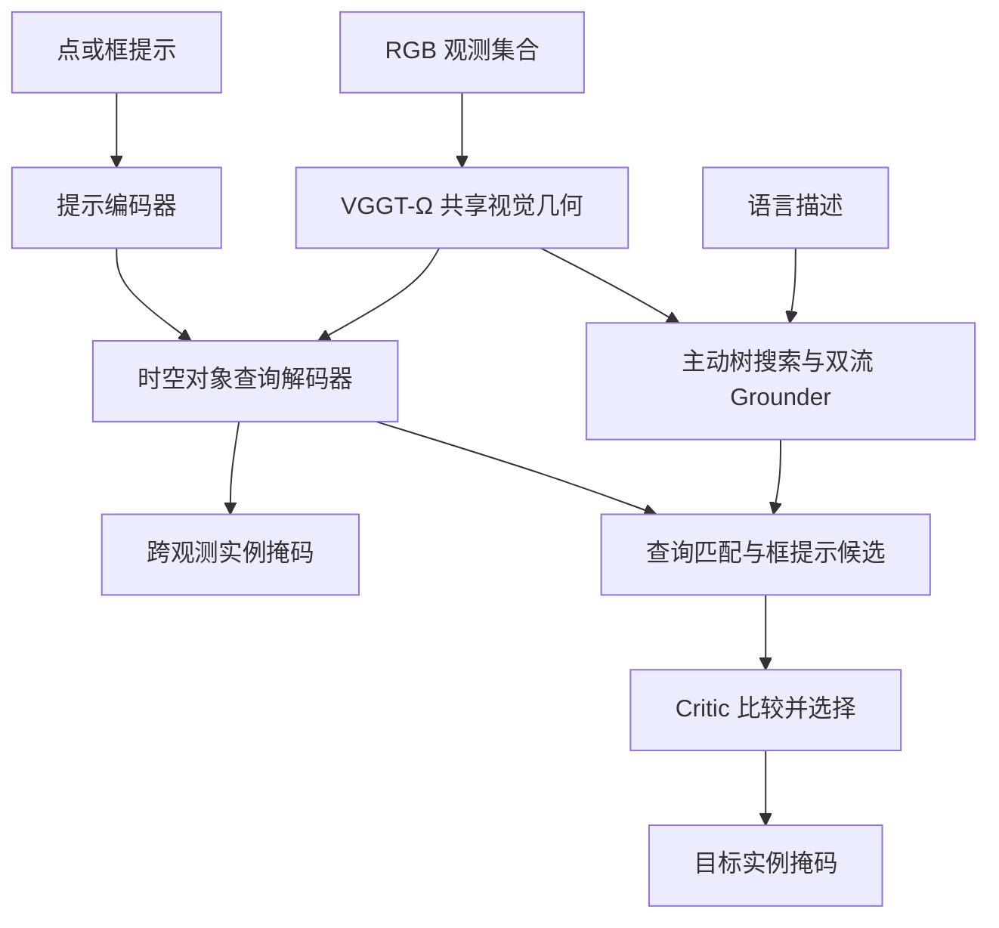
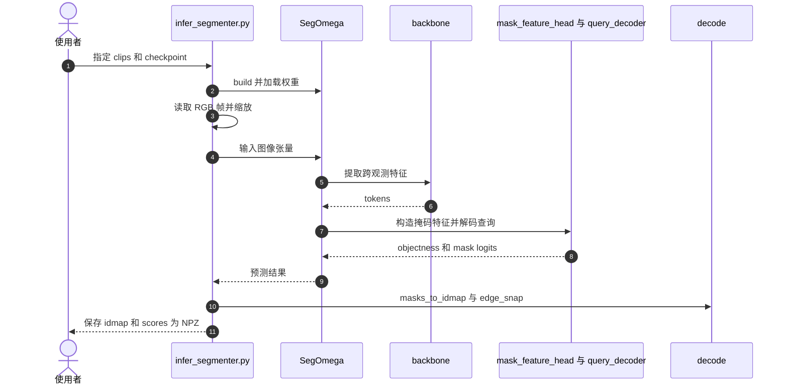

# S4VY：前馈 4D 视觉几何中的万物分割

## 一句话定义

S4VY 从一组 RGB 观测联合预测跨画面身份一致的实例掩码，支持无提示、点框选择和语言定位。

## 英文缩写速查

| 缩写 | 英文全称 | 简要说明 |
|------|----------|----------|
| RGB | Red Green Blue | 输入彩色图像 |
| ATS | Active Tree Search | 根据目标存在性递归搜索观测 |
| VLM | Vision-Language Model | 视觉语言模型 |
| IoU | Intersection over Union | 交并比 |
| LoRA | Low-Rank Adaptation | 低秩参数适配 |

## 核心信息

| 项 | 内容 |
|----|------|
| 机构 | 德克萨斯农工大学（Texas A&M University）、英伟达（NVIDIA） |
| 论文 | [arXiv:2609.36875v2](https://arxiv.org/abs/2609.36875v2) |
| 骨干 | VGGT-Ω-1B，使用 LoRA 适配 |
| 输出 | 无类别的跨观测实例掩码；同一查询对应同一实例 |
| 开放状态 | [训练和推理代码及权重](../../sources/repos/s4vy.md)已发布；评测 harness 和训练数据未随仓库提供 |

## 流程总览

## 核心机制

- **持久实例：** 跨帧注意力生成共享视觉几何特征，400 个全局查询以集合预测方式生成掩码，避免事后聚类关联；输入允许稀疏和乱序。
- **提示选择：** 点框采样局部特征，形成提示查询；单向注意力使提示查询读取全局查询，同时不反向干扰无提示预测。
- **语言定位：** Grounder 在 ATS 选出的观测上同时预测查询匹配和边界框；两条路径产生候选，由独立 VLM Critic 比较选择。
- **训练：** 19 个数据集共 6.05M 观测；教师在穷尽标注数据上训练，再用伪掩码补足部分和未标注数据。Grounder 基于 Qwen3-VL-4B，Critic 基于 Qwen3-VL-2B。

## 源码运行时序图

以下对应官方仓库 `infer_segmenter.py` 的无提示分割入口，固定版本见[代码归档](../../sources/repos/s4vy.md)。

## 实验与评测

论文 v2 表 2 在无目标提示或首帧真值的统一设置中，LVOS 采样 100 帧：S4VY 的 4D-IoU 为 **0.533**，SAM 2 为 **0.450**；S4VY 的 J&F 为 **0.602**。Ref-DAVIS 语言定位 J&F 为 **0.755**。A100-80GB 的 10.1 秒/100 帧为分割阶段耗时，不代表语言定位总延迟。

视频数据只提供逐帧 2D 标注；论文用同一模型预测的深度和相机把预测及真值掩码提升为点集后计算 4D 指标，结果不能单独证明几何重建精度。干净的多观测框提示下，表 6 中 SAM 2 通常更强。

## 结论

S4VY 将动态场景的实例关联、提示选择和语言定位放在共享视觉几何表示上，适合研究跨视角感知。

- 稀疏乱序观测可用于评估跨视角身份一致性。
- 若上游已有可靠多帧框提示，应结合具体任务比较 SAM 2。
- 机器人部署需另测显存、总延迟、遮挡和域外场景；论文耗时不是实时闭环结论。
- 评测代码与训练数据未随仓库发布，复现实验需自行准备并核查各项许可证。

## 关联页面

- [SAM-V 多视角实例分割](./paper-sam-v.md)
- [SAM 2 视频分割](./paper-sam2.md)

## 参考来源

- [论文归档](../../sources/papers/s4vy_arxiv_2609_36875.md)
- [官方代码归档](../../sources/repos/s4vy.md)
- [项目主页归档](../../sources/sites/s4vy.md)

## 推荐继续阅读

- [S4VY 论文 v2](https://arxiv.org/abs/2609.36875v2)
