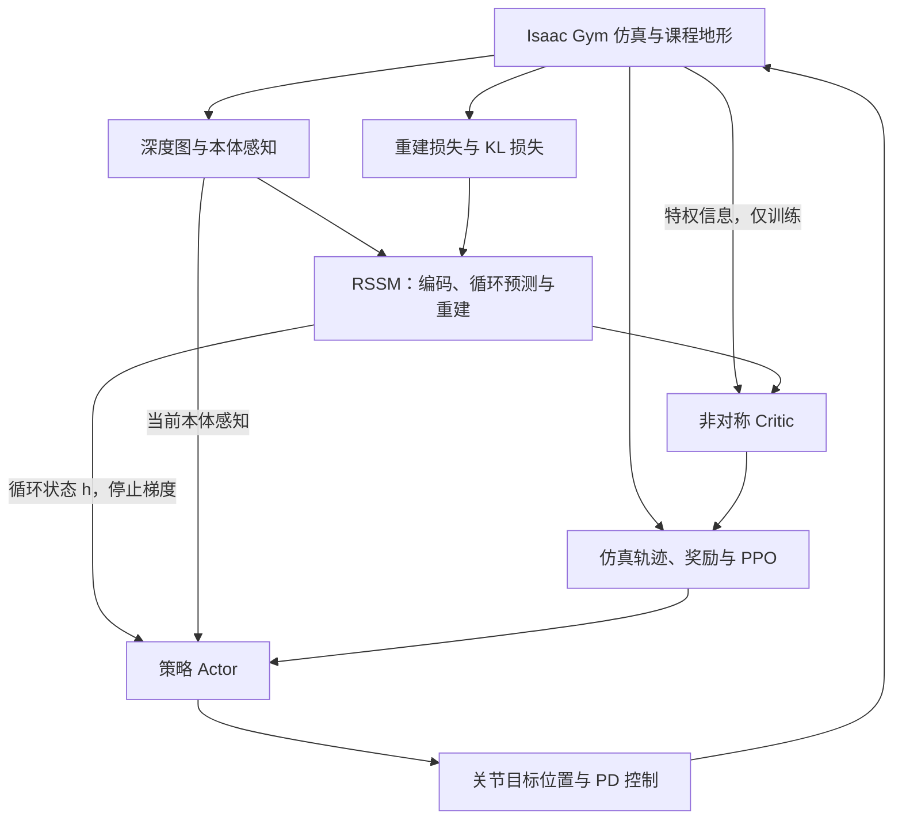
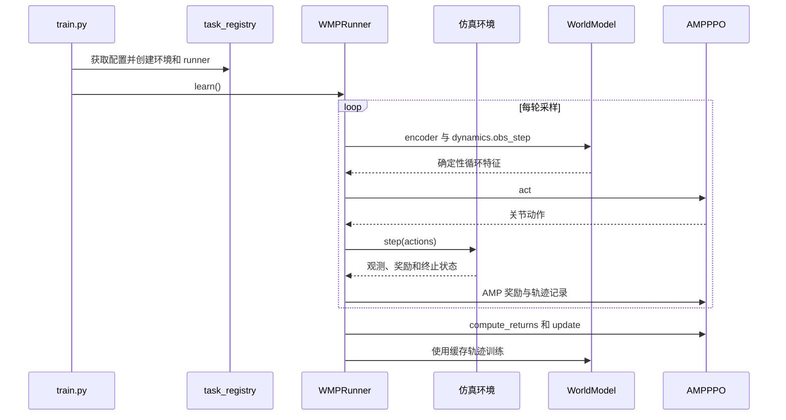

# WMP: World Model-based Perception for Visual Legged Locomotion / 基于世界模型的视觉足式运动感知

## 一句话定义

WMP 用预测感知的循环世界模型压缩历史信息，并以其隐藏状态辅助四足机器人的视觉运动控制。

## 英文缩写速查

| 缩写 | 英文全称 | 简要说明 |
|------|----------|----------|
| WMP | World Model-based Perception | 基于世界模型的感知 |
| RSSM | Recurrent State-Space Model | 循环状态空间模型 |
| PPO | Proximal Policy Optimization | 近端策略优化 |
| AMP | Adversarial Motion Priors | 对抗运动先验 |

## 核心信息

| 字段 | 内容 |
|------|------|
| 作者 | Hang Lai、Jiahang Cao、Jiafeng Xu、Hongtao Wu、Yunfeng Lin、Tao Kong、Yong Yu、Weinan Zhang |
| 机构 | 上海交通大学、字节跳动研究院 |
| 会议 | ICRA 2025，11531–11537 |
| 原文 | [arXiv:2409.16784v1](https://arxiv.org/abs/2409.16784)，2024-09-25 |
| 代码 | [bytedance/WMP](https://github.com/bytedance/WMP)，复现代码 |
| 项目页 | [WMP](https://wmp-loco.github.io/) |
| 索引 | Awesome World Models 第 374/571 条，814 Locomotion & Loco-Manipulation |

## 流程总览

## 核心机制

- 基于 Dreamer 风格 RSSM：GRU 循环状态根据过去动作及随机状态更新；视觉 CNN 与本体 MLP 编解码观测。重建损失和先验、后验之间的 KL 项训练模型。
- 策略输入当前本体感知和停止梯度的循环状态；训练时 critic 另可访问地形采样点、足端接触力及随机化物理参数。并非完全不使用特权信息；部署 actor 不需要它们。
- PPO 使用**仿真器采样**训练策略，世界模型不生成策略训练 rollout；AMP 判别器提供动作风格奖励。世界模型与策略并行训练，并非老师策略蒸馏学生。
- 4096 个 A1、六类课程地形，策略 50 Hz；世界模型每 5 步更新，即 10 Hz。观测含 45 维本体状态和 64×64 深度图，动作是 12 维关节位置目标，再经 PD 转换为力矩。

## 源码运行时序图

依据官方 [train.py](https://github.com/bytedance/WMP/blob/master/legged_gym/scripts/train.py) 和 [wmp_runner.py](https://github.com/bytedance/WMP/blob/master/rsl_rl/runners/wmp_runner.py)；开源代码还包含深度预测器用于仿真采样，不应等同于论文抽象图的全部细节。

## 评测与指标

- 仿真每类地形评估 100 条不同难度轨迹。Gap 回报 WMP 为 32.37±8.24，student 为 27.07±12.38，teacher 为 32.80±7.06。Teacher/student 基线不适用于文中 Tilt、Crawl；不能据此声称在这两项上完成了同设置对比。
- 实机 Unitree A1 配 Jetson NX 和 Intel D435i；文中报告跨越 85 cm 缺口、攀上 55 cm 台阶、穿过 22 cm 低矮空间。成功率图中每种条件为 10 次试验；这些尺寸不代表所有试验均成功。
- 世界模型仅用仿真训练，论文展示真实轨迹的深度图开环预测；形状可能不一致，但示例中可通行空间的位置和角度较一致。

## 结论

世界模型提供可用于运动控制的历史感知表征，论文在特定 A1 实验中展示了 sim-to-real 效果。

- 部署需权衡感知延迟、计算频率和运动速度；文中深度采集与计算约 40 ms，选 10 Hz 世界模型。
- 扰动和视觉域差仍需处理：训练使用物理随机化与 100 ms 图像延迟，实机做深度滤波。
- 消融显示去掉视觉在困难地形上明显退化；去掉世界模型的本体输入也会降低表现。
- 官方复现仓库 README 报告训练约需 23 GB GPU 显存、建议至少 10k 次迭代；不能直接推断 8 GB 显存足以运行。

## 关联页面

- [基于模型的强化学习](../methods/model-based-rl.md)
- [足式运动](../tasks/locomotion.md)
- [Awesome World Models 技术地图](../overview/sun-awesome-wm-technology-map.md)

## 参考来源

- [论文全文 arXiv v1](https://arxiv.org/html/2409.16784v1)
- [项目页归档](../../sources/sites/wmp-loco.md)
- [官方源码归档](../../sources/repos/wmp.md)
- [原策展索引](../../sources/papers/sun_awesome_wm_2409_16784_wmp-world-model-based-perception-for-vis.md)

## 推荐继续阅读

- [WMP 论文](https://arxiv.org/abs/2409.16784)
