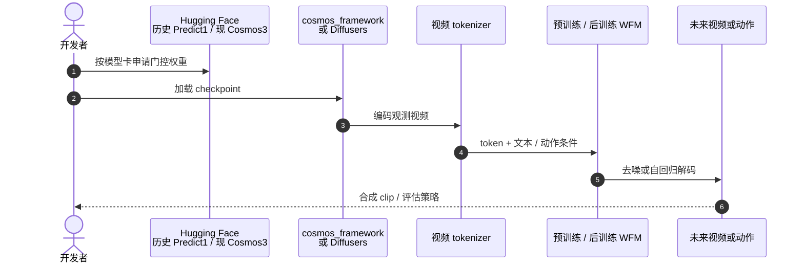

# Cosmos World Foundation Model Platform for Physical AI

**Cosmos World Foundation Model Platform for Physical AI**（[arXiv:2501.03575](https://arxiv.org/abs/2501.03575)，NVIDIA，2025）是 Cosmos **第一代** 平台论文：把世界基础模型（WFM）定义为 Physical AI 的「世界数字孪生」，并给出视频策展、扩散 / 自回归预训练、tokenizer、后训练示例与 guardrail。Awesome World Models 列表坐标仍为 **第 018/571**、分组 **111 General Simulation Platforms**；本页已按一手 PDF 升格，不再停留在清单 Highlights。

## 一句话定义

**先用大规模视频把 WFM 训成世界通才，再在目标机器人 / 驾驶环境上后训练成专才——用数字世界代替真机探索。**

## 英文缩写速查

| 缩写 | 英文全称 | 简要说明 |
|------|----------|----------|
| WFM | World Foundation Model | 可后训练的通用世界模型 \(\mathcal{W}(x_{0:t}, c_t)\to\hat{x}_{t+1}\) |
| VLM | Vision-Language Model | 为 clip 写字幕、并参与过滤 |
| AR | Autoregressive | 离散 token 上按序生成的预训练路线 |
| DM | Diffusion Model | 连续 token 上逐步去噪的预训练路线 |
| MPC | Model Predictive Control | 论文列出的 WFM 用途之一：在想象里滚动作 |
| SDG | Synthetic Data Generation | 条件 WFM 生成深度 / 语义等再用于 Sim2Real |

## 为什么重要

- 把「Physical AI 数据难规模化」写成平台问题，而不是又一篇视频生成论文：探索动作会损坏真机，所以先要世界孪生。
- 给出可复述的预训练–后训练配方，后续 [Predict2.5](./paper-sa-2511-00062-world-simulation-with-video-foundation-models-fo.md) 与 [Cosmos 3](./cosmos-3.md) 都沿这条轴加流量匹配、全模态与 serving。
- 明确 WFM 的五种用法（评估 / 初始化 / 配奖励训练 / 规划 / 合成数据），方便和 [Newton](./newton-physics.md) 的解析仿真对照。

## 核心信息

| 项 | 内容 |
|----|------|
| **机构** | 英伟达（NVIDIA） |
| **Awesome 坐标** | 018/571 · 111 General Simulation Platforms |
| **数据** | ~2000 万小时源视频 → ~1 亿条 2–60 秒 clip；每 256 帧 VLM 字幕 |
| **预训练** | Transformer 扩散 WFM（连续 token）+ Transformer 自回归 WFM（离散 token） |
| **后训练示例** | 相机位姿条件、机器人 video–action、自动驾驶 |
| **开源** | 论文发布时：NVIDIA Open Model License，入口 Cosmos-Predict1。2026-09 主线在 [NVIDIA/cosmos](https://github.com/NVIDIA/cosmos)（Cosmos 3） |

## 核心原理

WFM \(\mathcal{W}\) 根据过去观测 \(x_{0:t}\)（RGB 视频）与当前扰动 \(c_t\)（动作、随机扰动或文本等）预测 \(\hat{x}_{t+1}\)。

预训练用多样视频让模型接触真实世界物理；后训练用目标环境的 prompt–视频对做成 specialist，数据量可以小得多。Tokenizer 被写成类视频编解码器：既要压 token 数，又要保住视觉内容。Guardrail 分 pre-Guard（拦输入）与 post-Guard（拦输出）。

### 论文各模块的关键事实（一手 PDF）

| 模块 | 论文给出的内容 |
|------|----------------|
| 数据 | 约 2000 万小时 720p–4K 原始视频（驾驶 11%、手部/物体操作 16%、人体活动 10%、空间导航 16%、第一人称 8%、自然动态 20%、动态相机 8%、合成渲染 4%、其他 7%）；约 10⁸ 条 clip 用于预训练、约 10⁷ 条用于微调 |
| 策展五步 | 切分（TransNetV2 做镜头检测，<2 s 丢弃、>60 s 再切；PyNvideoCodec + h264_nvenc 转码，吞吐比基线约 6.5×）→ 过滤（运动：ViT 分类器 + TensorRT 光流；画质：DOVER 去掉最低 15%、美学阈值 3.5；文本叠加：InternVideo2 + MLP；视频类型分类并上/下采样）→ 字幕（内部 13B VILA，8 帧输入，FP8 TRT-LLM 吞吐约 10×，平均 97 词）→ 语义去重（k-means，k=10,000，去掉约 30%）→ 分片 |
| Tokenizer | 因果、小波（2 级 Haar）空间 + 因果时空卷积/注意力；连续版用普通 AE（潜维 16），离散版用 FSQ（级数 8,8,8,5,5,5 → 词表 64,000）；两阶段训练：L1 + VGG 感知损失，再加光流损失 + Gram 损失，微调阶段加对抗损失；压缩率 4×8×8 / 8×8×8 / 8×16×16；TokenBench（500 视频）上 4×8×8 的 CV 变体 PSNR 38.42（Cosmos-Tokenize1-CV4×8×8-360p，对比 CogVideoX 32.06） |
| 扩散 WFM | 在 Cosmos-Tokenize1-CV8×8×8-720p 潜空间做 EDM 去噪（不是 flow matching）；DiT + 3D patchify（1×2×2）、FPS 感知 3D RoPE + 可学习绝对位置嵌入、T5-XXL 交叉注意力、QK-RMSNorm、AdaLN-LoRA（7B 从 11B 参数降到 7B，−36%）；7B：28 层/4096 维，14B：36 层/5120 维；渐进训练 512p×57 帧 → 720p×121 帧 → 高质量微调；Video2World 通过拼接条件帧 + 二值掩码实现 |
| 自回归 WFM | Llama3 风格 GPT 从头训练（4B/12B 纯视频预测，5B/13B 加文本交叉注意力的 Video2World）；3D RoPE（YaRN 沿时间轴外推）+ 3D APE；QK-Norm + z-loss（λ=3e-4）；词表 64,000；Medusa 推测解码（9 个头最优）；320×512 低分辨率适配后 4B 可达 10.08 帧/s；扩散解码器（由 7B Text2World 微调）修复离散 token 模糊 |
| 算力 | 全部模型在 10,000 张 H100 上训练约 3 个月；14B 训练用 FSDP（分片 64）+ 上下文并行（CP=8，P2P 重叠）；14B 参数/梯度/优化器状态约 280 GB，激活约 310 GB |

### 流程总览

## 源码运行时序图

第一代入口是 Cosmos-Predict1（NVIDIA Open Model License）。2026-09-05 官方主仓 [NVIDIA/cosmos](https://github.com/NVIDIA/cosmos) 与 [cosmos-framework](https://github.com/NVIDIA/cosmos-framework) 面向 **Cosmos 3**；复现本文化应用 1.0 历史权重，新产品应走 3.0 cookbook。

## 工程实践

| 项 | 要点 |
|----|------|
| 论文主张的用途 | 策略评估、策略初始化、配奖励的策略训练、规划 / MPC、条件合成数据 |
| 今日入口 | 平台总览见 [nvidia-cosmos](./nvidia-cosmos.md)；不要把 Predict1 README 当当前产品 |
| 与解析仿真 | 需要接触与守恒律时用 [Newton](./newton-physics.md)；本平台输出是视频世界 |

## 评测与指标

论文有系统的定量评测（更正：本页早期版本曾写「本文无定量榜单」，与原文不符）。关键数字：

| 评测 | 结果（论文表格） |
|------|------------------|
| 3D 一致性（RealEstate10K 500 条，Table 19） | Sampson 误差：VideoLDM 0.841 → Cosmos-7B-Text2World 0.355（真实视频 0.431）；相机位姿估计成功率 4.4% → 62.6%（真实视频 56.4%）；新视角合成 PSNR 26.23 → 33.02（真实 35.38） |
| 物理对齐（8 类刚体仿真场景、800 条 1080p 视频，Table 20） | 条件帧越多预测越好；扩散 WFM 像素级优于自回归；**更大模型并不更好**，论文原话：所有 WFM 在物理遵从上同样吃力，需要更好的数据策展与模型设计（常见失败：物体凭空出现/消失、形变、重力违例） |
| 相机控制（Table 22，对比 CamCo） | 位姿估计成功率 43.0% → 82.0%；旋转误差 8.277° → 1.646°；FID 57.49 → 14.30；FVD 433.24 → 120.49 |
| 指令式机器人视频预测（Cosmos-1X 约 200 小时、约 1.2 万 episode；10 人评 23 条） | 7B 总体偏好 78.3% vs VideoLDM-Instruction 13.0% |
| 动作条件下一帧（Bridge，Table 23） | IRASim-Action：PSNR 19.13 / SSIM 0.64 / FVD 593；5B-ActionCond：19.95 / 0.80 / FVD 434；7B-ActionCond：21.14 / 0.82 / FVD 190 |
| 驾驶多视角（RDS 约 3.6M 条 20 秒六路视频 ≈ 2 万小时，Table 24–25） | FID 60.84 → 32.16、FVD 884.46 → 210.23；时间 Sampson 误差 TSE 1.24 → 0.68，跨视角 CSE 6.48 → 2.11；带轨迹条件的模型轨迹跟随误差 TFE 20.20 cm（真实视频 13.49 cm） |
| 自回归失败率（100 条 Physical AI 输入，Table 18） | 单帧条件：4B 15%、5B 7%、12B 2%、13B 3%；9 帧条件均 ≤2% |

## 与其他工作对比

| 对比轴 | Cosmos 1.0 | [Predict2.5](./paper-sa-2511-00062-world-simulation-with-video-foundation-models-fo.md) | [Cosmos 3](./cosmos-3.md) |
|--------|------------|----------------------------------------------------------------------------------------|---------------------------|
| 生成范式 | 扩散 + 自回归分模型 | 单网 flow matching | MoT：AR Reasoner + 扩散 Generator |
| 模态 | 视频为主，文本条件 | 文本 / 图像 / 视频世界 | 文本 / 图像 / 视频 / 音频 / 动作 |
| 控制翻译 | 后文 Transfer1 | Transfer2.5 ControlNet | Generator transfer cookbook |
| 维护 | 历史入口 | 有限维护，引导迁移 | **当前主线** |

Awesome 策展索引仍指向本文件名；深度内容以本页与一手 PDF 为准。

## 结论

**Cosmos 1.0 真正留下的是「WFM = 可后训练的世界孪生」与五类用法，而不是某一版视频质量分数。**

1. **先问用途再选代际** — 只要视频世界与后训练配方，读本页；要 PAI-Bench / Transfer 控制图，读 2.5；要动作 / 音频 / serving，读 Cosmos 3。
2. **数据管线是平台资产** — 切 clip、字幕、tokenizer、guardrail 比单次 checkpoint 更长久。
3. **后训练数据可以少** — 前提是预训练已经见过足够物理视觉。
4. **开源入口已搬家** — 论文写 Predict1；2026-09 可跑主线是 NVIDIA/cosmos。
5. **不能替代 Newton** — 本 WFM 预测像素未来，不保证接触力或动量守恒。

## 局限与风险

- 论文自己说 WFM 远未解决：当前模型仍缺物体恒存、接触密集动力学不准、指令跟随不一致，生成视频不总是遵守重力、光照、流体等基本物理；论文还指出人工评测的物理保真度难以统一、且未必与下游 Physical AI 任务指标正相关（§9）。
- **§2.1 列出的五类用途（策略评估/初始化/带奖励训练/规划/合成数据）论文明确写明「本文不含这些用途的实证结果」**；它们是愿景而非已验证结论，引用时勿当成论文成果。
- 论文自评：扩散 WFM 当前生成质量更好，自回归 WFM 的潜力（继承 LLM 权重、更快推理）尚未兑现。
- 1.0 画质与指令对齐被 2.5 / 3.0 超越（后继页面的陈述，非本论文）。
- 把 Awesome Highlights 当完整方法证明会漏掉 tokenizer / guardrail / 五类用法。
- 权重许可与仓名随代际变化，复现须核对模型卡。

## 关联页面

- [NVIDIA Cosmos 平台](./nvidia-cosmos.md)
- [Cosmos 3](./cosmos-3.md)
- [Predict2.5 / Transfer2.5](./paper-sa-2511-00062-world-simulation-with-video-foundation-models-fo.md)
- [Newton Physics](./newton-physics.md)
- [Awesome World Models](./awesome-world-models.md)
- [Awesome World Models 技术地图](../overview/sun-awesome-wm-technology-map.md)
- [Generative World Models](../methods/generative-world-models.md)
- [Video-as-Simulation](../concepts/video-as-simulation.md)
- [Sim2Real](../concepts/sim2real.md)
- [Cosmos Transfer](./cosmos-transfer.md) — 1.0 条件翻译后继
- [Transfer1 论文](./paper-cosmos-transfer1.md)

## 参考来源

- [Cosmos 1.0 一手摘录](../../sources/papers/cosmos_wfm_arxiv_2501_03575.md)
- [Awesome 策展摘录](../../sources/papers/sun_awesome_wm_2501_03575_cosmos-world-foundation-model-platform-f.md)
- [NVIDIA Cosmos 产品页](../../sources/sites/nvidia-cosmos.md)
- [NVIDIA/cosmos 仓库](../../sources/repos/nvidia_cosmos.md)

## 推荐继续阅读

- [机器人论文阅读笔记：Cosmos World Foundation Model Platform for Physical AI](https://imchong.github.io/Robot_Learning_Paper_Notebooks/papers/03_High_Impact_Selection/Cosmos_World_Foundation_Model_Platform_for_Physical_AI/Cosmos_World_Foundation_Model_Platform_for_Physical_AI.html)
- [arXiv:2501.03575](https://arxiv.org/abs/2501.03575)
- [NVIDIA Cosmos 产品页](https://www.nvidia.com/en-us/ai/cosmos/)
- [Awesome World Models 仓库](https://github.com/sun254667/awesome-world-models)
