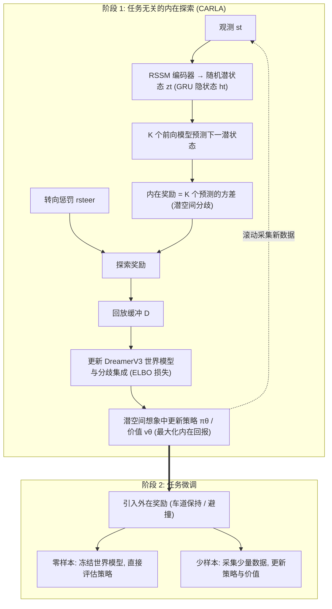

# InDRiVE

**InDRiVE: Intrinsic Disagreement based RL for Vehicle Exploration through Curiosity Driven Generalized World Model** 收录于 [Awesome World Models](https://github.com/sun254667/awesome-world-models) **第 446/571** 篇，分组 **82 Autonomous Driving**。本页是 **清单索引**：给出它在清单中的位置与原文入口，方法细节和量化结果请看原文。

## 一句话定义

Intrinsic disagreement-based RL for vehicle exploration via curiosity-driven generalized world models.

## 英文缩写速查

| 缩写 | 英文全称 | 简要说明 |
|------|----------|----------|
| WM | World Model | 环境前向预测模型 |
| WAM | World Action Model | 世界预测与动作联合建模 |
| VLA | Vision-Language-Action | 视觉–语言–动作策略 |
| MBRL | Model-Based RL | 基于模型的强化学习 |

## 为什么重要

- Intrinsic disagreement-based RL for vehicle exploration via curiosity-driven generalized world models.
- 想横向对照同一分组的其他工作，可以从 [Awesome World Models 技术地图](../overview/sun-awesome-wm-technology-map.md) 逐条展开。
- 顺着列表实体 [Awesome World Models](../entities/awesome-world-models.md) 与下方关联的方法 / 任务页，可以接回对应的学习主线。

## 流程总览

图依据：论文 §III-A / §III-B / §III-C / §III-D（含 Algorithm 1）与 §IV-C（两阶段训练）。

## 核心信息

| 字段 | 内容 |
|------|------|
| 编号 | 446/571 |
| 分组 | 82 Autonomous Driving |
| 出处 | arXiv 2025 |
| 论文 | <https://arxiv.org/abs/2503.05573> |

## 核心机制（归纳）

### 策展导读要点

Intrinsic disagreement-based RL for vehicle exploration via curiosity-driven generalized world models.

本页不复述论文公式与完整实验表；若需工程落地，请回到原文并对照站内相关方法页（见关联页面）。

## 评测与指标

- 本页 **没有搬运** 原文的量化 benchmark 与实机指标。
- 评测口径与具体数值以 [原文 / 项目页](https://arxiv.org/abs/2503.05573) 为准。
- 横向对照请回到 [技术地图](../overview/sun-awesome-wm-technology-map.md) 同分组条目。

## 与其他工作对比

- 本页 **不做** 与具体基线的逐项数值对比；同分组的横向对照请回到 [技术地图](../overview/sun-awesome-wm-technology-map.md) 的 **82 Autonomous Driving** 分组逐条展开。
- 如果站内已经有这篇的深读页（含机构、实验表与源码运行时序图），请以那一页为准；本页只保留清单要点。
- 与清单内相邻条目孰优孰劣，本页不下结论：Awesome Highlights 可能滞后于论文最新版本，差异应以各自原文的问题设定与评测口径为准。

## 结论

**这一页能给你的是「InDRiVE」在策展清单里的坐标与要点：够你判断要不要去读原文，但不能替代原文。**

- 可确证的只有清单坐标：分组 **82 Autonomous Driving**，以及 Highlights 点出的问题设定；本页不自行推导新结论。
- 适用边界：本页不能替代原文 PDF；开源状态以项目页实际链接为准（清单可能滞后）。
- 要深读这篇，建议直接从原文入手，再回到下方关联的方法 / 任务页对照。

## 常见误区

1. 不要把 Awesome 条目的 Highlights 当成完整方法证明——它只是策展导读。
2. 若站内已有这篇的深读页，以那一页为准——本页只是清单入口，不含实验数据。

## 关联页面

- 列表实体：[Awesome World Models](../entities/awesome-world-models.md)
- 技术地图：[Awesome World Models 技术地图](../overview/sun-awesome-wm-technology-map.md)
- 方法/任务：[generative-world-models.md](../methods/generative-world-models.md)、[manipulation.md](../tasks/manipulation.md)

## 参考来源

- [`sources/papers/sun_awesome_wm_2503_05573_indrive-intrinsic-disagreement-based-rl.md`](../../sources/papers/sun_awesome_wm_2503_05573_indrive-intrinsic-disagreement-based-rl.md) — 本条目策展摘录
- [`sources/papers/sun_awesome_wm_catalog.md`](../../sources/papers/sun_awesome_wm_catalog.md) — 列表总表
- [`sources/repos/awesome-world-models.md`](../../sources/repos/awesome-world-models.md)
- 论文：<https://arxiv.org/abs/2503.05573>
- [arXiv PDF](https://arxiv.org/pdf/2503.05573)：已通读方法部分（实验与附录以略读为准）：§III 方法（A 内在动机与世界模型、B 集成分歧、C 转向损失、D 训练流程与 Algorithm 1）、§IV-A/C 环境与训练设定；§V 结果仅略读。

## 推荐继续阅读

- [Awesome World Models 仓库](https://github.com/sun254667/awesome-world-models)
- [原文](https://arxiv.org/abs/2503.05573)
